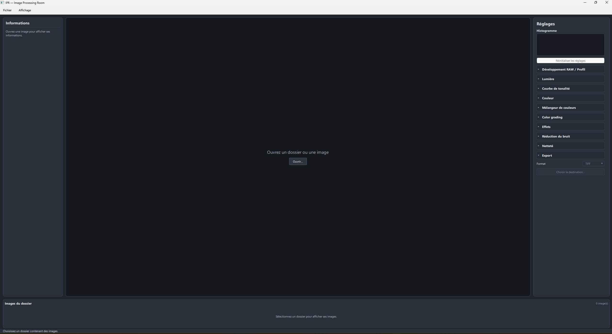

*[Français](README.md) | [English](README_en.md)*

# IPR — Image Processing Room

IPR is a non-destructive photo development and editing application,
written in **C++17 with Qt Quick/QML**. It lets you browse an image folder,
develop RAW files, adjust rendering and export an image without modifying the original.

The project is under active development. **Available feature does not mean fully
validated quality**: results and limitations are tracked in the
[validation matrix](docs/validation/matrice-validation.md).

## Interface overview



*Home screen with no image open. Adjustments are grouped into collapsible
sections; the histogram stays at the top of the right-hand panel.*

## Features

### Navigation and browsing

- Opening an image and accessing its folder; browsing JPEG, PNG, TIFF and supported RAW files.
- Horizontal thumbnail strip with loading around the visible area and release of distant items.
- Information panel: name, dimensions and available metadata for the camera, lens and shot.
- Star rating, color labels and flag marking.
- Zoom, panning in the preview and **before / after** comparison.
- Multi-selection and applying adjustments to selected images.

The "before" comparison uses the decoded and profiled base prior to edits:
it is neither the RAW mosaic nor necessarily the camera's embedded JPEG.
Zoom operates on the preview proxy, not on a full-resolution RAW view.
See the [navigation and comparison contract](docs/specifications/zoom-image.md).

### RAW and optical development

- **CR2, CR3 and DNG** import via the optional LibRaw backend.
- Selection and activation of **DCP** camera profiles, including Camera Neutral when a compatible profile is available.
- Source file white balance and an automatic white balance option.
- **LCP** optical profiles: independent controls for lens correction
  (distortion/vignetting) and lateral chromatic aberration.
- Storage of profiles, their fingerprints and development options in sidecars.
- Experimental RAW normalization, disabled by default and limited to audited cases.

ICC profiles of rendered images are used to interpret their colors;
DCPs are involved in RAW development and LCPs in optical corrections.
Longitudinal fringing correction and CA correction without an LCP model
are not implemented. See the [profile engine](docs/camera-profile-engine.md).

### Photographic adjustments

| Set | Available adjustments |
| --- | --- |
| Light | Exposure (±5 EV), contrast, shadows, blacks, whites and highlights |
| Tone curve | Luminance, red, green and blue curves, independent of the histogram |
| Color | Temperature (2,000–50,000 K), green/magenta tint (−150 to +150), vibrance and saturation |
| Color mixer | Hue, saturation and luminance across eight bands: red, orange, yellow, green, cyan, blue, purple and magenta |
| Color grading | Color wheels for shadows, midtones and highlights |
| Effects | Texture, clarity, dehaze, grain and blur |
| Noise reduction | Classic luminance and chrominance processing |
| Sharpening | Amount, radius and masking |

Numeric fields and sliders are linked. The neutral temperature depends
on the reference detected when opening the image, not a universal temperature applied
to every photo. Methods, parameters and limitations are detailed in the
[photographic adjustments specification](docs/specifications/reglages-photographiques.md).

### Saving, preferences and export

- Non-destructive edits kept in **`.ipr` sidecars**; reading of historical versions is supported.
- Interface preferences in **`ipr-ui.ini`**: window state, sections and display settings.
- Background rendering and export to keep the interface responsive.
- Export of the active image as **JPEG, PNG, TIFF or rendered linear DNG**.
- Dialog adapted to the chosen format and automatic numbering to avoid overwriting an existing export.

**Applying settings to a batch is not batch export**:
the multiple-export queue is still to be implemented. The exported DNG contains a
linear RGB rendering with edits baked in, not the original RAW mosaic;
its Lightroom compatibility is not yet validated.

The **View → Preferences file…** menu shows the location of the INI file.
See the [UI preferences](docs/architecture/ui-preferences.md)
and the [configuration template](config/ipr-ui.ini).

## Project status and next steps

Camera Neutral rendering has been visually accepted on the studied corpus,
without certification of physical fidelity or Lightroom parity.
Exposure has been revalidated; the positive amplitude of shadows and the saturation
of whites/highlights remain to be refined. Noise, sharpening and other
adjustment quality follow separate campaigns.

Upcoming developments include manual cropping and geometry,
masks and local adjustments, AI integration and batch export.
These should not be interpreted as already delivered features.

For the precise status, see the [validation matrix](docs/validation/matrice-validation.md)
and the [Light report](docs/validation/analyses/analyse-validation-lumieres-base-2026-10-02.md).

## Build

### Dependencies

| Dependency | Usage |
| --- | --- |
| Qt ≥ 6.8 | Quick/QML interface, Core, Gui and Concurrent |
| OpenCV | Image computation: `core`, `imgproc`, `imgcodecs` |
| LibTIFF | Writing the linear DNG |
| LibRaw ≥ 0.21, optional | CR2/CR3/DNG decoding; `IPR_ENABLE_LIBRAW` option |
| CMake ≥ 3.21 and a C++17 compiler | Configuration and build |

Qt and OpenCV do not replace a RAW decoder. Without LibRaw, rendered formats
remain usable, but the current RAW backend is unavailable.

### Windows

From WSL or Git Bash, with the application closed:

```bash
bash scripts/build-windows.sh
```

The launcher prepares the build and selects the tests affected by the changes.
The first run, cross-cutting changes and CI validation require
a full suite. To request it explicitly:

```bash
bash scripts/build-windows.sh --full-tests
```

- [Prerequisites, options and targeted tests](docs/architecture/tests-cibles-et-build-windows.md).
- [OpenCV installation: MSVC/vcpkg or MinGW](docs/installation-opencv-windows.md).
- [Standalone Windows packaging](docs/architecture/build-windows-standalone.md).

Do not mix MSVC and MinGW libraries. Choose dependencies compatible
with the Qt kit in use. Standalone packaging also requires Qt DLLs and plugins.

### Linux / WSL

With development dependencies installed and Ninja available:

```sh
cmake -S . -B build -G Ninja -DIPR_ENABLE_LIBRAW=ON -DBUILD_TESTING=ON
cmake --build build
ctest --test-dir build --output-on-failure
```

Tests using a local photographic corpus are only available when
their files are present; test images are not shipped
in the repository. The optional `tonalReferenceComparisonProbe` probe compares
a development of 9933 to its reference JPEG: this historical diagnostic
does not certify the rendering of every image.

Prerequisites and the Windows/macOS/Linux strategy are described in the
[multi-OS and CI plan](docs/architecture/ci-et-build-multiplateforme.md);
this plan does not amount to certification of every platform.

## Local profiles and redistribution

`profiles/index.json` maps cameras/lenses to the resources in
`profiles/dcp/` and `profiles/lcp/` to limit costly lookups.
Only the manifest and structure are versioned; Adobe profiles are not
redistributed with the repository.

The engine can also look up profiles installed in Adobe Camera Raw,
notably under `%ProgramData%/Adobe/CameraRaw` on Windows and its mount
`/mnt/c/ProgramData/Adobe/CameraRaw` under WSL. The
`IPR_ADOBE_CAMERARAW_DIR` variable allows specifying another root.

A locally installed profile is not automatically redistributable.
DCP/LCP transformations are partial and not certified for the full extent
of their specifications; profile tests use synthetic resources.
See the [DCP/LCP contract](docs/camera-profile-engine.md) before deployment.

## Architecture and documentation

The code is organized under `src/`: QML interface, application, editor,
color/detail pipeline, RAW decoders, profiles, caches and image providers.

The engine uses a **linear sRGB** floating-point RGBA image.
Rendered inputs go through their valid ICC profile, with an sRGB assumption flagged
when absent. RAW development provides the profiled base.
Preview and export share the rendering engine and sRGB gamut compression;
this does not constitute dedicated HDR tone mapping.

| Resource | Content |
| --- | --- |
| [Documentation index](docs/INDEX.md) | Documentation entry point |
| [Architecture](docs/architecture/README.md) | Components, contracts and technical decisions |
| [Rendering engine](docs/imageeditor-render-working-image.md) | Transformations, math and asynchronicity |
| [LaTeX technical manual](docs/technical/latex/README.md) | Technical documentation and diagrams |
| [Scholar course](docs/scholar/README.md) | Mathematical and physical foundations |
| [Self-contained tests](docs/validation/procedure-tests-autonomes.md) | Image generation, audits and analyses |

The build also produces `iprGenerateTests.exe`, which generates validation
variants without writing sidecars. See the [test image generator guide](docs/validation/tools/generateur-images-tests.md)
and `scripts/generate-test-images.ps1`.

From PowerShell: `./scripts/generate-test-images.ps1 couleur` (or `all`).
The generator reads images at the root of `tests/image/base` and writes
TIFFs into the existing folders shared with Lightroom, without dated folders
or auxiliary files. Images are removed manually after analysis.

Each feature set has an evolving analysis report. **Versioned, timestamped
JSON files are the source of truth for measurements**; CSVs and
charts are derived from them. Images are temporary and their deletion remains
up to the user. See the [test memory contract](docs/validation/data/README.md).

## Licenses

The inventory and license texts of dependencies are in
[licenses/](licenses/README.md). No license for the IPR code has yet been
chosen at the root; dependency licenses do not automatically determine
the project's own license.
