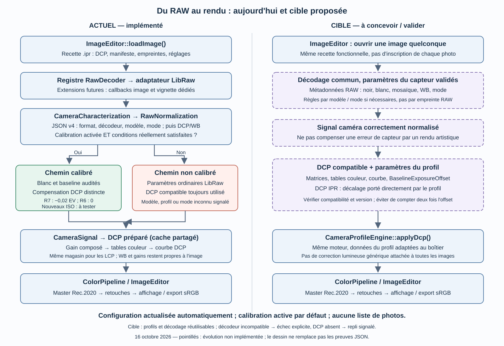

# Chemin fonctionnel RAW → DCP → rendu

État du 16 octobre 2026. La colonne gauche représente le code courant ; les
blocs pointillés de droite décrivent la cible, **pas une généralisation déjà livrée**.

## Correspondance avec le code

| Étape | Code actuel | Responsabilité |
| --- | --- | --- |
| Ouvrir et restaurer | `src/editor/imageeditor.cpp`, `loadImage()` | Réglages `.ipr`, profil/manifeste, empreintes, cache |
| Importer / valider | `src/core/ImageImporter.cpp` | Résultat partagé RAW/raster, métadonnées, provenance, capacités et contrat Rec.2020 |
| Choisir l'adaptateur | `RawDecoder::registerFormatHandler()`, `FormatOptions` | Extensions et callbacks image/vignette, identité/version du décodeur |
| Décoder le RAW | `src/raw/RawDecoder.cpp` | Adaptateur LibRaw actuel, métadonnées, niveaux, WB et RGB caméra |
| Sélectionner le mode | `src/raw/CameraCharacterization.cpp` | Catalogue JSON schéma 4, format/décodeur/boîtier/niveaux natifs ; cache borné |
| Résoudre la calibration | `src/raw/RawNormalization.cpp`, `resolve()` | Règles modèle/DCP/mode capteur sans liste de photos, puis compensation du profil |
| Transmettre le signal caméra | `src/raw/CameraSignal.cpp`, `render()` | Contrat RGB caméra float, WB appliquée, identité et neutre ; rendu DCP commun |
| Appliquer le profil | `src/profiles/CameraProfileEngine.cpp`, `applyDcp()` | Matrices, gain, tables et courbe du profil |
| Refaire la WB | `DcpWorkingContext`, `renderWhiteBalance()` | Retoucher la source caméra avant le DCP, sans accumuler le rendu précédent |
| Retoucher / sortir | `src/core/ColorPipeline.cpp` | Master Rec.2020, retouches, conversion de sortie sRGB |

## Cible : deux responsabilités distinctes

La frontière aval des formats est maintenant commune : voir le
[contrat d'import](import-images.md) et l'ADR-0013. Le chemin RAW décrit ici
est un adaptateur, pas un second moteur de retouches distinct de JPG/PNG/TIFF.

Le premier lot de transition est implémenté : adaptateurs image/vignette et
sélection de caractérisation sans marque ni extension codée en dur.
L'[ADR-0012](../decisions/ADR-0012-formats-extensibles-et-caracterisations.md)
décrit l'ajout d'un format futur, le choix DCP + JSON et la comparaison SQLite.
Le deuxième lot extrait maintenant le contrat RGB caméra pré-DCP dans
`CameraSignal`. Le décodage LibRaw avec DCP et le changement rapide de profil
utilisent le même rendu. La caractérisation physique indépendante du profil
reste à faire ; les règles empiriques acceptées restent liées à leur DCP.

Ce contrat porte un RGB déjà dématricé, normalisé et corrigé optiquement si
demandé, dont la WB du décodeur est déjà appliquée. Il ne transporte pas une
mosaïque CFA et ne redécode pas le fichier. Le tampon transféré devient la
source immuable des retouches WB ; une seule copie de travail est rendue.
Les coordonnées sRGB, valeurs non finies et WB non appliquées sont refusées.
Le neutre caméra est normalisé à G=1, ou explicitement absent (trois zéros).
Les gains source/profil ne sont appliqués qu'au rendu DCP, pas dans le contrat.
Sans DCP, le repli matrice LibRaw reste distinct et inchangé.

Une nouvelle extension exige un décodeur réel ; ajouter son nom dans le JSON
ne suffit pas. Le registre ne charge pas de plugins dynamiques et n'utilise
pas de joker LibRaw. Le modèle et les vignettes voient les formats enregistrés
avant la découverte du dossier. Un lecteur de vignette absent est signalé.

Le décodeur doit fournir un signal caméra correctement interprété à partir
des métadonnées et, si nécessaire, de règles validées par modèle/mode de
capture. Le DCP définit ensuite le rendu colorimétrique et tonal. Le verrou
par empreinte RAW est levé sur autorisation utilisateur pour les R6 III/R7 et
modes reconnus. Les nouveaux ISO sont ouverts à l'essai, pas déclarés validés.
Voir l'[ADR-0011](../decisions/ADR-0011-regles-raw-par-mode-et-configuration-vivante.md).

Un DCP IPR pourra embarquer son offset via `BaselineExposureOffset`, déjà lu
par le moteur. Il ne remplace pas la soustraction du noir, la lecture du blanc
capteur ou la décompression du CR3. Les paramètres du profil ne doivent pas
corriger silencieusement une erreur du décodeur. Voir l'[ADR-0010](../decisions/ADR-0010-compensation-rendu-par-profil-dcp.md).

## Configuration vivante et incident de restauration corrigé

Avant l'ADR-0011, la calibration demandée par la recette et la calibration effectivement
appliquée sont deux états distincts. Si le manifeste sauvegardé par son
empreinte a changé, `ImageEditor::loadImage()` refuse ses nouveaux octets et
transmet un manifeste vide au décodeur. Le DCP peut rester le même alors que
la normalisation et les options de courbe calibrées ne sont plus appliquées.
Le cache empêche de mélanger les recettes, mais ne réactive pas une ressource
modifiée sans confirmation. Ce chemin explique une régression visuelle possible
sans fuite d'un coefficient R7 vers le R6 ; chaque cas doit être vérifié par rejeu.

Ce comportement est remplacé : le manifeste sélectionné est suivi
automatiquement, ses règles sont validées et le cache utilise son nouveau
digest. La recette enregistre la configuration résolue actualisée. Les DCP/LCP
restent vérifiés indépendamment. Une désactivation explicite enregistrée est
conservée ; les nouvelles images demandent la calibration par défaut.
