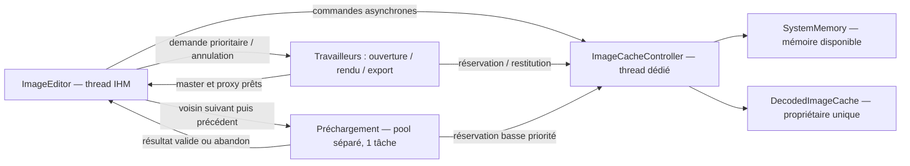

# Contrôle mémoire et navigation

Décision : [ADR-0015](../decisions/ADR-0015-controle-memoire-et-prechargement.md).
Mesures et limites : [rapport unique](../validation/analyses/analyse-performance-ouverture.md).

Le LRU conserve les images inactives. Un hit transfère l’entrée hors du cache
vers le consommateur ; l’éditeur la remet en rétention lorsqu’il la quitte.
L’image affichée reste référencée jusqu’à l’arrivée de sa remplaçante.
Faute de place, l’ouverture évince d’abord le LRU, puis **attend** la restitution
des réservations d’IPR, avec un message au pied de fenêtre. Si IPR n’a plus rien
à libérer, elle est admise sous pression lorsque la limite de commit la couvre.
Changer d’image annule l’attente périmée. Un échec ou une annulation restaure
l’identité et la recette de l’image affichée, sans écrire ses réglages dans le
sidecar de la cible.

Une image de plus de 2048 px ne laisse que son proxy, son signal caméra réduit,
ses métadonnées et ses dimensions réelles. L’export reconstruit alors le master
pleine résolution. Une petite image, dont le proxy est le master, garde aussi
sa source DCP. Au clic sur un RAW, l’aperçu intégré du boîtier (≈ 13 ms) s’affiche
avec un badge, en attendant le rendu IPR.
Chaque entrée peut garder master, proxy, source DCP et empreinte de profil.
Les allocations communes `cv::Mat` sont comptées une seule fois par entrée.
La clé distingue source, WB, profil, calibration/configuration, moteur et
optique. Elle est figée après restauration des réglages de l’image entrante,
pas avec la WB de l’image précédente. DCP/LCP modifiés invalident les hits.

Les fonds de calcul ne modifient jamais directement l’IHM. La promotion d’un
préchargement partage ses buffers immuables ; la sauvegarde `.ipr` n’intervient
qu’après ouverture réelle. Les révisions et jetons d’annulation empêchent la
publication d’une sélection devenue obsolète. L’arrêt attend les travailleurs
avant de détruire le contrôleur et son thread, sans attendre un callback IHM.

La propriété `memoryCacheStatus` expose mémoire disponible, réservations,
pression et hits/misses. Le pied de fenêtre affiche nombre d’images, taille
retenue et pression éventuelle. Une limite explicite à zéro désactive la
rétention et le préchargement, pas l’ouverture prioritaire sous admission.

Les miniatures du ruban ont leur propre fournisseur asynchrone : pool de 2–4
threads de basse priorité, hors du thread unique de lecture QML. L’aperçu de
l’image ouverte n’attend donc pas la file des miniatures, et le décodage
pleine résolution garde la priorité CPU.

Le seuil de 80 % est une politique d’admission, pas une garantie OS. Les
paramètres initiaux et les cas non validés sont détaillés dans l’ADR. La
recherche initiale des profils reste un coût distinct, non corrigé ici.
