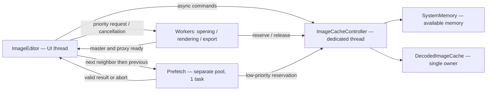

<!-- translation-source: docs/architecture/controle-memoire-images.md; sha256: 29931dff185ce05893900d161c6c3891a59cb914bfd92d28b9d49147058c7a88 -->
*[Français](controle-memoire-images.md) | [English](controle-memoire-images_en.md)*

# Memory control and navigation

Decision: [ADR-0015](../decisions/ADR-0015-controle-memoire-et-prechargement.md).
Measurements/limits: [single report](../validation/analyses/analyse-performance-ouverture.md).

The LRU retains inactive images. A hit transfers its entry out of cache to
the consumer; the editor returns it on leaving. The displayed image stays
referenced until its replacement arrives. Under pressure, opening first evicts
LRU, then **waits** for IPR reservation release, showing a footer message.
If IPR has nothing left to release, admit under pressure when commit headroom
covers the request. Image changes cancel stale waits. Failure/cancellation
restores displayed identity/recipe without writing its edits to the target sidecar.

Images larger than 2048px retain only proxy, reduced camera signal, metadata
and real dimensions; export rebuilds full resolution. Small images whose
proxy is the master also retain DCP source. Clicking a RAW displays a badged
embedded camera preview(about 13ms) while awaiting IPR rendering.
Each entry can hold master, proxy, DCP source and profile fingerprint.
Shared `cv::Mat` allocations count once per entry. Keys distinguish source,
WB, profile, calibration/configuration, engine and optics; freeze after incoming
settings restoration, not with previous-image WB. Changed DCP/LCP invalidate hits.

Background work never directly changes UI. Promoted prefetch shares immutable
buffers; `.ipr` saving occurs only after actual opening. Revisions/cancellation
tokens prevent stale-selection publication. Shutdown waits for workers before
destroying controller/thread, without waiting for a UI callback.

`memoryCacheStatus` exposes available memory, reservations, pressure and
hits/misses. Footer shows image count, retained size and pressure. An explicit
zero limit disables retention/prefetch, not admitted priority opening.

Filmstrip thumbnails have their own async provider: 2–4 low-priority threads,
outside the single QML reading thread. The open-image preview does not wait
for thumbnail queues; full-resolution decoding retains CPU priority.

The 80% threshold is admission policy, not an OS guarantee. Initial parameters
and unvalidated cases are detailed in the ADR. Initial profile discovery
remains a separate cost not fixed here.
