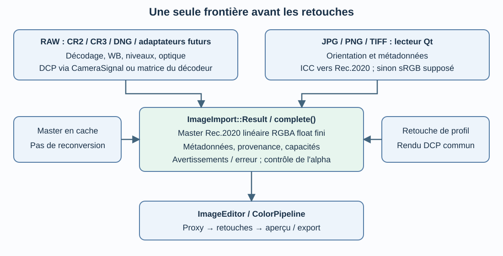

# Import commun des images

État relu le 22 octobre 2026 : contrat intégré dans `dev` (`a15f703`).
L'introduction du 16 octobre sur `patch_raw_opening` est historique.
Décision : [ADR-0013](../decisions/ADR-0013-contrat-import-commun.md).

## Une frontière, plusieurs adaptateurs

`ImageImport::load()` (`src/core/ImageImporter.cpp`) choisit l'adaptateur puis
appelle `ImageImport::complete()`. `ImageEditor` n'effectue plus lui-même le
décodage raster ou sa lecture des métadonnées ; il construit le proxy après
l'import commun. Le générateur utilise le même point d'entrée via l'éditeur.

| Entrée | Adaptateur | Transformation avant le contrat |
| --- | --- | --- |
| RAW enregistré : CR2, CR3, DNG avec LibRaw activé | `RawDecoder` | Développement caméra, DCP via `CameraSignal` ou matrice LibRaw |
| JPG, PNG, TIFF et formats raster reconnus par Qt | `QImageReader` | Orientation automatique, lecture métadonnées, ICC vers Rec.2020 ; sRGB supposé si aucun espace valide |
| Master en cache | Cache LRU existant | Aucune conversion ; mêmes contrôles et descripteurs reconstruits |
| Retouche rapide du profil | `RawDecoder::applyProfile` | Rendu DCP commun, puis mêmes contrôles avant le proxy |

Le registre de formats est consulté avant Qt. Un échec du décodeur RAW ne
provoque pas de repli silencieux vers une lecture d'aperçu JPEG. Une extension
inconnue peut être lue par Qt si un plugin réel la reconnaît ; aucun décodage
n'est inventé. Le filtre de sélection suit les extensions annoncées.

## Résultat commun

`ImageImport::Result` contient :

- `image` : master pleine résolution, RGBA float32, Rec.2020 linéaire D65,
  alpha droit dans [0,1]. Les RGB signés/étendus restent permis.
- `metadata` : `ImageMetadata`, type indépendant du namespace RAW, partagé
  par l'éditeur, les adaptateurs et le cache.
- `provenance` : identifiant/version du lecteur, description de l'espace source
  et origine couleur (DCP, matrice du décodeur, espace ICC reconnu ou sRGB supposé).
- `warnings` et `error` : avertissements distincts d'un échec ; un lecteur qui
  retourne une erreur non vide ne peut pas livrer en même temps un master utilisable.
- `capabilities` : développement caméra, présence d'un contexte WB caméra et
  possibilité technique de changer de profil sans redécoder.
- `dcpSource` : tampon caméra facultatif ; absent pour le chemin raster.

`complete()` refuse espace, dimensions/type, pixels non finis et alpha hors
domaine. Un échec efface le master, les capacités et le tampon facultatif.
Le résultat conserve les métadonnées utiles au diagnostic. La validation ne
redimensionne, ne clippe ni ne transforme les pixels ; elle parcourt le tampon.
Le retour du cache ne clone pas les pixels, mais il n'est pas exempt de ce coût
de contrôle. Aucun gain de latence n'est affirmé sans mesure isolée.

L'éditeur utilise les capacités communes pour identifier une image caméra et
le chemin rapide, en conservant ses conditions supplémentaires (réglages WB,
optique et calibration). Les descripteurs sont disponibles dans `imageDetails`
(`importDecoder`, `importDecoderVersion`, `importColorOrigin`,
`importSourceProfile`, `importWarnings`). Ils ne sont pas une nouvelle copie
des coefficients dans le sidecar.

## Limites à ne pas masquer

Le master commun ne signifie pas que tous les fichiers portent la même
information. La WB pré-DCP exige un contexte caméra ; les retouches RGB restent
disponibles aux images développées sans leur réappliquer le développement RAW.
`cameraWhiteBalanceContext` indique la présence du contexte, pas la validation
de tous les illuminants/profils. L'indication de chemin rapide reste conditionnelle
à l'état courant de l'éditeur.

Les types Qt réellement lisibles dépendent des plugins déployés. La lecture
des métadonnées raster conserve les champs exposés par Qt, pas un audit EXIF
exhaustif. Elle utilise les textes de l'image décodée, pas une nouvelle lecture
du flux par `QImageReader` après consommation des pixels : un test PNG a révélé
et corrigé cette perte de métadonnées. DNG passe par LibRaw ; le test DNG linéaire exporté et les 19 CR3
du corpus ne valident pas tous les DNG mosaïqués, compressés ou spécialisés.
TIFF float/multipage/CMJN et fichiers HDR demandent des corpus spécifiques.
Les miniatures gardent leur chemin léger dédié ; elles ne fabriquent pas un
master pleine résolution par ce contrat.
