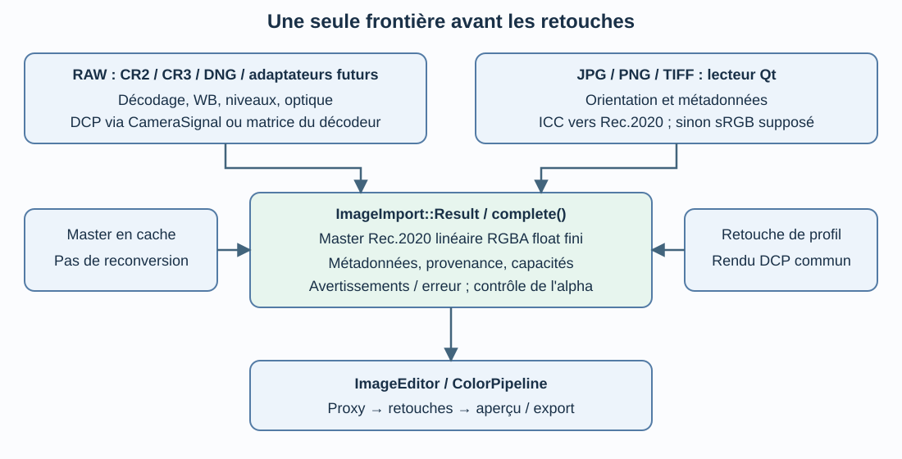

<!-- translation-source: docs/architecture/import-images.md; sha256: b436673e6ea15141dbf10efece09e08802a188c02dd478faac5c4fb922626c48 -->
*[Français](import-images.md) | [English](import-images_en.md)*

# Shared image import

Reviewed 22 October 2026: contract integrated into `dev`(`a15f703`).
The 16 October introduction on `patch_raw_opening` is historical.
Decision: [ADR-0013](../decisions/ADR-0013-contrat-import-commun_en.md).

## One boundary, multiple adapters

`ImageImport::load()` in `src/core/ImageImporter.cpp` selects an adapter and
calls `ImageImport::complete()`. `ImageEditor` no longer decodes raster or
reads its metadata itself; it builds the proxy after common import.
The generator uses that same entry through the editor.

| Input | Adapter | Transformation before contract |
| --- | --- | --- |
| Registered RAW: CR2, CR3, DNG with LibRaw enabled | `RawDecoder` | Camera development, DCP through `CameraSignal` or LibRaw matrix |
| JPG, PNG, TIFF and Qt-recognized raster | `QImageReader` | Auto orientation, metadata, ICC→Rec.2020; assume sRGB if no valid space |
| Cached master | Existing LRU | No conversion; reconstruct the same checks/descriptors |
| Fast profile edit | `RawDecoder::applyProfile` | Shared DCP rendering, same checks before proxy |

Consult the format registry before Qt. RAW decode failure does not silently
fall back to JPEG preview. An actual Qt plugin may recognize an unknown
extension; no decoding is invented. File filters follow advertised extensions.

## Common result

`ImageImport::Result` contains:

- `image`: full-resolution linear D65 Rec.2020 float32 RGBA master, straight
  alpha in [0,1]; signed/extended RGB remains permitted;
- `metadata`: `ImageMetadata`, independent of RAW namespace and shared by
  editor, adapters and cache;
- `provenance`: reader ID/version, source-space description and color origin
  (DCP, decoder matrix, recognized ICC or assumed sRGB);
- `warnings`/`error`: warnings separate from failure; a nonempty reader error
  cannot accompany a usable master;
- `capabilities`: camera development, camera WB context and technical ability
  to change profile without re-decoding;
- `dcpSource`: optional camera buffer, absent on raster path.

`complete()` rejects wrong space, dimensions/type, nonfinite pixels and
out-of-range alpha. Failure clears master, capabilities and optional buffer,
retaining useful diagnostic metadata. Validation traverses but neither resizes,
clips nor transforms pixels. Cache return does not clone pixels but still
incurs checking cost; claim no latency gain without isolated measurement.

The editor uses common capabilities to identify camera images and fast path,
retaining extra WB/optics/calibration conditions. Descriptors appear in
`imageDetails`: `importDecoder`, `importDecoderVersion`, `importColorOrigin`,
`importSourceProfile`, `importWarnings`. They are not duplicate sidecar coefficients.

## Limits not to hide

A common master does not mean equal source information. Pre-DCP WB requires
camera context; RGB edits remain available for developed images without
reapplying RAW development. `cameraWhiteBalanceContext` indicates context,
not qualification of every illuminant/profile. Fast-path indication remains
conditional on current editor state.

Readable Qt types depend on deployed plugins. Raster metadata retains Qt-exposed
fields, not exhaustive EXIF auditing. Read texts from the decoded image,
not a new `QImageReader` stream read after consuming pixels: a PNG test
revealed and fixed that metadata loss. DNG uses LibRaw; exported linear-DNG
testing and 19 corpus CR3s do not validate every mosaiced/compressed/specialized
DNG. Float/multipage/CMYK TIFF and HDR files need dedicated corpora.
Filmstrip thumbnails keep a dedicated lightweight path; this contract does
not manufacture full-resolution masters for them.
