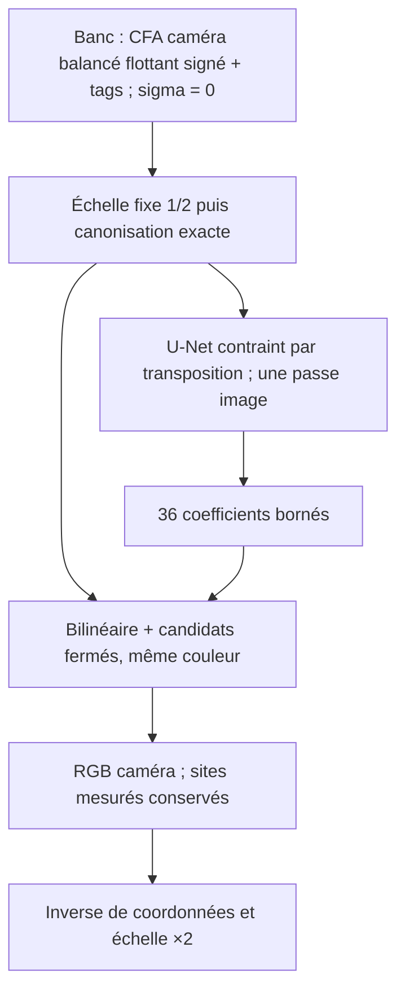
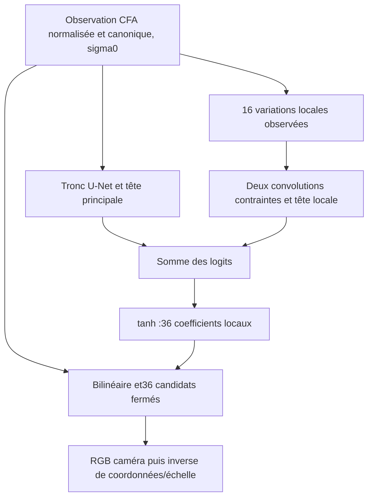
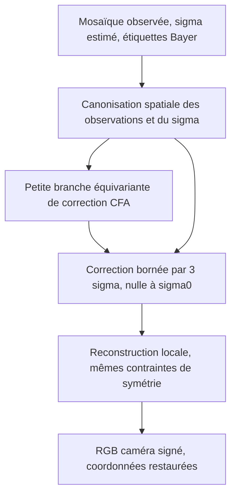
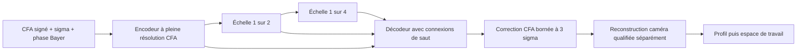

*[Français](restauration-neuronale.md) | [English](restauration-neuronale_en.md)*

# B4 — étude de préparation de la restauration neuronale locale

## État courant du 5 novembre 2026, après comparatif réel

La réplication est close (10 et 12 échecs forts/48), sans ouverture de
réserve ni sélection de graine. Trois compositions réelles, neuf régions
fixes chacune, ont maintenant un comparatif neutre RCD / classique
luminance courant / correcteur CFA puis RCD, les deux graines conservées.
DRUNet officiel est testé séparément sur le sRGB encodé ; la reconstruction
RGB apprise est un autre diagnostic, distinct de RCD. Bénéfice photographique
non validé : dépendance aux graines et motifs directionnels observés.

CUDA est qualifié numériquement sur le modèle courant ; un essai Adam
jetable mesure environ 0,327 s/mise à jour, soit 9,1 h pour 100 000,
avant génération/évaluation. Aucun apprentissage long ni intégration en
production. La limite globale physique reste 92 %, avec budgets locaux
distincts pour natif pleine définition et runtime CUDA.

Prochaine preuve : compléter le comparateur par la couleur courante après
les tons et rejouer la calibration sous la chaîne signée actuelle. Les
349 RAW inventoriés ne sont pas automatiquement admis à l'apprentissage.
Pas de nouvelle acquisition avant examen des noirs/aplats/rafales existants,
pas de nouvelle micro-variante procédurale sur les mêmes seuils. Le
[rapport unique](../validation/analyses/analyse-restauration-neuronale.md)
conserve les méthodes, résultats par campagne et limites.

## État du 3 novembre2026

Le premier contrat bruité (§17) est implémenté et couvert par9 tests
ciblés, sans intégration en production. Les deux tentatives de premier
apprentissage sont interrompues par le seuil de mémoire physique globale,
alors que le processus reste autour de307Mio résidents. Aucun checkpoint
final ou gain de débruitage n'est qualifié. L'utilisateur autorise ensuite
un seuil global92 % pour cette campagne, en conservant les plafonds propres
au processus. Le plan est tracé dans une nouvelle version avant reprise,
sans modifier données, modèles ou critères photographiques.

La relance à92 % est également interrompue par un pic global95,08 %,
avec environ307Mio résidents propres. Aucun résultat final disponible,
aucun résultat de débruitage qualifié. La reprise technique est ensuite
implémentée et testée (§18). Le lanceur et le plan sont préparés, en
attente du signal explicite de l'utilisateur pour son absence13h30–17h30.

## État historique du 2 novembre 2026

**Structure Bayer expérimentale fiabilisée sur signaux synthétiques,
pas de débruiteur photographique intégré.** La base de poursuite est
décrite au [§13](#13-structure-bayer-expérimentale--2-novembre-2026) :
36 candidats d'interpolation, convolutions contraintes par transposition,
noyaux préparés une fois pour une inférence. Deux initialisations et une
confirmation procédurale distincte de cette première structure sont
conservées. La [voie locale suivante (§15)](#15-voie-courte-locale--2-novembre-2026)
réduit l'erreur de reconstruction avec deux initialisations, puis sur
des contenus procéduraux distincts. La graine73 de l'objectif RGB échoue
sur les ondes chromatiques du sous-ensemble historique20. L'objectif
relatif suivant lève cet échec pour les deux graines, puis confirme
une meilleure fidélité des ondes sur de nouveaux contenus, au prix
d'une hausse d'erreur sur les contours distincts. Une pondération
intermédiaire est désormais retenue comme base de poursuite : les deux
graines passent les contrôles historiques et améliorent les groupes
mixtes/contours de deux cohortes distinctes, sans domination de chaque cas.
Cela qualifie une étape de reconstruction sans bruit, pas un débruiteur.
Les576 comparaisons de sorties qualifient la préparation
des noyaux de cette nouvelle branche, sans qualification photographique.

Le [rapport évolutif](../validation/analyses/analyse-restauration-neuronale.md)
et ses JSON canoniques portent les résultats et limites. Les sections1à12
ci-dessous conservent le cadrage et les premiers essais historiques.
L'ouverture, le filtre classique et l'IHM restent inchangés.

## État historique du 31 octobre 2026

**Premier banc synthétique passé (§10), pas intégration ni résultat photo.**
L'utilisateur autorise les premiers tests et l'installation de PyTorch dans un
environnement isolé. Le moteur classique reste inchangé ; les essais alpha
gardent la priorité. Les sections 1 à 9 retracent le cadrage préalable, avant
installation et calcul neuronal.

Audit suivant (§11) : réglages des 115 CR3 lunaires vérifiés, trois aperçus
mesurés et mouvement historique réutilisé. Aucune référence propre constituée.

Préparation en attendant les nouvelles prises (§12) : contrat de normalisation,
masques et partitions testé, puis épreuve multi-scènes synthétique exécutée.
Pas de gain photographique ni de poids utilisables revendiqués.

Orientation utilisateur précisée ensuite (§9) : architecture éprouvée,
**poids entraînés pour IPR et signal caméra signé** en priorité ; les modèles
RGB existants restent des comparateurs, pas une cible imposée.

Cette référence précise le [lot B4 du plan bêta](roadmap-beta.md). Les faits
locaux et limites sont conservés dans le
[JSON de préparation v001](../validation/raw/preparation-b4-v001-20261031T132231Z.json),
pas dans un nouveau rapport de campagne concurrent. Le
[rapport RAW évolutif](../validation/analyses/analyse-developpement-raw.md)
reste le suivi des résultats existants. Au cadrage initial : documentation sur
`patch_documentation`, branche locale de prototype `patch_neural_restoration` depuis `dev`
`b19b4c3`, sans worktree, implémentation ni publication à cette étape.

## 1. Conclusion de cadrage

Deux voies à ne pas confondre :

1. **Pilote RGB développé** pour comparer vite des poids disponibles : NAFNet
   SIDD largeur 32, DRUNet couleur et Restormer Real Denoising. Ce pilote évalue
   leur intérêt photographique ; il ne valide pas un remplacement du débruitage RAW.
2. **Cible RAW** : restaurateur conditionné par le bruit sur CFA ou RGB caméra,
   adapté à nos boîtiers et au signal signé. Aucun poids de la sélection ne
   justifie un branchement direct à cette frontière. Décider ensuite adaptation
   ou entraînement, selon le bénéfice du pilote et les données nécessaires.

Recommandation : commencer par NAFNet largeur 32 et DRUNet, puis Restormer si le
premier couple ne donne pas le compromis attendu. C'est un ordre d'essai proposé,
pas un classement mesuré ni un recensement exhaustif de l'état de l'art.
Pas de LLM, de diffusion générative ou de réseau
unique bruit/netteté imposé : le premier objectif est la restauration fidèle.

## 2. Machine de référence et conséquences

| Observation locale | Valeur | Portée |
| --- | --- | --- |
| CPU | Intel Core i7-12700K, 20 threads logiques annoncés | Affinité effective et budget partagé à qualifier |
| RAM physique | 16 933 507 072 octets, environ 15,77 Gio | Environ 5,65 Gio disponibles à la requête ; état variable, non réservé |
| GPU | NVIDIA RTX 3060, 12 288 Mio annoncés | VRAM libre, runtime CUDA et compatibilité ONNX non testés |
| Pilote GPU | 610.88 | Observé par `nvidia-smi`, pas une validation de dépendances |
| OS | Windows 11 AMD64, version 10.0.26300 | Pas de qualification Linux/macOS par cette mesure |

Le GPU rend un pilote local plausible ; il ne prouve ni capacité pleine image
ni délai de 10 s. La RAM système impose de borner également les copies CPU,
pas uniquement les activations GPU. À 32 Mpx, un seul RGBA float32 représente
512 Mo décimaux, avant source caméra, caches, tenseurs et temporaires.

Proposition initiale : une seule inférence à la fois, tuiles 256 puis 512 pixels,
batch 1, FP32 d'abord. Essayer 1024 seulement après mesure des pics. Ces tailles
ne sont pas encore qualifiées et comprennent des halos à définir. Réserver
les ressources via le contrôleur existant ; pas de règle « utiliser toute la
VRAM » ni de multiplication des pools CPU. Le plafond actuel de 8 threads du
filtre classique n'est pas une mesure du meilleur budget neuronal.

## 3. Modèles examinés et droits à lever

| Candidat | Utilité dans le pilote | Limite décisive |
| --- | --- | --- |
| NAFNet-SIDD-width32 | CNN RGB, premier témoin bruit réel | Domaine smartphone SIDD ; pas RGB caméra signé ; attention au contexte spatial des tuiles |
| DRUNet couleur | CNN RGB avec carte de niveau de bruit, utile pour étudier la force | Bruit gaussien de référence différent du bruit Canon dématricé |
| Restormer Real Denoising | Comparateur RGB fondé sur l'attention | Coût et contexte spatial à mesurer ; pas supérieur par définition |
| Learning to See in the Dark (SID) | Référence d'architecture RAW | Poids Sony/Fuji non interchangeables avec Canon ; pas retenu comme pilote prêt à l'emploi |

Les dépôts [NAFNet](https://github.com/megvii-research/NAFNet),
[DPIR/DRUNet](https://github.com/cszn/DPIR) et
[Restormer](https://github.com/swz30/Restormer) fournissent architectures et
références de poids. Les variantes débruitage et défloutage sont distinctes :
ne pas charger un poids GoPro à la place de SIDD. Aucun poids ni nombre exact
de paramètres n'a été vérifié localement. La taille des poids n'est pas le pic
mémoire d'inférence ; pas de chiffre de latence déduit d'un classement PSNR.

Les licences des sources consultées déclarent MIT pour
[NAFNet](https://raw.githubusercontent.com/megvii-research/NAFNet/main/LICENSE)
(avec notices Apache-2.0 de BasicSR),
[DPIR](https://raw.githubusercontent.com/cszn/DPIR/master/LICENSE) et
[Restormer](https://raw.githubusercontent.com/swz30/Restormer/main/LICENSE.md).
Cela ne clôt pas la qualification juridique d'un paquet : avant redistribution,
identifier l'artefact exact, ses droits, notices et données d'entraînement.
Conserver commit source, URL officielle, SHA-256, architecture/configuration,
version d'export et licence des poids. Aucun simple miroir ou tag « open weight »
ne suffit. Aucun tiers n'a été contacté ou contenu utilisateur envoyé.

Le [site SIDD](https://abdokamel.github.io/sidd/) décrit des données smartphone
et des versions RAW/sRGB ; leur disponibilité ne démontre pas la généralisation
aux Canon. Le [README SID](https://github.com/cchen156/Learning-to-See-in-the-Dark)
avertit lui-même de la dépendance des poids au capteur. Aucun corpus externe
n'est téléchargé pour ce cadrage.

## 4. Contrats d'entrée : protéger le chemin actuel

Le code de référence livre deux frontières différentes :

- `CameraDenoise.h` : `CV_32FC3`, RGB caméra **déjà balancé**, blanc 1, valeurs
  finies négatives et supérieures à 1 acceptées ; après RCD/médiane, avant LCP/DCP
  sur le chemin pré-optique retenu. Pas une luminance photométrique universelle.
- `ColorPipeline::WorkingImage` : `CV_32FC4`, Rec.2020 D65 à transfert linéaire,
  alpha droit, plage étendue. Le DCP peut avoir appliqué sa courbe ; ce tampon
  n'est donc pas nécessairement radiométrique scene-linear.

Pour le **pilote RGB**, fabriquer uniquement une copie de rendu neutre dans le
domaine RGB encodé attendu par les poids, en flottants si l'adaptateur le permet.
Comparer le modèle et les témoins sur **la même copie/adaptation**. Tracer chaque
borne et les pixels hors domaine ; ne pas faire passer les pertes de gamut ou
les changements de transfert de l'adaptateur pour un gain neuronal. Ce chemin
de banc SDR n'est ni inversible en général ni une proposition de nouveau master.
Pas d'aller-retour via TIFF IPR pour les mesures : utiliser les buffers en mémoire.

Pour la **cible RAW**, définir explicitement CFA/RGB, ordre des plans Bayer,
noir/blanc par canal, gains, ISO connu/inconnu, bruit dépendant du signal,
orientation et stade du dématriçage. Le réseau doit être entraîné/qualifié sur
ce domaine. Ajouter simplement un décalage aux négatifs ou borner à 0 ne crée
pas une compatibilité valide. Conserver source immuable, sortie flottante et
valeurs étendues selon le contrat ; alpha et métadonnées ne sont pas prédits.

Force 0 = saut exact du réseau. Pour un modèle sans condition de force,
`sortie = entrée + t × (prédiction − entrée)` est un témoin ergonomique à tester,
pas une preuve de débruitage monotone ou d'équivalence LR. La carte de bruit de
DRUNet n'est pas directement notre barre 0..100. Une correction de netteté future
aura ses propres poids, données et tests de faux détails.

## 5. Runtime et tuilage

Référence de calcul : environnement auteur isolé et figé, jamais installation
dans l'environnement des campagnes alpha. Proposition de déploiement :
[ONNX Runtime](https://onnxruntime.ai/docs/execution-providers/), API C++, CPU
pour contrôle et CUDA pour la première machine. La
[licence du runtime](https://github.com/microsoft/onnxruntime/blob/main/LICENSE)
est distincte des modèles et bibliothèques GPU. Export et opérateurs doivent
passer un contrôle de parité avant toute conclusion de qualité.

[ncnn](https://github.com/Tencent/ncnn), C++ CPU/Vulkan, reste un comparateur
de déploiement si conversions et taille du paquet le justifient ; ses
[licences et composants](https://raw.githubusercontent.com/Tencent/ncnn/master/LICENSE.txt)
doivent aussi être audités. Ne pas multiplier les backends au premier pilote.
CoreML/macOS et les autres GPU sont des qualifications ultérieures, pas couverts
par le matériel présent. La documentation
[DirectML](https://onnxruntime.ai/docs/execution-providers/DirectML-ExecutionProvider.html)
signale sa maintenance et l'orientation des nouveaux développements vers WinML :
ne pas choisir automatiquement cet ancien chemin pour tout Windows.

Qualifier pooling global de NAFNet et réductions spatiales de Restormer : un halo
fini n'assure pas l'identité pleine image. `NAFNetLocal` est une variante de
configuration à identifier, pas une correction invisible du checkpoint.
Comparer deux grilles décalées, bords, coins et image entière de petite taille ;
rechercher des différences de rendu, pas seulement une couture visible.
Conserver padding, recouvrement, fusion des tuiles et précision dans la recette.

CPU : limiter explicitement pools interne et externe ; mesurer 1/4/8 threads
après libération des tests alpha. La
[documentation ONNX sur les threads](https://onnxruntime.ai/docs/performance/tune-performance/threading.html)
explique notamment la consommation de l'attente active ; désactiver le spinning
pour le premier témoin afin de ne pas brûler du CPU entre deux commandes.
Une annulation empêche la publication et termine les travaux au prochain point
sûr ; une tuile GPU n'est pas nécessairement interruptible instantanément.

## 6. Données disponibles et prévention des biais

Inventaire par noms/extensions, **sans nouveau décodage** : 28 RAW de base
(14 CR3, 14 CR2), 76 RAW hors protocole, 42 CR3 en rafale et 241 CR3 dans le
protocole colorimétrique, dont 77 dans `blacks`. Les groupes se recoupent ;
ni leur somme ni le nombre de fichiers ne donne le nombre de scènes indépendantes.
Les milliers de TIFF ne sont pas déclarés neutres LR valides par cet inventaire.

L'inventaire CFA historique conserve 14/14/14 images de la rafale en
développement/validation/réserve fermée. Les anciennes scènes de contrôle et
les 76 hors protocole ont déjà été examinées : **pas de nouvelle réserve** créée
par renommage ou recadrage. Vérifier provenance et historique avant de figer
le jeu final ; ne pas sélectionner ses exemples selon le résultat d'un réseau.

Pour le premier pilote, aucune nouvelle photo n'est nécessaire pour vérifier
contrats, ressources et bénéfice visuel exploratoire. Pour entraîner ou conclure
sur la fidélité, il faudra des références propres qualifiées : rafales statiques
alignées avec exposition/BdB stables, saturation contrôlée, détails fins, peau,
cheveux, tissus et aplats. Une moyenne de rafale conserve le bruit fixe commun ;
un noir bouchon fermé n'est pas une vérité propre pour les textures éclairées.
Séparer séances/scènes/boîtiers, pas seulement les crops. Auditer le mouvement
de la rafale actuelle avant d'utiliser sa moyenne comme vérité. Les références
LR servent à une comparaison de comportement, pas à une vérité radiométrique
ni à des données d'entraînement implicitement autorisées.

## 7. Banc à préparer puis exécuter après les tests alpha

| Porte | Travail | Sortie attendue |
| --- | --- | --- |
| Q0 | Figer sources, poids/droits, adaptateurs, jeux et masques avant essais | Manifeste interne du banc et empreintes ; pas d'export IPR de mesure |
| Q1 | Chargement local et contrats sur petites images synthétiques | Dimensions/canaux, RGB/BGR, finitude, identité0, source inchangée, erreurs explicites |
| Q2 | Auteur FP32 contre export ONNX FP32 sur mêmes buffers | Erreurs moyenne/max et par canal ; tolérances arrêtées avant campagne |
| Q3 | Tuiles 256/512, deux origines, bords et masque alpha | Raccords, variation contextuelle et pic mémoire ; pas simple mesure sur image réduite |
| Q4 | Trois à six scènes de développement, témoin neutre/classique/neural | Détail et couleur à 100 %, forces et masques identiques, comparaison aveugle si possible |
| Q5 | Qualification gelée, scènes indépendantes, pleine définition | Accord utilisateur, échecs/limites et budget matériel avant intégration |

Ne pas noter une image « meilleure » sur la seule baisse du passe-haut.
Mesurer luma/chroma par signal, contraste des détails, déplacement des couleurs,
noirs/HL et faux contours. PSNR/SSIM uniquement avec référence alignée et
indépendante recevable ; sans elle, annoncer des indicateurs de résidu et une
revue perceptuelle, pas une erreur à la vérité. Éviter les métriques fondées sur
des masques recalculés séparément pour favoriser un candidat.

Ressources : chargement froid séparé, échauffement puis au moins 3 répétitions,
médiane/pire valeur, transfert CPU/GPU, préparation et reconstruction inclus
dans le temps total ; synchronisation GPU pour les chronos. Mesurer pics RAM et
VRAM, pas seulement les poids. Objectif exploratoire utilisateur d'environ 10 s,
pas engagement avant mesures pleine définition. Ne pas mesurer en concurrence
avec LR ou les tests alpha ; consigner toute interférence.

Défauts bloquants : changement de couleur manifeste, détails inventés, couture,
entrée non prise en charge acceptée silencieusement, source altérée, NaN/Inf,
annulation publiant un résultat obsolète, dépassement non maîtrisé ou crash.
Modèle absent/empreinte fausse : message explicite, mode classique disponible,
aucun téléchargement ou changement de backend silencieux. Ne pas exécuter de
scripts tiers ou charger un pickle non vérifié ; prévoir un chargement de poids
limité aux tenseurs et des artefacts de provenance contrôlée.

## 8. Prochaine décision

Finir l'audit des artefacts et geler Q0, puis lancer Q1/Q2 seulement après la
fin des campagnes alpha et libération du budget machine. Choisir le premier
checkpoint et autoriser son acquisition avant téléchargement ; aucun choix
de redistribution n'est acquis. Le présent travail livre les contrats proposés,
l'inventaire et le protocole du banc, **pas un modèle performant démontré**.

## 9. Orientation retenue et besoins d'images — 31 octobre 2026

L'utilisateur retient une **architecture éprouvée avec nos propres poids** et
un contrat de couleur maîtrisé. La cible prioritaire devient le RGB caméra
signé pré-LCP/DCP ; les poids RGB existants restent des comparateurs facultatifs,
pas un passage obligé avant notre apprentissage. Le détail factuel de cet audit
est conservé dans le [JSON de besoins v001](../validation/raw/besoins-corpus-b4-v001-20261031T134511Z.json).

### Ce qui manque réellement

- Plusieurs **scènes différentes avec bruit et référence propre comparable**,
  pas simplement davantage de photos isolées. L'inventaire historique vérifié
  couvre une rafale de 42 images à ISO 4000 et des noirs/prises en pièce sombre,
  tous du R6 Mark III ; il ne constitue pas un jeu supervisé diversifié.
- Des textures faibles : tissus fins, cheveux immobiles ou perruque, papier
  granuleux, bois ; et des couleurs franches : orange/rouge, bleu, verts et gris.
  Sur les panneaux d'escalade, conserver le vrai grain de sable en luminance.
- Des scènes réparties sur plusieurs séances et éclairages stables, avec des
  scènes indépendantes réservées avant réglage. Les noirs existants sont utiles ;
  **ne pas les refaire tous** avant d'avoir audité les séries non classées.
- La qualification du 60D viendra ensuite. Ne pas transférer automatiquement
  les niveaux ISO, le bruit, les poids ou les conclusions du R6 Mark III.

### Première acquisition demandée : trois scènes pilotes

Commencer seulement par trois installations fixes :

1. Tissu fin + mèches immobiles + objet à bord net, éclairage doux.
2. Objets orange/rouge, bleu et vert + plage grise, sans canaux saturés.
3. Aplat gris mat + détail peu contrasté + objet sombre, avec ombres lisibles.

Pour **chaque scène**, R6 Mark III sur trépied, RAW pleine définition non C-RAW
pour le premier lot, mode d'obturation constant, ouverture et mise au point
manuelles fixes. BdB fixe, pas d'Auto ISO ni de correction automatique d'exposition.
Désactiver la réduction de bruit longue pose ; enregistrer les autres réglages
de bruit boîtier. Ne pas déplacer caméra, sujet ou éclairage entre séries.
Éviter écran, LED à scintillement, feuillage, personnes et tissus qui bougent.

- **Référence : 16 vues à ISO 100**, ou 400 si cela permet une séquence plus
  stable ; allonger le temps de pose pour exposer correctement sans écrêtage.
- **Bruit : 16 vues à chacun des ISO 3200, 12800 et 51200**. Raccourcir le temps
  de pose quand l'ISO augmente pour garder une luminosité comparable ; ne pas
  conserver simultanément tous les paramètres d'exposition inchangés.
- Même cadrage, ouverture et éclairage. Contrôler les noirs, gris et couleurs,
  sans chercher à exposer toute la scène à droite. Noter les temps de pose et
  vérifier la stabilité entre la référence et les prises bruitées.

Cela fait **64 RAW par scène, 192 RAW au total**. Les 16 vues de référence ne
sont pas les entrées bruitées d'entraînement. Après alignement et contrôle,
leur agrégation réduit le bruit temporel sans supprimer automatiquement FPN,
pixels chauds ou variations d'éclairage. Référence basse sensibilité et vues à
haute sensibilité nécessitent un raccord radiométrique mesuré ; elles ne sont
pas égales pixel à pixel par simple changement d'ISO. Ne produire aucun TIFF LR.

Faire auditer ce lot avant d'en prendre davantage. Si recevable, proposition
de départ : **12 scènes au total, réparties 8 développement / 2 validation /
2 test fermé**, soit 768 RAW avec cette recette. Les trois pilotes restent en
développement ; toutes les sensibilités et tous les crops d'une scène restent
dans le même groupe. Ce nombre prépare une première étude, pas une garantie de
modèle généraliste : l'entraînement depuis zéro peut demander bien plus de diversité.

### Rafales lunaires sur la carte D:

L'utilisateur confirme une prise sur trépied. Lecture seule : 115 CR3 dans
`D:/DCIM/101EOSR6`, de `6V1A0016.CR3` à `6V1A0130.CR3`, regroupés par dates
d'écriture le 30 octobre vers 22 h 44, 22 h 46 et 22 h 47. Ces groupes ne sont
pas encore des limites de rafales prouvées par EXIF. Le premier aperçu embarqué
montre la Lune ; les autres fichiers et paramètres restent à auditer.

Usage proposé : contrôle exploratoire des cratères, halos, ciel sombre et faux
détails, hors apprentissage dans un premier temps. Trépied ne supprime ni dérive
lunaire, ni turbulence, ni vibrations. Pas de moyenne déclarée « propre » sans
recalage/contrôle ; ne pas sélectionner uniquement les vues qui favorisent le réseau.
La série déjà prévisualisée n'est pas présentée comme un test aveugle scellé.

### Banques publiques : compléments, pas substitution des Canon

| Source | Apport possible | Décision de préparation |
| --- | --- | --- |
| [SIDD](https://abdokamel.github.io/sidd/) | Paires bruit/référence, données RAW et sRGB ; licence MIT déclarée | Premier candidat public, commencer par un sous-ensemble ; smartphone et RAW normalisé ne qualifient pas nos négatifs Canon |
| [raw.pixls.us](https://raw.pixls.us/) | Diversité de scènes et de formats | Seulement fichiers dont CC0 est vérifié individuellement ; pas de vérité propre appariée, bruit synthétique à déclarer |
| [RENOIR](https://ani.stat.fsu.edu/~abarbu/Renoir.html) | Données incluant Canon T3i et S90 | Intérêt à étudier, droits de réutilisation des images non établis ici : pas retenu pour entraînement à ce stade |
| [ELD](https://github.com/Vandermode/ELD) | Modélisation du bruit et comparaison basse lumière | Code MIT, mais jeu annoncé pour évaluation : ne pas l'assimiler à un corpus d'entraînement libre |
| [FiveK](https://data.csail.mit.edu/graphics/fivek/) | Diversité RAW, retouches expertes | Licences de recherche limitant les usages commerciaux ; pas retenu comme base sans restriction |
| [HDR+](https://hdrplusdata.org/dataset.html) | Rafales smartphone et résultats fusionnés, CC-BY-SA déclaré | Étude ultérieure possible pour B7 ; pas de téléchargement complet, ni de droits sur nos poids supposés automatiquement |

La [licence FiveK](https://data.csail.mit.edu/graphics/fivek/legal/LicenseAdobeMIT.txt)
est une licence de recherche malgré le nom MIT dans le jeu ; ce n'est pas la
licence logicielle MIT. Chaque acquisition future doit tracer les droits des
images séparément de ceux du code et des poids. Aucun téléchargement effectué.

### SSD de 500 Go : organisation proposée, aucune opération disque

À la médiane de 38 026 452 octets des 14 CR3 de base, 192 nouveaux RAW occupent
environ **7,3 Go**, 768 environ **29,2 Go** ; tailles futures variables, hors
copies et caches. Les 115 candidats lunaires représentent environ 2,62 Go.
Un SSD annoncé 500 Go est une aide substantielle, pas une raison de matérialiser
tous les tenseurs pleine image : un RGB float32 de 32 Mpx occupe déjà 384 Mo.

Après montage par l'utilisateur, garder un corpus d'apprentissage distinct de
`base` et de ses exports jetables, avec identité boîtier/séance/scène/série et
empreinte des sources. Les noms Canon se répètent : ne jamais copier les vues
lunaires dans `base` en écrasant un homonyme. Sources immuables sauvegardées,
crops calculés à la demande, cache régénérable borné ; budget initial proposé
de 100 Go pour ce cache avec réévaluation après mesure, et marge disque libre.
Le SSD de calcul ne remplace pas une sauvegarde. Ne pas appliquer la purge des
TIFF d'analyse aux RAW d'entraînement nécessaires à la reproductibilité.

Le formatage, le choix du volume et le déplacement de corpus restent à décider
avec l'utilisateur. Aucune action de formatage, copie, suppression ou partition
n'est exécutée par cette préparation.

## 10. Premier banc synthétique et cours — 31 octobre 2026

Sur `patch_neural_restoration`, worktree dédié et environnement `.venv-neural`,
PyTorch **2.9.1+cpu** et NumPy **2.3.5** installés ; Python 3.14.3. Paquets acquis
depuis les index officiels PyTorch/PyPI, pas de poids préentraînés. Le Python
global et les dépendances alpha n'ont pas été modifiés. Aucun calcul GPU lancé.

Le commit local `b6ad93d` livre un petit U-Net résiduel à deux réductions,
largeur 8, **29 995 paramètres**, et un banc CPU. Entrées RGB caméra/sigma par
canal en NCHW float32 ; corps aléatoire et tête nulle au départ. C'est un témoin
de contrat, pas une architecture ou des poids sélectionnés pour la production.

[Preuve JSON](../validation/raw/neural-contracts-v001-20261031T190924Z.json) :
**14 tests réussis**, zéro échec/erreur/skip, environ 1,36 s pour la suite interne,
deux threads intra-op et un inter-op. Contrôles des tailles paires/impaires,
plage étendue à l'identité, force 0 sans appel réseau, source inchangée,
entrées/sorties invalides, annulation avant/après et gradients. Un test fait
16 petits pas Adam sur un seul patch artificiel : vérification du câblage,
**pas apprentissage photographique ni généralisation**. Aucun poids sauvegardé.

Ce temps n'est pas la latence d'une photo. Pas de CUDA, ONNX, tuilage pleine
image, pic RAM/VRAM, bruit Canon ou qualité photo qualifiés. La prochaine porte
est le gel de l'adaptateur/dataset et un essai sur références recevables, pas
une intégration ou un nouvel entraînement massif automatique.

Le [cours 13](../scholar/cours-13-reseaux-neuronaux-de-zero.pdf), avec
[source LaTeX](../scholar/cours-13-reseaux-neuronaux-de-zero.tex) et
[TP exécutable](../scholar/references/reseaux-exemples.py), explique les bases,
gradients à la main, CNN/U-Net, données et qualification. Le TP reste séparé
du banc : démonstration pédagogique, pas nouvelle campagne de validation.

## 11. Audit des rafales disponibles — 31 octobre 2026

L'utilisateur autorise l'audit pendant la préparation de nouvelles scènes.
Outil dédié sur `patch_neural_restoration`, commit `1aec51c`, sept tests de
lecteur synthétique réussis. Mesure conservée dans le
[JSON lunaire v001](../validation/raw/moon-audit-v001-20261031T194552Z.json).
Lecture bornée des CMT1/CMT2, pas interprétation complète des MakerNotes/CTMD.
Traitement séquentiel, un thread OpenCV ; aucune modification de production.

### Ce qui est confirmé pour la Lune

Les 115 fichiers de `D:/DCIM/101EOSR6` déclarent Canon EOS R6 Mark III,
200 mm, objectif `70-200mm F2.8 DG OS HSM | Sports 018`, orientation1.
Le trépied reste une information fournie par l'utilisateur, pas une mesure EXIF.

| Fichiers | Nombre | ISO | Temps de pose | Ouverture |
| --- | --- | --- | --- | --- |
| `6V1A0016.CR3` à `6V1A0049.CR3` | 34 | 1600 | 1/200 s | f/5,6 |
| `6V1A0050.CR3` à `6V1A0130.CR3` | 81 | 1000 | 1/200 s | f/9 |

Les horodatages de prise confirment le 30 octobre vers22h44–22h47.
La seconde plage comprend deux groupes horaires ; l'égalité des paramètres
ne prouve pas la continuité d'une rafale. Ne pas moyenner les 115 images en bloc :
gain et ouverture diffèrent, et le cadre s'est déplacé entre les aperçus.

Les JPEG embarqués de0016/0073/0130 font6960×4640 pixels. La zone lumineuse
détectée mesure environ300 pixels de côté : intérêt local sur la Lune, pas
115 scènes ni des exemples variés de textures et couleurs. Les niveaux médians
encodés de cette zone sont159/75/78. Le premier aperçu contient environ1,17%
de canaux à255 dans cette zone ; les deux autres0%. Ce n'est **pas un diagnostic
d'écrêtage RAW** : courbe, balance et traitement JPEG peuvent saturer un canal.

Le proxy Laplacien varie entre les vues, mais n'est pas utilisé pour classer
leur netteté : exposition et traitement changent aussi sa valeur. La boîte de
sélection est en coordonnées JPEG, pas un ROI capteur certifié. Les empreintes
RAW complètes sont conservées pour ces trois vues ; les autres ont seulement
les empreintes des blocs de métadonnées et leur taille/date, pas un hash complet.

**Décision :** série candidate aux tests exploratoires de détails et halos,
hors apprentissage pour l'instant. À qualifier ensuite en RAW : saturation,
alignement par sous-série, couverture, turbulence et stabilité des textures.
Ni moyenne « propre » ni référence supervisée créée à partir des JPEG.

### Réutilisation de la rafale historique de 42 vues

Le banc ne relit aucun pixel des groupes développement/validation/réserve.
Il réutilise le JSON de mouvement du27 octobre, dont le chemin et l'empreinte
sont conservés dans la nouvelle preuve. L'audit ancien portait seulement sur
les14 premières vues de développement, avec aperçu CFA de800 pixels de large.
Il rapportait jusqu'à5,19 pixels de translation globale,0,427° de rotation
absolue et une échelle entre1 et1,00458. Ne pas convertir ces valeurs en
déplacements RAW natifs sans reprendre les conventions exactes de l'ancien banc.

Ces résultats interdisent une moyenne naïve comme vérité de texture. Ils ne
réfutent pas une référence après recalage : affine globale, parallaxe et mouvement
local doivent encore être contrôlés sur les pixels autorisés. La réserve reste
fermée. Les anciennes images examinées ne deviennent pas un nouveau test vierge.

### Suite retenue

Auditer le premier lot de nouvelles prises avant extension, en conservant
scène/séance/réglages et groupes indépendants. Pour les sources existantes,
geler d'abord le domaine RAW et le traitement d'alignement avant toute cible
de moyenne ; pas de reprise d'un entraînement ni de modification des poids
sur la base de métriques d'aperçu. Aucun RAW copié, exporté, supprimé ou modifié.

## 12. Chaîne de données et pilote synthétique — 31 octobre 2026

L'utilisateur annonce les nouvelles prises pour le lendemain et autorise la
préparation en attendant. Sur `patch_neural_restoration`, commits `cbe1770`
et `041af0b`, sans raccordement au moteur. Le contrat de banc impose :

- même facteur scalaire positif explicite pour entrée, référence et sigma ;
  aucune plage déduite automatiquement, aucun gamma/clamp/changement de BdB ;
- source inchangée, négatifs et valeurs étendues conservés. L'inversion de
  l'échelle reste soumise aux arrondis float32, pas une identité binaire
  générale. Rejet des débordements et sous-débordements détruisant une valeur ;
- masque booléen de validité N1HW, perte calculée sur les seuls canaux valides,
  masque vide et valeurs non finies rejetés. Exclure des pixels ne doit pas
  diminuer artificiellement la perte en gardant l'ancien dénominateur ;
- toutes les variantes d'une scène dans le même groupe, et refus d'un contenu
  source ou d'une référence identique partagé entre apprentissage/validation/test.
  Cette protection dépend encore d'identités de scène honnêtement attribuées.

Les **14 tests de données** passent. Un premier passage avait13 tests ; le
contrôle supplémentaire concerne le partage d'une cible propre. Les preuves
restent distinctes : [premier passage](../validation/raw/neural-data-pilot-v001-20261031T204455Z.json)
et [rejeu avec garde-fou](../validation/raw/neural-data-pilot-v001-20261031T204714Z.json).
Même architecture, graines,64 étapes Adam et taux0,001 ; aucun réglage choisi
selon la validation ou le test, aucune sélection de checkpoint. Les mesures
par scène et pertes du rejeu sont identiques au premier passage.

Le pilote porte sur **8/4/4 scènes artificielles**, au sens de16 graines d'un
même générateur, pas16 scènes photographiques indépendantes. Ramps, faibles
motifs et zones étendues signées,32×48 pixels, deux threads intra-op CPU.
Bruit gaussien à variance dépendante du signal ; sigma calculé depuis la cible
propre : conditionnement idéal, pas estimation de bruit exploitable sur Canon.

| Groupe | MSE moyenne entrée | MSE moyenne sortie |
| --- | --- | --- |
| Apprentissage,8 cas | 0,000788827 | 0,000788840 |
| Validation,4 cas | 0,000784167 | 0,000784299 |
| Test synthétique,4 cas | 0,000718287 | 0,000718276 |

**Verdict :** plomberie et contrôles opérationnels, sortie quasi identitaire,
aucun bénéfice de débruitage utile démontré. Ne pas régler le réseau en boucle
sur ces16 cas pour obtenir une baisse décorative. Le temps interne d'environ
1,73s du dernier rejeu n'est pas une latence photo ou un budget mémoire qualifié.
Aucun poids sauvegardé, aucun RAW/réserve/référence LR lu, pas de GPU/ONNX.

### Premier contrôle à la réception des prises

Avant tout apprentissage : identités sans collision, intégrité et boîtier/mode
RAW, ISO/temps/ouverture, stabilité du cadrage et de l'éclairage, absence de
référence saturée, mise au point comparable et qualité du recalage. Vérifier
les unités du signal pré-LCP/DCP et les masques dans ce signal, pas dans le JPEG.
Beige accepté : il n'est pas nécessaire que l'aplat soit gris neutre. La trame
du tissu reste du détail à protéger, pas du bruit à effacer.

Fixer les tolérances et les groupes avant d'examiner les sorties du réseau.
Si les prises sont recevables, construire une première référence avec carte
de validité et provenance, puis qualifier l'apprentissage réel. Sinon, indiquer
les fichiers et raisons à corriger, sans les intégrer silencieusement.

## 13. Structure Bayer expérimentale — 2 novembre 2026

Décision de banc prise dans l'autonomie autorisée par l'utilisateur :
retenir une structure symétrique par construction pour poursuivre B4,
avec poids propres entraînés par Adam. Le U-Net de largeur8 produit
36 coefficients bornés par tanh ; les convolutions suivent explicitement
les permutations de canaux et la transposition des noyaux. Le compteur
de31300 paramètres stockés ne représente pas autant de degrés de liberté
indépendants après projection. Aucun poids tiers n'est utilisé ici.

Les candidats d'interpolation ont masse1, premier moment nul et ne lisent
que des échantillons de la même couleur. La liste est fermée par
transposition ; les homologues verticaux du vert aux sites rouges et
bleus sont présents. Les poids appris peuvent être négatifs dans la
combinaison effective : aucune moyenne convexe ou borne[0,1] n'est
présumée. Les garanties affines concernent l'intérieur, hors bords réfléchis.

Ce graphe décrit le **prototype de banc**, pas un nouveau chemin de
production. Le contrat présent n'accepte que sigma0 et observations
déclarées exactes : ce modèle n'est pas encore un joint dématriçage/
débruitage qualifié. Pour le bruit, recopier les mesures du capteur
conserverait précisément le bruit de ces sites ; il faudra définir
un autre contrat d'estimation et le qualifier explicitement.

### Préparation de l'inférence et identité des poids

La projection des petits noyaux et biais est calculée une fois sur une
copie indépendante et figée du modèle évalué. Les convolutions préparées
deviennent ordinaires ; cela évite de répéter la projection à chaque
image et n'exige pas une seconde vue transposée. Le modèle source et
l'état aléatoire ne changent pas. La copie doit être reconstruite après
tout changement de checkpoint : une future intégration devra identifier
le checkpoint, la configuration, le domaine et la version de structure,
et ne pas réutiliser un modèle préparé périmé. Aucun cache moteur ou
chargement ONNX n'est implémenté par cette étude.

Les sorties préparées sont identiques au bit près sur960 cas rejoués,
deux graines conservées. Ce résultat qualifie l'optimisation sur le banc,
pas une latence pleine définition. Le détail des contrôles, les échecs
historiques et les temps par répétition restent dans le
[rapport unique](../validation/analyses/analyse-restauration-neuronale.md).

### Frontière de validation et suite

Les propriétés de structure, les partitions et la reproductibilité sont
distinctes de la qualité photo. La confirmation procédurale passe les
critères pour les deux graines, mais ne remplace pas le groupe20
historique où le gain minimal reste insuffisant. Aucun seuil n'a été
ajusté et aucune meilleure graine n'est sélectionnée. Les contrôles
de confirmation sont désormais consultés et ne redeviendront pas vierges.

La qualification suivante devra fixer le bruit CFA et sa propagation,
les pertes avec observations bruitées, les données physiques propres
et réservées, le tuilage/halo et les pics mémoire avant toute intégration.
Le CPU fournit le témoin numérique ; un environnement GPU séparé pourra
être qualifié pour les campagnes plus lourdes. La présence d'une RTX3060
12Go n'est pas un résultat de compatibilité CUDA/ONNX ou de vitesse.
Pas de modification actuelle des profils, de l'espace de travail,
du rendu par défaut, des réglages ou des exports de production.

## 14. Protection mémoire et contrat bruité — 2 novembre 2026

À la demande de l'utilisateur, les nouveaux pilotes lourds de ce banc
Windows utilisent un job propre au processus : quota dur de2Gio de
mémoire engagée, distincte de la RAM résidente. Un moniteur échantillonne
les compteurs privés/résidents et la disponibilité physique toutes les0,25s.
Il demande un arrêt à1,25Gio privés/résidents ou80 % de mémoire physique
utilisée, vérifié aux frontières de chaque micro-lot. Ce second mécanisme
est coopératif ; il ne borne ni ne termine les autres applications.
L'API et les mesures exactes sont tracées dans le
[rapport](../validation/analyses/analyse-restauration-neuronale.md).

L'exécution est mono-processus, sans DataLoader multiprocessus ni chargement
du corpus entier : micro-lot1, accumulation4, cache quatre petites images,
évaluation en flux et absence de graphes conservés dans les mesures.
Le refus d'installer le quota provoque un refus de lancer le calcul,
sans repli silencieux non protégé. Les erreurs, pics et abandons sont
enregistrés. Ce mécanisme de banc ne modifie pas le contrôleur mémoire
de l'application ou les critères de livraison multiplateforme.

### Contrat préparé pour le futur joint dématriçage/débruitage

Le module de données bruitées distingue explicitement : observation CFA
en quatre plans spatiaux, vérité RGB caméra à résolution complète,
tags Bayer, sigma dans les mêmes unités et échelle positive déclarée.
Les valeurs signées ou supérieures au blanc restent acceptées, sans
gamma, changement de profil, min/max par image ou borne de signal.
Les conversions non finies ou détruisant un non-zéro par sous-flux
sont refusées. Les sources et l'état aléatoire global ne sont pas modifiés.

Le premier bruit simulé suit `variance = a × max(signal,0) + b` ;
les coefficients et graines sont connus, mais **ne constituent pas un
profil Canon ni une correspondance ISO**. Le conditionnement sigma est
calculé depuis l'observation bruitée et ces coefficients, pas depuis
la vérité propre. Le plancher de variance ne borne pas le signal bruité :
les valeurs négatives sont conservées. Signal, vérité et sigma partagent
la même normalisation fixe, sigma étant divisé par cette échelle.

Pour un futur profil physique établi avant gains de balance, appliquer
un gain `g` au signal multiplie sa variance par `g²`. Avec la loi affine
`a × signal + b`, les coefficients exprimés dans le domaine balancé
deviennent `g × a` et `g² × b`. Il faut donc identifier le domaine exact
et l'ordre des opérations avant d'utiliser un profil de capteur. Aucun
coefficient de boîtier n'est extrapolé par le module synthétique.

La perte future supervise toutes les composantes RGB, y compris les
positions mesurées par le capteur. En régime bruité, leur copie exacte
conserverait le bruit : le futur modèle doit pouvoir les corriger. Le
modèle sans bruit actuel continue de refuser sigma non nul ; le nouveau
contrat de données, testé séparément, n'est pas un raccordement de filtre
ni un débruiteur entraîné. Un résultat calculé par RCD ne sera pas présenté
comme une vérité indépendante du dématriçage.

Le précontrôle et l'essai8192 étapes confirment une mémoire résidente
inférieure à300Mio sur ce banc128pixels, sous quota2Gio engagés.
Cela ne vaut pas pour une image pleine définition. L'essai long n'a
pas levé le critère historique de reconstruction ; le contrat bruité
est donc préparé et testé, mais aucun entraînement bruité n'a été lancé.
Les poids précédents restent des preuves distinctes et les seuils ne
sont pas assouplis. Les résultats détaillés et les catégories de mémoire
mesurées restent dans le rapport unique.

Le diagnostic suivant compare les coefficients complets à leurs biais
seuls et à leurs moyennes spatiales, sur deux checkpoints figés. Il
révèle une adaptation locale presque supprimable sur les contrôles
procéduraux : remplacer les coefficients par une constante par canal
et par image change très peu la sortie. La covariance structurelle
ne prouve donc pas une adaptation locale utile. La piste suivante est
une connexion courte donnant à la tête une information locale explicite,
à tester par ablation et avec le même budget mémoire ; aucun nouveau
modèle ou correctif de production n'est validé par ce seul constat.

## 15. Voie courte locale — 2 novembre 2026

L'ablation suivante ajoute une route d'accès aux variations de l'observation
pour la tête36 : quatre descripteurs par plan CFA (pentes H/V centrales
absolues et différences secondes H/V absolues), deux convolutions
contraintes puis une tête1×1. Ses logits s'ajoutent à ceux du tronc avant
tanh. La permutation transforme les positions et les directions ensemble.
La source n'est pas bornée ou changée d'espace ; aucune vérité cible
n'est lue par cette voie. L'initialisation commune et les têtes nulles
conservent le point de départ bilinéaire.

Les deux routes appartiennent à une seule évaluation du modèle, sans
seconde vue transposée. Le graphe reste celui du banc sans bruit.

Le modèle compte33368 paramètres au lieu31300. Le tronc, les règles
d'interpolation et de symétrie restent présents ; la capacité, les
descripteurs et la longueur de chemin changent ensemble. La campagne
appariée à2048 étapes, avec les mêmes données, Adam, micro-lots et
critères, retrouve une adaptation spatiale effectivement utile et passe
les12 critères sur20 et80 contrôles de développement, sans changer les
seuils. Le détail, les ablations et les mesures font autorité dans le
[rapport unique](../validation/analyses/analyse-restauration-neuronale.md).

La reproduction avec la graine73 conserve les gains globaux et passe
les12 critères sur80 contrôles historiques, mais échoue sur les ondes
chromatiques du sous-ensemble20 (11/12). Le succès initial71 n'est donc
pas une qualification de toutes les initialisations. Les deux graines
passent les12 critères sur80 nouveaux cas mixtes et améliorent les128
nouveaux contours, sur un plan figé avant le second apprentissage mais
après le choix d'architecture. Ces contenus consultés ne sont désormais
plus réservés. Ils partagent les générateurs du développement.

La préparation des noyaux des deux routes est requalifiée :576 sorties
identiques au bit près, sans changement des sources. Les mesures CPU
128px restent distinctes d'une latence photographique pleine définition.
Cette branche reste expérimentale et sans bruit, sans validation photo.
La protection des signaux chromatiques lisses doit être étudiée avant
le pilote bruité, sans choisir la meilleure graine ou assouplir les seuils.

L'essai suivant conserve cette architecture et pondère la MSE de chaque
exemple par `max(MSE bilinéaire,1e-6)` en unités physiques, avec référence
détachée du gradient. Les deux graines passent alors12/12 critères sur20
et80 contrôles consultés. L'erreur globale baisse pour71 mais augmente
de5,57 % pour73 face à leurs témoins respectifs. La fidélité des ondes
progresse fortement. La confirmation suivante sur quatre checkpoints
et832 cas nouveaux retrouve ce gain, mais l'erreur sur128 contours
distincts augmente de6,69 %/17,96 % pour71/73 face à l'objectif RGB.
Il n'y a donc pas de supériorité globale uniforme. Un seul objectif
intermédiaire, d'exposant d'énergie1/2, est fixé avant deux nouveaux
apprentissages, puis comparaison des six modèles sur une autre cohorte.
Les seuils ne changent pas et aucune graine n'est sélectionnée. Ce changement ne
modifie pas les calculs d'inférence et n'est pas intégré en production.
Les ressources restent bornées selon le§14 et aucune production ou IHM
n'est modifiée par cette étude.

## 16. Objectif tempéré retenu pour la poursuite — 2 novembre2026

L'architecture locale33368 paramètres ne change pas. Seul l'objectif
d'apprentissage devient `MSE / sqrt(1e-6 × max(MSE bilinéaire,1e-6))`
en unités physiques du signal. La référence est détachée du gradient,
disponible uniquement pour l'apprentissage supervisé. Aucune vérité
cible n'est requise à l'inférence ; aucune nouvelle opération n'y est
ajoutée par ce changement de fonction de coût.

Les deux graines71/73 passent les12 critères historiques20/80. Les six
checkpoints (RGB/relatif/tempéré×deux graines) sont ensuite comparés sur
deux nouvelles cohortes procédurales figées avant leur mesure. Le tempéré
améliore les groupes mixtes et les contours distincts pour les deux
graines ;2496 sorties des deux campagnes sont identiques au bit près
entre modèles sources et noyaux préparés. Les cas qui régressent restent
rapportés : il ne s'agit pas d'une domination universelle. Cette base
est retenue pour préparer le pilote bruité, sans nouvelle recherche
d'objectif sur les mêmes contrôles. Les preuves et limites demeurent
dans le rapport unique et les JSON canoniques.

Le contrat actuel refuse sigma non nul et préserve les sites capteur
exacts. La transition au bruit doit donc définir explicitement son
conditionnement et le traitement des observations bruitées, avec tests
des invariants attendus ; ouvrir seulement cette entrée ne suffit pas
à qualifier un débruiteur. Pas d'intégration moteur/IHM à ce stade.

## 17. Premier contrat bruité — 3 novembre2026

Le pilote conserve la reconstruction locale tempérée et ajoute une
correction CFA bornée par `3 × sigma × tanh(logits)` avant l'interpolation.
Les deux parties sont apprises ensemble. Le modèle compte36588 paramètres,
les paramètres initiaux du tronc proviennent des témoins71/73 qualifiés.
Le sigma estimé est une entrée explicite, en mêmes unités que le signal.
Il ne déclenche pas une borne RGB : les valeurs signées restent permises.

Une projection des observations bruitées à l'identique serait contradictoire
avec le débruitage ; elle est refusée. À sigma0, les sites observés sont
préservés et le résultat coïncide avec la reconstruction portant le même
tronc. L'affinage peut changer ce tronc : le parent figé et les critères
historiques restent donc des témoins distincts. La branche commence par
une correction nulle et les poids de reconstruction doivent correspondre
exactement au contrat attendu, sans chargement partiel silencieux.

Le premier essai est simulé, avant dématriçage, avec variance dépendant du
signal et sigma estimé depuis l'observation. Ce n'est pas un profil de
capteur. Données de validation propres et bruitées figées avant calcul,
deux initialisations sans sélection, témoins parent/ablation et critères
structurels sont décrits dans le rapport unique. Les quotas du§14 restent
applicables. Contrat testé, apprentissage à qualifier ; aucune intégration
en production ou promesse de qualité photographique à ce stade.

La préparation a figé624 cas par modèle avant entraînement. Les tentatives
71 initiale puis reprise sont interrompues à cause de la RAM globale ;73
n'a pas démarré. Les preuves d'arrêt et ressources figurent dans le rapport
et les JSON. Les limites restent inchangées, aucune relance en boucle et
aucune conclusion photographique tirée des calculs partiels. Cette version
ne disposait pas d'une sauvegarde de reprise ; les parents figés sont intacts.
La version suivante ajoute cette sauvegarde technique (§18).

À la demande explicite de l'utilisateur, le pilote bruité porte désormais
son seuil physique global à92 %, déclaré dans le plan (schéma2). Les
plafonds2Gio engagés et1,25Gio privés/résidents restent inchangés. Cette
autorisation ne modifie pas le garde générique des autres bancs ni les
preuves historiques à80 %. Les modèles, données et critères sont conservés.

## 18. Reprise et campagne préparée — 3 novembre2026

Le banc sauvegarde atomiquement un unique état technique courant toutes
les64 étapes complètes et au terme2048 : modèle, Adam, étape, pertes,
expositions et RNG CPU. La reprise doit correspondre au même plan, parent
et graine. Elle ne choisit pas un état selon un score de validation.
Le test sur le vrai cadenceur confirme l'identité au bit près entre calcul
continu et reprise après une accumulation partielle interrompue.

Le lanceur séquentiel attend une marge mémoire, exécute71 puis73, reprend
seulement après arrêt mémoire, borne les tentatives et arrête sur erreur
de calcul. Il ne sélectionne pas la meilleure graine et ne modifie pas les
modèles. Le seuil physique global92 % et les plafonds propres sont conservés.
Le plan schéma3 fige également la politique de checkpoint.

La [procédure de lancement](../validation/tools/pilote-unet-bruite.md) décrit
les limites horaires et les étapes de qualification. Onze tests ciblés
passent sur le périmètre reprise/lanceur/protocole ; pas de campagne
lancée avant le signal utilisateur. Les contrôles photographiques et la
validation sur images réelles restent à faire, sans intégration moteur/IHM.

## 19. Correction CFA conditionnée — 3 novembre 2026

Le pilote courant conserve le reconstructeur U-Net local appris, avec
ses 33 368 paramètres figés, et apprend seulement une correction des
quatre plans CFA physiques. Le prototype courant utilise un correcteur
U-Net à deux réductions, de largeurs 8/16/32, avec connexions de saut :
32 452 paramètres entraînés, 65 820 au total. Il remplace le correcteur
local et l'élargissement écarté ; leurs preuves restent historiques.
Ce choix
maintient exactement le parent lorsque sigma vaut zéro. Il ne constitue
pas un grand réseau photographique entièrement entraîné de bout en bout.

La correction est bornée à trois sigma fournis. Son descripteur de bruit
utilise un résidu d'ajustement quadratique 5×5, normalisé par sa variance
propagée. Le signal reste signé ; seul ce descripteur est limité à ±8.
La protection fixe de courbure utilise trois contrastes H/V/croisé,
partage une confiance entre les quatre positions CFA et réduit la
correction près des structures détectées. La composante croisée supprime
une zone aveugle diagonale des deux premières réponses ; la borne
d'union nominale porte sur 588 comparaisons, alpha 0,01.
Ce facteur est une heuristique de protection, pas une probabilité calibrée.

Le correcteur local a échoué sur des confirmations à fort bruit malgré
une erreur moyenne réduite. Le nouveau contexte n'a passé qu'un prétest
d'exécution, pas une qualification de qualité. Les cas connus doivent
passer avant d'ouvrir de nouveaux
contrôles. Une confirmation distincte reste nécessaire ;
aucune valeur de sigma simulée n'est assimilée à une calibration ISO réelle.
Les empreintes des fonctions de calcul, des poids et des entrées sont liées
au protocole. Changer le conditionnement sans entraîner de nouveaux poids
ou réutiliser une ancienne preuve sous un nouveau code est refusé.

Le déploiement par tuiles est une qualification séparée : il faut préserver
la phase Bayer et celle des deux réductions spatiales, utiliser un halo
fixe vérifié et comparer au calcul sur une vue plus grande. Une évaluation
sur de petits centres ne garantit pas à elle seule l'absence de raccords.
Les données sources restent immuables ; la boucle de qualification n'entre
pas dans le chemin d'ouverture de production.

Les entrées/sorties de ce banc sont en signal caméra linéaire signé,
avant profil et tons. Elles ne sont ni du sRGB d'affichage ni le Rec.2020
de travail utilisé plus tard dans la chaîne de production. Les planches
réelles exploratoires emploient seulement le canal vert balancé, avec un
contraste d'affichage partagé ; elles n'ont pas de référence propre.

La qualification suit plusieurs barrières : développement, rejeu des
anciennes données et échecs avec le code courant, confirmation nouvelle,
puis validation photographique et ressources. Une régression n'est jamais
renommée confirmation indépendante. Aucun réglage par boîtier, niveau ISO
réel, saturation ou défaut de capteur n'est déclaré qualifié par les
simulations gaussiennes. Le protocole et les preuves sont dans le
[rapport évolutif](../validation/analyses/analyse-restauration-neuronale.md).

## 20. Prochaine étape — contexte appris à plusieurs échelles

Le correcteur précédent était un CNN local en amont du U-Net de reconstruction
figé. Il voyait au plus 7×7 cellules par plan CFA, soit environ 14×14 pixels
capteur. La confiance analytique peut
protéger une structure détectée ; elle ne fournit pas au correcteur un
contexte appris plus large. L'élargissement des canaux garde ce même support.
Son échec ne prouve pas que le contexte soit l'unique cause, mais justifie
de tester cette variable séparément de nouvelles règles de protection.

Le prototype courant remplace la seule décision locale de correction
par un petit encodeur/décodeur à deux réductions, avec connexions de saut.
Préserver les positions CFA, la covariance D4, le signal signé, le parent
exact à sigma nul et les interfaces courtes. Ne pas modifier le développement
de production ou les profils pour préparer cette expérience.

Avant l'entraînement, calculer le champ réceptif composé correction puis
reconstruction. Prévoir initialement des fenêtres de 256 pixels et un
centre mesuré de 64 pixels ; la marge définitive devra être démontrée par
comparaison à une vue plus grande. Les anciennes fenêtres 128 ne suffisent
pas automatiquement. Étendre analytiquement les scènes simulées, en
conservant exactement leurs centres, labels et champs de bruit connus ;
générer indépendamment le bruit du halo. Ne pas fabriquer ce contexte en
redimensionnant les centres ni le présenter comme une nouvelle référence.

Étapes de qualification :

1. Vérifier par empreinte les centres hérités et par calcul les marges,
   puis tester préparation des poids, finitude et symétries.
2. Mesurer huit étapes représentatives sous les mêmes plafonds : microbatch1,
   accumulation4, cache4,4threads,1,25Gio souple et2Gio engagés maximum.
   Le seuil physique global92% reste coopératif ; il n'empêche pas un autre
   programme de le dépasser. Aucun repli silencieux hors quota.
3. Comparer les deux graines sous un budget préalablement figé, avec une
   seule variation de contexte et une mémoire des entrées par empreinte.
4. Rejouer toutes les régressions connues avant les cohortes encore réservées
   classique352/3800000 et fine2. Elles n'ont pas été ouvertes après l'échec
   de l'élargissement.
5. Qualifier ensuite les paires CFA photographiques, la calibration sigma
   réelle, les saturations et les défauts de capteur avant toute intégration.

L'inférence GPU pourra être étudiée si le prétest CPU justifie ce besoin,
avec sa propre qualification numérique. Le temps, la mémoire et le transfert
des détails restent trois résultats séparés. Une réussite de l'un ne vaut
pas validation des autres.

### Préparation réalisée — 3 novembre 2026

`multiscale_correction.py` calcule les dépendances pour les quatre phases
de pooling. Le rayon composé maximal atteint 45 cellules CFA ; une marge
conservatrice de 96 pixels couvre aussi le sous-pixel RGB. Le prétest
compare un centre de 64 pixels entre vues 384 et 256. Pour isoler la
variation de contexte à l'apprentissage, le centre de perte reste celui
de 32 pixels du protocole précédent : bord 112 dans une fenêtre 256.
La qualification classique conserve ses anciens centres et ses critères.

`context_data.py` prolonge analytiquement constantes, rampes, contours et
textures. Les centres RGB, CFA bruités et sigma sont conservés au bit près ;
seul le bruit du halo utilise un autre générateur. Le calendrier d'indices
et de phases continue d'utiliser la taille source128 : le changer à256
modifierait sa consommation RNG et donc les exemples tirés.

Le plan schéma4 impose ce contexte et exige une preuve de prétest réussie
avant l'entraînement long. Les anciennes versions du correcteur ne sont
pas conservées dans le code courant. Prétest : huit mises à jour sans
conservation des poids, quatre contrôles sigma nul exacts, 32 symétries,
quatre comparaisons de fenêtres et pont vers le centre du parent.
Il ne valide ni le débruitage ni les photographies.

### Supervision de structure — 4 novembre 2026

L'architecture d'inférence conserve 65 820 paramètres et le reconstructeur
figé. L'apprentissage limite à 1 la norme L2 des gradients accumulés avant
chaque étape Adam. À l'erreur RGB tempérée et au point fixe CFA propre
s'ajoute une supervision des variations de la cible CFA. Le code courant
utilise au plus deux projections : détail centré et courbure des quatre
voisins orthogonalisée dans le produit scalaire pondéré par la variance
estimée. Les carrés d'erreur projetée sont normalisés par cette variance,
puis moyennés sur les directions actives et les plans.

Les gardes relatives 10⁻⁸/10⁻⁴ évitent de traiter l'arrondi comme une
direction indépendante. Aucun changement de signal, profil, table ou filtre
n'est ajouté à l'inférence ; ces cibles propres ne servent qu'à entraîner
les poids. Les coefficients, plans et preuves d'entraînement figent le
terme utilisé, y compris pour les modèles précédents conservés en preuves.
La supervision simple a réduit les échecs fins de 24 à 19/48, sans validation
globale. La version à deux projections est un nouvel essai, pas un résultat
qualifié. Détails et limites dans le
[rapport unique](../validation/analyses/analyse-restauration-neuronale.md).

Résultat de cet essai : la graine 71 passe le développement, la graine 73
reste presque à l'identité et échoue au gain minimal. Les gradients sont
actifs ; la qualification s'arrête avant les nouveaux rejeux. Le code de
supervision à deux projections reste un outil d'étude, sans validation ni
raccordement en production. Les poids à supervision simple conservent le
statut de référence expérimentale, avec leurs 19/48 échecs fins.

La transition suivante est appariée : initialisation depuis cette référence,
512 étapes supplémentaires avec Adam remis à zéro dans les deux bras,
taux 0,00025 et données identiques. Le contrôle conserve la projection simple ;
l'autre bras passe continûment vers deux projections en 256 étapes, puis
continue jusqu'à 512. Le plan distingue les pas de stage des 2 560 pas cumulés.
La même fonction de perte fournit cette combinaison convexe ; aucun autre
chemin d'inférence n'est introduit. Une reprise restaure aussi la position
dans la rampe. Les textures fines sont désormais le premier rejeu après le
développement protégé ; leur échec interdit une qualification globale.

### Entrées statistiques observées — 4 novembre 2026

La transition progressive précédente reste insuffisante : 17/48 échecs
fins forts contre 19/48 au contrôle, sans amélioration sur les deux graines.
Le candidat courant conserve la supervision simple et ajoute aux 40 entrées
de base 32 corrélations calculées dans le réseau, sur quatre plans physiques,
deux axes, deux décalages et deux supports (9 et 17 cellules CFA).
Ces statistiques utilisent uniquement le signal observé et son sigma.
Après compression `asinh`, une projection 1×1 rejoint le premier encodeur.

Cette projection ajoute 264 paramètres : 66 084 au total, dont 32 716
entraînables dans le candidat et 33 368 figés dans le reconstructeur.
Le contrôle fige aussi les 264 paramètres nouveaux à zéro. Les deux bras
exécutent le même graphe ; il n'existe pas de chemin ancien d'inférence.
L'importation explicite des poids archivés exige ces seules nouvelles clés
et une projection nulle. Quatre-vingts empreintes de sorties initiales ont
été vérifiées identiques avant entraînement.

Le rayon composé atteint 51 cellules CFA, soit une marge conservatrice
de 104 pixels. Les tests comparent un centre 64 entre vues 384 et 288,
avec une marge de 112 ; l'audit exige 112 et 128, tandis que 96 est un
témoin trop court. Le centre de perte 32 dans 256 reste inchangé.
Les nouvelles cohortes excluent toutes les empreintes de l'ascendance,
pas seulement celles du préfixe de données rejoué. La campagne appariée
garde les graines 71/73, Adam neuf et 512 étapes par bras ; aucun résultat
de ce candidat n'est encore qualifié. Le bilan du 5 novembre compte
15/48 échecs fins forts, contre 19/48 au contrôle, avec un gain limité
à une graine et davantage d'erreur RGB. Les ablations confirment une
préservation de signal et de bruit. Les sondes de gradients et de biais
ne justifient pas une nouvelle perte à ce stade. La préparation suivante
porte sur la couverture conjointe des données d'entraînement, sans modifier
les critères ni ouvrir de nouveau jeu réservé. Voir le rapport pour
les nombres, les empreintes et les limites de chaque diagnostic.

### Couverture stratifiée — bilan du 5 novembre 2026

L'essai suivant compare deux flux de 822 textures fraîches, à perte et
architecture identiques. Le candidat couvre chaque cellule déclarée
famille/phase/bruit/fréquence/amplitude, tandis que le contrôle aléatoire
en laisse 28/192 vides. Les distributions empiriques changent légèrement ;
ce n'est pas une expérience à marges strictement égales.
Les deux graines progressent : 12/48 échecs fins forts contre 19/48,
avec une hausse de 1,9–3,5 % de l'erreur RGB fine. La grille descriptive
de force confirme une indication de meilleure sélectivité à bruit fort,
sans validation indépendante. Le candidat reste absent de la production.

Les diagnostics de contenu comparent désormais les deux domaines connus
quand les données d'apprentissage diffèrent. Chaque mesure déclare si son
contenu a été appris par le modèle ; un contenu de l'autre domaine ne
devient pas une validation réservée. Les dix défauts de transfert et les
deux défauts RGB restants doivent être étudiés sans modifier les critères.

La campagne chromatique suivante conserve le réseau et les pertes. La cible
procédurale est identifiée par `texture_serial` et ses signes de contraste
par `colour_flips`. `training_texture_data.py` reconstruit le centre et le
halo avec la même transformation, sans écrêtage. Les coefficients absolus,
DC et géométrie sont appariés ; seul le signe G/B peut changer. Les quotas
regroupent les phases Bayer. Cette transformation appartient exclusivement
au banc d'apprentissage, sans option ni traitement de production. Les
prétests passent ; le bénéfice de ce nouvel essai reste à mesurer.

Son bilan est désormais mesuré : 15/48 échecs contre 16/48 au contrôle,
sans amélioration robuste entre les graines. La diversité des signes n'est
pas retenue comme traitement général. Deux tirages stratifiés naturels ont
donné 12 et 16 échecs ; la suite mesure la répétabilité sur deux autres
tirages à paramètres fixes. Le périmètre `known_only` du plan interdit
l'ouverture de nouvelles cohortes réservées, même après réussite des
contrôles connus. Aucun modèle n'est sélectionné d'après le meilleur tirage.

### Recentrage produit après revue — 5 novembre 2026

Les contrôles synthétiques restent un banc de développement ; ils ne sont
plus une condition préalable pour produire une planche photographique
exploratoire non qualifiante. La réplication engagée se termine, puis les
nouveaux réglages procéduraux sont suspendus avant comparaison sur trois
scènes réelles. Le premier bras naturel de réplication, les deux graines,
est fixé par rôle avant notation photo, sans sélectionner le meilleur score.

Comparer le même RCD/médiane en neutre, avec classique IPR courant et après
le correcteur CFA ; montrer séparément la reconstruction apprise. Une
demi-pile RGB rééchantillonnée n'est pas une vérité CFA. Les seuils gelés
reçoivent des comparateurs, pas des assouplissements. Une courbe longue
GPU devra avoir un budget mesuré, données/points de contrôle/graines figés,
et distinguer froid complet, correcteur froid et continuation. Le CPU et
le GPU ont des contrats numériques distincts.

Claude prépare CUDA dans un environnement séparé. Les archives CPU restent
reproductibles et la campagne active n'est pas modifiée. Avant toute demande
de nouvelles prises, requalifier les noirs/aplats/rafales existants avec la
chaîne signée actuelle. Le rapport unique contient le point de décision
en tête, les réponses factuelles à la revue et les critères d'arrêt.
