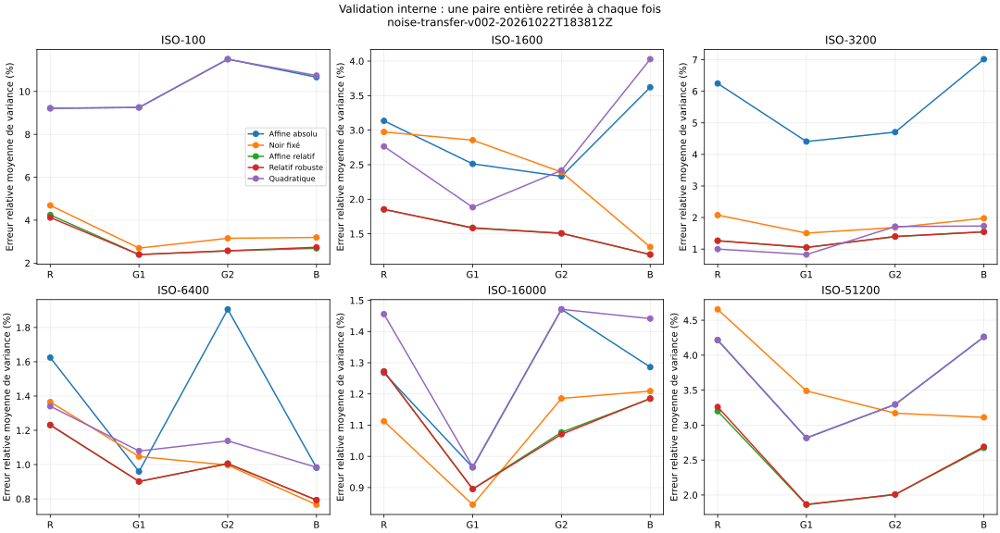
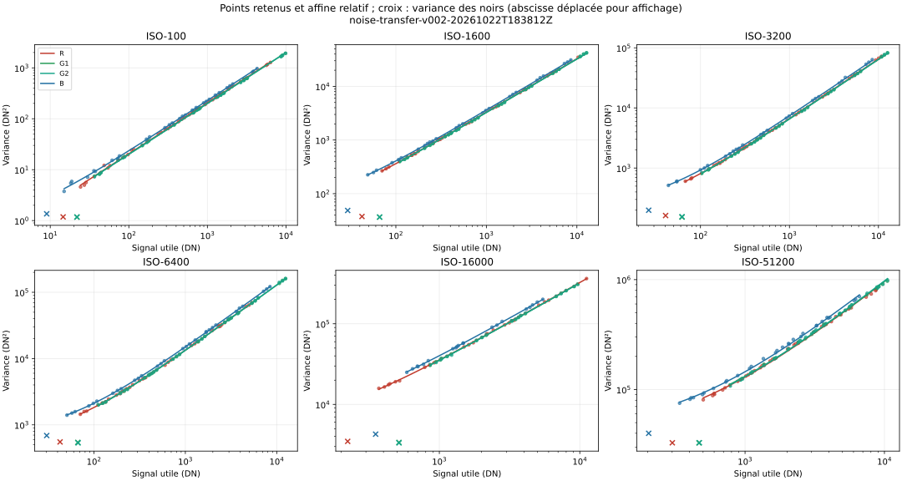
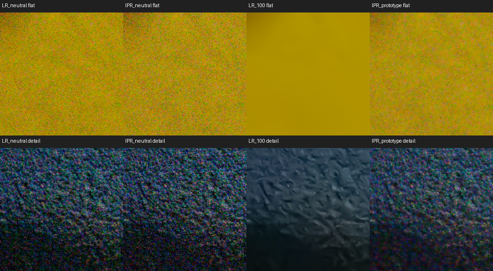
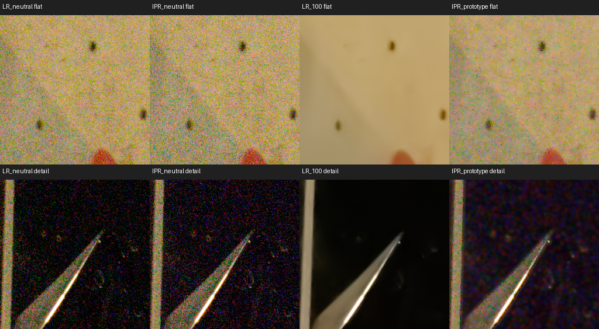

# Réduction de bruit — rapport consolidé

## Bilan actuel — 24 octobre 2026

**Dernière étude :** le [diagnostic spectral et directionnel](#bruit-20261024-spectral)
utilise huit paires RCD, douze scènes et un complément de 2 508 injections.
Il distingue mieux certaines textures d'un résidu de bruit, mais pas toutes
les petites formes : en luminance, 16/24 étoiles à pic 10 σ restent compatibles
avec le bruit. Piste retenue pour sélectionner les tuiles d'estimation, **pas
pour corriger directement les pixels**. Aucun changement de production ;
aucune nouvelle prise requise ([conclusion](#conclusion-actuelle)).

**Étude précédente :** le [soutien du profil et l'abstention G](#bruit-20261024-soutien-profil)
compare douze scènes (116 zones) et 48 contrôles synthétiques. G conserve mieux
la texture lunaire, mais lisse encore une texture propre et introduit plus de
1 % de dérive Y dans cinq zones. **G non admissible en production en l'état.**
La prochaine piste porte sur la cohérence spectrale/directionnelle du bruit,
pas sur un simple renforcement du filtre. Aucun nouveau fichier utilisateur
n'est nécessaire à ce stade ([conclusion](#conclusion-actuelle)).

**Étude précédente :** l'[extension du stock et la correction des impulsions](#bruit-20261024-stock-impulsions)
inventorie 3 105 RAW lisibles dans Images et sur D/E, puis mesure dix nouvelles
scènes et deux témoins. La correction locale F retire les impulsions ajoutées
dans les contrôles, mais supprime aussi un détail légitime d'un pixel et dépasse
le critère de dérive Y dans certaines ombres. **Pas d'intégration de F en
production.** Priorité : confiance du profil aveugle, information de contexte
et abstention sur les points ambigus. Les originaux restent inchangés.

**Reprise précédente :** la [reprise sur RCD livré](#bruit-20261024-rcd)
remesure 61 paires puis compare E sur huit scènes de trois boîtiers.
RCD réduit surtout le bruit chromatique fin ; son spectre impose de revoir
le profil d'E. Le profil recalibré atteint une médiane de bande moyenne
chromatique de 0,118 de l'entrée, contre 0,626 pour la référence de production,
mais seulement 22/32 zones planes passent le seuil 0,15. E reste expérimental,
sans intégration en production. `dev` validée (`v0.1.40-alpha`, `3c98ea7`)
est fusionnée dans `patch_noise` par `1b055cf`.

**Résultat historique AHD :** le [candidat E corrigé](#bruit-20261023-candidat-e-v005)
réduit les taches colorées à 0,09 de l'entrée (0,59 pour la production) sur
65 scènes, sans dérive, en 4,2 s médian à 8 threads pour 32 Mpx (plafond
accepté : 20,8 s). Ses paramètres restent **inchangés pour la reprise** :
le dématriçage, qui fixe le bruit qu'il traite, a été livré sur `dev` depuis `patch_raw_decoder`
([rapport Dématriçage](analyse-dematricage.md)). Points ouverts : validation
visuelle, points isolés et grain du R7, paires 60D
([conclusion](#conclusion-actuelle)).

**Veille DFS :** les [approches DFS](#bruit-20261023-dfs) sont consignées
comme pistes non testées, après l'étude des voisinages adaptatifs. DFS seul
organise un parcours ; il ne définit ni le bruit ni sa correction.

**Comparaison photographique :** la [première comparaison photographique du prototype](#bruit-20261023-comparaison)
montre encore beaucoup de granulation colorée face au débruitage manuel Lightroom.
À l'ouverture, le surplus n'est pas uniforme : le proxy chromatique haute fréquence
augmente surtout sur 9890 (+40 % sur les zones retenues), pas dans les mêmes
proportions sur 9608 (+6 %). Ce ne sont ni des pourcentages de bruit capteur,
ni une comparaison avec l'IA Lightroom. Aucune correction de production
n'est effectuée pendant cette comparaison.

**Caractérisation RAW antérieure :** les 171 RAW ont été audités avec les six nouvelles
paires noires. Les six paires noires passent les contrôles ; à ISO 51200,
sept des huit nouvelles paires éclairées sont entièrement retenables.
Des instabilités/voisinages du blanc subsistent sur certaines nouvelles prises.
Dix fichiers rangés dans iso-3200 appartiennent en fait à ISO 1600 ou 6400 :
le regroupement analytique suit les métadonnées, sans déplacement.

L'approfondissement montre qu'un ajustement en erreurs relatives améliore
nettement les prédictions et rapproche le bruit de fond ajusté des noirs
mesurés à ISO 1600–16000. ISO 100 et 51200 restent à examiner séparément.
Le modèle quadratique n'apporte pas de gain transférable suffisamment fiable.
Le raccord DN/noir/blanc reste ouvert : **aucun coefficient ni traitement de
production n'est modifié par l'étude du 22 octobre.** Depuis la reprise du
23 octobre, un prototype adaptatif est raccordé sur `patch_noise` : bouton
d'estimation, curseur global et modèle mesuré dans le domaine développé.
Les coefficients du corpus RAW ne sont pas injectés ; validation visuelle
du nouveau rendu en attente.

Lecture rapide : [reprise du 22 octobre](#bruit-20261022-reprise),
[approfondissement des modèles et du transfert](#bruit-20261022-transfert),
[prototype intégré](#bruit-20261023-prototype),
[comparaison des exports et pistes classiques/IA](#bruit-20261023-comparaison),
[voisinages adaptatifs](#bruit-20261023-voisinages),
[vérité par paires](#bruit-20261023-paires), [candidat E](#bruit-20261023-candidat-e),
[dématriçage, déplacé](#bruit-20261023-dematricage),
[conclusion actuelle et prochaines actions](#conclusion-actuelle).

Les campagnes ci-dessous se lisent **de la plus ancienne à la plus récente**.
Les conclusions des 4 et 5 octobre sont historiques : elles ne valident pas
les nouvelles pistes du 20 octobre. Les recommandations de chaque étape
décrivent son état à ce moment-là ; leur éventuelle exécution apparaît dans
l’étape suivante. Les preuves JSON et les verdicts d’origine sont conservés.

État de qualification : [matrice de validation](../matrice-validation.md).
Méthodes : [protocole bruit](../protocols/protocole-bruit.md).

<a id="campagne-3"></a>

## Campagne du 4 octobre 2026 — analyse photographique initiale

**Date :** 4 octobre 2026. **Décision :** activité des réglages confirmée sur les
séries exploitables ; calibration et recette complète **non validées**.
Le moteur n'est pas modifié par cette analyse. Aucun RAW, TIFF, sidecar ou INI
utilisateur n'a été déplacé, corrigé ou écrasé.

**Suite au 5 octobre :** les [correctifs CPU](correctif-bruit-2026-10-05.md)
sont maintenant appliqués et testés automatiquement. Les mesures ci-dessous
restent celles **avant correction** ; elles ne valident pas le nouveau rendu.
La [campagne v2](../protocols/protocole-bruit-v2.md) doit encore être exécutée.

[Protocole](../protocols/protocole-validation-bruit-2026-10-04.md) ·
[Architecture](../../architecture/denoising-sharpening.md).

### 1. Conclusion opérationnelle

Les deux commandes IPR ont un effet mesurable. Le réglage de luminance conserve
bien les contours examinés à ISO faible/modéré, mais sa réponse peut plafonner
très tôt. À très haut ISO, la chrominance résiduelle reste importante : la
scène 9890 à ISO 25 600 conserve environ **81 % du proxy de bruit couleur**
de son neutre, au réglage 100. Les crops montrent encore des taches colorées.

Le diagnostic synthétique identifie trois pistes prioritaires dans le code :

1. rendre le seuillage continu à l'approche de zéro et revoir le plancher de bruit ;
2. empêcher le masque de contours de protéger le bruit comme un détail réel ;
3. contrôler la dérive lumineuse lors du seuillage et de la reconstruction RGB.

Ces recommandations ne signifient pas qu'il faut copier les valeurs Lightroom,
changer immédiatement d'algorithme ou intégrer une IA/GPU. Commencer par corriger
et mesurer la référence CPU actuelle. L'efficacité absolue, les halos, la
conservation de toutes les textures et la cohérence aperçu/export ne sont pas
encore validés. La netteté n'est pas testée dans cette campagne.

### 2. Corpus réellement reçu et audit

Quatre niveaux par composante : **25, 50, 75, 100**, pour luminance seule puis
couleur seule. Ce n'est pas la convention −50/−25/+25/+50 du mélangeur.

| Scène | ISO EXIF | Sujet observé | IPR | Lightroom retenu |
| --- | ---: | --- | --- | --- |
| 6V1A0043 | 100 | Fleur, fond flou | Deux séries avec neutre | Deux séries conformes |
| 6V1A0112 | 64 000 | Lune/ciel nocturne très bruité | Deux séries avec neutre explicitement associé | Deux séries conformes |
| 6V1A0327 | 100 | Escalade extérieure, rocher | Deux séries avec neutre | Deux séries conformes |
| 6V1A0624 | 400 | Chien noir, pelage et sangle | Deux séries avec neutre | Deux séries conformes après correction du dernier TIFF |
| 6V1A9890 | 25 600 | Escalade intérieure, mur et vêtement | Deux séries avec neutre | Deux séries conformes après mapping explicite des réexports |

Les métadonnées indiquent « Canon EOS R6 Mark III » ; ce libellé est transcrit
du corpus, pas vérifié comme identification indépendante du matériel.

Le dossier bruit contient **84 TIFF** : 40 IPR et 44 Lightroom. Quatre Lightroom
9890 sont d'anciens exports doublons à netteté 40 ; leurs réexports propres
portent les suffixes −5 à −8. La campagne retenue comporte donc **80 variantes
distinctes**, dix neutres disponibles et aucun état manquant.

Après sélection des bons réexports, **80 variantes** satisfont l'audit de
campagne : 40 IPR avec leur neutre déclaré et 40 Lightroom avec neutre conforme.
Les vingt séries attendues sont complètes. L'audit des fichiers n'est pas
une validation de la qualité photographique de l'algorithme.

#### Compléments reçus pendant l'analyse

- Neutre IPR de 0112 reçu sous `tests/image/base/neutre/6V1A0112-IPR-5.tiff` :
  référence opérateur explicitement associée avec `--neutral-file`.
- Dans `bruit/luminance`, les quatre IPR de 9890 reçus :
  `6V1A9890-IPR.tiff`, `6V1A9890-IPR-2.tiff`, `6V1A9890-IPR-3.tiff`,
  `6V1A9890-IPR-4.tiff`, aux valeurs 25/50/75/100.
- Lightroom `bruit/luminance/6V1A0624-4.tif` réexporté : luminance 100,
  **couleur remise à 0**, XMP vérifié. La version précédente activait couleur 25.

Les Lightroom 9890 −5/−6/−7/−8 indiquent bien luminance 25/50/75/100,
couleur 0, netteté 0. Ils sont explicitement associés aux quatre états,
sans renommer ni supprimer les fichiers de l'utilisateur.

#### Autres contrôles

Les TIFF retenus sont sRGB 16 bits SDR, orientation déjà appliquée.
Les dimensions IPR et Lightroom diffèrent d'un pixel par axe ; aucune
superposition interlogiciels n'est imposée. La géométrie est constante
à l'intérieur de chaque série mesurée.

Les paramètres secondaires Lightroom sont constants dans les états valides :
détail luminance 50, contraste 0 ; détail couleur 50 et lissage 50 lorsque
les contrôles couleur sont actifs. Les autres paramètres XMP sont comparés
au neutre. Aucun indicateur IA actif n'est détecté dans ces exports ; l'absence
de balise ne prouve pas l'absence d'un traitement amont. Aucune série IA
séparée n'a été fournie. Les valeurs IPR sont déclarées par l'opérateur :
leurs TIFF n'offrent pas une preuve XMP équivalente des réglages appliqués.

### 3. Méthode et portée des nombres

Lecture de **pixels natifs adjacents**, sans passage en 8 bits pour les mesures.
Chaque référence fournit six régions peu structurées et quatre régions de
détail de 256×256 pixels, coordonnées figées pour ses quatre variantes.
Les coordonnées et toutes les statistiques par région sont dans les JSON.

Après décodage sRGB, le proxy haute fréquence est le MAD du coefficient
diagonal Haar normalisé :

`HH = (p00 − p01 − p10 + p11)/2`,
`sigma = median(abs(HH − median(HH)))/0,67448975`.

Y est la luminance linéaire Rec.709 ; le proxy couleur combine Co et Cg
de YCoCg. Un ratio de 0,80 signifie 80 % du proxy initial restant,
**pas 80 % de bruit capteur ni 20 % de gain de qualité perceptuelle**.
Un proxy faible peut aussi provenir de l'effacement d'une texture,
d'un changement de corrélation ou d'un assombrissement.

Les tableaux sont des médianes sur six régions, sélectionnées séparément
par logiciel. Ils permettent des tendances internes, pas un classement
quantitatif sur des zones strictement équivalentes IPR/Lightroom. Ni MAE
interlogiciels, ni PSNR de reconstruction : aucune vérité sans bruit n'existe.
Le protocole précise les filtres, critères et limites.

### 4. Résultats IPR

Ratios au **neutre propre**, pour les dix séries IPR complètes.
Les valeurs sont arrondies à trois décimales ; un plateau arrondi n'implique
pas l'identité des pixels ou un blocage de l'interface.

| Scène et composante mesurée | 25 | 50 | 75 | 100 | Référence |
| --- | ---: | ---: | ---: | ---: | --- |
| 0043 — σY, luminance | 0,748 | 0,748 | 0,746 | 0,746 | 0 |
| 0043 — σC, couleur | 0,447 | 0,447 | 0,447 | 0,447 | 0 |
| 0327 — σY, luminance | 0,910 | 0,876 | 0,835 | 0,808 | 0 |
| 0327 — σC, couleur | 0,989 | 0,981 | 0,841 | 0,677 | 0 |
| 0624 — σY, luminance | 0,927 | 0,890 | 0,860 | 0,832 | 0 |
| 0624 — σC, couleur | 0,889 | 0,816 | 0,808 | 0,802 | 0 |
| 9890 — σY, luminance | 0,946 | 0,919 | 0,893 | 0,867 | 0 |
| 9890 — σC, couleur | 0,919 | 0,880 | 0,843 | 0,806 | 0 |
| 0112 — σY, luminance | 0,919 | 0,897 | 0,866 | 0,830 | 0 |
| 0112 — σC, couleur | 0,866 | 0,794 | 0,722 | 0,660 | 0 |

#### Interprétation

- **0043 :** la fleur a très peu de bruit. Une grande partie du changement
  arrive avant ou à 25, puis le proxy varie peu ; ce n'est pas une bonne scène
  pour calibrer seule l'extrémité forte du curseur.
- **0327/0624 :** progression de luminance mesurée. Les ratios de gradient
  de contour à 100 sont respectivement 0,995 et 0,987. Les crops du pelage
  0624 conservent visuellement les poils examinés, avec lissage modéré des
  aplats ; cela ne valide pas toutes les textures ni tous les halos.
- **9890 :** le bruit couleur baisse d'environ 8 % à 25 à 19 % à 100,
  et le proxy de luminance baisse d'environ 13 % à 100. Les crops à un pixel affiché par pixel natif montrent
  beaucoup de bruit résiduel, notamment dans le vêtement et sur le mur.
- **0112 :** le ciel permet d'étudier le bruit, pas de prétendre valider
  la texture par ses gradients. Avec le neutre reçu, le proxy de luminance
  baisse d'environ 17 % à 100 et le proxy couleur d'environ 34 %.
  La moyenne Y monte d'environ **2,67 %** dans les aplats de la série
  luminance à 100 par rapport au zéro, et de 0,38 % dans la série couleur.
  Cette dérive confirme la nécessité de contrôler les tons très sombres.

Sur les huit séries IPR hors 0112, les médianes de dérive Y sont très
faibles (moins de 0,03 % en valeur absolue). Cela ne garantit pas l'absence
de dérive locale ; les mesures par région sont conservées.

### 5. Lightroom classique : repère, pas vérité absolue

| Scène et composante mesurée | 25 | 50 | 75 | 100 |
| --- | ---: | ---: | ---: | ---: |
| 0043 — σY, luminance | 0,623 | 0,535 | 0,473 | 0,461 |
| 0043 — σC, couleur | 0,452 | 0,454 | 0,459 | 0,457 |
| 0112 — σY, luminance | 0,505 | 0,374 | 0,257 | 0,215 |
| 0112 — σC, couleur | 0,043 | 0,043 | 0,043 | 0,043 |
| 0327 — σY, luminance | 0,584 | 0,452 | 0,333 | 0,238 |
| 0327 — σC, couleur | 0,337 | 0,334 | 0,332 | 0,331 |
| 0624 — σY, luminance | 0,532 | 0,383 | 0,249 | 0,167 |
| 0624 — σC, couleur | 0,172 | 0,170 | 0,171 | 0,169 |
| 9890 — σY, luminance, réexports −5 à −8 | 0,560 | 0,414 | 0,282 | 0,192 |
| 9890 — σC, couleur | 0,183 | 0,184 | 0,183 | 0,183 |

Les tendances et les crops montrent un débruitage couleur Lightroom beaucoup
plus marqué sur 9890, dès 25. Ce constat porte sur ce corpus, ces rendus
et ces zones ; les valeurs numériques des curseurs ne sont pas des unités
physiques communes. La baisse forte des gradients peut enlever du bruit
autant que des détails : aucune perte de texture absolue n'est déduite
du seul ratio de gradient.

Attention à **0112** : la luminance moyenne des aplats baisse d'environ
39 à 61 % dans les variantes Lightroom de luminance, et d'environ 41 %
dans celles de couleur. Les contrôles XMP audités restent isolés, mais
l'assombrissement contribue à la baisse du proxy linéaire. Le chiffre de
0,215 ne doit donc pas être interprété seul comme une réduction de bruit
à luminosité égale. Il faut des crops et une analyse locale tenant compte
du niveau de signal avant une comparaison qualitative définitive.

Le réexport corrigé Lightroom 0624 luminance 100 donne un ratio de **0,167**.
L'ancienne version (~0,018) activait également couleur 25 : historique
conservé dans la mesure v2, mais remplacé et exclu des conclusions finales.

### 6. Diagnostic reproductible des constantes du moteur

Le code étudié est [`DetailProcessing.cpp`](../../../src/core/DetailProcessing.cpp),
SHA-256 `1af77486a369b6c265d93bae97c9c24f313a4b26f7917fe67d512e59165c3048`.
Les versions exactes des exécutables ayant produit les TIFF ne sont pas
encodées dans ces fichiers : ce hash identifie le **code audité**, pas une
preuve de provenance de chacun des exports.

[Source de la sonde](../raw/sonde-bruit-2026-10-04.cpp) et
[sortie brute](../raw/sonde-bruit-2026-10-04.txt). Compilation et exécution
WSL/OpenCV réussies, sans changement du moteur. Trois aplats synthétiques,
graine fixe 812, 512×512 pixels ; niveaux 1/5/10/25/50/75/100.

Cette sonde historique inclut le fichier moteur à la compilation. Pour reproduire
ses anciens chiffres il faut le code au hash ci-dessus, pas le moteur corrigé
actuel. La nouvelle référence synthétique est `detailProcessingTests`.

#### A. Seuil non nul dès l'activation

Le chemin à 0 ne filtre pas. Dès que la valeur est positive :

`lambda_fin = sigma * (0,35 + multiplicateur * valeur/100)`.

Le multiplicateur est 2,2 en luminance et 2,8 en couleur ; le seuil moyen
vaut 0,52 fois le seuil fin. La limite du seuil lorsque la valeur tend
vers zéro reste donc **0,35 sigma**, au lieu de zéro.

Le plancher `kNoiseFloor=0,00025` domine aussi une scène synthétique
à σ≈0,0001. À valeur 1, son proxy résiduel tombe déjà à **0,153** ;
à 5, à **0,031** ; à 25–100, à environ **0,009**. Cela démontre une
activation brutale et un plateau sur cet aplat de faible bruit.

**Recommandation :** seuil nul à force nulle, calibration séparée des
échelles et du plancher. Tester aussi une interpolation continue entre
l'image originale et filtrée ; ne pas choisir ses constantes uniquement
pour faire correspondre un seul TIFF Lightroom.

#### B. Le bruit est protégé comme un contour

Le Sobel qui pilote la protection travaille directement sur la luminance
bruitée. Sur un aplat sans texture à σ=0,005, **70,25 %** des pixels ont
un poids de protection au moins 0,5 et **43,94 %** au moins 0,99.
Ce sont des structures dues au bruit, pas des bords à conserver.

**Recommandation :** guide de structure préfiltré ou gradient normalisé
par le bruit attendu, puis comparaison sur véritables bords et textures.
Ne pas simplement supprimer toute protection pour augmenter la baisse
de σ : cela risquerait d'effacer les poils et motifs fins.

#### C. Relèvement possible des tons très sombres

La reconstruction YCoCg borne séparément les composantes RGB négatives à
zéro. Sur l'aplat sombre à bruit couleur de la sonde, la moyenne YCoCg
monte de **1,89 %** à luminance 100, contre **0,71 %** avant ce bornage.
Le seuillage est lui aussi contributeur : le clamp n'explique pas tout.

**Recommandation :** mesurer le biais sombre avant/après reconstruction,
étudier une contrainte de gamut préservant mieux la luminance, sans supprimer
aveuglément les protections de validité numérique. La sonde démontre un
mécanisme possible ; elle n'attribue pas à elle seule la totalité de la
dérive photographique de 0112.

#### D. Coût, IA et GPU

Cette campagne ne chronomètre pas le rendu et ne mesure aucune accélération
GPU. Corriger le masque, les seuils et la reconstruction ne nécessite pas
immédiatement une IA. Si la qualité reste insuffisante à haut ISO après
calibration, comparer une option classique plus élaborée sur les mêmes
neutres et ROI, avec licence, coût CPU et préservation des détails audités.
Une IA nécessite une campagne et un budget propres, pas une équivalence
supposée à partir d'une seule valeur de curseur Lightroom.

### 7. Traçabilité et reproduction

- [Inventaire v5](../raw/inventaire-bruit-2026-10-04-v5.json) : audit final
  des 80 variantes et dix neutres, mappings explicites ; **aucune anomalie**.
- [Mesure v4](../raw/mesure-bruit-2026-10-04-v4.json) : passe finale complète,
  **seule référence des résultats consolidés**.
- [Mesure v2](../raw/mesure-bruit-2026-10-04-v2.json) : 76 variantes mesurées,
  dont anciennes Lightroom 9890 de luminance à netteté 40 ; historique seulement.
- [Mesure 9890 v3](../raw/mesure-bruit-9890-2026-10-04-v3.json) : sélection
  explicite −5 à −8 avant réception des IPR luminance ; historique seulement.
- Les inventaires v1/v2/v3/v4 et mesure v1 restent des instantanés historiques
  pendant les remplacements. Ils ne définissent pas le corpus final ;
  notamment les anciennes étiquettes Lightroom 0327 couleur étaient erronées.

La mesure v4 emploie les métriques de l'analyseur version 2, dont le SHA-256 est enregistré
dans chaque JSON. Le lecteur conserve les vrais niveaux XMP, vérifie tailles
et dates avant/après lecture et à la fin de la campagne, et refuse d'écraser
un fichier de mesure existant. Les neutres disponibles ont leur SHA-256.

Reproduction complète avec les noms réellement reçus :

```bash
python3 tests/analyse_noise.py --analyse \
  --neutral-file 6V1A0112 IPR tests/image/base/neutre/6V1A0112-IPR-5.tiff \
  --variant-file 6V1A9890 luminance LR 1 tests/image/base/bruit/luminance/6V1A9890-5.tif \
  --variant-file 6V1A9890 luminance LR 2 tests/image/base/bruit/luminance/6V1A9890-6.tif \
  --variant-file 6V1A9890 luminance LR 3 tests/image/base/bruit/luminance/6V1A9890-7.tif \
  --variant-file 6V1A9890 luminance LR 4 tests/image/base/bruit/luminance/6V1A9890-8.tif \
  --output NOUVELLE-MESURE-BRUIT.json
```

Les aperçus des ROI et crops diagnostiques sont dans `build-wsl-libraw` :
images de consultation 8 bits uniquement, statistiques natives 16 bits.
Inspection à taille native effectuée pour le pelage 0624 et le bruit couleur
9890. Les autres scènes demandent encore une recette visuelle plus exhaustive.

**Tests ciblés :** 15 tests bruit, 13 tests du lecteur/comparateur partagé,
7 tests de sélection de build réussis. La modification du seul analyseur
bruit sélectionne sa seule suite Python, aucun CTest. Le changement de
cartographie `scripts/test-rules.json` reste transversal et entraînera une
suite complète au prochain build automatique ; aucun checkpoint n'a été
avancé par cette campagne. Aucune recompilation Windows n'était nécessaire
pour cette analyse sans changement de l'application.

### 8. Suite proposée

1. Ajouter des régressions CPU pour identité à 0, activation 1/5/10,
   progression, aplats, marches, fins motifs et biais sombre.
2. Appliquer les corrections de seuil/masque/reconstruction dans une action
   distincte ; conserver ce corpus comme référence de l'ancienne version.
3. Réexporter les séries corrigées et comparer aux mêmes neutres, puis valider
   à 100 % peau/pelage/feuillage, halos, frontières de couleur et aperçu/export.
4. Tester ensuite le couplage bruit + netteté, ainsi que restauration sidecar.

### Bibliographie

- D. L. Donoho et I. M. Johnstone, *Ideal spatial adaptation by wavelet shrinkage*,
  Biometrika 81(3), 1994, 425–455 : [DOI](https://doi.org/10.1093/biomet/81.3.425),
  [rapport Stanford](https://statistics.stanford.edu/technical-reports/ideal-spatial-adaptation-wavelet-shrinkage).
  Référence du seuillage ; la mesure Haar est un proxy, pas une implémentation
  complète de cet algorithme.
- [Adobe — high ISO et outils manuels/IA](https://blog.adobe.com/en/publish/2023/04/20/lowdown-using-high-iso-settings-in-photography)
  et [Enhance/Denoise](https://helpx.adobe.com/lightroom-classic/desktop/process-and-develop-photos/enhance-details.html).
  Les hypothèses expérimentales sont détaillées dans le protocole.
- Sources d'implémentation comparées : bibliographie de
  [l'architecture bruit/netteté](../../architecture/denoising-sharpening.md).
  Cette passe mesure les exports fournis ; elle ne renouvelle pas un benchmark
  de RawTherapee, DxO, IA ou GPU.

<a id="campagne-2"></a>

## Campagne du 5 octobre 2026 — correctif du débruitage CPU

**État :** implémentation et régressions automatisées terminées ;
[revalidation photographique v2](analyse-bruit-v2-2026-10-05.md) désormais disponible.
Ce document conserve les résultats de l'implémentation ; les chiffres des
TIFF réexportés et la portée de leur validation sont consignés dans la campagne v2.

Référence avant correction : [analyse du 4 octobre](analyse-bruit-2026-10-04.md).
Équations et constantes courantes : [architecture](../../architecture/denoising-sharpening.md).
Réexport : [protocole v2](../protocols/protocole-bruit-v2.md).

### Modifications

- Seuil proportionnel au curseur, sans terme d'activation 0,35*sigma.
- Estimation robuste sur blocs Haar adjacents, sans plancher absolu 0,00025
  pour le bruit ; exclusions des blocs exactement constants.
- Masque Sobel normalisé calculé sur un guide préfiltré ; les guides Co/Cg
  protègent aussi les frontières de couleur sans différence de luminance.
- Mélange progressif avec l'original pour limiter les plateaux aux valeurs
  intermédiaires. Les courbes 1/5/10 restent volontairement très douces.
- Passage à Y Rec.709 avec Co/Cg, conservation de moyenne par rééquilibrage
  des changements, puis compression vers le gris en cas de canaux négatifs.
  Pas d'offset global ajouté aux noirs, pas de clamp supérieur HDR.

Les coefficients maximaux 2,55/3,15 reprennent les totaux historiques des
seuils à 100, mais l'estimateur, le guide et le mélange ont changé : cela
ne signifie pas que les anciens rendus non nuls sont conservés.
La netteté garde son estimateur et ses paramètres précédents ; le format
sidecar reste v4, les valeurs enregistrées sont conservées.

### Tests et résultat du build

Nouvelle cible portable CMake `detailProcessingTests` ; source
[`detail_processing_test.cpp`](../../../tests/detail_processing_test.cpp).
Les assertions vérifient zéro bit-exact, faible/fort bruit, progressivité
1/5/10/25/50/75/100, stabilité lumineuse sombre, préservation des noirs,
bord lumineux et frontière chromatique isoluminante, constante HDR,
entrées vides et mauvais type. Le gain de netteté zéro reste inchangé.

| Mesure synthétique | Résultat Windows Release |
| --- | --- |
| Proxy σY restant à 1 sur un aplat peu bruité | ~0,9998 |
| Proxy σY à 25/50/75/100 sur cet aplat | 0,831 / 0,523 / 0,253 / 0,009 |
| Proxy σC à 100 sur un aplat couleur | ~0,0091 |
| Dérive relative Y moyenne sur l'aplat sombre, bruit luminance 100 | ~−2,7×10⁻⁹ |
| Contraste du bord lumineux restant | 99,34 % |
| Contraste du bord chromatique isoluminant restant | 98,69 % |

[Sortie brute et empreintes](../raw/regressions-bruit-2026-10-05.txt).
Les faibles proxies à 100 décrivent des **aplats synthétiques**, pas une
qualité photographique garantie ni le bruit capteur restant. Ce réglage
fort doit notamment être contrôlé pour les textures fines et les halos.

Le premier build a détecté que la fixture d'export était un dégradé/damier
propre, pas une image bruitée. Le nouveau MAD ne devait pas être forcé à
confondre ce motif avec du bruit : la fixture contient désormais un bruit
luminance/couleur déterministe, en gardant ses motifs. L'assertion que
chaque effet change l'export n'a pas été supprimée ou affaiblie.

Build Windows MSVC x64 Release réussi, **12 CTest et 36 tests Python**
(13 comparateur partagé, 15 analyseur bruit, 8 sélecteur) réussis. Checkpoint
de validation enregistré. Binaire : `build-windows-msvc/Release/appIPR.exe`,
SHA-256 `28e3779fcc2aee85751ca48d7c78a04cefd8bf0e6fdf3bf22328b71405b00b46`.
Les avertissements Qt/Vulkan déjà présents ne bloquent pas la compilation.
Ce build ne fournit pas un nouveau packaging autonome.

Le build CMake ciblé Linux/WSL et les trois CTest `detailProcessingTests`,
`colorPipelineTests`, `imageExportTests` réussissent également. Cela confirme
le chemin CPU sur les deux configurations disponibles, pas sur macOS ni
sur une installation Windows vierge.

La règle ciblée pour `DetailProcessing.*` sélectionne les tests détail,
pipeline et export, plus l'analyseur Python bruit. Le seul fichier de test
détail ne sélectionne que sa cible. La modification CMake/cartographie
étant transversale, une suite complète a été utilisée ici.

### Limites et suite

- Moyenne globale préservée ne signifie pas moyenne locale invariante :
  remesurer les régions sombres de 0112, les carnations et les aplats.
- La compression en RGB non négatif peut réduire la saturation de certains
  pixels. Surveiller les couleurs fortes et les frontières à 100 %.
- Les unités restent des pixels natifs. Le proxy et la pleine résolution
  peuvent donc répondre différemment : recette aperçu/export nécessaire.
- Le MAD Haar ignore les blocs exactement constants ; ce n'est pas un
  modèle Poisson-Gaussien spatial, ni un correcteur de pixels chauds.
- Aucune IA, nouvelle dépendance, modification GPU ou promesse de performance
  à ISO élevé ajoutée. La latence et le pic mémoire doivent encore être mesurés.
- Aucun RAW, TIFF, sidecar ou INI utilisateur modifié ou archivé par cette action.

La campagne v2 a conservé les cinq RAW et les références Lightroom, puis
ajouté sept scènes dont deux ISO 3 200 et une ISO 8 000. Progressivité et
amélioration du biais sombre sont confirmées, mais pas la qualité globale.
La prochaine priorité est la calibration du bruit couleur résiduel à haut ISO ;
la netteté et son couplage restent une campagne distincte. Voir
[les conclusions et données photographiques](analyse-bruit-v2-2026-10-05.md).

<a id="campagne-1"></a>

## Campagne du 5 octobre 2026 — revalidation photographique v2

**Date :** 5 octobre 2026. **Décision :** fonctionnement et progressivité
confirmés sur le corpus ; amélioration luminance et stabilité sombre confirmées.
Qualité photographique globale, calibration couleur à haut ISO, parité Lightroom
et couplage à la netteté **non validés**.

### 1. Conclusion

Le correctif CPU produit le résultat recherché sur deux points importants :
les curseurs ne donnent plus les mêmes plateaux aux quatre niveaux standards,
et le relèvement indésirable des tons sombres est nettement réduit.
Les **24 séries IPR** (douze images × luminance/couleur) ont un proxy de bruit
médian strictement décroissant entre **25, 50, 75 et 100**.

À luminance 100, le proxy σY restant sur 0112 passe de **0,830 à 0,445**,
avec une dérive de Y médiane des aplats passant de **+2,674 % à −0,289 %**.
Sur 0327 et 0624, la réduction augmente sans dégradation importante du
proxy de contours déjà mesuré. La réduction couleur préserve mieux les
contours de luminance des scènes à bruit élevé.

En revanche, à couleur 100 il reste environ **77 à 84 % du proxy chromatique**
sur les nouvelles scènes ISO 3200/8000 : c'est une réduction réelle, mais
encore modérée et visible comme insuffisante dans certains aplats sombres.
Sur 9890, le proxy chromatique à 100 remonte de 0,806 à 0,835 par rapport
à l'ancien moteur : **le correctif n'améliore pas tous les indicateurs**.
La meilleure séparation luminance/couleur et la protection de contours ont
un coût en puissance de lissage chromatique.

**Recommandation :** conserver ces corrections ; traiter ensuite le bruit
couleur résiduel dans une action ciblée, en protégeant la luminance et les
frontières colorées. Ne pas augmenter simplement tous les seuils ni utiliser
Lightroom comme une vérité terrain. Aucun nouveau correctif de rendu n'est
appliqué dans cette campagne d'analyse.

### 2. Corpus retenu et traçabilité

| Élément | Nombre / couverture |
| --- | --- |
| Scènes | 12 : cinq historiques, sept nouvelles |
| Neutres | 24 : un IPR et un Lightroom par scène |
| Variantes standards | 136 : 96 IPR et 40 Lightroom |
| Activation luminance 1/5/10 | 9 IPR : 0043, 9890, 9421 |
| Total de variantes mesurées | **145**, hors neutres |
| États Lightroom absents | 56 : huit par nouvelle scène |
| Autres anomalies d'audit des fichiers retenus | 0 |

Les deux identifiants annoncés 1050/9920 ont été **confirmés par l'utilisateur
comme étant 9950/1020**. Aucune image n'est renommée ni substituée silencieusement.
Les anciennes variantes restent en place ; seuls les mappings explicites
ci-dessous sont utilisés, sans écrasement des photographies.

#### Associations de fichiers

- Anciennes scènes 0043/0112/0327/0624/9890 : nouveaux IPR `-5/-6/-7/-8`
  dans chaque série = 25/50/75/100 ; anciens IPR sans suffixe et `-2/-3/-4`
  exclus de la mesure v2 mais conservés.
- Lightroom historique : sans suffixe, `-2/-3/-4`, sauf luminance 9890 où
  **`-5/-6/-7/-8`** sont les réexports à netteté zéro audités précédemment.
- Neutre IPR 0112 : `neutre/6V1A0112-IPR-5.tiff`. Les dix neutres historiques
  sont réutilisés, pas présentés comme dix nouveaux exports à zéro.
- Sept nouvelles scènes : sans suffixe, `-2/-3/-4` = 25/50/75/100.
  Neutres dans `tests/image/base/neutre`, y compris 9734 sans suffixe,
  pas son ancien fichier EV0 `-3`.
- Faible activation : `ID-IPR-L001.tiff`, `-L005.tiff`, `-L010.tiff`
  dans `bruit/luminance`, associés explicitement par `--extra-state`.

Les fichiers sélectionnés sont TIFF natifs **sRGB, 16 bits, orientation 1**.
Les géométries sont identiques au sein de chaque moteur. Le TIFF IPR n'a pas
de métadonnées de réglages embarquées permettant de certifier ses curseurs
ou son build : les états viennent du protocole déclaré par l'utilisateur.
Les contrôles Lightroom sont vérifiés dans le XMP : bruit opposé et netteté
à zéro, autres réglages inchangés par rapport au neutre de la même scène,
aucun indicateur d'IA actif détecté. Cette absence ne prouve pas qu'aucune
amélioration IA n'a été utilisée en amont.

#### Scènes supplémentaires

ISO et exposition lus dans l'EXIF des **neutres Lightroom** ; les TIFF IPR
ne portent pas ces informations. Les noms de sujets viennent de la lecture
des aperçus, pas d'une classification automatique.

| Image | ISO | Pose / ouverture | Intérêt du sujet |
| --- | ---: | --- | --- |
| 6V1A9950 | 100 | 1/2000 s, f/2,8 | Ciel, végétation et ombres |
| 6V1A0106 | 100 | 1/1600 s, f/5,6 | Ciel, pont, eau et flou de premier plan |
| 6V1A1020 | 3200 | 1/2500 s, f/5,6 | Grimpeur, texture du rocher, contre-jour |
| 6V1A9734 | 8000 | 1/4000 s, f/2,8 | Peau, cheveux, textile, mur et vitres |
| 6V1A9421 | 3200 | 1/1000 s, f/2,8 | Mur peint, aplats colorés et motifs de textile |
| 6V1A9377 | 1250 | 1/800 s, f/2,8 | Ombres intérieures, volumes et surfaces peintes |
| 6V1A8988 | 400 | 1/200 s, f/4,5 | Intérieur sombre, plafond, mobilier et contre-jour |

Les scènes initiales couvrent ISO 100 (0043/0327), 400 (0624),
25600 (9890) et 64000 (0112). **ISO 6400 n'est pas indispensable** ici :
8000 couvre déjà un cas intermédiaire fortement bruité. En revanche, ce
corpus n'est pas une échelle ISO de la même scène sous lumière constante :
les écarts entre images ne peuvent pas être attribués à l'ISO seul.

### 3. Méthode et limites

Chaque variante est comparée à **son propre neutre**, par régions contiguës
de 256 × 256 pixels natifs. Six régions peu structurées et quatre régions
de détail sont retenues automatiquement sur une grille de candidats.
Ces catégories sont des heuristiques, pas une annotation de terrain.
À ISO 64000, une région « détail » peut mesurer principalement du bruit.

Après décodage de la courbe sRGB, on utilise :

```text
Y = 0,2126 R + 0,7152 G + 0,0722 B
Co = R − B ; Cg = G − (R+B)/2
HH = (p00 − p01 − p10 + p11)/2
σ = médiane(|HH − médiane(HH)|)/0,67448975
σC = sqrt((σCo² + σCg²)/2)
rY = σY(variante)/σY(neutre) ; rC = σC(variante)/σC(neutre)
δY = 100 × (moyenne_Y(variante)/moyenne_Y(neutre) − 1)
```

Les tableaux indiquent les **médianes des ratios des six aplats**, pas un
ratio de variance global ni un pourcentage de pixels bruités. Plus le ratio
est bas, moins le proxy de haute fréquence demeure ; cela ne distingue pas
parfaitement le bruit de la vraie texture. Les gradients sont mesurés après
deux filtrages binomiaux, sur les pixels forts du neutre ; leur ratio ne
garantit ni l'absence de halo ni la conservation de tous les détails fins.

Les TIFF complets ne sont pas convertis en 8 bits pour les statistiques.
Les PNG d'extraits sont uniquement des aides visuelles 8 bits, à un pixel
source par pixel de l'extrait. Pas de MAE/PSNR entre Lightroom et IPR :
géométrie et rendu de base différents, régions sélectionnées indépendamment.
La MAE vers le propre neutre décrit une modification, pas une erreur de
reconstruction faute de photographie propre de référence.

Les dix SHA-256 des neutres historiques sont identiques au JSON du 4 octobre,
et les régions avant/après sont exactement les mêmes dans les vingt groupes
historiques. L'analyseur contrôle taille/date des fichiers avant/après lecture
et à la fin de chaque passe. Les JSON consignent leurs mappings et son hash.

### 4. Avant/après sur les cinq scènes historiques

Valeurs à **100** seulement ; les autres niveaux sont dans les JSON.

| Image | rY luminance ancien → v2 | rC couleur ancien → v2 | δY luminance ancien → v2 | Gradient détail luminance ancien → v2 |
| --- | --- | --- | --- | --- |
| 0043 | 0,746 → 0,702 | 0,447 → 0,448 | +0,019 % → −0,048 % | 0,998 → 0,999 |
| 0112 | 0,830 → 0,445 | 0,660 → 0,661 | +2,674 % → −0,289 % | 0,833 → 0,733 |
| 0327 | 0,808 → 0,499 | 0,677 → 0,716 | +0,002 % → −0,020 % | 0,995 → 0,996 |
| 0624 | 0,832 → 0,566 | 0,802 → 0,806 | +0,004 % → −0,013 % | 0,987 → 0,987 |
| 9890 | 0,867 → 0,736 | 0,806 → 0,835 | +0,028 % → −0,013 % | 0,868 → 0,718 |

Sur 0112/9890, la baisse du gradient luminance est également sensible :
elle accompagne le lissage mais **ne doit pas être décrite comme 27/28 %
de détails photographiques détruits**. Les zones contiennent beaucoup de
grain ; une expertise de vraie texture reste nécessaire. Pour couleur seule,
le ratio de gradient sur 0112 passe de **0,975 à 1,000**, et sur 9890 de
**0,976 à 1,000**, résultat cohérent avec la séparation Rec.709 corrigée.

### 5. Progressions IPR sur l'ensemble du corpus

Chaque cellule contient le ratio aux niveaux **25 / 50 / 75 / 100**.
Le zéro de référence vaut 1 ; pas d'égalité sur les quatre médianes standards.

| Image | rY, luminance seule | rC, couleur seule |
| --- | --- | --- |
| 0043 | 0,876 / 0,874 / 0,870 / 0,702 | 1,000 / 0,996 / 0,722 / 0,448 |
| 0112 | 0,958 / 0,842 / 0,663 / 0,445 | 0,971 / 0,884 / 0,779 / 0,661 |
| 0327 | 0,955 / 0,845 / 0,667 / 0,499 | 0,998 / 0,993 / 0,982 / 0,716 |
| 0624 | 0,960 / 0,861 / 0,715 / 0,566 | 0,998 / 0,991 / 0,830 / 0,806 |
| 9890 | 0,978 / 0,918 / 0,824 / 0,736 | 0,988 / 0,953 / 0,895 / 0,835 |
| 9950 | 0,985 / 0,939 / 0,887 / 0,838 | 0,998 / 0,992 / 0,908 / 0,851 |
| 0106 | 0,934 / 0,748 / 0,508 / 0,268 | 0,978 / 0,876 / 0,783 / 0,723 |
| 1020 | 0,959 / 0,848 / 0,716 / 0,594 | 0,979 / 0,922 / 0,844 / 0,772 |
| 9734 | 0,980 / 0,921 / 0,835 / 0,747 | 0,975 / 0,941 / 0,899 / 0,836 |
| 9421 | 0,971 / 0,901 / 0,799 / 0,711 | 0,996 / 0,945 / 0,863 / 0,793 |
| 9377 | 0,936 / 0,771 / 0,591 / 0,482 | 0,997 / 0,930 / 0,817 / 0,788 |
| 8988 | 0,931 / 0,745 / 0,494 / 0,238 | 0,997 / 0,944 / 0,763 / 0,706 |

Un arrondi à 1,000 ne signifie pas fichier identique : toutes les variantes
diffèrent du neutre dans au moins une région échantillonnée. La réponse
reste nettement non linéaire, notamment couleur 0327/0624 et faible bruit
0043. Progressivité de la médiane n'implique pas monotonicité de chaque
pixel, de chaque région ou perceptuelle à chaque cran du curseur.

#### Stabilité lumineuse et nouveaux sujets

Sur tous les niveaux IPR retenus, le maximum absolu de la **dérive médiane
des aplats** est **0,289 %** (0112, luminance 100). Cette borne n'est pas
une borne pixel : les moyennes des régions individuelles, aplats et détails
confondus, vont approximativement de **−0,479 % à +0,829 %**.
Pour couleur seule, le maximum absolu des dérives médianes est environ
**0,033 %** (9377, niveau 50). Des ratios σY peuvent pourtant bouger sur les
zones très peu bruitées : MAD, quantification et faible dénominateur rendent
ce proxy plus sensible qu'une moyenne de luminance.

À luminance 100, gradients de détail restants : 1020 **0,963**, 9734 **0,949**,
9421 **0,989**. Couleur seule : environ **1,000** sur ces trois scènes.
Sur les extraits examinés, rocher, pelage, coutures et motif du tee-shirt
restent lisibles. Sur 9734, les cheveux et la peau sont lissés à 100 mais
du bruit coloré reste présent ; pas de halo large évident dans ces seuls
extraits. Cela ne vaut pas inspection exhaustive des douze images ni
validation de tous les bords colorés.

Extraits natifs reproductibles, colonnes **0/50/100**, trois premières lignes
luminance et trois dernières couleur :
[ciel 0112](../raw/extraits-bruit-v2-6V1A0112-2026-10-05.png),
[pelage/sangle 0624](../raw/extraits-bruit-v2-6V1A0624-2026-10-05.png),
[mur/ombres 9890](../raw/extraits-bruit-v2-6V1A9890-2026-10-05.png),
[rocher 1020](../raw/extraits-bruit-v2-6V1A1020-2026-10-05.png),
[mur/fenêtre 9734](../raw/extraits-bruit-v2-6V1A9734-2026-10-05.png),
[textile 9421](../raw/extraits-bruit-v2-6V1A9421-2026-10-05.png),
[peau/cheveux/textile 9734](../raw/extraits-bruit-v2-6V1A9734-carnation-2026-10-05.png).
Le dernier utilise des coordonnées explicites pour l'examen visuel,
distinctes des régions statistiques ; ses observations ne sont pas
introduites comme de nouvelles médianes dans les tableaux.

### 6. Activation à luminance 1 / 5 / 10

| Image | rY à 1 / 5 / 10 | δY médiane à 10 |
| --- | --- | --- |
| 0043 | 1,00000 / 1,00000 / 1,00000 | −0,0007 % |
| 9890 | 1,00000 / 0,99991 / 0,99696 | −0,0021 % |
| 9421 | 0,99995 / 0,99883 / 0,99502 | −0,0003 % |

Les neuf états sont différents du neutre sur les régions mesurées.
La réponse est faible près de zéro, comme attendu du mélange progressif.
Sur 0043, la médiane MAD inchangée ne démontre **pas** que le moteur est
inactif : cette photo très peu bruitée et quantifiée est peu discriminante.
Les données confirment une activation sans le saut massif précédent ;
elles ne valident pas une linéarité perceptuelle ni tous les crans 0–100.

### 7. Comparaison Lightroom : ce qu'on peut conclure

Les quarante références standards des cinq scènes initiales sont réutilisées
et redonnent les mesures précédentes. À luminance 100, leurs rY sont
0043 **0,461**, 0112 **0,215**, 0327 **0,238**, 0624 **0,167**, 9890 **0,192**.
À couleur 100, rC : **0,457 / 0,043 / 0,331 / 0,169 / 0,183** respectivement.

Le filtrage Lightroom mesuré est donc souvent plus marqué, surtout pour
la couleur ; **cela ne suffit pas à classer la qualité des logiciels**.
Les rendus/ROI diffèrent et, sur 0112, les aplats Lightroom de la série
luminance s'assombrissent fortement par rapport à leur propre neutre
(jusqu'à environ −61 % dans l'ancienne mesure) : une partie de la baisse
de σ est liée à la luminosité. Ne pas compenser IPR par une exposition ou
forcer son rY à rejoindre ce chiffre.

Les sept nouvelles scènes disposent de neutres Lightroom, mais **pas de
variantes Lightroom de bruit**. Les 56 absences sont un manque de couverture
comparative, pas un rejet des 56 variantes IPR correspondantes. Pour une
comparaison étendue utile, commencer seulement par **1020/9421 (ISO 3200)
et 9734 (ISO 8000)**, à 50/100 de chaque composante, netteté zéro, autre
composante zéro. Pas besoin de demander tous les exports absents maintenant.

### 8. Suite proposée et portée de validation

1. **Accepter le fonctionnement CPU actuel** : activation, progressivité
   standard et diminution du biais sombre confirmées. Ne pas fermer la
   recette de qualité globale ni celle de l'aperçu/export et des sidecars.
2. **Priorité suivante : bruit chromatique à haut ISO.** Instrumenter les
   estimations σ par canal, la carte de protection et les résidus par échelle
   sur 9421/9734/9890. Le code utilise un σ global et deux petites échelles
   gaussiennes ; un bruit local dépendant du signal et des taches plus larges
   peuvent être mal traités. C'est une hypothèse à vérifier, pas une cause
   unique démontrée par les TIFF. Évaluer seuils locaux robustes et une échelle
   chromatique supplémentaire, avec non-régression des bords/peau/saturation.
3. **Préserver Y et les noirs.** Garder les tests de reconstruction et la
   mesure δY ; ne pas revenir à un clamp RGB indépendant qui relève le sombre.
4. **Tester le couplage luminance/couleur**, puis la netteté gain/rayon/masquage.
   Les séries actuelles isolent les composantes et utilisent gain de netteté
   zéro : elles ne valident pas simultanément les deux débruitages activés.
5. **Recette utilisateur** : comparaison à 100 %, aperçu stabilisé/export,
   restauration `.ipr`, peau, couleurs saturées et halos ; durée/pic mémoire
   à mesurer séparément. Une acquisition à ISO 6400 reste facultative.

### 9. Reproduction, version et tests

Moteur analysé par lecture du code : `src/core/DetailProcessing.cpp`, SHA-256
`a3af2978884728da45edf2903f35959ba926bfbab7f629b9728a4d85bf0f0b23`,
inchangé depuis le correctif. Le build précédent est détaillé dans le
[rapport du correctif](correctif-bruit-2026-10-05.md). Les TIFF fournis ne
portent pas de hash de build : leur attribution au correctif est déclarative.
Aucune recompilation ni modification du moteur n'a lieu pour cette analyse.

L'analyseur prend maintenant des états supplémentaires explicites avec
`--extra-state IMAGE_ID COMPONENT ENGINE VALUE PATH`, en complément des
quatre états standards. Deux tests ajoutés vérifient leur association et
le rejet d'un doublon d'état standard. Suites exécutées sous WSL :
**17 tests bruit, 13 comparateur partagé, 8 sélection de tests = 38 réussis**.
[Commandes et relevé des tests](../raw/tests-analyse-bruit-v2-2026-10-05.txt).
Ce résultat ne remplace pas le checkpoint de build Windows précédent.

Depuis la racine du dépôt, sous WSL/Bash avec NumPy/Pillow :

```bash
## Choisir de nouveaux noms de JSON pour toute réexécution.
bash docs/validation/raw/analyse-bruit-v2-2026-10-05.sh old \
  docs/validation/raw/mesure-bruit-v2-initial-2026-10-05-v2.json --analyse
bash docs/validation/raw/analyse-bruit-v2-2026-10-05.sh new \
  docs/validation/raw/mesure-bruit-v2-etendu-2026-10-05-v2.json --analyse
python3 -m unittest discover -s tests -p test_analyse_noise.py
```

Les mesures existantes ne sont jamais écrasées. Les scripts d'extraits et
de synthèse refusent eux aussi d'écraser leur sortie ; leurs noms v1 doivent
être versionnés pour produire une nouvelle synthèse. La synthèse conserve
les SHA-256 des JSON sources. Les photographies ne sont ni modifiées,
ni déplacées, ni archivées dans cette action.

#### Données et références internes

- [Inventaire audité](../raw/inventaire-bruit-v2-2026-10-05-v1.json).
- [Mesures sur les cinq scènes historiques](../raw/mesure-bruit-v2-initial-2026-10-05-v1.json).
- [Mesures sur les sept nouvelles scènes](../raw/mesure-bruit-v2-etendu-2026-10-05-v1.json).
- [Synthèse vérifiable](../raw/synthese-bruit-v2-2026-10-05-v1.json) et
  [script de consolidation](../raw/consolider-bruit-v2-2026-10-05.py).
- [EXIF des nouvelles scènes](../raw/exif-bruit-v2-2026-10-05-v1.json).
- [Mappings et commandes de campagne](../raw/analyse-bruit-v2-2026-10-05.sh),
  [script d'extraits](../raw/extraits-bruit-v2-2026-10-05.py),
  [analyseur](../../../tests/analyse_noise.py).
- [Mesures avant correction](../raw/mesure-bruit-2026-10-04-v4.json),
  [analyse historique](analyse-bruit-2026-10-04.md),
  [protocole v2](../protocols/protocole-bruit-v2.md),
  [équations et constantes du moteur](../../architecture/denoising-sharpening.md).

Il s'agit d'une campagne expérimentale locale, pas d'une nouvelle recherche
bibliographique ni d'un benchmark des versions commerciales actuelles.

<a id="etudes-du-20-octobre-2026"></a>

## Études du 20 octobre 2026 — déroulement chronologique

Les neuf étapes suivantes suivent l’ordre des investigations. Les étapes
purement théoriques sont distinguées des campagnes mesurées ; les titres et
liens JSON permettent de retrouver leurs preuves sans les confondre.

<a id="bruit-20261020-etape-1"></a>

### 1. Premier banc — polarité locale et cinq médianes

**Statut : étude exploratoire exécutée, pas de modification de production.**
Branche isolée `patch_noise`, créée depuis `origin/dev` (`c86c934`).
Cette étude ne valide ni ne remplace les campagnes photographiques historiques présentées plus haut.

#### Question et interprétation retenue

Proposition utilisateur : déterminer si une cellule bruitée dévie vers le sombre
ou le clair en examinant ses voisins latéraux et diagonaux, puis calculer cinq
médianes : haut-gauche, bas-gauche, bas-droit, haut-droit et centre.

Ici, une cellule désigne **un pixel de luminance linéaire après dématriçage**,
pas un photosite de la mosaïque Bayer ni une tuile de pixels. Les cinq mesures
sont cinq fenêtres 3×3 dans une empreinte 5×5. Les quatre fenêtres de coin
partagent le pixel testé ; la cinquième est centrée. Ce choix est une hypothèse
de travail à confirmer avec l’utilisateur. Ce ne sont pas cinq balayages
successifs qui réécrivent l’image : cela introduirait un biais d’ordre.

#### Modèle mathématique testé

Pour le pixel `p`, `N8(p)` contient ses huit voisins, sans le centre :

```text
r(p) = Y(p) − médiane(Y(q), q dans N8(p))
d(p) = signe(r(p))
a(p) = nombre de voisins tels que d(p) × (Y(p)−Y(q)) > 0, divisé par 8
m_k(p) = médiane(Y dans la fenêtre k), k = HG/BG/BD/HD/centre
s_k(p) = médiane(|Y−m_k(p)| dans cette même fenêtre)
```

`d > 0` signifie « plus clair que son voisinage », `d < 0` « plus sombre ».
Ce signe mesure un **résidu local**, pas la certitude qu’un pixel est bruité,
ni l’orientation spatiale d’un contour. Sans référence propre, un reflet,
un poil clair ou un fil sombre peut produire exactement le même signe.

Deux variantes ont été évaluées :

- **Directe** : remplacer Y par la médiane des cinq `m_k`.
- **Conditionnelle** : intervenir seulement si `|r| > 2,5 σ` et `a ≥ 0,75`
  (six voisins concordants sur huit). Retenir la médiane de la ou des fenêtres
  ayant le plus petit `s_k` ; traiter symétriquement les égalités. Sinon conserver Y.

Les calculs lisent une source figée, écrivent une autre matrice, utilisent une
extension miroir aux bords et ne clippent pas les valeurs négatives ou supérieures
à 1. Les métriques excluent quatre pixels de bord. Le seuil σ vaut 0,025 dans
ce banc : il est exact pour le bruit gaussien simulé, **pas** pour la simulation
à variance dépendante du signal. Il ne constitue pas un estimateur validé.
La médiane est un estimateur de niveau local ; prendre la médiane des cinq
médianes ne revient pas à calculer la médiane des 25 pixels.

#### Essais et résultats mesurés

Mémoire canonique : [JSON v002](../raw/etude-bruit-directionnel-v002-20261020T142751Z.json).
Le [premier relevé v001](../raw/etude-bruit-directionnel-v001-20261020.json)
est conservé comme preuve préliminaire : la v002 ajoute les numérateurs et
dénominateurs explicites de détection, sans changement d’algorithme ni de corpus.
Analyseur : `tests/study_directional_noise.py`. Quatre tests unitaires réussis :
constantes/HDR, valeurs aberrantes claires et sombres, absence de modification
de l’entrée, symétrie de rotation et rejet des entrées invalides.

**315 mesures** : sept scènes synthétiques 128×128 × trois graines × trois
bruits × cinq traitements. Scènes : aplat sombre, rampe, bord vertical, bord
diagonal, texture périodique, lignes fines et rampe HDR signée. Bruits : gaussien
σ=0,025, impulsions aléatoires sur 3 % des pixels, approximation gaussienne
de variance `max(Y,0)/2500 + 0,01²`. Référence propre connue, aucun clipping.
Le bruit dépendant du signal n’est pas un simulateur complet de capteur.

Moyenne arithmétique des RMSE par scène et graine, en unités de luminance
linéaire synthétique ; plus petit = meilleur. Ce n’est pas une RMSE regroupant
tous les pixels, ni un classement de qualité photographique universelle.

| Traitement | Gaussien | Impulsions | Variance dépendante du signal |
| --- | ---: | ---: | ---: |
| Sans traitement | 0,02505 | 0,12686 | 0,01608 |
| Médiane 3×3 | 0,04564 | 0,04047 | 0,04366 |
| Gaussien spatial σ=0,8 px | 0,03613 | 0,06438 | 0,03453 |
| Cinq médianes directes | 0,04293 | 0,03871 | 0,04152 |
| Cinq médianes conditionnelles | 0,05610 | 0,03723 | 0,05079 |

Ces moyennes sont fortement influencées par les lignes fines : il faut lire
les résultats par scène dans le JSON, pas conclure que tout filtrage est mauvais.
Sur l’aplat sombre gaussien, la version directe réduit la RMSE de **0,02521 à
0,00755** (environ 70 %). Sur les lignes fines, elle l’augmente de **0,02506 à
0,19979** : une vraie structure est confondue avec une anomalie. La variante
conditionnelle atteint **0,20776** sur ce cas ; six voisins majoritaires ne
suffisent pas à préserver une ligne d’un pixel.

Sur le bruit impulsionnel, le masque conditionnel détecte en moyenne **99,47 %**
des pixels réellement contaminés mais modifie aussi **5,87 %** des pixels propres,
avec **7,82 %** de faux positifs sur les lignes fines. Il s’agit de moyennes des
taux par scène/graine, dont les dénominateurs restent disponibles dans les
configurations et mesures. Pour le bruit gaussien, la polarité estimée concorde
avec le signe de l’erreur injectée dans **84,38 %** des cas en moyenne : utile,
mais insuffisant pour affirmer que la direction de correction est toujours juste.

#### Rapport au moteur actuel et recommandation

Le moteur inspecté dans `src/core/DetailProcessing.cpp` estime σ à partir du
MAD de détails Haar 2×2, effectue un seuillage doux sur deux échelles, protège
les structures par gradients et équilibre les corrections positives/négatives.
Cette étude **ne l’a pas exécuté ni comparé numériquement** : les comparateurs
sont des filtres simples, pas le débruitage IPR ou Lightroom. Les performances
Python sur de petites images ne prédisent pas la latence C++/GPU.

**Décision : ne pas intégrer ces deux variantes telles quelles en production.**
Conserver l’idée pour une correction ciblée de pixels aberrants ou comme
information de confiance, plutôt que comme remplacement systématique du bruit
photographique. Le choix de la fenêtre la plus homogène peut sélectionner le
mauvais côté d’un contour et provoquer une dérive de luminance.

Suite proposée, non exécutée dans cette étude :

1. Séparer la polarité du résidu et l’orientation de structure. Examiner les
   quatre paires opposées horizontal/vertical/deux diagonales ; protéger un
   pixel soutenu par une paire cohérente, même si les six autres le contredisent.
2. Calibrer un seuil dépendant du signal et de la corrélation du dématriçage,
   plutôt qu’un σ constant. Tester noirs, valeurs HDR et bruit corrélé.
3. Ajouter une pondération de confiance entre fenêtres, une protection des
   textures multiscales et un contrôle de dérive, sans détruire la symétrie.
4. Comparer au vrai moteur en mémoire, sur des ROI natives de 9890/0112
   (aplats), 9734 (peau/cheveux), 0624 (pelage) et 9421 (textile), après audit
   de leur disponibilité. Une photo bruitée sans référence propre ne permet
   pas une mesure absolue d’erreur ; Lightroom reste un comparateur visuel.
5. Valider la luminance avant d’étendre aux composantes couleur ; filtrer
   séparément R/G/B par médiane peut créer des couleurs artificielles.

Aucune image utilisateur mesurée, créée, modifiée ou supprimée. Aucun nouvel
export Lightroom n’est nécessaire pour ce premier banc synthétique. Aucun
commit/push de l’étude ni fusion dans `dev` n’est implicite.

#### Bibliographie commentée

- [Mandal et Mukhopadhyay, *Directional Weighted Minimum Deviation*, 2010/2012](https://arxiv.org/abs/1212.3373) :
  détection et correction séparées, analyse dans quatre directions ; concerne
  le bruit impulsionnel, pas une validation sur le bruit RAW photographique.
- [Wolfram, documentation du filtre Kuwahara](https://reference.wolfram.com/language/ref/KuwaharaFilter.html) :
  choix de quatre sous-zones par variance puis moyenne. Proximité de construction,
  mais notre variante utilise cinq médianes et des MAD : ce n’est pas Kuwahara.
- [Arias-Castro et Donoho, *Does median filtering truly preserve edges better than linear filtering?*, 2009](https://arxiv.org/abs/math/0612422) :
  les avantages de la médiane sur les contours dépendent des hypothèses ;
  aucune garantie générale de préservation du détail ne découle de son seul nom.

<a id="bruit-20261020-etape-2"></a>

### 2. Conception — détection et fusion probabiliste

**Statut : modèle à étudier, non implémenté et non mesuré.** Le premier banc
présenté à l’étape 1 compare deux règles déterministes simplifiées ; il ne teste pas
encore le modèle statistique complet proposé par l’utilisateur. Ses échecs ne
suffisent donc pas à rejeter une fusion probabiliste correctement construite.
Ce complément ne modifie aucun JSON ni résultat de cette première campagne.

#### 1. Que signifie « détecter un pixel bruité » ?

Sur une photo réelle, `Y_p = X_p + n_p` : on observe Y, pas la valeur propre X.
Pour un bruit continu, pratiquement **tous les pixels** reçoivent une perturbation.
Il faut distinguer deux questions : estimer l’incertitude normale de chaque
pixel et détecter une **anomalie excessive** (impulsion, pixel chaud, valeur
incompatible avec la structure). Un test binaire « bruit présent/absent » ne
résout pas le débruitage gaussien ou photonique ordinaire.

On peut comparer plusieurs hypothèses locales, plutôt que seulement aplat/bruit :

- H0 : la valeur est compatible avec une structure propre et le bruit attendu.
- H1 : elle présente une contamination supplémentaire, par exemple une impulsion.
- Plusieurs structures propres sont possibles : aplat, rampe, contour, ligne fine,
  coin et texture. Une structure absente des modèles sera facilement prise pour
  du bruit, comme les lignes d’un pixel dans le premier banc.

Il faut d’abord estimer une prédiction `mu_p` de la structure **sans le pixel
testé**, puis son incertitude `v_mu`. L’inclusion du centre dans chacune des
cinq fenêtres initiales crée une dépendance avec Y et peut masquer l’anomalie.
Une variante à tester retire donc le centre des cinq sous-échantillons ; les
fenêtres restent corrélées entre elles et les huit valeurs restantes donnent
une médiane paire. Ce changement doit être explicite dans la prochaine campagne.

Un résidu normalisé possible est :

```text
r_p = Y_p − mu_p
v_r = Var(Y_p) + Var(mu_p) − 2 Cov(Y_p, mu_p)
z_p = r_p / sqrt(max(v_r, epsilon))
```

Retirer le centre ne garantit pas `Cov=0` après dématriçage. Un seuil de type
`|z| > t` indique une incompatibilité avec H0 sous ses hypothèses, pas une
preuve de bruit. Si le résidu est réellement normal standard et ses paramètres
connus, un seuil bilatéral 3 correspond à environ 0,27 % de rejets sous H0.
Sur des millions de pixels, cela produit déjà de nombreux faux positifs ;
paramètres estimés, tests multiples, corrélations et sélection de structure
changent le contrôle effectif. Calibrer sur des images propres et du bruit
injecté, puis vérifier le taux réel de fausses alarmes sur contours/textures.

Pour une interprétation probabiliste de H1, il faut des vraisemblances et
des probabilités a priori, par exemple :

```text
P(H1 | D) = pi1 p(D | H1) / [pi0 p(D | H0) + pi1 p(D | H1)]
```

`D` comprend le pixel, les observations locales et les indicateurs de structure.
La distribution sous H1 doit être spécifiée (contamination large, Student,
impulsion, etc.), les paramètres appris/calibrés, et les probabilités vérifiées
sur des données indépendantes. **Une p-valeur n’est pas P(pixel bruité).**
De même, une distance convertie arbitrairement entre 0 et 1 n’est pas une
probabilité calibrée. En cas d’ambiguïté, conserver le pixel ou réduire la force.

#### 2. Quel modèle de bruit utiliser ?

Le modèle Poisson-gaussien est une base physique pour les données capteur
linéaires : composante photonique dépendante du signal et composante de lecture.
Une approximation utile est `Var(n | X) = a X + b` pour un signal capteur
non négatif, après définition du gain et de la soustraction du niveau noir.
Foi et ses coauteurs proposent une méthode d’identification à partir d’une
image et traitent aussi l’écrêtage ; leur méthode n’est pas exécutée ici.
[Présentation et publications de l’auteur](https://webpages.tuni.fi/foi/sensornoise.html).

Cette loi ne se transfère pas telle quelle sur le Y de travail Rec.2020 :
balance des blancs, interpolation, matrices couleur et corrections optiques
modifient variance et corrélations. Pour une transformation linéaire A,
la covariance devient `C_sortie = A C_entree Aᵀ` ; les transformations non
linéaires demandent un modèle adapté, une propagation locale par Jacobienne
si justifiée, ou une calibration empirique. Ne pas appliquer `aY+b` à des
valeurs négatives de travail en prétendant que c’est la variance physique.

#### 3. Les cinq valeurs constituent bien un vecteur d’observations

```text
m_p = [m_HG, m_BG, m_BD, m_HD, m_C]ᵀ
m_p = X_p 1 + b_structure + e
Cov(e) = Sigma_p
```

Cette écriture ne suppose pas que les cinq médianes ont réellement le même
centre X. Sur un contour, une sous-fenêtre peut représenter l’autre surface :
c’est un **biais de structure**, pas seulement une variance plus forte.
Il faut sélectionner les sous-fenêtres compatibles avec la structure du pixel,
modéliser leurs biais, ou intégrer plusieurs hypothèses. Ne pas moyenner
automatiquement les deux côtés d’un bord. Le désaccord des cinq nombres peut
signifier « contour réel » plutôt que « bruit fort ».

| Estimateur candidat | Hypothèse / intérêt | Limite à vérifier |
| --- | --- | --- |
| Moyenne simple | Même valeur attendue, erreurs comparables | Sensible aux fenêtres biaisées ; covariance non prise en compte |
| Médiane | Localisation robuste ; maximum de vraisemblance pour erreurs Laplace i.i.d. à échelle commune | N’est pas un modèle de bruit en soi ; perd l’information de fiabilité |
| Moyenne pondérée par inverse des variances | Erreurs gaussiennes indépendantes, variances connues | Les fenêtres se recouvrent : hypothèse d’indépendance généralement fausse |
| Moindres carrés généralisés (GLS) | Erreurs gaussiennes conjointes et covariance connue ; estimation commune sans biais | Covariance et modèle de structure à calibrer ; inversion instable possible |
| Estimateur robuste Huber / Student | Compromis ou queues lourdes ; limite les observations aberrantes | Hyperparamètres, corrélations et biais de structure restent à traiter |
| MAP / moyenne a posteriori (MMSE) | Ajoute un modèle de scène et son incertitude ; peut fusionner plusieurs structures | Dépend de la validité des lois et des a priori ; risque de sur-lissage |

Sous le modèle gaussien commun non biaisé, la fusion GLS est :

```text
X_hat = (1ᵀ Sigma⁻¹ m) / (1ᵀ Sigma⁻¹ 1)
Var(X_hat) = 1 / (1ᵀ Sigma⁻¹ 1)
```

La moyenne est un cas particulier si `Sigma = sigma² I`. À titre d’exemple
mathématique, avec cinq estimateurs de même variance et corrélation commune
rho, la moyenne a une variance `sigma² (1+4rho)/5`. Pour `rho=0,8`, les cinq
mesures n’apportent qu’environ **1,19 observation indépendante équivalente**,
pas cinq. Exemple illustratif, pas une corrélation mesurée de nos fenêtres.

Une seule réalisation du vecteur à cinq composantes ne permet pas d’estimer
fiablement sa covariance 5×5 ni de valider sa gaussianité. Estimer ces paramètres
sur de nombreux patchs comparables ou des simulations répétées, puis tester
sur d’autres patchs. La distribution d’une médiane n’est pas nécessairement
gaussienne pour une si petite fenêtre, surtout près des contours.
Estimer une gaussienne sur les cinq m_k puis lui faire expliquer ces mêmes
cinq m_k produirait une confiance circulaire et généralement excessive.

Si Sigma est presque singulière, régulariser de manière explicite et vérifier
la couverture des incertitudes. Les poids GLS peuvent être négatifs, avec
risque de dépassement près des contours : comparer aussi une fusion à poids
positifs sous contrainte. Ne pas masquer ce défaut par un clipping systématique.

Pour le bruit ordinaire, une correction continue est plus adaptée qu’un simple
masque d’anomalies. Exemple de modèle scalaire gaussien conditionnel :

```text
X ~ N(mu, tau²),  Y | X ~ N(X, v)
E[X | Y] = mu + [tau² / (tau² + v)] (Y − mu)
```

Une faible variance de scène `tau²` favorise le lissage d’un aplat ; une forte
incertitude de structure favorise Y. Ce modèle suppose que mu, tau² et v sont
pertinents et que les dépendances sont traitées ; remplacer mu par une estimation
locale incertaine sans propager son incertitude ne conserve pas cette garantie.
Pour H1, fusionner les estimations conditionnelles par leurs probabilités
postérieures est une autre possibilité. Distinguer ce traitement des impulsions
du lissage du bruit présent sur tous les pixels.

#### 4. Apport précis des travaux de Vincent Choqueuse et de la réception radio

Choqueuse, Yao, Collin et Burel (ICASSP 2008) proposent de détecter le nombre
de signaux dans un réseau de récepteurs malgré du bruit spatialement corrélé.
Leur méthode combine séparation par ICA et tests K–S, avec des hypothèses sur
les sources et le bruit gaussien. Elle ne détecte pas des pixels bruités.
[Texte déposé par l’auteur](https://www.researchgate.net/publication/224312636_Blind_Detection_of_the_Number_of_Communication_Signals_Under_Spatially_Correlated_Noise_by_ICA_and_K-S_Tests),
[notice HAL](https://hal.science/hal-00489085), DOI `10.1109/ICASSP.2008.4518130`.

**Transposition proposée pour IPR, pas résultat de cet article :** définir les
hypothèses, les dépendances et le contrôle des erreurs avant la décision.
Les cinq fenêtres ne sont pas cinq antennes observant des mélanges indépendants.
Appliquer une ICA ou un K–S directement à leurs cinq médianes n’est pas justifié.
La notice HAL est référencée par le CV institutionnel ; son PDF direct n’était
pas accessible via l’outil de recherche lors de cette consultation.

Pour la synchronisation, Wilson et Shang (2020) reprennent le détecteur OFDM
de Schmidl–Cox et stabilisent une corrélation normalisée afin de limiter les
fausses détections aux transitions signal/silence. L’apport utile ici est la
normalisation de la statistique et l’analyse détection/fausse alarme, pas la
copie de leur formule de synchronisation sur les intensités d’une photo.
[Article intégral des auteurs](https://arxiv.org/html/2010.00762v1).

Un récepteur peut exploiter un préambule ou une redondance conçue à l’émission.
Une photographie naturelle n’a pas cette référence connue. Les motifs répétés,
une mire ou une rafale alignée offrent de la redondance exploitable, mais dans
une image unique elle doit être recherchée et validée, pas supposée. Une
statistique normalisée entre 0 et 1 n’est pas pour autant une probabilité.

#### 5. Prochaine étude à exécuter avant intégration

1. Définir « bruit normal » versus « anomalie excessive » et les modèles de
   structure. Construire les cinq estimateurs en excluant le pixel cible.
2. Calibrer variance, biais et covariance de leurs erreurs sur des patchs
   distincts, avec bruit dépendant du signal et bruit spatialement corrélé.
3. Comparer moyenne, médiane, GLS régularisé, estimateur robuste et posterior
   avec **le même détecteur**, puis comparer les détecteurs avec la même fusion.
   Éviter de changer détection et correction en même temps comme le premier banc.
4. Mesurer RMSE/MAE, biais de luminance, perte des lignes et textures, courbes
   détection/fausses alarmes pour les anomalies, calibration des probabilités
   et couverture des intervalles. Définir le niveau de contamination des tests.
5. Séparer apprentissage/calibration et validation par scène et graine ; ne
   pas sélectionner les seuils à partir des mêmes pixels qui servent au verdict.
6. N’appliquer ensuite aux photos réelles qu’après contrôle de ces invariants,
   avec le moteur IPR comme témoin en mémoire et sans toucher à sa production.

Ce complément est une spécification mathématique et bibliographique. Aucun
nouveau résultat expérimental, gain de qualité ni probabilité calibrée n’est
annoncé pour ces estimateurs à ce stade.

<a id="bruit-20261020-etape-3"></a>

### 3. Extension — luminance, neuf voisinages et fusion d’estimateurs

**Décision : l’ensemble est une piste valide à étudier, mais la fusion globale
testée n’est pas suffisamment sûre pour la production.** Les poids sont des
coefficients de régression calibrés sur ce banc, pas des probabilités de bruit.
Le modèle photographique de production reste inchangé.

#### Construction et indépendance des mesures

Le nouveau banc travaille uniquement sur une luminance scalaire linéaire.
Il conserve les quatre sous-fenêtres de coin 3×3 et la fenêtre centrale 3×3,
en **retirant le pixel testé** de chacune : huit échantillons par fenêtre.
Il ajoute quatre demi-lignes de trois pixels : au-dessus, au-dessous, à gauche
et à droite. Leur sens est une différence de support, pas un ordre de balayage.
L’empreinte totale est 7×7 ; aucun calcul ne modifie la source en place.
Les bordures sont prolongées en miroir, puis six pixels de bord sont exclus
des mesures. Les valeurs négatives et HDR restent non clippées.

Les neuf médianes et neuf dispersions MAD constituent des caractéristiques,
pas des observations indépendantes. Elles restent corrélées et peuvent représenter
des surfaces différentes. Le niveau σ est désormais **estimé sur l’image** par
MAD des détails Haar diagonaux, non fourni par la vérité synthétique. Il peut
confondre texture et bruit et sous-estimer du bruit spatialement corrélé.
Ce banc ne valide pas l’estimateur de σ ni un modèle physique de capteur.

#### Pourquoi plusieurs modèles peuvent aider, sans garantie

On combine des sorties d’estimateurs, pas seulement leurs paramètres :

```text
X_ensemble(p) = somme_j w_j(p) X_j(p)
w_j >= 0 ; somme_j w_j = 1
MSE = (somme_j w_j b_j)^2 + wᵀ C_erreurs w
```

Les biais `b_j` et la covariance des erreurs `C_erreurs` sont essentiels.
Des erreurs différentes peuvent se compenser, mais cinq modèles qui effacent
le même cheveu ne le recréent pas par moyenne. Une faible dispersion entre
leurs résultats ne prouve pas leur justesse. Les poids positifs empêchent de
sortir de l’enveloppe des estimations, **pas** de sortir d’une couleur ou
luminance correcte. Pour la suite, les poids pourront dépendre de la structure
locale, mais devront être appris et validés sans utiliser la référence de test.

Le principe s’apparente au *stacking* : combiner les prédictions et régler les
poids sur des données de calibration séparées. La revue de Breiman décrit une
construction par validation croisée et coefficients non négatifs ; notre essai
utilise un ensemble de calibration séparé et impose aussi une somme égale à 1.
[Breiman, *Stacked Regressions*](https://statistics.berkeley.edu/tech-reports/367).
La moyenne bayésienne de modèles est une autre approche : ses poids découlent
de probabilités de modèles, pas de coefficients appelés abusivement probabilités.
[Hoeting et al., tutoriel BMA corrigé](https://sites.stat.washington.edu/www/research/online/hoeting1999.pdf).

#### Estimateurs et poids effectivement testés

Cinq sorties élémentaires :

1. **Inchangé** : permet à l’ensemble de conserver une fraction de la mesure
   plutôt que de forcer systématiquement une correction.
2. **Médiane des neuf médianes** : robuste vis-à-vis de certaines valeurs isolées.
3. **Moyenne à précision heuristique** : poids `n / (MAD_normalisé² + σ²)`,
   avec n=8 ou 3. Comparateur diagonal, ni vraie variance de médiane ni GLS.
4. **Localisation Huber** sur les neuf médianes : huit itérations, seuil 1,5
   fois une échelle robuste locale majorée inférieurement par σ.
5. **Candidat directionnel** : comparer les paires de fenêtres opposées,
   puis fusionner leurs moyennes selon leur désaccord et leur proximité à Y.
   Un poids exponentiel est une confiance heuristique, pas un posterior.
   Les paires diagonales utilisent les fenêtres de coin : **ce ne sont pas des
   demi-lignes diagonales**. Le nom informatique `axis_preserving` n’est pas
   une garantie de préservation des lignes.

Deux fusions de ces cinq sorties : moyenne à poids égaux et combinaison convexe
à poids globaux optimisés. Pour cette dernière, on mesure sur calibration
`Q_ij = moyenne[(X_i−X_propre)(X_j−X_propre)]`, puis minimise `wᵀ Q w`
sous les contraintes ci-dessus. Q inclut covariance et biais : ce n’est pas
la covariance des neuf observations et ce n’est pas une simple pondération
indépendante par inverse des variances.

Poids appris : inchangé **17,427 %**, médiane **0,283 %**, moyenne à précision
**≈0 %**, Huber **0 %**, directionnel **82,290 %**. L’optimisation ne justifie
donc pas de conserver tous les estimateurs dans un éventuel moteur final.
Sur calibration, les erreurs de médiane et de Huber sont très proches : leur
similarité normalisée non centrée `Q_ij/sqrt(Q_ii Q_jj)` vaut environ **0,999**.
Ce nombre n’est pas une corrélation centrée de Pearson.

#### Corpus, mesures et séparation calibration/validation

Mémoire canonique : [JSON ensemble v001](../raw/etude-luminance-ensemble-v001-20261020T144553Z.json).
Code : `tests/study_luminance_ensemble.py`, tests
`tests/test_study_luminance_ensemble.py` (**sept tests réussis**).

**616 lignes de mesures** : 88 cas image/bruit/graine × sept sorties,
dont 40 cas de calibration et 48 de validation. Chaque image fait 96×96 ;
chaque mesure retient 84×84 pixels. σ est estimé sur le plan complet.

- Calibration : aplat sombre, rampe, contour vertical, texture périodique et
  grille de lignes fines ; graines 101/107.
- Validation : aplat clair, rampe courbe, contour diagonal, texture tournée,
  lignes diagonales et rampe HDR signée ; graines 211/223.
- Bruits dans les deux ensembles : gaussien σ=0,025, gaussien corrélé par
  flou spatial σ=0,65 px puis remis à un écart-type empirique de 0,025,
  impulsions sur 3 % des pixels à −0,1/1,1 et gaussien hétéroscédastique
  de variance `max(Y,0)/2500 + 0,01²`. Pas de simulation complète du capteur.

Les poids sont figés avant de lire les erreurs de validation. Les ensembles
ont des scènes et graines différentes, mais restent de petites familles
procédurales apparentées, pas des photographies indépendantes représentatives
de tous les usages. Aucun seuil n’a été corrigé après ce résultat.

**Erreur quadratique moyenne sur tous les pixels de validation** (même nombre
de pixels par cas), critère correspondant à l’optimisation :

| Sortie | MSE de calibration | MSE de validation |
| --- | ---: | ---: |
| Inchangée | 0,003938 | 0,004386 |
| Directionnelle seule | 0,000917 | 0,008305 |
| Ensemble à poids égaux | 0,003420 | 0,005622 |
| Ensemble optimisé | **0,000776** | **0,005830** |

**L’optimum de calibration ne généralise pas suffisamment.** Sur validation,
la moyenne simple et la fusion pondérée sont toutes deux moins bonnes que
l’absence de correction selon ce critère ; la pondérée est même légèrement
moins bonne que la moyenne simple. Il ne faut pas publier seulement la moyenne
des RMSE par cas, qui donne ici une lecture plus favorable en changeant la
pondération implicite des erreurs fortes.

En gaussien, sur l’aplat clair la RMSE passe de **0,02509 à 0,00788** avec
l’ensemble optimisé, et sur le bord diagonal de **0,02474 à 0,00812**.
En revanche, les lignes diagonales passent de **0,02510 à 0,17829** et la texture
tournée de **0,02496 à 0,04331**. L’ensemble régresse par rapport à l’entrée
dans **14 des 48 cas** de validation. La proximité statistique des sorties
ne suffit donc pas à protéger un détail absent ou mal représenté dans les modèles.

Les erreurs globales ne sont pas comparables numériquement à celles du premier
banc cinq-fenêtres : résolution, supports, scènes et graines ont changé.
Aucune comparaison numérique IPR/LR ou exécution du débruiteur de production
n’a été effectuée dans cette extension. Le masque de structures utilise la
référence propre uniquement pour l’évaluation, jamais pour régler les poids
locaux des candidats. Les comptes par scène et graines sont dans le JSON.

#### Suite recommandée

Conserver la séparation entre détection, correction et fusion. Étudier des
modèles réellement complémentaires — aplat, rampe, bord, ligne et texture —
plutôt que multiplier des localisations proches. Ajouter des supports linéaires
diagonaux pour le diagnostic des lignes et un mécanisme d’abstention dans les
zones ambiguës. Comparer ensuite des poids locaux déterminés par les données
bruitées et évalués sur de nouvelles scènes, avec contrôle des pires cas.
Un posterior bayésien ne sera annoncé qu’après définition de ses lois/a priori
et vérification de sa calibration. Pas de transfert en production des poids
globaux de ce petit banc, ni de promesse que l’ensemble soit meilleur partout.

<a id="bruit-20261020-etape-4"></a>

### 4. Fusion locale — demi-lignes diagonales et abstention

**Verdict : progrès confirmé pour l’estimateur à vrais supports diagonaux ;
fusion locale et abstention non validées pour la production.** Aucun seuil ni
poids n’a été retouché après lecture du nouveau jeu tenu à l’écart. Les résultats
négatifs sont conservés, sans les remplacer par un autre essai sur ce même jeu.

#### Ce qui a changé

La luminance reste la seule composante étudiée. Aux neuf supports précédents,
quatre demi-lignes diagonales de trois pixels sont ajoutées : on dispose de
cinq fenêtres sans le centre et huit demi-lignes, soit **13 supports distincts**.
Un nouveau candidat compare les deux demi-lignes opposées des axes horizontal,
vertical et deux diagonales. Il fusionne leurs estimations par un score combinant
désaccord, dispersion et proximité à la valeur observée. Ses poids exponentiels
restent des heuristiques, pas des probabilités calibrées.

La décision locale utilise seulement l’image bruitée : guide gaussien σ=0,8 px,
gradients Sobel normalisés et tenseur de structure lissé à σ=1 px. L’énergie
et la cohérence du tenseur, ainsi qu’un soutien par une paire de demi-lignes,
répartissent les pixels en quatre régimes heuristiques :

- **Lisse** : énergie de structure au plus 0,35 fois σ estimé.
- **Bord cohérent** : énergie supérieure à ce seuil et cohérence supérieure à 0,7.
- **Ligne soutenue** : valeur atypique à plus de 3σ de la médiane 3×3 mais
  soutenue par une paire opposée (proximité, désaccord et dispersion au plus 2σ).
- **Incertain** : les autres situations.

Ce sont des classes opérationnelles, **pas** des annotations fiables de scène.
La classe ligne est prioritaire. L’estimateur σ reste le MAD Haar global :
une mauvaise estimation de ce bruit affecte donc aussi ces classes.

Trois politiques sont comparées avec **les mêmes six candidats** : les cinq
précédents et le nouveau candidat à demi-lignes linéaires. La première optimise
des poids globaux ; la deuxième optimise des poids par régime ; la troisième
reprend la deuxième mais conserve exactement l’entrée dans le régime incertain.
Tous les poids appris sont positifs ou nuls, de somme 1. Une classe comptant
moins de 1 024 pixels de calibration retombe sur l’entrée ; ce garde-fou n’est
pas activé dans la campagne complète. Aucune fusion n’utilise la référence
propre au moment de prédire une image de validation.

#### Corpus, traçabilité et contrôles

Mémoire canonique : [JSON local v001](../raw/etude-luminance-locale-v001-20261020T145350Z.json).
Code : `tests/study_local_luminance.py`, dépendance explicitement hachée
`tests/study_luminance_ensemble.py` ; tests
`tests/test_study_local_luminance.py` (**sept contrôles unitaires réussis**).
La mémoire contient matrices des sommes de produits d’erreurs, poids et effectifs
de calibration, métriques par cas et par régime, erreurs de structure, abstentions,
versions et empreintes des sources. Les JSON précédents sont inchangés.

**1 296 lignes de mesures** : 144 cas × neuf sorties. Chaque cas est 96×96 ;
mesures sur les mêmes 84×84 pixels centraux et valeurs linéaires signées sans
clipping. Les quatre bruits et leur génération restent ceux du banc précédent.

- **Calibration** : 40 cas des cinq scènes initiales, graines 101/107. Les
  paramètres de classes sont fixés avant l’essai ; leurs poids sont appris ici.
- **Régression historique** : 48 anciens cas de validation, graines 211/223.
  Ils sont désormais nommés régression, **pas** présentés comme un nouveau test.
- **Nouveau holdout** : 56 cas, graines 401/419, scènes non utilisées auparavant :
  aplat intermédiaire, bord oblique à environ 27°, fil courbe d’environ un pixel,
  petits points isolés, texture irrégulière, barres peu contrastées et surface HDR.

Les familles restent procédurales et apparentées : ceci n’est pas une validation
photographique indépendante. Les masques de structures issus de la référence
propre servent uniquement aux métriques, pas au classement des pixels bruités.

#### Résultats

MSE sur tous les pixels retenus de chaque ensemble, en unités de luminance
linéaire au carré ; les cas ont tous le même nombre de pixels.

| Politique | Calibration | Régression historique | Nouveau holdout |
| --- | ---: | ---: | ---: |
| Entrée inchangée | 0,003938 | 0,004386 | 0,004122 |
| Ancien candidat directionnel (fenêtres) | 0,000917 | 0,008305 | 0,001679 |
| Nouveau candidat à demi-lignes | 0,000809 | **0,000475** | 0,001736 |
| Fusion globale des six candidats | 0,000704 | 0,000476 | **0,001367** |
| Fusion par régime | **0,000331** | 0,002522 | 0,001633 |
| Fusion par régime + abstention | 0,003611 | 0,006066 | 0,005088 |

Les vrais supports diagonaux corrigent une défaillance précise : sur les lignes
diagonales historiques avec bruit gaussien, la RMSE de l’ancien candidat
directionnel vaut **0,21583**, contre **0,00763** pour le nouveau candidat et
**0,02510** pour l’entrée. Ce gain local ne rend pas le modèle universel.
La fusion locale remonte à **0,10811** sur ce cas : ses poids appris sur des
structures surtout axiales réintroduisent trop de l’ancien candidat.

Le gain global du nouveau holdout provient principalement du bruit impulsionnel.
Il ne faut pas le confondre avec une validation du bruit photographique ordinaire :

| Bruit du nouveau holdout | Entrée | Fusion globale | Fusion locale | Locale + abstention |
| --- | ---: | ---: | ---: | ---: |
| Gaussien | **0,000633** | 0,001283 | 0,001757 | 0,001649 |
| Gaussien corrélé | **0,000620** | 0,001359 | 0,001642 | 0,001697 |
| Impulsionnel | 0,014997 | 0,001583 | **0,001541** | 0,015574 |
| Dépendant du signal | **0,000237** | 0,001240 | 0,001591 | 0,001433 |

Sur les 56 nouveaux cas, la fusion locale régresse face à l’entrée dans
**24 cas**, et celle avec abstention dans **23 cas**. La baisse du nombre de
régressions ne suffit pas : leur amplitude compte. En gaussien, sur le fil
courbe, la RMSE passe de **0,02538** pour l’entrée à **0,07480** avec la fusion
locale. Sur l’aplat intermédiaire, elle s’améliore de **0,02517 à 0,01938**.
Ces résultats ne justifient donc pas de remplacer le moteur en production.

L’abstention conserve exactement l’entrée sur **38,26 %** des pixels du nouveau
holdout (151 183 sur 395 136). Elle protège certains vrais points isolés mais
laisse aussi passer des contaminations impulsionnelles. **Ne pas corriger
n’est pas synonyme de minimiser l’erreur**, et « incertain » ne signifie pas
« déjà correct ». L’abstention systématique fondée sur ce seul nom de classe
est donc rejetée comme politique générale.

#### Interprétation et prochaine action proposée

L’expérience sépare deux résultats : les supports diagonaux apportent un vrai
complément ; le sélecteur de régimes et sa calibration ne sont pas encore fiables.
La MSE de calibration très basse de la fusion locale ne prouve pas sa capacité
de généralisation. Ajouter des modèles ne compense pas un mauvais choix de classe.

La suite recommandée est de **calibrer une décision de correction fondée sur le
risque**, plutôt que d’ajouter immédiatement une nouvelle moyenne :

1. Séparer bruit diffus, contamination impulsionnelle et structure isolée.
   Mesurer les erreurs de classement sur les motifs fins, fils courbes et points.
2. Renforcer la calibration des niveaux de bruit et des géométries. Des rayons
   droits à quatre orientations ne décrivent pas tous les fils courbes ni tous
   les angles ; un point réel et une impulsion peuvent rester indiscernables
   dans une seule petite fenêtre sans hypothèses supplémentaires.
3. Définir l’abstention d’après l’amélioration de risque prévue par rapport à
   l’entrée et son incertitude, sur des blocs/scènes de calibration indépendants,
   pas d’après la seule classe « incertain ». Conserver des scénarios hors distribution.
4. Garder un prochain holdout neuf : les graines 401/419 et ces scènes sont
   désormais connues et ne devront pas servir à affirmer une validation aveugle
   après modification des seuils. Les conserver comme régression.
5. Comparer ensuite au vrai débruiteur IPR en mémoire avant toute proposition
   d’intégration ; aucun avantage numérique sur celui-ci ou sur Lightroom
   n’est établi par ces filtres exploratoires.

Le code de production, les photos et les autres worktrees sont inchangés.
Cette campagne ne nécessite aucun export Lightroom supplémentaire à ce stade.

<a id="bruit-20261020-etape-5"></a>

### 5. Détecteur et décision fondée sur le risque

**Verdict : progrès sur le bruit diffus, mais qualification insuffisante pour
la production.** La politique conservatrice réduit l’erreur moyenne des trois
bruits diffus du nouveau holdout. Elle ne traite presque plus les impulsions
et dégrade encore quelques textures. Le détecteur ne distingue pas suffisamment
les valeurs contaminées et les vrais détails pour autoriser une correction forte.

#### Hypothèses et décision évaluées

L’étude précédente identifiait l’échec d’une abstention basée sur le seul régime
« incertain ». Cette campagne remplace cette règle par une comparaison entre
**risque de corriger** et **risque de conserver l’entrée**.

Le signal reste une luminance scalaire linéaire signée, sans clipping. Les
neuf voisinages et les demi-lignes diagonales servent à la description locale.
Les régimes bruités déjà définis sont croisés avec trois tranches de résidu
normalisé à la médiane des neuf observations : moins de 2σ, de 2σ à 4σ,
au moins 4σ. On obtient 12 cellules de décision. σ est toujours estimé sur
l’image par le MAD Haar, avec ses limites sur les textures et corrélations.
Ni le vrai bruit injecté ni la référence propre ne sont utilisés à la prédiction.

Quatre candidats fixes, pour isoler la décision sans réoptimiser leur forme :

1. Entrée inchangée.
2. Correction diffuse faible : `Y + 0,25 × (Gauss_0,8px(Y) − Y)`.
3. Correction robuste partielle : moyenne à 50 % entre Y et la médiane des
   neuf médianes, dont les supports excluent le centre.
4. Correction robuste complète : cette médiane des neuf médianes.

Pour une cellule c et un candidat j, la référence propre de calibration permet
de calculer `delta_j = erreur_j² − erreur_entree²`. Une valeur négative indique
un gain. Les produits et effectifs sont regroupés par scène propre, en réunissant
ses graines et variantes de bruit : les pixels ne sont pas traités comme des
observations indépendantes. Chaque scène présente dans la cellule a ensuite
le même poids pour estimer le risque, même si ses effectifs diffèrent.

Trois politiques figées avant le holdout :

- **Risque empirique** : candidat ayant la plus petite moyenne des delta,
  uniquement si elle est négative ; sinon conserver Y.
- **Marge par blocs** : autoriser le candidat seulement si
  `moyenne(delta) + 2 × écart-type(delta)/sqrt(nombre_de_scènes) < 0`.
- **Garde bruit diffus** : même marge, avec une seconde condition de non-
  dégradation estimée en excluant les cas d’impulsions. Cette seconde évaluation
  inclut les trois bruits diffus **et les contrôles sans bruit ajouté**.

Au moins six scènes contributrices sont nécessaires par cellule ; sinon,
abstention. La marge « moyenne + 2 SE » est un **score conservateur de diagnostic**,
pas une borne de risque certifiée : sélection du candidat, cellules multiples,
dépendances et petit corpus interdisent d’annoncer une garantie statistique.

#### Détecteur évalué en parallèle

La fréquence d’impulsions supplémentaires est estimée par cellule sur calibration,
avec lissage `(nombre_impulsions + 1)/(nombre_pixels + 2)`. Elle ne désigne
**pas** la présence de tout bruit : les pixels gaussiens ordinaires sont ici
négatifs pour l’hypothèse « impulsion supplémentaire ». Cette fréquence dépend
du prior du corpus ; elle n’est pas annoncée comme un posterior calibré.
Les politiques de correction utilisent les cellules et leurs risques estimés,
pas un seuil sur cette fréquence. On évalue séparément le score du détecteur
pour comprendre le compromis détection/fausses alarmes.

#### Corpus et preuves

Mémoire canonique : [JSON risque v001](../raw/etude-bruit-risque-v001-20261020T150018Z.json).
Code : `tests/study_noise_risk.py`, tests : `tests/test_study_noise_risk.py`
(huit contrôles réussis). Sources et dépendances sont hachées dans le JSON.
Matrices de décisions, effectifs par cellule, sommes de delta par scène,
compteurs de confusion à neuf seuils, MSE des pixels impulsionnels/non
impulsionnels, erreurs de structure et contrôle d’ambiguïté sont conservés.

**1 890 lignes** : 270 cas × sept sorties. Images de 96×96, métriques sur
84×84 pixels centraux, soit 7 056 pixels par cas.

- Calibration : les **18 scènes déjà connues** des trois ensembles précédents,
  désormais réunies pour la calibration, graines 503/509. Elles ne sont plus
  présentées comme des validations indépendantes.
- Nouveau holdout : neuf scènes et graines 601/617 non utilisées pour régler
  les politiques : deux aplats, bord oblique peu contrasté, fil elliptique,
  points lumineux aléatoires, points de couture sombres, texture radiale,
  texture douce de faible amplitude et surface HDR en selle.
- Cinq états par scène/graine : contrôle sans bruit ajouté, gaussien σ=0,025,
  gaussien corrélé (flou 0,65 px puis remise à σ=0,025), approximation gaussienne
  de variance `max(Y,0)/2500 + 0,01²`, et gaussien σ=0,025 plus 3 % d’impulsions
  remplaçant la valeur par −0,1 ou 1,1. Les contrôles propres sont répétés pour
  chaque graine mais sont identiques ; ne pas les considérer comme indépendants.

Cela fait 180 cas de calibration et 90 de holdout, dont 18 contrôles sans bruit
ajouté. Ce nouveau corpus diffère du précédent : ne pas comparer directement
leurs moyennes globales. Aucun nouveau TIFF ni fichier utilisateur n’est modifié.

#### Résultats de correction sur le nouveau holdout

MSE moyenne sur les pixels retenus, en unités de luminance linéaire au carré.
Dans chaque ligne, les mêmes images sont comparées.

| État | Entrée | Risque empirique | Marge par blocs | Garde bruit diffus |
| --- | ---: | ---: | ---: | ---: |
| Sans bruit ajouté | **0** | 0,00094110 | 0,00058523 | 0,00003737 |
| Gaussien | 0,00062482 | 0,00119426 | 0,00088711 | **0,00046240** |
| Gaussien corrélé | 0,00062006 | 0,00121017 | 0,00086489 | **0,00039881** |
| Dépendant du signal | 0,00026292 | 0,00107462 | 0,00071469 | **0,00021187** |
| Gaussien + impulsions | 0,01366646 | 0,00131892 | **0,00122052** | 0,01337523 |

La garde bruit diffus réduit la MSE moyenne d’environ **26 %**, **36 %** et
**19 %** respectivement pour les trois bruits diffus. Ce sont des réductions
d’erreur sur ce banc, pas des pourcentages d’amélioration perceptuelle.
Le prix est une réduction très faible, environ **2 %**, sur le mélange avec
impulsions. La marge sans garde traite mieux ce dernier mais dégrade les
autres états : un verdict fondé sur une moyenne dominée par les impulsions
serait trompeur pour le bruit photographique ordinaire.

La garde régresse dans **8 des 90 cas** du nouveau holdout, contre 32 pour la
marge seule et 36 pour le risque empirique (seuil numérique MSE `1e-14`).
Les huit cas sont précisément : texture radiale propre, texture radiale avec
bruit corrélé, texture radiale avec bruit dépendant du signal, et texture douce
propre, pour chacune des deux graines. Les contrôles propres répétés ne sont
donc que deux scènes distinctes. Les supprimer ou ne publier que les moyennes
positives masquerait un défaut réel : le modèle continue à prendre certains
détails propres pour du bruit.

#### Résultats de détection et ambiguïté fondamentale

Sur les **635 040 pixels** du holdout, 3 801 ont une impulsion supplémentaire.
Au seuil de fréquence **0,10**, le détecteur compte 3 724 vrais positifs,
23 589 faux positifs, 607 650 vrais négatifs et 77 faux négatifs : rappel
**97,97 %**, précision **13,63 %**, taux de fausses alarmes **3,74 %**.
Une détection sensible n’est donc pas assez spécifique pour remplacer chaque
pixel signalé. Au seuil 0,50 : zéro vrai positif et neuf faux positifs.
La cellule de calibration dont la fréquence dépasse 0,5 ne contient que
54 pixels ; elle ne généralise pas ici. Ne pas interpréter ce score comme
une certitude individuelle ni choisir un nouveau seuil sur ce holdout.

Le score Brier vaut **0,004234**, contre **0,005950** pour une fréquence
constante de 0,006 sur ce même jeu. Ce gain de score global ne suffit pas à
établir une calibration conditionnelle ou une bonne précision de détection.
Les fréquences et tous les compteurs sont dans le JSON.

Contrôle séparé : un fond à 0,2 avec un centre observé à 0,9 peut correspondre
à un vrai point lumineux ou à une contamination du centre. **L’entrée entière
est identique dans les deux hypothèses.** Le risque empirique et la marge
choisissent 0,2 ; la garde conserve 0,9. Chacun réussit une hypothèse et échoue
sur l’autre (erreur quadratique 0,49 au centre). Ce contrôle logique est distinct
du générateur d’impulsions de la campagne ; il montre une non-identifiabilité,
pas l’impossibilité de réduire du bruit avec des hypothèses valides. Une moyenne
intermédiaire peut répartir l’erreur mais ne peut pas être exacte dans les deux cas.

#### Conclusion et prochaine priorité

Retenir la comparaison explicite à l’entrée et le contrôle séparé du bruit
diffus. Ne pas intégrer encore le détecteur ou les tables de décision : ils
dépendent de scènes synthétiques et d’un σ global qui reste fragile sur texture.
La priorité suivante est d’**auditer et améliorer l’estimation du bruit** sur
les textures propres, faibles détails et bruit corrélé, avant d’ajuster à nouveau
la fusion. Comparer également une référence de débruitage éprouvée et le moteur
IPR actuel, afin de ne pas optimiser seulement des filtres exploratoires faibles.
Pour les ambiguïtés de détails isolés, élargir l’information (patchs similaires,
autres échelles, répétitions ou vues), plutôt que prétendre obtenir une décision
certaine en multipliant des statistiques sur les mêmes pixels.

Les graines 601/617 sont désormais connues et devront servir de régression.
Les futurs réglages nécessiteront un nouveau holdout. Aucun réglage de cette
campagne n’a été modifié après ses résultats ; aucune correction de production,
publication ou comparaison numérique Lightroom n’est effectuée.

<a id="bruit-20261020-etape-6"></a>

### 6. Estimation du niveau de bruit — audit natif et comparatif

**Conclusion : un défaut de sélection est reproduit dans l’estimateur C++
actuel ; aucun remplaçant universel n’est validé.** Aucun fichier de production
n’a été modifié. Le banc porte sur une luminance synthétique linéaire signée,
pas sur un développement RAW complet ni une comparaison Lightroom.

Mémoire canonique :
[mesures v003](../raw/etude-niveau-bruit-v003-20261020T151031Z.json).
Les v001 et v002 sont conservées : les révisions ajoutent les contrôles,
effectifs et provenance native, sans constituer trois campagnes indépendantes.
Le JSON contient les résultats par scène, graines, cibles, empreintes des
sources/exécutable/DLL et versions. Sonde : OpenCV 5.0.0, MSVC 1944.

#### Ce que mesure le code actuel

`estimateDenoiseSigma`, dans `src/core/DetailProcessing.cpp`, calcule sur des
blocs 2×2 le coefficient `HH = (p00 − p01 − p10 + p11)/2`, puis le MAD centré
divisé par `0,67448975`. Le code utilise des flottants 32 bits, la médiane
supérieure et un pas d’échantillonnage adapté à la taille. Il exclut les blocs
dont les quatre valeurs sont **exactement égales**.

La sonde isolée inclut le fichier C++ courant pour appeler cette fonction
privée : il ne s’agit pas seulement d’une réécriture Python. Le port Python
de contrôle reproduit exactement ses sorties sur les 187 entrées natives
(168 cas principaux, un grand plan et 18 contrôles de quantification ; écart
absolu maximal nul). Les premiers bancs de cette étude utilisaient un Haar
Python avec tous les blocs et une médiane conventionnelle : ils ne prouvaient
donc pas le comportement de cette fonction de production.

#### Plan expérimental et alternatives

Douze scènes 96×96, deux graines par scène (1201/1231), sept états : sans
bruit ajouté, gaussien blanc σ = 0,005/0,025/0,05, gaussien corrélé,
bruit dépendant du signal et gaussien avec 3 % d’impulsions. Les scènes couvrent
aplats, rampes, surfaces, contour oblique, lignes fines, textures périodiques,
chirp radial, texture aléatoire propre, faible texture, valeurs signées/HDR et
bordure noire fixe. Sept estimateurs donnent **1 176 mesures principales** :

- Haar C++ actuel et Haar Python des premiers bancs ;
- MAD et moyenne absolue d’un Laplacien normalisé ;
- prototype DCT : blocs 8×8, sélection des 20 % les plus faibles en énergie
  basse fréquence, MAD des coefficients hauts ;
- prototype PCA : covariance de blocs 7×7, moyenne des 16 plus petites
  valeurs propres, avant et après calibration sur bruit blanc indépendant.

Le facteur PCA `1,1549221466509383` provient uniquement de douze plans de
bruit blanc de calibration (graines 901 à 912). Il ne corrige pas par principe
les impulsions ou la corrélation. DCT et PCA sont des **prototypes exploratoires**,
pas des reproductions complètes des méthodes publiées ci-dessous.

#### Défaut natif : les blocs constants ne sont pas tous invalides

| Scène sans bruit ajouté | Blocs conservés / total | σ estimé par le C++ | σ réellement ajouté |
| --- | ---: | ---: | ---: |
| Contour oblique | 44 / 2 304 | 0,518911 | 0 |
| Grille oblique fine | 662 / 2 304 | 0,481846 | 0 |

En éliminant les aplats constants, il ne reste ici que les blocs du motif :
le signal est pris pour du bruit. Sur le même contour non quantifié, ajouter
un bruit presque nul (σ = 10⁻⁷) rend 2 299 blocs non constants et fait retomber
l’estimation vers 10⁻⁷. C’est une **discontinuité vérifiée dans la fonction
native**, pas la preuve que chaque photographie subit cette erreur extrême.

Les 18 contrôles de quantification confirment la dépendance à l’égalité exacte.
Pour un bruit préquantification σ = 10⁻⁷, le contour arrondi au pas 1/255 donne
environ 0,002907, contre environ 10⁻⁷ sans arrondi. La cible préquantification
n’est cependant pas une vérité gaussienne après quantification : ce test
diagnostique une instabilité, pas un modèle physique du RAW.

**Ne pas simplement supprimer l’exclusion.** Pour la bordure noire fixe et
un centre bruité à σ = 0,025, le C++ estime 0,025701 alors que le Haar Python
incluant tous les blocs renvoie zéro. Il faut distinguer le domaine valide,
les aplats réels et les zones masquées/écrêtées, avec un niveau de confiance.
Dans cette scène, la cible primaire est σ sur le centre actif ; le RMS sur
toute l’image, bordure incluse, est conservé séparément dans le JSON.

#### Les alternatives ne suppriment pas l’ambiguïté signal/bruit

Valeurs moyennes des deux graines, bruit blanc ajouté σ = 0,025 :

| Scène | Haar C++ | DCT faible texture | PCA calibrée blanc |
| --- | ---: | ---: | ---: |
| Aplat 0,60 | 0,024901 | 0,024845 | 0,024761 |
| Contour oblique | 0,025642 | 0,025081 | 0,030886 |
| Grille oblique fine | 0,036664 | 0,115613 | 0,039874 |
| Texture périodique | 0,035835 | 0,026227 | 0,025124 |
| Texture aléatoire propre | 0,038500 | 0,039103 | 0,038530 |
| Bordure noire fixe | 0,025701 | 0,025178 | 0,020112 |

Sur les trois niveaux blancs, l’erreur absolue moyenne en σ est respectivement
0,004660, 0,009930 et 0,004116. La moyenne PCA légèrement meilleure ne suffit
pas à la qualifier : ses échecs aux impulsions et ses erreurs par scène restent
importants. Les médianes et moyennes globales masquent les cas difficiles.

Une texture aléatoire propre de dispersion proche de 0,03 est déjà estimée
autour de 0,03 **sans aucun bruit ajouté** par ces méthodes. Une seule image
ne permet pas de séparer tout signal aléatoire du bruit sans hypothèse ou
information supplémentaire ; multiplier les estimateurs ne lève pas cette
ambiguïté à lui seul.

#### Bruit corrélé : amplitude des pixels et énergie haute fréquence

Sur l’aplat 0,60 avec bruit corrélé de σ pixel = 0,025, le C++ donne 0,011817.
Or l’écart-type mesuré du bruit injecté **après filtre Haar** est 0,011800 :
l’estimateur suit bien ici l’énergie haute fréquence, pas l’amplitude totale.
Les autres estimateurs testés sous-estiment aussi l’amplitude pixel.

Pour un filtre h, la variance vaut `hᵀ C_bruit h`. Elle ne se réduit à
`σ² ||h||²` que sous les hypothèses de bruit blanc correspondantes. Un facteur
global ne corrige donc pas tous les bruits corrélés. Le commentaire de production
signale déjà que ce proxy après dématriçage n’est pas un estimateur physique
universel. Il faut préciser **la grandeur attendue par chaque traitement**
avant d’interpréter sa valeur comme un niveau de bruit global.

Avec les impulsions, le rapport médian estimation/cible diffuse atteint environ
1,16 pour Haar, 1,44 pour DCT et 4,36 pour PCA calibrée. La cible est ici la
composante gaussienne σ = 0,025, non la dispersion totale contaminée ; cette
dernière et les comptes d’impulsions figurent aussi dans le JSON.

#### Suite recommandée, non intégrée

1. Remplacer la règle globale « bloc constant = invalide » par une sélection
   explicite des zones valides et un contrôle du nombre/nature des observations.
   Ajouter les deux cas opposés contour propre/bordure noire aux régressions.
2. Décrire le bruit par intensité, échelle/fréquence et confiance, en séparant
   contamination impulsionnelle et bruit diffus. Ne pas transformer un désaccord
   entre estimateurs en une moyenne présentée comme certaine.
3. Évaluer un estimateur par blocs avec rejet des structures, puis une courbe
   dépendant de l’intensité, sur un nouveau holdout et sur les photographies.
   Les graines de cette campagne, maintenant observées, deviennent des régressions.

Il n’est pas encore justifié de remplacer le MAD par la PCA, ni d’appliquer
un facteur correctif général au débruitage. L’amélioration du choix des zones
et de la définition de σ précède une nouvelle optimisation du filtre.

#### Bibliographie et portée des emprunts

- Colom et Buades, 2013, *Analysis and Extension of the Ponomarenko et al.
  Method, Estimating a Noise Curve from a Single Image*,
  [article et code IPOL](https://www.ipol.im/pub/art/2013/45/).
  Référence pour la sélection DCT et les courbes de bruit. Notre sélection à
  20 % et notre MAD ne reproduisent pas la méthode complète ; aucun code IPOL
  n’a été copié. Vérifier les licences avant toute reprise de code.
- Immerkær, 1996, *Fast Noise Variance Estimation*,
  [DOI](https://doi.org/10.1006/cviu.1996.0060).
  Référence bibliographique et résumé éditeur consultés pour l’approche par
  masque et sa limite sur les textures fines ; le Laplacien MAD est une variante.
- Liu, Tanaka et Okutomi, 2013, *Single-image noise level estimation for blind
  denoising*, [DOI](https://doi.org/10.1109/TIP.2013.2283400),
  [liste institutionnelle des publications](https://www.vip.sc.eng.isct.ac.jp/publication.html).
  Piste de sélection des blocs peu texturés ; pas une implémentation reproduite ici.
- Pyatykh, Hesser et Zheng, 2013, *Image noise level estimation by principal
  component analysis*, [DOI](https://doi.org/10.1109/TIP.2012.2221728).
  Référence identifiée pour approfondir la PCA, non validation de notre moyenne
  des 16 valeurs propres ni de sa calibration blanche.

<a id="bruit-20261020-etape-7"></a>

### 7. Analyse par plans, zones et résidus

**Verdict : l’architecture proposée est exploitable pour le diagnostic, mais
la fusion locale actuelle n’est pas qualifiée pour corriger les pixels.**
Elle mesure correctement les différences d’amplitude entre plans sur les aplats.
L’accord des méthodes ne suffit pas à exclure les textures, ni à garantir une
estimation juste en présence de bruit corrélé ou d’impulsions.

Mémoire canonique :
[campagne par plans v002](../raw/etude-bruit-plans-v002-20261020T211030Z.json).
La v001 reste historique : son horodatage dans le nom était erroné ; son champ
UTC interne indique l’exécution réelle. La v002 ajoute une échelle et un contrôle
global utilisant la même fusion, afin de séparer l’effet de la localisation
de celui du changement d’estimateurs. Aucun traitement de production n’est modifié.

#### Plans et méthode effectivement testés

Le banc `tests/study_noise_planes.py` mesure 180 plans synthétiques : six motifs,
deux graines nouvelles (1601/1613), trois composantes et cinq états de bruit.
Y reprend le motif ; C1 et C2 en sont des versions signées et atténuées, avec
des bruits injectés indépendamment et des amplitudes respectives 1, 0,7 et 1,3.
Ces noms représentent des **composantes de test**, pas une conversion couleur
d’un boîtier ni une simulation complète de ses covariances chromatiques.

Sur chaque plan, les fenêtres 32×32 espacées de 16 pixels donnent trois
estimations : Haar avec tous les blocs, Laplacien MAD et DCT faible texture.
Leur médiane forme un candidat de niveau local. Les fenêtres sont assemblées
par pondération cosinus strictement positive : pas de frontières dures ni
redimensionnement des pixels. La PCA est enregistrée comme diagnostic seulement,
car sa calibration précédente ne vaut pas pour ces petits blocs. Une seconde
carte 64×64/pas 32 et la même fusion sur le plan entier servent de contrôles.

L’accord vaut ici `max(estimates) − min(estimates) <= 0,5 × médiane`, avec un
sigma positif. Un pixel devient admissible lorsque les fenêtres en accord
représentent au moins 75 % de son poids. Ce sont des seuils exploratoires fixés,
**pas une probabilité calibrée**. Le résidu compare le centre à la moyenne de
ses huit voisins, sans inclure le centre. Le score est
`|résidu| / (sqrt(9/8) × sigma_local)` ; le seuil est 3 et une bordure de deux
pixels est exclue. Le facteur 9/8 suppose un bruit blanc indépendant et une
variance localement constante : il ne valide pas le score sur le bruit corrélé.
Ni la référence propre ni le sigma injecté ne sont consultés à la prédiction.

#### Erreurs de niveau et décision par pixel

MAE du sigma, unités linéaires propres au banc ; chaque plan a le même poids :

| État | Haar global | Fusion globale identique | Fusion locale 32 | Fusion locale 64 |
| --- | ---: | ---: | ---: | ---: |
| Sans bruit ajouté | 0,005517 | 0,003778 | 0,003773 | 0,003799 |
| Blanc | 0,004468 | 0,005966 | 0,006410 | 0,006073 |
| Corrélé | 0,010641 | 0,011758 | 0,011753 | 0,011747 |
| Dépendant du signal | 0,004747 | 0,005570 | 0,004946 | 0,005163 |
| Blanc + impulsions | 0,008126 | 0,014365 | 0,017591 | 0,014900 |

Sur les aplats blancs, les niveaux moyens locaux Y/C1/C2 sont respectivement
0,02510 / 0,01764 / 0,03266 pour des cibles 0,025 / 0,0175 / 0,0325. Leurs taux
de résidus signalés hors impulsions sont proches de 0,25–0,30 %. En revanche,
le bilan complet montre que les structures et contaminations annulent ce bon
comportement : une segmentation locale seule ne résout pas la séparation.

Sur 304 704 pixels intérieurs par état, l’admissibilité est de 87,79 % en blanc,
67,22 % en corrélé et 14,34 % dans le mélange avec impulsions. Dans ce dernier,
seules **735 impulsions sur 9 398** sont signalées (7,82 %), avec 2 526 fausses
alertes parmi 295 306 pixels sans impulsion. Le désaccord fait beaucoup s’abstenir.
En bruit corrélé, 14 305 pixels sont signalés hors impulsions (4,69 %), ce qui
confirme que le score blanc ne conserve pas son interprétation nominale.

Sans bruit ajouté, le contour et les lignes fines obtiennent une carte locale
nulle et une abstention, plutôt que la forte surestimation native constatée
précédemment. Mais la texture aléatoire propre reçoit encore une estimation
non nulle et 108 alertes sur l’ensemble des six plans/graines correspondants.
**Même plusieurs estimateurs en accord peuvent partager la même erreur.**
Les alertes désignent ici des résidus extrêmes ; elles ne classent pas tous les
pixels affectés par le bruit diffus comme « bruités/non bruités ».

#### Corpus réel fourni : inventaire et sondage en lecture seule

`tests/image/colorimétrie` contient **130 entrées CR3**, sans déduplication
par contenu. Les six dossiers du protocole couvrent les libellés ISO 100,
1600, 3200, 6400, 16000 et 51200. Un fichier par dossier, le premier dans
l’ordre lexical, est sondé sur un carré central de 256×256 échantillons mosaïque,
séparé en quatre plans CFA 128×128. Ce choix déterministe ne constitue pas
une sélection représentative ; il mélange notamment des prises sombres et éclairées.

Fichiers sondés : 9626, 9622, 9706, 9621, 9617 et 9620. Le JSON conserve leurs
chemins complets relatifs, SHA-256, positions, dimensions, motif CFA, niveaux
exposés par le décodeur et mesures par fenêtre. Lecture avec rawpy 0.27.1 /
LibRaw 0.22.1 ; copie des tableaux avant fermeture du décodeur. Aucun DCP,
balance des blancs ou dématriçage n’est appliqué : ce n’est **pas** une mesure
du rendu IPR ni une évaluation réelle de Y/C1/C2 après développement.

Sur les plans sombres sondés, la dispersion locale augmente fortement entre
les dossiers 100 et 51200, mais ces valeurs ne sont pas un classement de
qualité entre ISO : exposition et contexte diffèrent. Un problème de coordonnées
reste à résoudre avant toute calibration physique : les niveaux de noir exposés
par rawpy sont typiquement `[0,32,96,64]`, alors que certaines zones sombres se
situent autour de 2048 DN, et celle de 9626 autour de 512 DN. L’origine exacte
n’est pas déterminée par ce banc. **Aucune conversion en électrons, soustraction
de noir ni estimation des coefficients physiques n’est donc autorisée ici.**

Les six JSON PTC déjà présents sont lus et identifiés par empreinte, sans les
réécrire ni réutiliser leurs coefficients. Le résumé historique indique des noirs
repris d’autres ISO, parfois deux ou trois points seulement et de nombreuses
exclusions. Il ne suffit pas à qualifier ces coefficients. Les paires doivent
être auditées sur métadonnées, exposition, saturation, stabilité et domaine DN,
sans supposer qu’une proximité des noms/moyennes garantit des prises identiques.

#### Réponse DCP/DNG et direction suivante

Un DCP standard décrit le rendu couleur, **pas un profil de puissance du bruit**.
Dans le DNG, `NoiseProfile` peut fournir par plan les coefficients de
`sigma_i(x) = sqrt(S_i × x + O_i)` sur un signal linéaire normalisé. Il suppose
un bruit spatialement indépendant ; il ne décrit pas toutes les corrélations.
`BaselineNoise` est une indication relative à ISO 100, moins précise. Ces champs
ne garantissent pas leur présence dans un CR3 ou un DCP particulier.
[Source Adobe, DNG 1.7.1, pages 14–15, 37 et 59–61](https://helpx.adobe.com/content/dam/help/en/camera-raw/digital-negative/jcr_content/root/content/flex/items/position/position-par/download_section_733958301/download-1/DNG_Spec_1_7_1_0.pdf).

L’architecture à poursuivre reste : caractérisation par plan et intensité,
propagation du bruit vers l’espace de travail, puis décision locale avec
incertitude. Une transformation linéaire M transporte la covariance selon
`C_sortie = M C_entree Mᵀ` ; après une étape non linéaire, une approximation
locale par Jacobienne peut être étudiée, sans ignorer les corrélations introduites
par le dématriçage. Le DCP influence donc le bruit visible par sa transformation,
sans fournir à lui seul le modèle initial du capteur.

Priorité suivante : auditer la chaîne DN/noir/blanc et les paires de prises du
corpus, puis estimer le modèle signal-dépendant sur des paires réellement stables.
Ensuite seulement, calibrer les résidus et l’abstention sur des données distinctes.
Ne pas intégrer ce vote local comme détecteur de production en l’état.

<a id="bruit-20261020-etape-8"></a>

### 8. Audit des paires RAW et correction du rangement

**Audit réalisé sur les 95 CR3 des six dossiers ISO du protocole**, pas sur
toutes les images photographiques à la racine du corpus. Les champs CMT1/CMT2
indiquent ici `Canon EOS R6 Mark III`. Les réglages standard sont lus directement
dans le CR3 ; les valeurs DN sont décodées par rawpy/LibRaw. Ce contrôle n’est
pas un passage dans le moteur de développement IPR.

Mémoire canonique après rangement corrigé :
[audit des paires v003](../raw/audit-paires-bruit-v003-20261020T211741Z.json).
Les v001/v002 sont conservées et leurs limites identifiées. La v002 introduit
l’exclusion conservative des zones proches du blanc et les paires éloignées
dans l’ordre des noms ; la v003 remesure le rangement corrigé et trace le déplacement.

#### Déplacement autorisé et contrôlé

`6V1A9724.CR3` était dans `protocole/iso-100`, mais son champ ISO vaut 51200.
Après autorisation de l’utilisateur, il a été déplacé dans `protocole/iso-51200`.
La destination était libre ; aucun écrasement ni suppression n’a eu lieu.
SHA-256 identique avant/après :
`576c62b315a6c887d2d3e0abe0a67459079b9050af52816c62eaa7b45cce1fee`.
Le nouvel audit ne retrouve aucune autre discordance ISO/dossier sur ces 95 RAW.
Les copies hors de ces dossiers ne sont ni déplacées ni dédupliquées.

#### Contrôles et bilan

L’outil `tests/audit_noise_pairs.py` examine les voisins et les alternatives
non consécutives dont modèle, ISO, pose, ouverture, focale et objectif coïncident.
La géométrie CFA et le blanc du décodeur doivent également correspondre.
Trois carrés mosaïque 256×256, au centre vertical et à 20/50/80 % de la largeur,
donnent douze mesures par paire (quatre positions CFA, trois zones).

La variance temporelle candidate est `Var(A−B)/2`. Les critères exploratoires
rejettent une dérive de moyenne supérieure à 1 %, une structure basse fréquence
excessive dans la différence, ou plus de 0,1 % de pixels au-dessus de 98 % du
blanc déclaré. Ce dernier seuil **conservateur** exclut le voisinage du blanc ;
ce n’est pas une mesure certifiée du point physique de saturation. Le seuil
initial strict `pixel >= white` pouvait manquer des plateaux à 16382 lorsque
le décodeur annonçait 16383 ; la v001 n’est donc pas la référence de sélection.

| Dossier ISO | RAW | Paires éclairées stables dans les 12 mesures | Paires éclairées partiellement utilisables | Paires sombres candidates à pose identique |
| --- | ---: | ---: | ---: | ---: |
| 100 | 21 | 3 | 0 | 1 |
| 1600 | 15 | 6 | 1 | 0 |
| 3200 | 15 | 6 | 1 | 0 |
| 6400 | 15 | 6 | 0 | 0 |
| 16000 | 11 | 5 | 0 | 0 |
| 51200 | 18 | 2 | 2 | 1 |

« Stable » signifie passage de ces contrôles, **pas validation de l’aplat,
de l’indépendance temporelle ou du modèle physique**. Les alternatives peuvent
partager un fichier ; elles ne constituent pas autant de mesures indépendantes.
« Sombre candidate » signifie seulement que les douze moyennes sont proches,
sans confirmation d’un bouchon effectivement posé lors de la prise.

À ISO 100, les paires 9652/9653, 9654/9655 et 9656/9657 sont rejetées. Les
différences relatives mesurées sur la zone gauche atteignent respectivement
environ 42 %, 36 % et 4,6 % selon le plan. La cause n’est pas déterminée :
éclairage, changement de scène ou autre. Les trois paires 9658/9659,
9660/9661 et 9662/9663 passent les contrôles. Plusieurs états les plus lumineux
des autres ISO ont des plans proches du blanc et ne doivent pas être traités
comme des mesures valides du bruit sur toute la mosaïque.

Deux paires sombres candidates sont retrouvées malgré l’éloignement des noms :
9626/9727 à ISO 100 et 9617/9738 à ISO 51200, toutes deux à 1/200 s.
Pour 1600/3200/6400/16000, le corpus contient une image sombre candidate à
1/200 s, mais pas sa répétition à réglages identiques. Des noirs à poses différentes
ne remplacent pas cette répétition sans hypothèse sur le bruit thermique.

L’incohérence entre noir exposé par rawpy et plan sombre persiste. Pour cet
audit, elle n’empêche pas de mesurer une différence temporelle dans les mêmes
unités ; elle empêche encore de certifier la normalisation et les coefficients
physiques. Le contrôle enregistre les divergences du noir entre prises au lieu
de les interpréter silencieusement comme une évolution réelle du capteur.
**Aucun coefficient n’est injecté en production et aucune calibration complète
n’est déclarée.** La recette de complément est dans le protocole unique.

#### Peut-on appliquer l’équation nous-mêmes ?

Oui. L’absence de métadonnée n’interdit pas d’estimer notre modèle effectif.
Après validation des unités, mesurer sur des paires stables :

`mu = moyenne((A+B)/2) − B_noir`, puis `v = Var(A−B)/2`.

Ajuster par plan `v = a × mu + b`, avec `a >= 0` et `b >= 0`, puis contrôler
les résidus et les niveaux exclus sur d’autres paires. Pour une plage valide
`D = blanc − B_noir`, poser `x = mu/D` et obtenir
`S = a/D`, `O = b/D²`, donc `sigma_normalise(x) = sqrt(S×x+O)`.
Les unités DN, DN² et normalisées ne doivent pas être mélangées.

Ces coefficients décrivent la chaîne effectivement lue, pas nécessairement
un gain électronique pur si un traitement a déjà eu lieu. Ils dépendent du
boîtier, de l’ISO, du mode RAW et potentiellement de la température/pose.
Interpoler entre ISO validés peut être étudié ; extrapoler sans preuve aux ISO
extrêmes ou à un autre boîtier ne constitue pas une calibration.

`NoiseProfile` appartient au DNG et non au profil DCP standard. Le CR3 ne doit
pas nécessairement porter ce champ DNG ; un convertisseur peut produire ses
propres paramètres. La présence du modèle dans le standard ne prouve donc
ni sa présence ni sa lecture pour nos Canon. L’audit CMT1/CMT2 ne prétend pas
exclure toute donnée de bruit propriétaire ailleurs dans le fichier.
[Spécification Adobe, pages 14–15 et 59–61](https://helpx.adobe.com/content/dam/help/en/camera-raw/digital-negative/jcr_content/root/content/flex/items/position/position-par/download_section_733958301/download-1/DNG_Spec_1_7_1_0.pdf).

Préférer un profil de bruit IPR distinct du DCP, indexé par identité boîtier,
ISO/mode et version de chaîne, avec provenance et domaine de validité. Il pourra
fournir une estimation initiale, contrôlée et adaptée par les observations locales,
puis propagée à travers les transformations couleur. C’est une direction
d’architecture, pas un nouveau format de profil implémenté dans cette campagne.

<a id="bruit-20261020-etape-9"></a>

### 9. Premier ajustement signal–variance sur les paires auditées

**Le corpus suffit pour une première étude exploratoire.** Les 24 ajustements
par ISO/plan donnent un comportement signal–variance cohérent sur les prises
retenues, mais ne valident pas encore le bruit de lecture ni un profil de bruit
physique à utiliser en production.

Mémoire canonique :
[ajustement exploratoire v001](../raw/etude-ptc-exploratoire-v001-20261020T212357Z.json),
calculé par `tests/study_noise_ptc.py` à partir de l’audit v003, identifié par
empreinte. Aucun nouveau décodage, export ou changement d’image n’est nécessaire
pour rejouer cet ajustement. Les métadonnées/unités et limites du lecteur restent
celles de l’audit source, pas une caractérisation du chemin de rendu IPR.

#### Sélection, modèle et vérification

L’analyse réutilise uniquement les mesures qui passent les critères de l’audit.
Elle conserve des paires sans fichier partagé, en privilégiant celles qui ont
le plus de zones admissibles. Les exclusions par zone sont conservées.
Chaque paire a le même poids total dans l’ajustement ; ses zones ne sont pas
comptées comme des répétitions indépendantes. Des paires à poses différentes
peuvent apporter des niveaux différents, jamais être prises l’une pour l’autre.

La référence noire empirique est la médiane des moyennes CFA/ROI des images
sombres candidates du **même ISO à 1/200 s**. Elle n’est pas empruntée à un
autre ISO. L’identité « prise avec bouchon » reste à confirmer ; une seule
prise sombre par certains ISO ne permet pas une estimation temporelle autonome.

Le modèle effectif ajusté est `variance_DN² = a × signal_DN + b`, avec
`signal_DN = moyenne_paire − noir_empirique`. Un ajustement aux moindres carrés
non négatifs impose `a,b >= 0`, et un ajustement libre est conservé en diagnostic.
Au moins trois paires éclairées distinctes sont nécessaires pour ce premier
essai ; ce seuil ne suffit pas à qualifier une calibration.

La vérification retire **une paire entière**, réajuste sur les autres et prédit
ses zones. L’erreur est la moyenne de `|variance_prédite−variance_mesurée| /
variance_mesurée`, avec un poids égal par paire puis par zone dans la paire.
Il s’agit d’une validation croisée interne, **pas** d’un nouveau corpus aveugle.
Les courbes sont évaluées dans la plage de signal mesurée, pas par extrapolation.

#### Résultats préliminaires

| ISO | Paires éclairées par plan après exclusions | Erreur relative moyenne en retrait d’une paire, selon le plan | Pente a du plan G1 | Interception b du plan G1 (DN²) |
| --- | ---: | ---: | ---: | ---: |
| 100 | 3 | 0,93–2,04 % | 0,19581 | 6,22 |
| 1600 | 6–7 | 1,62–2,18 % | 3,30776 | 0, borne |
| 3200 | 6–7 | 1,75–3,20 % | 6,49791 | 0, borne |
| 6400 | 6 | 0,66–1,51 % | 12,86684 | 447,22 |
| 16000 | 5 | 0,83–1,24 % | 31,89475 | 3513,15 |
| 51200 | 3–4 | 2,30–4,80 % | 87,47819 | 60849,13 |

L’erreur porte sur la **variance temporelle prédite**, pas sur une différence
visuelle, un pourcentage de pixels corrigés ou une preuve de précision du
sigma global. Une paire partiellement exploitable peut ajouter un niveau à un
plan sans en ajouter aux trois autres ; cela explique les intervalles d’effectifs.
Les données complètes des quatre plans et chaque retrait sont dans le JSON.

Les pentes augmentent avec l’ISO et varient peu lorsqu’une paire est retirée
dans ces séries. Exemple G1 : 0,19402–0,20057 à ISO 100 ; 12,85773–12,92519
à ISO 6400. Le comportement est donc suffisamment régulier pour poursuivre
l’étude d’un modèle par ISO, plutôt que partir d’une valeur unique pour toutes
les images. Les unités sont celles du décodeur : ces pentes ne sont **pas**
directement les paramètres normalisés S d’un `NoiseProfile` DNG.

**Le terme constant est nettement moins fiable.** À ISO 1600 et 3200, les quatre
plans aboutissent à `b = 0` sous contrainte ; l’ajustement libre donne des
interceptions négatives. Cela ne signifie pas que le boîtier n’a pas de bruit
de lecture : le modèle et les niveaux disponibles ne permettent pas d’estimer
ce terme de manière physique fiable. À ISO 100, le plan B atteint aussi cette
borne. Des biais de sélection, la plage de signal, un noir de référence imparfait
ou une réponse déjà traitée peuvent contribuer ; le banc ne départage pas ces causes.

#### Conséquence pour la suite

Nous pouvons dès maintenant utiliser ces courbes **comme références d’étude
hors production**, dans leurs plages mesurées. Pas besoin de refaire tout le
corpus avant de poursuivre les expériences sur le bruit dépendant du signal.
En revanche, il faut compléter les noirs, les faibles niveaux et les niveaux
lumineux stables pour estimer b et qualifier la normalisation. ISO 100 reste
limité à trois niveaux bas et ISO 51200 est le moins robuste au retrait.
La procédure de complément de l’audit reste applicable ; ajouter des paires
très faiblement éclairées est prioritaire pour contraindre le pied de la courbe.

Aucun coefficient n’est chargé dans le moteur, converti en électrons ou publié
comme calibration capteur validée. Le contrôle du domaine DN/noir/blanc et la
propagation vers l’espace de travail restent nécessaires avant cette étape.

<a id="conclusion-20261020"></a>

## Conclusion de séance — 20 octobre 2026 (historique)

Les essais se sont succédé dans cet ordre : cinq médianes, conception de la
détection, fusion globale puis locale, décision par risque, audit du niveau
de bruit, cartes par plans, audit des paires et ajustement signal–variance.
Le dernier ajustement constitue le point de départ de la prochaine action,
pas les premières recommandations historiques.

Le corpus est assez fourni pour poursuivre les expériences sur le bruit
dépendant du signal. Il ne justifie pas encore de figer un profil de bruit
capteur ni un nouveau détecteur de production. Les coefficients ajustés restent
expérimentaux ; les bonnes erreurs de validation croisée ne sont pas une
validation sur un corpus indépendant.

Prochaines actions :

1. Confirmer l’identité des prises noires et compléter les répétitions/noirs
   et les faibles niveaux, selon le [protocole](../protocols/protocole-bruit.md).
2. Vérifier le raccord entre les DN décodés, le niveau de noir et le blanc,
   avant toute normalisation des coefficients.
3. Consolider le pied de courbe, puis contrôler les modèles sur d’autres
   paires indépendantes et leur domaine ISO/mode RAW.
4. Reprendre la détection locale en propageant le modèle de bruit et son
   incertitude ; ne pas intégrer le vote local actuel tel quel.

Contrôles à l’issue des travaux du jour : **63 tests réussis**, contrôle
documentaire sans erreur ni lien local manquant. Les JSON restent la mémoire
canonique. Cette réorganisation ne change ni les données ni les résultats.

<a id="bruit-20261022-reprise"></a>

## Reprise du corpus et des noirs — 22 octobre 2026

### 10. Périmètre, outils et provenance

Branche `patch_noise`, base Git `c86c934` ; scripts d'étude locaux identifiés
par SHA-256 dans les mémoires. Ce traitement porte sur les DN mosaïque
rawpy/LibRaw, pas sur le moteur de développement IPR, Lightroom ou les TIFF.
Lecture seule des photographies ; aucun déplacement, suppression ou écrasement.

Les **171 RAW uniques** comprennent 159 fichiers dans les dossiers ISO et
12 noirs dans `protocole/blacks`. L'utilisateur indique avoir pris ces derniers
avec bouchon ; l'audit trace cette déclaration, sans prétendre la certifier
physiquement. Deux fichiers par ISO : 100, 1600, 3200, 6400, 16000 et 51200,
tous à 1/200 s, Canon EOS R6 Mark III.

Mémoires conservées, dans l'ordre :

1. [Audit v004](../raw/audit-paires-bruit-v004-20261022T173455Z.json) :
   nouveaux fichiers et noirs partagés ; exclusions initiales si ISO/dossier
   discordants.
2. [PTC v002](../raw/etude-ptc-exploratoire-v002-20261022T173538Z.json) :
   première reprise, encore privée des fichiers mal classés.
3. [Audit v005](../raw/audit-paires-bruit-v005-20261022T173747Z.json) :
   regroupement logique par ISO réel, état du rangement conservé dans
   `storage_folder_iso_matches`. **Référence courante de cette reprise.**
4. [PTC v003](../raw/etude-ptc-exploratoire-v003-20261022T173823Z.json) :
   ajustement sur cet audit, avec lien de remplacement vers v002.
   **Référence courante des coefficients expérimentaux.**

Les anciennes campagnes du 20 octobre restent inchangées. Les nouvelles
mesures ne sont pas homogènes avec elles par simple numéro de curseur :
corpus, noirs de référence et sélection ont changé.

### 11. Classement et prise en compte des noirs

Dix fichiers sont stockés dans `iso-3200` avec un autre ISO réel :

- **ISO 1600** : 9761/9762, 9767/9768, 9769/9770 et 9771/9772.
- **ISO 6400** : 9765/9766.

Ils sont analysés dans leur groupe réel, sans toucher aux chemins physiques.
Le dossier ne doit donc pas servir de preuve du réglage. Les paires noires
9785/9786 (6400), 9787/9788 (3200), 9789/9790 (1600), 9791/9792 (100),
9793/9794 (51200), 9801/9802 (16000) sont toutes stables dans les douze
mesures (trois ROI, quatre plans).

L'analyseur exige une paire noire déclarée stable par plan et utilise ses
moyennes pour le piédestal empirique. Sa variance temporelle est conservée
**comme contrôle indépendant**, pas imposée au terme constant de la droite.
Une mesure à 1/200 s ne caractérise pas automatiquement une pose longue.
Les vues éclairées/noires ne sont pas mélangées ; les copies de même SHA-256
et les paires partageant un fichier ne sont pas comptées comme répétitions
indépendantes dans l'ajustement.

### 12. Couverture et images encore en défaut

Les comptes ci-dessous incluent anciennes et nouvelles prises, après
regroupement par métadonnées. Ce sont des **paires candidates** : des alternatives
peuvent partager un fichier. Les 12 mesures sont des diagnostics limités à
trois petites ROI, pas une validation de l'uniformité de toute l'image.

| ISO réel | RAW, noirs inclus | Paires éclairées complètes | Paires éclairées partielles | Paire noire stable |
| --- | ---: | ---: | ---: | ---: |
| 100 | 41 | 8 | 4 | Oui |
| 1600 | 25 | 9 | 1 | Oui |
| 3200 | 25 | 9 | 1 | Oui |
| 6400 | 25 | 10 | 0 | Oui |
| 16000 | 19 | 6 | 2 | Oui |
| 51200 | 36 | 9 | 3 | Oui |

**Nouvelles prises seulement :**

| ISO réel | Paire | Mesures acceptées / 12 | Motif des exclusions |
| --- | --- | ---: | --- |
| 100 | 9745/9746 | 1 | 11 instables (dérive ou structure) |
| 100 | 9747/9748 | 8 | 4 instables |
| 100 | 9749/9750 | 8 | 4 instables |
| 100 | 9753/9754 | 6 | 6 instables |
| 1600 | 9761/9762 | 0 | 12 instables ; fichiers rangés sous 3200 |
| 3200 | 9763/9764 | 0 | 12 instables |
| 16000 | 9797/9798 | 9 | 3 instables |
| 16000 | 9799/9800 | 1 | 6 proches du blanc, 5 instables |
| 51200 | 9803/9804 | 2 | 6 proches du blanc, 4 instables |

À **51200 ISO**, 9805/9806, 9807/9808, 9809/9810, 9811/9812,
9813/9814, 9815/9816 et 9817/9818 passent toutes les douze mesures.
La nouvelle série améliore donc nettement la couverture ; seule sa première
paire n'est pas exploitable sur tous les plans. Il n'est pas nécessaire de
recommencer les sept autres.

« Proche du blanc » signifie plus de 0,1 % des pixels d'une ROI/plan à
au moins 98 % du blanc déclaré par le décodeur ; ce n'est pas une preuve de
saturation physique. Le seuil de dérive de 1 % porte sur les DN avec
piédestal : sur les faibles signaux, il peut rester permissif relativement
au signal utile. Garder cette limite avant de qualifier le pied de courbe.

### 13. Ajustement signal–variance et apport des nouveaux noirs

Modèle effectif `v = a × (moyenne − noir empirique) + b`, en DN et DN².
Les points sont pondérés par paire sans fichier partagé ; la validation
retire une paire entière, mais pas nécessairement tous les niveaux proches
ou une session de capture entière. Le nombre de paires par plan ne vaut
pas un nombre de niveaux d'exposition distincts.

| ISO | Paires contribuant par plan | Erreur relative moyenne de variance en validation interne, plage des quatre plans |
| --- | ---: | ---: |
| 100 | 11–12 | 9,22–11,50 % |
| 1600 | 9–10 | 2,33–3,62 % |
| 3200 | 9–10 | 4,41–7,02 % |
| 6400 | 10 | 0,96–1,91 % |
| 16000 | 7–8 | 0,96–1,47 % |
| 51200 | 10–12 | 2,82–4,26 % |

L'erreur du nouveau corpus n'est pas une régression du moteur : ni celui-ci
ni une fonction de production n'ont été modifiés. L'ajout de faibles niveaux
et de nouvelles sessions rend le contrôle plus exigeant ; il n'est pas
légitime de comparer ces chiffres aux 0,7–4,8 % du corpus précédent comme
s'il s'agissait du même banc.

**Le terme constant reste non qualifié**, même avec de vraies paires noires :

- À ISO 1600, trois plans aboutissent encore à `b=0` sous contrainte, alors que
  les noirs ont une variance mesurée d'environ 37–49 DN². Zéro ajusté ne veut
  donc pas dire absence de bruit de lecture.
- À ISO 3200, `b` vaut environ 5–69 DN², contre 153–199 DN² sur les noirs.
- À ISO 51200, `b` vaut environ 47 123–49 850 DN², contre 32 699–39 972 DN²
  sur les noirs.
- ISO 6400 et 16000 présentent des ordres de grandeur plus proches, sans
  preuve que l'ensemble signal/bruit est physiquement caractérisé.

Le piédestal mesuré est proche de 512 DN à ISO 100 et de 2048 DN aux autres
ISO. Le décodeur de ce banc annonce encore des noirs par canal proches de
0/32/64/96, incohérents avec ces prises bouchonnées. Le calcul emploie donc
les noirs empiriques et ne transforme pas ces résultats en électrons ou en
`NoiseProfile` DNG. Cette incohérence concerne le banc rawpy/LibRaw ; elle
ne démontre pas que le chemin de production, qui possède son estimateur
optical-black, ignore les niveaux noirs.

Les causes possibles (domaine, traitement du décodeur, faibles signaux,
variation entre sessions ou limites du modèle affine) ne sont pas départagées.
Ne pas attribuer l'écart à une seule cause sans expérience dédiée.

<a id="conclusion-20261022-premiere-passe"></a>

## Conclusion de la première passe du 22 octobre 2026 — historique

Le nouveau corpus permet de poursuivre les études et ne justifie **pas de
refaire toutes les photos**. Les six paires noires sont utilisables pour ce
diagnostic ; ISO 51200 dispose de sept nouvelles paires éclairées complètes.
Les défauts et erreurs de classement sont désormais tracés dans les mémoires
canoniques, sans modifier les originaux.

Avant une calibration de production :

1. Revoir les zones des paires signalées, surtout les instabilités à ISO 100
   et les deux rejets complets ; ne reprendre que les états nécessaires à
   une couverture insuffisante, pas les séries entières.
2. Raccorder les DN à des niveaux noir/blanc cohérents et contrôler les
   sessions/faibles signaux. Comparer le pied affine aux noirs avant de figer b.
3. Qualifier sur des prises indépendantes, puis propager le modèle et son
   incertitude vers les plans et la détection locale.

**51 tests ciblés réussis** (44 études et 7 audit). Aucun coefficient chargé
en production, aucune photographie déplacée ou supprimée, aucune publication
GitHub ni nouvelle validation physique annoncée.

<a id="bruit-20261022-transfert"></a>

## Approfondissement du 22 octobre 2026 — modèles et transfert entre prises

Cette étape suit la première passe ci-dessus. **Verdict : première piste
statistique prometteuse, pas une calibration ni une amélioration visuelle
validée.** Elle réexploite les statistiques RAW conservées, sans nouvelle
génération TIFF ni modification des photographies ou du moteur.

### 14. Preuves, périmètre et reproductibilité

Sources : [audit v005](../raw/audit-paires-bruit-v005-20261022T173747Z.json)
et [PTC v003](../raw/etude-ptc-exploratoire-v003-20261022T173823Z.json).
La mémoire de cet approfondissement est le
[JSON transfert v002](../raw/etude-transfert-bruit-v002-20261022T183811Z.json),
avec empreintes des entrées et de l'analyseur, versions Python/NumPy/SciPy,
coefficients expérimentaux, points, exclusions de validation et prédictions
par paire/zone. La [v001](../raw/etude-transfert-bruit-v001-20261022T183722Z.json)
est la première exécution ; la v002 ajoute les diagnostics de corrélation,
sans changer les modèles. Leurs mesures restent immuables.

Les 24 groupes ISO/plan utilisent seulement les points retenus précédemment :
aucune mesure rejetée n'est réintroduite pour améliorer artificiellement un score.
Les mesures manquantes restent manquantes. Les trois zones d'une même paire
ne sont pas comptées comme trois prises indépendantes.

Reproduire dans un nouveau fichier JSON, sans écraser une campagne :

```powershell
python tests/study_noise_transfer.py `
  --ptc docs/validation/raw/etude-ptc-exploratoire-v003-20261022T173823Z.json `
  --audit docs/validation/raw/audit-paires-bruit-v005-20261022T173747Z.json `
  --output docs/validation/raw/etude-transfert-bruit-v002-HORODATAGE-UTC.json
```

Utiliser l'interpréteur où NumPy/SciPy sont installés ; sur le poste de cette
campagne : `C:/Users/victo/AppData/Local/Python/pythoncore-3.14-64/python.exe`.
Remplacer le suffixe par l'heure UTC réelle de lancement. Le script refuse
l'écrasement et vérifie que la PTC provient exactement de l'audit fourni.

### 15. Cinq modèles comparés

Avec `s` le signal RAW moyen moins le noir empirique, et `v` la variance
de la différence des deux prises divisée par deux :

| Modèle expérimental | Forme et ajustement | Hypothèse examinée |
| --- | --- | --- |
| Affine absolu | `v = a s + b`, moindres carrés, `a,b ≥ 0` | Référence de la PTC précédente |
| Noir fixé | `v = a s + v_noir`, `a ≥ 0` | Peut-on imposer le noir effectivement mesuré ? |
| Affine relatif | `v = a s + b`, résidus divisés par la variance observée | Éviter que les fortes variances dominent le coût |
| Relatif robuste | Même forme, perte `soft_l1`, échelle relative fixée à 0,05 | Réduire l'influence de points atypiques sans les effacer |
| Quadratique | `v = c s² + a s + b`, `a,b,c ≥ 0` | Une courbure supplémentaire apporte-t-elle un gain transférable ? |

Chaque paire possède le même poids total, partagé entre ses zones disponibles.
L'affine relatif minimise donc une somme pondérée de
`[(a s + b − v) / v]²`. Ce choix est cohérent avec la métrique de validation
relative, mais n'est pas une preuve de vraisemblance optimale : `v` est elle-même
estimée avec incertitude. La perte robuste et son échelle sont des choix
expérimentaux IPR, pas une méthode de Lightroom ni une valeur physique.

Trois validations sont calculées, avec réajustement complet à chaque retrait :

1. **Paire entière retirée** : toutes ses zones sont absentes de l'ajustement.
2. **Temps de pose retiré** : toutes les paires ayant ce temps sont absentes,
   y compris si elles proviennent de jours différents. Un temps n'est pas une
   garantie de niveau lumineux identique ; des temps distincts peuvent aussi
   donner des signaux voisins.
3. **Jour de prise retiré** : apprendre sur le 16 octobre et prédire le 22,
   puis l'inverse lorsque trois paires d'entraînement sont disponibles.
   Une date n'identifie pas à elle seule une session ni un éclairage.

La référence noire du 22 octobre reste commune aux validations : ce n'est
**pas** un test indépendant de sa stabilité temporelle. Les extrapolations
hors de la plage d'entraînement sont marquées dans les prédictions JSON.

### 16. Résultat principal : rééquilibrer l'ajustement avant de le complexifier

Erreur relative moyenne absolue de **variance**, validation par paire retirée.
Chaque plage couvre R/G1/G2/B ; ce ne sont ni des intervalles de confiance,
ni des pourcentages d'erreur de pixel ou de gain visuel.

| ISO | Affine absolu précédent | Affine relatif | Noir fixé |
| --- | ---: | ---: | ---: |
| 100 | 9,22–11,50 % | **2,40–4,24 %** | 2,70–4,69 % |
| 1600 | 2,33–3,62 % | **1,20–1,85 %** | 1,31–2,97 % |
| 3200 | 4,41–7,02 % | **1,05–1,55 %** | 1,51–2,08 % |
| 6400 | 0,96–1,91 % | **0,79–1,23 %** | 0,77–1,37 % |
| 16000 | 0,96–1,47 % | **0,90–1,27 %** | 0,85–1,21 % |
| 51200 | 2,82–4,26 % | **1,86–3,20 %** | 3,11–4,66 % |

La validation retirant un temps de pose donne des plages proches :
2,40–4,24 %, 1,23–1,76 %, 1,03–1,54 %, 0,79–1,25 %, 0,90–1,27 %
et 1,85–3,00 %, dans l'ordre ISO du tableau. Elle ne transforme pas ce corpus
en banc indépendant, mais limite une forme de fuite entre niveaux répétés.

L'effet de la pondération explique **une part importante** du décalage
signalé lors de la première passe. Avec l'affine relatif, le rapport
`b ajusté / variance noire mesurée` devient :

| ISO | Rapport sur les quatre plans |
| --- | ---: |
| 100 | 0–0,60 |
| 1600 | 0,93–1,02 |
| 3200 | 0,98–1,06 |
| 6400 | 0,97–0,99 |
| 16000 | 0,99–1,07 |
| 51200 | 1,04–1,21 |

Ainsi, les interceptions nulles à ISO 1600 ne prouvaient pas une absence de
bruit de lecture ni une incompatibilité fondamentale des noirs. Le changement
de coût corrige largement ce symptôme. Cela ne résout pas à lui seul le domaine
DN du décodeur, le cas ISO 100 ou le transfert temporel à ISO 51200.

Courbes dérivées du JSON, régénérables par `tests/plot_noise_transfer.py` :





Les croix de la seconde figure représentent la variance noire ; leur abscisse
est déplacée pour tenir sur une échelle logarithmique : elle n'est pas une
mesure de signal lumineux dans les noirs.

### 17. Ce que les tests plus difficiles révèlent

**La complexité quadratique n'est pas une bonne première direction.**
À ISO 3200, elle peut atteindre 0,83–1,73 % en retrait d'une paire, mais
1,72–42,60 % en retrait d'une journée. À ISO 1600, cette dernière validation
monte à 24,17 % sur B. Il s'agit de moyennes d'erreurs par plan, pas d'un
unique pixel aberrant. La courbure n'est pas suffisamment contrainte par les
plages disponibles ; choisir ce modèle sur le meilleur score local serait risqué.

**Le robuste change peu les résultats.** Sur ce corpus filtré, la version
`soft_l1` reste proche de l'affine relatif. Il n'y a pas de preuve justifiant
une fusion automatique de plusieurs modèles pour l'instant. Leur accord ne
leur donne pas des erreurs indépendantes : ils utilisent les mêmes mesures.

**ISO 1600–6400 est la zone la plus encourageante.** En retrait d'une journée,
l'affine relatif donne respectivement 1,23–2,32 %, 1,16–1,70 % et 0,89–1,53 %.
Les plages de signal diffèrent entre journées : conserver les indicateurs
d'extrapolation, ne pas présenter ce test comme une calibration certifiée.

**ISO 51200 reste dépendant des prises.** Le transfert par journée atteint
3,13–8,95 % avec l'affine relatif, contre 2,87–4,52 % avec le noir fixé.
Pour R, les ajustements relatifs séparés donnent `b ≈ 47 303 DN²` le 16 et
`36 649 DN²` le 22. Cela justifie d'étudier une interception ancrée sur les
noirs, mais ne démontre ni une dérive thermique ni un changement de mode capteur.
Une seule paire noire par ISO ne permet pas de trancher ces causes.

**ISO 100 exige un diagnostic propre.** L'affine relatif transfère moins bien
entre journées (3,73–7,86 %) que le noir fixé (2,78–4,57 %). La corrélation
horizontale de la différence noire est de 0,15–0,17 sur les quatre plans,
contre des médianes de 0,003–0,008 pour les points éclairés retenus. Ce sont
des échantillons voisins d'un même plan CFA, distants de deux colonnes de
mosaïque. Une paire noire et trois petites zones ne suffisent pas à expliquer
cette différence : examiner quantification, faibles niveaux, corrélations et
chemin de décodage avant de modifier le modèle.

**Durcir la stabilité ne résout pas tout.** Des seuils de dérive RAW de 0,5 %
et 0,25 %, ainsi qu'un seuil de 1 % rapporté au signal utile, ont été essayés.
Le gain n'est pas systématique et le corpus peut s'effondrer : à ISO 16000,
0,25 % ne laisse qu'une paire sur chaque plan vert. Les sous-corpus ne sont
pas identiques ; leurs erreurs ne prouvent pas à elles seules une amélioration.

### 18. Première piste proposée pour le débruitage

Retenir **un modèle affine dépendant du signal, par ISO et plan**, ajusté
en erreur relative et contrôlé par les noirs, comme candidat expérimental.
Ne pas choisir encore un algorithme de correction de pixel sur la seule PTC.

Le chemin à étudier serait :

1. Estimer un niveau de signal local robuste, sans utiliser seulement la
   valeur du pixel à tester ; en déduire une variance attendue `a s + b`.
2. Comparer cette attente aux dispersions locales et à la structure des
   voisinages distincts. Une forte dispersion ne suffit pas à déclarer un
   pixel bruité : elle peut correspondre à un contour ou une texture.
3. Évaluer un résidu normalisé par l'incertitude **de la prédiction locale**,
   et pas seulement par la variance du pixel ; tenir compte du recouvrement
   des fenêtres et des corrélations.
4. Comparer un estimateur unique bien contrôlé à une fusion pondérée sur
   données synthétiques propres/bruitées, puis sur scènes réelles. Mesurer
   faux positifs, conservation des détails, résidus et dérives colorées.

Ce chemin n'est **pas intégré**. `DetailProcessing.cpp` estime actuellement
le bruit sur les plans de luminance/chrominance de l'image développée avec
un proxy Haar/MAD ; il ne consomme pas directement cette caractérisation RAW.
Les DN de la mosaïque ne peuvent pas devenir tels quels ses seuils : il faut
propager les gains, la normalisation, le dématriçage et les transformations
colorimétriques. Pour une transformation linéaire connue, le contrôle de base
serait `Σ_sortie = M Σ_entrée Mᵀ` ; le dématriçage impose aussi une covariance
spatiale. Ce raccord demeure une étude, pas un contrat de production livré.

<a id="conclusion-20261022-approfondissement"></a>

## Conclusion du 22 octobre 2026, après approfondissement — historique

**Le corpus permet d'avancer sans refaire une série complète.** La première
piste solide est de rééquilibrer l'estimation signal–variance, avant d'ajouter
un modèle plus complexe ou de fusionner plusieurs estimateurs. La cohérence
avec les noirs s'améliore nettement à ISO 1600–16000 ; elle reste à qualifier
à ISO 100 et dans le transfert à ISO 51200.

Prochain ordre de travail recommandé :

1. Relire les pixels déjà disponibles à ISO 100 et 51200 pour comparer
   variance classique, estimateurs robustes, corrélations et faibles signaux.
   Le JSON actuel ne contient pas les pixels nécessaires à de nouvelles métriques.
2. Tester sur un banc synthétique le modèle affine relatif et sa variante
   ancrée sur les noirs, avec contamination, textures et erreurs de prédiction.
3. Étudier la propagation vers les plans effectivement traités par IPR,
   puis comparer une correction expérimentale sans changer le rendu de référence.
4. Demander de nouvelles prises seulement si les diagnostics ne départagent
   pas les hypothèses : répétitions indépendantes des noirs et de faibles niveaux
   aux ISO concernés, pas toutes les prises déjà acceptées.

**57 tests ciblés réussis** : 50 tests d'études et 7 tests d'audit, dont
6 nouveaux tests de modèles/transfert. Les JSON ont été conservés, deux
graphiques dérivés ajoutés. Aucun fichier image supprimé ou déplacé,
aucune modification de production, aucun push ni fusion.

<a id="bruit-20261023-prototype"></a>

## Intégration du 23 octobre 2026 — premier prototype visuel

À la demande utilisateur, la piste affine est intégrée dans le moteur courant
sur `patch_noise`, après synchronisation avec `dev` (`5549946`, PR IHM #8).
Cette étape est une **implémentation testable**, pas une nouvelle validation
photographique du corpus ni une qualification capteur. Les preuves RAW et
les campagnes du 22 octobre restent inchangées.

### 19. Modèle effectivement raccordé

`NoiseEstimation` mesure le Haar/MAD sur au plus 576 tuiles de 16×16 pixels
natifs, dans les plans Y/Co/Cg du signal linéaire Rec.2020 à l'entrée du
débruitage. Un tri par niveau Y et par structure limite l'influence des
textures ; chaque plan ajuste `variance = a×max(Y,0)+b` en erreur relative,
avec coefficients non négatifs. Les signaux de chrominance ne deviennent
pas une intensité lumineuse : leur variance utilise Y comme variable explicative.

Si l'ajustement manque de support, est mal conditionné ou présente une erreur
relative moyenne supérieure à 0,5, une variance constante robuste remplace
l'affine. Ce garde-fou expérimental ne prouve pas qu'une texture est distinguée
du bruit. Les paramètres et constantes sont décrits dans
l'[architecture courante](../../architecture/denoising-sharpening.md).

Le sigma local pilote le filtre multiscalaire existant ; les coefficients
RAW ajustés le 22 ne sont **pas** copiés dans le domaine développé. La netteté
ne change pas. L'identité moteur ajoute `noise-model=1`. Il n'y a ni chemin
`legacy`, ni deuxième implémentation de débruitage conservée.

### 20. Parcours IHM, persistance et ressources

1. Cliquer **Estimer le bruit**, après le chargement de la photo.
2. Attendre l'analyse asynchrone ; elle n'applique aucune retouche.
3. Régler **Réduction globale** de 0 à 100. Les deux intensités existantes
   sont modifiées ensemble ; leurs seuils Y/chroma gardent leurs pondérations.
4. Pour les modifier indépendamment, ouvrir **Réglages séparés (avancé)**.
5. Comparer avec l'origine, puis contrôler un export pleine résolution.

Le bouton mesure l'aperçu avant le débruitage, après les réglages amont.
L'export réestime à sa propre résolution : le bruit après redimensionnement
n'est pas celui du master. Un cache FIFO borné à huit résultats conserve
seulement les statistiques, indexées par les échantillons et la géométrie.
Le changement des réglages amont invalide l'état affiché ; la navigation
et un nouveau développement empêchent la publication d'un ancien résultat.

Le worker réserve sa mémoire via le contrôleur existant et la libère par RAII.
La fermeture annule les attentes et rejoint la tâche. Le bouton reste désactivé
pendant les traitements. L'intensité persiste dans les deux champs du sidecar
v6, sans nouveau format ; aucun coefficient expérimental n'est enregistré.
La restauration de valeurs avancées différentes ne doit jamais les remplacer
implicitement par la valeur du curseur global.

### 21. Vérifications locales et limites

Six exécutables CTest ciblés couvrent : récupération synthétique du niveau de
bruit dépendant du signal, estimation constante, cache/données modifiées,
formats invalides, neutralité à zéro, progressivité, contours, HDR, export,
UI étroite, persistance, navigation pendant une analyse et fermeture.
Le compte rendu JUnit local est `build-patch_noise/noise-prototype-tests.xml`.
Les 57 tests Python des études/audit et les 19 tests de sélection des builds
sont également exécutés. Aucun résultat de ce banc n'est présenté comme
une mesure de similarité Lightroom ou une validation physique.

La sonde isolée `noiseEstimatorProbe` utilise désormais le composant Haar
public partagé, compilé normalement : elle n'inclut plus un `.cpp` privé.
Elle ne valide pas à elle seule l'estimateur affine complet. Ses nouvelles
exécutions sont identifiées `noise-level-v004`, les JSON historiques sont conservés.

<a id="conclusion-20261023-implementation"></a>

## Conclusion après implémentation — 23 octobre 2026, historique

Le prototype est disponible pour une première appréciation visuelle sur le
build Windows local de `patch_noise`. Il remplace l'estimation constante
du débruitage par un modèle affine localement adapté, avec repli constant.
Il ne constitue pas encore la fusion probabiliste des voisinages étudiée.

Revoir d'abord une ombre uniforme, une texture fine et un contour, aux valeurs
0/25/50/75/100, puis un export à pleine résolution. Utiliser les scènes et
RAW existants : aucune nouvelle prise n'est nécessaire pour ce premier avis.
Restent à qualifier les textures périodiques, le bruit corrélé, les très hauts
ISO et la cohérence aperçu/export. Les vérifications du capteur à ISO 100 et
51200 restent un chantier distinct ; cette intégration ne les déclare pas résolues.

Aucune image utilisateur supprimée ou réécrite, aucun push ni fusion de cette
implémentation dans `dev` sans validation. Le bouton d'estimation seul
ne sauvegarde aucune retouche ; les changements de curseurs utilisent la
sauvegarde habituelle des compagnons.

<a id="bruit-20261023-comparaison"></a>

## Comparaison du 23 octobre 2026 — exports du prototype et bruit à l'ouverture

Cette étape suit l'implémentation et la réception des TIFF utilisateur dans
`base/bruit/proto`. Elle ne modifie ni le moteur ni les photographies.
**Verdict : débruitage insuffisant face à LR manuel 100 ; surplus chromatique
à l'ouverture confirmé sur certaines zones, pas de surplus universel de luminance.**

### 22. Audit et nature exacte des références

La [première passe d'audit](../raw/audit-bruit-prototype-v001-20261023T084330Z.json)
avait bloqué les mesures : les TIFF LR déclaraient une netteté de 97 sur
9608 et 100 sur 9890, avec bruit luminance/couleur à zéro. Ces fichiers ont été
réexportés par l'utilisateur : l'audit historique garde leurs empreintes,
sans modifier ses valeurs pour les faire correspondre aux nouveaux pixels.

Les **nouveaux** TIFF de `bruit/proto` déclarent Camera Neutral, As Shot
5200 K/+5, netteté zéro et bruit manuel luminance/couleur 100/100, avec
corrections optiques actives. Ils sont exploités comme références **manuelles**,
pas comme résultats de l'IA Lightroom. Les neutres LR déjà présents dans
`base/neutre` sont à netteté/bruit zéro et optique désactivée.

Les deux TIFF IPR sont déclarés par l'utilisateur comme des rendus du prototype
avec optique active. Ils n'embarquent pas de recette. Les compagnons courants
sont à bruit 100/100 et netteté zéro, mais ne prouvent pas le réglage à l'instant
de l'export. Le compagnon courant de 9890 indique même l'optique désactivée :
cela doit rester une incertitude de provenance, pas une accusation d'export erroné.
Les réglages et empreintes de chaque compagnon sont conservés dans la mémoire.

Pour isoler l'ouverture, les deux neutres IPR ont été calculés **en mémoire**
par `iprRenderServer`, depuis les RAW à la racine de base, sans sidecar appliqué :
Camera Neutral du R6 Mark III, calibration active, retouches à zéro et optique
désactivée. Les déclarations du serveur confirment ce contrat et une température
source de 4924 K. Aucun TIFF IPR supplémentaire n'est généré.

### 23. Méthode et preuves conservées

Mémoire canonique :
[comparaison prototype v001](../raw/comparaison-bruit-prototype-v001-20261023T085238Z.json).
Elle conserve les six TIFF sources audités, leurs empreintes, les deux RAW,
les états IPR en mémoire, la version binaire, les paramètres et toutes les
mesures par zone, y compris les alignements refusés. Les montages sont des
dérivés 8 bits ; les mesures utilisent les échantillons TIFF sRGB **16 bits
natifs**, puis leur linéarisation.

Six zones de faible structure et quatre zones de détail sont sélectionnées
sur chaque neutre LR. Leur caractère « uniforme » est une candidature
automatique, pas une vérité sémantique. Les TIFF IPR ont un pixel de moins
sur chaque axe ; les corrections optiques des logiciels peuvent aussi différer.
Une recherche de translation entière locale, de ±32 pixels, utilise Y lissé
à sigma 2. Le résumé n'inclut que les correspondances avec NCC ≥ 0,8.
Les mesures restent sur les pixels natifs, sans interpolation.

Mesures : proxy Haar HH/MAD pour Y et Co/Cg, sigma Y rapporté à sa moyenne,
MAD de bande moyenne (gaussien sigma 1 moins sigma 4), moyenne Y et gradient
lissé. Aucun MAE/PSNR/SSIM entre moteurs n'est présenté comme une fidélité à
une image propre : cette vérité terrain manque. Les gradients peuvent contenir
du bruit et ne constituent pas à eux seuls une mesure de détails conservés.

Outil : `tests/study_noise_exports.py --base CHEMIN_BASE --server CHEMIN_SERVEUR
--output NOUVEAU_JSON --figures DOSSIER_DERIVE`. Il ne réécrit ni sources,
compagnons, TIFF, ni JSON existant. Le serveur est fermé même en cas d'échec ;
chaque rendu est protégé par un délai de 180 s. Quatre nouveaux tests synthétiques
couvrent les proxys constants, la translation entière, les ratios identiques et
le refus d'inventer un alignement sur un aplat constant.

### 24. À l'ouverture : préciser de quel bruit on parle

Médianes du rapport IPR neutre / LR neutre sur les six zones de faible structure
acceptées par scène, optique désactivée des deux côtés :

| Scène | Proxy HH de luminance | Proxy HH chromatique | Bande moyenne chromatique | Moyenne Y |
| --- | ---: | ---: | ---: | ---: |
| 6V1A9608, ISO 16000 | 0,767 (−23,3 %) | 1,057 (+5,7 %) | 1,106 (+10,6 %) | 1,003 |
| 6V1A9890, ISO 25600 | 1,084 (+8,4 %) | 1,400 (+40,0 %) | 1,094 (+9,4 %) | 1,000 |

La normalisation de sigma Y par la moyenne Y ne renverse pas ces résultats :
les ratios deviennent 0,765 et 1,085. Le résultat ne s'explique donc pas ici
par un simple écart global de luminosité des aplats. Les zones de détail
peuvent présenter des écarts locaux plus grands ; ne pas généraliser ces
médianes aux images entières ni à tous les boîtiers.

**Le constat utilisateur a un fondement, surtout pour la couleur sur 9890.**
Cependant, « IPR est toujours plus bruité à l'ouverture » serait trop large :
9608 présente moins de détail diagonal Y, avec une distribution chromatique
différente. La corrélation spatiale, le dématriçage, la WB et le rendu de profil
restent des pistes à départager ; ce banc n'attribue pas la cause à LibRaw ou
au DCP à lui seul.

### 25. Après traitement : le prototype reste trop peu efficace

L'inspection des crops confirme beaucoup de granulation et de taches colorées
dans le prototype, alors que LR manuel 100 lisse fortement les aplats. Sur les
zones acceptées, les rapports de proxy HH Y IPR/LR traités atteignent environ
33 sur 9608 et 43 sur 9890 ; le proxy chromatique est voisin de 12 fois.
Ces grands rapports utilisent un dénominateur LR très faible : ils ne signifient
ni « 43 fois moins bonne qualité », ni une variance capteur multipliée par 43.
Les bandes moyennes restent elles aussi nettement plus élevées dans IPR,
ce qui empêche d'expliquer tout l'écart par le seul choix du filtre Haar.

Seulement trois des six zones de faible structure de 9608 sont suffisamment
alignées sur les exports traités, contre six sur 9890. Les recadrages et le
lissage LR rendent l'autre moitié incertaine. De plus, les neutres sont sans
optique et les exports traités avec optique déclarée : **aucun gain pur de
débruitage entre ces états n'est validé**. Pour cela, il faudrait aussi les
neutres correspondants avec optique active, ou une série entièrement sans optique.

LR 100 ne constitue pas automatiquement un optimum : son aspect peut être
trop lissé sur des textures. Notre prototype ne doit pas atteindre ce chiffre
en effaçant les vrais détails. Sa faiblesse porte pour l'instant sur le bruit
résiduel visible ; la fidélité de reconstruction n'est pas mesurée.





### 26. Peut-on se rapprocher d'une IA locale par une méthode classique ?

**Oui sur certaines scènes, sans garantie d'équivalence générale.** Une IA
est aussi un algorithme ; « local » décrit son lieu d'exécution, pas le fait
qu'il apprenne ou non. La distinction utile est entre un estimateur/filtre
explicite et un modèle dont les paramètres ont été appris sur un corpus.

Notre première piste reste mathématique : exploiter davantage les répétitions
de motifs et les corrélations du bruit. **BM3D** regroupe des patches similaires
puis effectue un filtrage collaboratif dans un domaine de transformation.
Ce principe apporte une information non locale que le seul voisinage court
et le seuil de variance du prototype ne fournissent pas. C'est une référence
de comparaison à étudier, pas une intégration annoncée ni une preuve de son
avantage sur ces deux RAW. L'adaptation au domaine développé et aux corrélations
reste nécessaire.

Une autre direction serait une IA entièrement exécutée sur le poste, sans
envoyer les images à un service : par exemple une architecture conditionnée
par une carte de bruit comme **FFDNet**. La publication présente un réseau
utilisant cette carte et des expériences CPU. Cela ne valide pas un modèle
préentraîné quelconque sur nos RAW Rec.2020 : domaine, couleurs, bruit réel,
ressources, licence du code et des poids exigent une qualification séparée.
La présence d'une IA n'est pas une garantie de fidélité des détails.

Références primaires consultées le 23 octobre 2026 :

- Marc Lebrun, **An Analysis and Implementation of the BM3D Image Denoising
  Method**, IPOL, 2012, [article et code](https://www.ipol.im/pub/art/2012/l-bm3d/),
  [DOI](https://doi.org/10.5201/ipol.2012.l-bm3d).
- Kai Zhang, Wangmeng Zuo et Lei Zhang, **FFDNet: Toward a Fast and Flexible
  Solution for CNN based Image Denoising**, TIP, 2018,
  [publication](https://arxiv.org/abs/1710.04026),
  [dépôt des auteurs](https://github.com/cszn/FFDNet).
- Adobe, [réglages Détail de Lightroom](https://helpx.adobe.com/fr/lightroom/desktop/edit-photos/edit-photos.html),
  pour distinguer netteté, bruit manuel et réduction IA, pas pour déduire
  le fonctionnement interne d'un algorithme propriétaire.

<a id="conclusion-20261023-comparaison"></a>

## Conclusion du 23 octobre 2026, après comparaison — historique

Le prototype n'est pas encore satisfaisant sur ces hauts ISO face au débruitage
manuel Lightroom. Le bruit d'ouverture chromatique est aussi à examiner,
notamment sur 9890, mais il ne faut pas en déduire un défaut uniforme de tous
les canaux ou une cause identifiée dans le décodage.

Ordre recommandé avant une nouvelle correction de production :

1. Instrumenter sur ces mêmes RAW le sigma estimé, le résidu et la protection
   de contours, pour vérifier si du bruit est pris pour de la structure.
2. Étudier un filtrage de chrominance corrélée à plus grande échelle et une
   référence non locale/BM3D, en contrôlant les textures ; ne pas simplement
   multiplier arbitrairement le curseur 100.
3. Compléter les neutres avec les mêmes corrections optiques si l'on veut
   quantifier le gain du filtre. Les images actuelles suffisent déjà pour
   poursuivre l'instrumentation et les études de filtre en mémoire.
4. Si l'objectif est une comparaison à **l'IA** Lightroom, fournir ensuite un
   état IA distinct ; les références actuelles restent manuelles.

Aucune modification du moteur pendant cette analyse, aucune suppression de
photo, aucun déploiement automatique de BM3D ou d'un modèle IA. Les quatre
tests de l'analyseur passent ; les mesures complètes restent dans le JSON.

<a id="bruit-20261023-voisinages"></a>

## Étude des voisinages adaptatifs — 23 octobre 2026, étape 1

Application du [protocole des voisinages adaptatifs](../protocols/protocole-bruit-voisinages-adaptatifs.md).
Aucune modification du débruitage de production : les candidats n'existent que
dans la sonde manuelle `noiseNeighbourhoodProbe` (exclue de CTest).

### 25. Banc

Pour chaque RAW de la racine de base (9 scènes : 6V1A0830, 9608, 9890 ;
7Y6A7003, 7232, 7298 ; IMG_3064, 3089 ; _MG_7906), le master linéaire Rec.2020
neutre juste avant le débruitage est rendu **en mémoire**
(`TestRecipes::neutral`, nouvel accès `ImageEditor::renderLinear`). Tous les
candidats reçoivent ce même signal. Zones automatiques de 256 × 256 pixels natifs
(marge de traitement 24) : 2 sombres, 4 planes, 4 détaillées par scène.
Référence : `DetailProcessing::reduceNoise` sur l'image entière à 50 et 100.
Candidats : A fenêtres adaptatives 3/5/9/17 (homogénéité ≤ (1+κ)σ² dans Y, Co
et Cg) ; B similarité de blocs 5×5 dans 17×17 sur Y/Co/Cg normalisés par le
bruit ; C = B limité à la fenêtre de A ; D fusion médiane / C / référence par
confiance (voisins effectifs), D à poids fixes, D robuste (médiane quand la
confiance est faible). Mesures sur la zone intérieure : rapports HH/MAD et bande
moyenne (gaussiennes 1 − 4) de Y et Co/Cg, corrélation de la bande moyenne Y,
dérives, corrélation du |ΔY| retiré avec le gradient lissé, temps par Mpx.
Lanceur : `tests/study_noise_neighbourhoods.py --data-version N --tuning STEM`.
Preuves : [v001](../raw/etude-voisinages-bruit-v001-20261023T093242Z.json),
[v002](../raw/etude-voisinages-bruit-v002-20261023T093757Z.json) ; réglage sur
6V1A9608, vérification sur les huit autres.

### 26. Constats

1. **Le bruit développé est corrélé spatialement.** Le modèle affine reproduit
   le bruit HH le plus fin des zones planes de 9608 (×0,98 à 1,16), mais
   l'écart-type des pixels y est environ deux fois plus grand ; en chrominance,
   le rapport atteint 3 à 4. L'énergie restante est aux fréquences moyennes :
   c'est elle que laisse la référence, sous forme de **taches colorées**
   (bande moyenne chromatique 0,51 à 0,66 de l'entrée à la force 100, alors que
   le HH est réduit à 0,07 à 0,34).
2. **Le modèle de bruit est faux dans les ombres de certaines scènes.** Sur
   6V1A9890 et 7Y6A7232, le HH mesuré des zones sombres et planes ne vaut que
   7 à 20 % de la prédiction (surestimation ×5 à ×14) ; il est sous-estimé dans
   les tons moyens détaillés (×1,2 à 1,6). Le prototype de production partage
   ce modèle.
3. Avec un facteur de corrélation mesuré sur les zones planes, **C** réduit la
   bande moyenne chromatique à 0,10–0,18 sur les neuf scènes (v001), environ
   quatre fois mieux que la référence, en gardant le détail moyen sur 9608,
   7003, 7298, 3064 ; mais elle lisse trop où le facteur est surestimé
   (7232, 3089, _MG_7906). **B** seule donne un rendu « plastique » ; **A** seule
   dérive en luminosité (jusqu'à −4 %) ; C et D laissent des **points colorés
   isolés** (blocs sans voisin similaire), que D robuste vise à corriger.
4. Le facteur unique par scène est instable : estimé sur l'écart-type brut (v001),
   il absorbe les dégradés ; sur le résidu d'un flou large par médiane (v002),
   il tombe à 1 dans les ombres surestimées. Les conclusions sur les candidats
   restent donc **conditionnées à l'estimation du bruit**.
5. Coût en mono-thread : référence 0,06 s/Mpx ; A 0,08 ; B et C 1,3 à 2,4 s/Mpx,
   soit 30 à 60 s pour 24 Mpx sans parallélisation ; budget visé : 10 s.

### 27. Suite

Étape A du protocole d'abord : estimer le bruit **par échelle et par niveau de
signal** (HH et bande moyenne, par plan), avec une confiance, à partir de zones
planes validées, puis rejouer A à D sur cette estimation. Seuils d'acceptation
à fixer avant la comparaison finale ; aucune intégration sans validation visuelle.

<a id="bruit-20261023-paires"></a>

## Étude des voisinages adaptatifs — 23 octobre 2026, étape 2 : vérité du bruit développé

Étape A du protocole. Statut : mesure, sans modification de production.

### 28. Banc

Les 61 paires du dossier `colorimétrie` retenues par l'audit des paires
(exposition, géométrie et niveaux décodeur identiques, paires noires exclues)
sont rendues en mémoire au neutre, comme à l'étape 1. Pour chaque paire, la
**vérité** est le bruit de D = (A − B)/√2, mesuré sur des tuiles de 32 pixels
calmes (gradient du master moyen < 3 σ Haar de D). Il est comparé à
l'**estimation aveugle** sur A seule (quantiles des tuiles) et au modèle affine
de production, par niveau de luminance et par plan (Y, Co, Cg). Bandes : HH de
Haar, fine x − G1, moyenne G1 − G4, large G4 − G16, pixel x − G16. 60 paires
mesurables, 175 classes de niveau, ISO 100 à 51200 (R6 Mark III).
Preuve : [etude-bruit-paires-developpe-v001](../raw/etude-bruit-paires-developpe-v001-20261023T095620Z.json).

### 29. Constats

1. **Signature spectrale stable.** Rapport médian de chaque bande au HH :
   luminance fine 1,17, moyenne 0,53, large 0,14, pixel 1,50 ; chrominance
   fine 1,41, moyenne 1,49, large 0,51, pixel 2,72. En chrominance, la bande
   moyenne porte plus d'énergie que le HH : ce sont les taches colorées de
   l'étape 1. La forme reste la même d'ISO 100 à 51200.
2. **Le modèle affine de production sous-estime le bruit d'environ 20 %**
   (rapport médian au HH vrai 0,80, quartiles 0,74 et 0,87).
3. **L'estimation aveugle tient avec un seul niveau mesuré** : le quantile 25 %
   des tuiles HH vaut 0,87 fois la vérité. Le profil aveugle retenu mesure donc
   le HH sur l'image (q25 / 0,87) et en déduit les autres bandes par la
   signature.

<a id="bruit-20261023-candidat-e"></a>

## Étude des voisinages adaptatifs — 23 octobre 2026, étape 3 : candidat E

### 30. Candidat E

Débruitage par bandes guidé par le profil spectral de l'étape 2 :

- luminance : G16 + réduction de Wiener locale des bandes fine, moyenne et
  large, gain max(0, 1 − α σ² / énergie locale), σ lu au niveau du pixel ;
- chrominance : demi-résolution (INTER_AREA), médiane 3 × 3, blocs 3 × 3 guidés
  par Y (recherche ±4), remontée bilinéaire puis filtre guidé de He par Y,
  plus le résidu fin réduit par Wiener ;
- traitement par tuiles de 512 pixels (marge 64) en parallèle sur les threads
  de l'hôte ; temps mesuré sur l'image entière à 1 et 8 threads.

### 31. Campagne v003 — 49 scènes, 60D, R6 Mark III et R7

[etude-voisinages-bruit-v003](../raw/etude-voisinages-bruit-v003-20261023T103216Z.json),
racines `base` et `base-hors-protocole`, ISO 100 à 32000. Médianes des zones
(rapport sortie / entrée ; dérive relative de Y ; dérive chromatique en σ) :

| Variante | Plat chroma bande moy. | Détail luma bande moy. | Détail chroma bande moy. | Dérive Y sombre (pire) |
|---|---:|---:|---:|---:|
| Référence 100 | 0,61 | 0,95 | 0,90 | −0,002 (+0,085) |
| C (h² = 1) | 0,16 | 0,98 | 0,96 | 0,000 (+0,041) |
| E (α 1, h² 1, fin 2) | **0,09** | 0,89 | 0,34 | −0,008 (**−0,19**) |

- E retire les taches colorées sur les trois boîtiers (0,08 à 0,11), là où C
  échoue sur R7 (0,68) faute d'estimation fiable du facteur de corrélation.
- **Défaut 1 : E assombrit les ombres** : −16 % en médiane dans les zones
  sombres R7, jusqu'à −19 %, et −9 % dans les plats R7.
- **Défaut 2 : dominante chromatique** dans les ombres : 0,46 σ en médiane sur R7,
  jusqu'à 2,1 σ sur R6 Mark III, contre 0,09 σ pour la référence.
- Le recul de la chrominance des zones « détaillées » (0,34) correspond, sur les
  planches contrôlées (IMG_8055 ISO 1250, _MG_7906 ISO 400), à des dégradés
  lisses dont E retire les points rouges que la référence garde : c'est du bruit
  retiré, pas une texture perdue sur ces zones.
- Temps à 8 threads : médiane 7,0 s, maximum 20,8 s (6V1A0327, 32,3 Mpx) ;
  1 thread : médiane 20,2 s. La campagne tournait seule, mais le poste était
  chargé par ailleurs ; les reprises montrent une forte variance.

### 32. Correctifs du défaut 1 et du défaut 2

- **Défaut 1, cause** : σ était lu sur un flou G1 de la luminance bruitée. Près
  du noir, le profil croît vite avec le niveau : un écart positif du bruit lève σ
  et se trouve plus réduit qu'un écart négatif ; la moyenne baisse. **Correctif** :
  σ lu sur G4, presque sans bruit (G1 reste le guide du filtre guidé).
- **Défaut 2, cause** : la médiane et les poids des blocs biaisent un bruit
  chromatique dissymétrique près du noir. **Correctif** : restituer la moyenne
  G16 de chaque plan chromatique d'entrée (sortie + G16(entrée) − G16(sortie)),
  échelle où le bruit n'a presque plus d'énergie.

Contrôle sur les 8 scènes R7 (exécutions de mise au point, non versionnées) :

| E sur R7 | v003 | σ sur G4 | + moyenne G16 chroma |
|---|---:|---:|---:|
| Dérive Y zones sombres | −16,1 % | +3,3 % | +3,3 % |
| Dérive Y zones planes | −8,6 % | +1,1 % | +1,1 % |
| Dérive chroma zones sombres | 0,46 σ | 0,43 σ | **0,004 σ** |
| Plat chroma bande moyenne | 0,085 | 0,085 | 0,085 |

Le bruit retiré est inchangé. Le seuil de latence accepté par l'utilisateur
est le pire cas observé, **20,8 s à 8 threads** ; aucune variante ne doit le
dépasser. La campagne complète du correctif est la v004 (voir plus bas).

<a id="bruit-20261023-dfs"></a>

## Veille DFS — 23 octobre 2026, après l'étude des voisinages

Statut : revue bibliographique, sans essai ni modification de production.
L'utilisateur ne visait pas une publication précise : sa question concernait
initialement le parcours en profondeur. Les autres sens de DFS découverts
pendant la recherche sont des pistes distinctes à conserver, pas des variantes
déjà implémentées dans IPR.

### DFS classique : un outil de parcours, pas un filtre

DFS (*Depth-First Search*) explore une branche d'un graphe avant de revenir
aux branches non visitées. Il utilise une pile explicite ou la récursion.
Voir la [définition du NIST](https://xlinux.nist.gov/dads/HTML/depthfirst.html)
et le [cours de Carnegie Mellon](https://www.cs.cmu.edu/~15210/algobook/graph-search/dfs.pdf).

Pour IPR, un usage envisageable serait de parcourir les composantes d'un
masque ou des régions de pixels reliés par un critère de similarité. Ce critère,
l'estimation du bruit et la correction doivent toutefois être définis séparément :
le parcours seul ne les fournit pas. Il ne garantit ni une visite par proximité
croissante, ni que deux pixels successifs du parcours représentent le même signal.

Sur un graphe à listes d'adjacence, le parcours coûte O(V + E) et demande
O(V) de mémoire au pire. Une grille locale peut être représentée implicitement
sans stocker toutes ses arêtes. Le DFS classique est séquentiel dans son ordre
de découverte ; il n'est pas à lui seul une stratégie de parallélisation sur
12 threads. Sur une grande image, préférer une pile explicite bornée à une
récursion susceptible de déborder.

### DFS Fused Lasso : piste classique de régularisation

Madrid Padilla, Sharpnack, Scott et Tibshirani proposent de construire une
chaîne à partir de l'ordre de découverte DFS, puis d'y résoudre un problème
de débruitage par variation totale unidimensionnelle :

\[
\hat{x}=\arg\min_x\left[
\tfrac12\sum_{i=1}^{n}(y_i-x_i)^2
+\lambda\sum_{i=1}^{n-1}|x_{i+1}-x_i|\right].
\]

Les indices désignent ici l'ordre de la chaîne, pas le balayage original de
l'image. Le terme quadratique conserve la proximité aux observations ; la
pénalité favorise des portions constantes. La construction est linéaire en
taille du graphe et la résolution sur la chaîne linéaire en nombre de sommets.
Ce n'est pas la solution exacte du fused lasso sur le graphe initial.
Les garanties statistiques du papier sont conditionnées à ses hypothèses ;
elles ne constituent pas une validation sur notre bruit photographique développé.

Références : [publication JMLR](https://www.jmlr.org/beta/papers/v18/16-532.html),
[texte des auteurs](https://stat.cmu.edu/~ryantibs/papers/tvdfs.pdf).

Appréciation pour IPR, à vérifier expérimentalement : candidat pour les aplats
et les taches chromatiques, avec un risque de paliers, de lissage des textures
et de sensibilité au parcours. L'étudier sur Y et les plans chromatiques
séparément, mesurer les contours et les dérives, et comparer au prototype ainsi
qu'aux candidats de voisinages. Une extension pondérée selon le bruit estimé
serait une adaptation à étudier, pas une propriété déjà démontrée ici.

### Dynamic Filter Selection : piste neuronale distincte

Dans MSFSNet, DFS signifie *Dynamic Filter Selection*. Le module utilise des
filtres appris et une sélection fréquentielle à différentes échelles ; il ne
s'agit pas du parcours de graphe précédent.

Source primaire : Gao et Dang,
[Exploring Richer and More Accurate Information via Frequency Selection for Image Restoration](https://arxiv.org/abs/2407.08950).
Il s'agit d'une prépublication ; sa page signale un recouvrement de texte avec
un autre article. Ne pas la présenter comme une méthode validée dans IPR.

Conserver l'idée de sélectionner les informations selon leur fréquence et
leur échelle dans la veille IA. Disponibilité, licence du code et des poids,
coût CPU/GPU et transfert au bruit de nos images restent à auditer avant tout
essai. Aucun modèle n'est téléchargé ni entraîné dans cette revue.

<a id="conclusion-20261023-dfs"></a>

## Conclusion du 23 octobre 2026, après veille DFS — historique

Les constats et limites des campagnes précédentes restent inchangés : les
nouvelles références bibliographiques ne constituent pas des mesures et ne
justifient aucune correction immédiate de production. Aucun JSON de mesures
n'est créé pour cette seule veille.

Priorité : fiabiliser l'estimation du bruit par échelle et niveau de signal,
puis rejouer les candidats de voisinages. DFS seul reste un outil éventuel de
parcours des régions ; DFS Fused Lasso rejoint les candidats classiques à
comparer, sans remplacer le multiscale à ce stade. Dynamic Filter Selection
reste une piste IA séparée. Toute intégration demeure conditionnée aux mesures,
au budget matériel et à la validation visuelle.

<a id="bruit-20261023-dematricage"></a>

## Dématriçage à l'ouverture — 23 octobre 2026, déplacé

L'étude du dématriçage (modèles LibRaw, RCD et LMMSE écrits pour IPR, écart au
neutre Lightroom) relève du décodeur : elle a été transférée le 24 octobre 2026
sur `patch_raw_decoder`, avec sa sonde, ses lanceurs et ses preuves, et se
poursuit dans le [rapport Dématriçage](analyse-dematricage.md). Les preuves
`etude-dematricage-v001` à `v004` et `etude-bruit-neutre-lr-v001` restent aussi
dans `docs/validation/raw/`. Le candidat E ci-dessous a été réglé sur le
dématriçage AHD : sa signature spectrale sera remesurée avec le dématriçage
retenu avant toute reprise.

<a id="bruit-20261023-candidat-e-v005"></a>

## Candidat E corrigé — 23 octobre 2026, campagnes v004 et v005

### 33. Campagnes

- [v004](../raw/etude-voisinages-bruit-v004-20261023T134630Z.json) : correctifs du
  §32, 65 scènes (49 du corpus et 16 nouvelles du R6 Mark III à ISO 1600,
  3200 et 16000, avec leurs neutres LR) ; une scène présente dans les deux
  racines n'est prise qu'une fois, depuis `base`.
- **Défaut 3** relevé par la v004 : les ombres du R7 s'éclaircissent encore de
  3,3 % (jusqu'à 4,2 %). Près du noir, le bruit est dissymétrique et les bandes
  réduites par Wiener n'ont plus une moyenne nulle. **Correctif** : restituer la
  moyenne G16 de la luminance d'entrée, comme pour la chrominance ; sur dix
  scènes R7 et R6 Mark III, la dérive tombe à −0,1 % au pire, aucun autre
  rapport ne bouge.
- [v005](../raw/etude-voisinages-bruit-v005-20261023T145137Z.json) : même corpus avec
  ce correctif, poste au repos (les autres applications fermées).

### 34. Résultats v005 — 65 scènes

Médianes des zones (pire valeur entre parenthèses pour les dérives) ;
rapports sortie / entrée ; dérive relative de Y ; dérive chromatique en σ.

| Boîtier | Variante | Plat chroma bande moy. | Détail luma bande moy. | Détail chroma bande moy. | Dérive Y sombre | Dérive chroma sombre |
|---|---|---:|---:|---:|---:|---:|
| Tous (65) | Référence 100 | 0,59 | 0,92 | 0,88 | −0,003 (+0,085) | 0,075 (0,80) |
| Tous (65) | **E** | **0,087** | 0,85 | 0,31 | **0,000 (−0,001)** | **0,009 (0,15)** |
| 60D (21) | E | 0,084 | 0,91 | 0,35 | 0,000 (−0,001) | 0,008 (0,15) |
| R6 Mark III (36) | E | 0,095 | 0,86 | 0,34 | 0,000 (+0,001) | 0,010 (0,10) |
| R7 (8) | E | 0,085 | 0,65 | 0,16 | 0,000 (−0,001) | 0,004 (0,015) |
| R7 (8) | Référence 100 | 0,62 | 0,75 | 0,79 | −0,003 (+0,085) | 0,092 (0,13) |

Temps de E sur l'image entière, poste au repos : **médiane 4,2 s à 8 threads,
maximum 5,7 s** (32,3 Mpx), soit 3,7 fois sous le plafond de 20,8 s ; 19,0 s en
médiane sur un thread. Les maxima de 20 s de la v003 tenaient à la charge du
poste, pas à la méthode.

Sur le R7 (ISO ≥ 20000), E garde moins de bande moyenne en zone détaillée
(0,65 contre 0,75) : à ce niveau de bruit, cette bande est surtout du bruit ;
le jugement relève du contrôle visuel (§35).

### 35. Contrôle visuel des planches

Planches dérivées (`build-patch_noise/voisinages-v004`, non suivies), zones de
détail où E retire le plus de chrominance :

- le bruit coloré disparaît ; les aplats saturés gardent leur couleur (étiquette
  rouge de 6V1A9890, ISO 25600) et les lettres restent nettes ;
- **points isolés** sombres ou clairs subsistants sur les aplats : impulsions de
  luminance que Wiener conserve, l'énergie locale y étant forte ;
- **grain structuré « en vers »** dans la luminance du R7 à ISO 25600 : la bande
  moyenne réduite garde une structure. Le curseur de luminance devra pouvoir le
  doser ; à valider visuellement par l'utilisateur.

### 36. Montée en charge du candidat E — 1, 8, 12 et 16 threads

[etude-voisinages-bruit-v006](../raw/etude-voisinages-bruit-v006-20261023T154855Z.json),
quatre scènes (6V1A0327, 6V1A9608, 7Y6A7298 de 32 Mpx ; IMG_4002 de 18 Mpx),
poste au repos. Temps de E sur l'image entière de 32 Mpx : 18,7 à 26,9 s sur un
thread ; 4,2 à 5,9 s à 8 ; 4,4 à 5,2 s à 12 ; 5,2 à 6,2 s à 16.

**E plafonne à 8 threads** et ralentit à 16 : le calcul est borné par la
mémoire, et les flous OpenCV parallèles s'imbriquent dans le parallélisme par
tuiles. 8 threads sont donc à la fois la base et le plafond utile.

<a id="conclusion-20261024-attente-rcd"></a>

## Conclusion historique — 24 octobre 2026, avant livraison du dématriçage

### État du candidat E

E (bandes guidées par le profil spectral, chrominance à demi-résolution, trois
correctifs de dérive) réduit la bande moyenne chromatique des zones planes à
0,09 de l'entrée, contre 0,59 pour le débruitage de production, sur 65 scènes
des trois boîtiers, sans dérive de luminosité ni de couleur ; 4,2 s médian à
8 threads pour 32 Mpx, sous le plafond accepté de 20,8 s.

Restent à juger visuellement : points isolés de luminance sur les aplats et
grain structuré du R7 à ISO 25600 (§35).

### Ordre de reprise

Décision du 24 octobre 2026 : le dématriçage passe d'abord, sur
`patch_raw_decoder` ([rapport Dématriçage](analyse-dematricage.md)). E est gelé
dans son état v005 ; il sera repris après validation et livraison de la
nouvelle ouverture, car il a été réglé sur un bruit dématricé par AHD.

### Limites

- Signature spectrale et vérité par paires mesurées avec AHD, sur le seul
  R6 Mark III (60 paires) ; aucune paire 60D ni R7.
- R7 représenté seulement à ISO ≥ 20000 (8 scènes) ; l'utilisateur ne possède plus
  ce boîtier (24 octobre 2026) : aucune prise ni paire R7 supplémentaire.
- Planches de contrôle seulement : aucune validation visuelle de l'utilisateur
  sur un rendu complet.
- Montée en charge mesurée sur un seul poste (20 threads logiques).

### Besoins

- Paires d'exposition identique pour le 60D et le R6 Mark III à ISO 400–1250,
  dématricées avec le nouvel algorithme.
- Validation visuelle de E sur rendu complet, avec le curseur de luminance.

### Directives pour la reprise

- Après fusion de la nouvelle ouverture dans `dev` : fusionner `dev` dans
  `patch_noise`, remesurer la vérité par paires et la signature spectrale,
  recalibrer le profil aveugle, rejouer v005 sur le corpus.
- Fixer avant la comparaison finale les seuils d'acceptation : dérive |Y| ≤ 1 %,
  dérive chromatique ≤ 0,1 σ, bande moyenne chromatique des zones planes ≤ 0,15,
  latence ≤ 20,8 s à 8 threads sur 32 Mpx.
- Intégration de E derrière une interface courte, hors d'`ImageEditor`, en
  fonctions libres par tuiles ; threads issus de l'hôte et plafonnés à 8 ;
  éviter l'imbrication des parallélismes ; supprimer le débruiteur remplacé et
  ses tests spécifiques, sans option legacy.
- Traiter les points isolés (impulsions de luminance) avant la validation.

### Prochaines actions

1. Validation et livraison de la nouvelle ouverture (rapport Dématriçage).
2. Reprise de `patch_noise` selon les directives ci-dessus.

<a id="bruit-20261024-rcd"></a>

## Reprise sur RCD livré — 24 octobre 2026, après notification de CI verte

### 37. Intégration et nouvelle mesure des paires

Le tag annoté `v0.1.40-alpha` pointe sur
`3c98ea7d3e073a1d8e26e0ff4c0143a24bdb9dec`. `dev` est fusionnée dans
`patch_noise` par `1b055cfb3af1c4a0fdc85aae1b9e039c87451181`, sans modification
du worktree principal ni publication. Le conflit des règles de sélection des
tests a été résolu en conservant les règles Bruit et Dématriçage. Le rapport
local a été préservé par autostash puis restauré.

Les outils sont reconstruits avec l'ouverture de production RCD et sa médiane
chromatique `FlatOnly`. Les trois tests natifs ciblés (`demosaicTests`,
`noiseEstimationTests`, `detailProcessingTests`) passent.

Nouvelle preuve : [paires développées v002](../raw/etude-bruit-paires-developpe-v002-20261024T142642Z.json),
61 paires du même audit v005, une seule tâche pour contenir la mémoire,
1 255 s de calcul. 60 paires présentent des classes mesurables, pour 180
classes de luminance. Les masters sont rendus en mémoire ; aucun TIFF IPR
n'est généré et aucune source n'est modifiée.

La [synthèse RCD v001](../raw/synthese-bruit-rcd-v001-20261024T144750Z.json)
apparie les SHA-256 des deux sources et les classes de luminance entre AHD et
RCD. La lecture principale exclut les paires dont la dérive moyenne de Y
dépasse 2 % : six exclusions de chaque côté. Elle porte sur 52 paires et
153 classes communes, soit 2 295 observations plan/bande. Chaque classe a le
même poids ; les classes d'une paire ne sont pas indépendantes.

Rapport médian des proxies sigma RCD / AHD sur ces observations :

| Plan | HH Haar | Fine | Moyenne | Large | Pixel |
|---|---:|---:|---:|---:|---:|
| Y | 0,875 | 0,849 | 1,000 | 0,983 | 0,914 |
| Co | 0,464 | 0,449 | 0,717 | 0,934 | 0,636 |
| Cg | 0,490 | 0,475 | 0,734 | 0,972 | 0,680 |

Le proxy de bruit fin diminue donc d'environ 12,5 % en luminance et de
51–54 % en chrominance, mais les moyennes fréquences chromatiques ne baissent
que de 27–28 %. Les basses fréquences changent peu. La sensibilité sans
exclusion d'exposition donne des médianes HH de 0,875 / 0,465 / 0,490 : le
constat global n'est pas porté par le seul seuil d'exclusion.

Ce sont des estimations robustes sur différence de prises développées,
pas une vérité propre sans bruit ni des pourcentages de qualité visuelle.
La sélection des tuiles calmes peut changer avec le dématriçage ; les valeurs
nulles/non finies sont exclues des ratios. Un faible gradient ne garantit pas
l'absence de dérive locale d'éclairage. Les mesures concernent uniquement les
paires du R6 Mark III, ISO 100, 1600, 3200, 6400, 16000 et 51200 selon les
métadonnées, pas les noms des dossiers.

### 38. Profil spectral à recalibrer, sans modification de production

La signature utilisée par E sous AHD n'est plus adaptée. Rapports médians
bande / HH sous RCD :

| Plan | Fine | Moyenne | Large | Pixel | Biais q25 HH / proxy des paires |
|---|---:|---:|---:|---:|---:|
| Y | 1,144 | 0,614 | 0,156 | 1,586 | 0,933 |
| Co | 1,301 | 2,095 | 0,947 | 3,455 | 0,874 |
| Cg | 1,406 | 2,740 | 1,251 | 4,418 | 0,861 |

L'ancien profil chromatique partagé (moyenne 1,57 et large 0,54 fois HH)
sous-estime désormais les bandes plus larges, surtout dans Cg. La sonde
expérimentale sépare donc les trois signatures et biais. Ce sont des
coefficients développés mesurés sur ce banc, pas des constantes universelles
du capteur. Le biais de luminance à ISO 100 atteint 1,143 sur ce sous-groupe :
la validité d'un biais global sur des images à faible bruit reste à vérifier.

La première passe photographique conserve les anciens paramètres d'E :
[voisinages v007](../raw/etude-voisinages-bruit-v007-20261024T144806Z.json).
Huit scènes, trois boîtiers : R6 Mark III (6V1A0327, 0830, 9608, 9890),
R7 (7Y6A7232, 7298), 60D (IMG_3064, 3089). Le mode `--candidate-e-only`
compare les références de production à trois réglages E et mesure le filtre
sur l'image entière à huit threads. Les sigmas d'entrée et de sortie sont
aussi conservés, pour ne pas comparer seulement des ratios lorsque l'entrée
change. Ce mode n'est pas une nouvelle implémentation de production.

Une seconde passe sur ces mêmes scènes mesure l'effet du profil recalibré.
Les paires de caractérisation sont distinctes de ces photos, mais restent
limitées au R6 Mark III ; le transfert vers les deux autres boîtiers est un
essai, pas une validation de caractérisation.

### 39. Résultats photographiques après recalibrage

Preuve : [voisinages v008](../raw/etude-voisinages-bruit-v008-20261024T145120Z.json).
Les huit SHA-256 sources et les coordonnées des 76 zones sont identiques à
v007. Le seul changement de filtre étudié est le profil spectral/biais par
plan ; les trois intensités E gardent leurs paramètres de traitement.

Pour `E-l1-c1-f2`, médiane par scène du ratio de bande moyenne chromatique
sortie / entrée sur les quatre zones planes :

| Scène | ISO | Ancien profil, RCD v007 | Profil RCD v008 | Référence production 100 |
|---|---:|---:|---:|---:|
| 6V1A0327 | 100 | 0,254 | 0,239 | 0,634 |
| 6V1A0830 | 3200 | 0,195 | 0,177 | 0,604 |
| 6V1A9608 | 16000 | 0,097 | 0,082 | 0,658 |
| 6V1A9890 | 25600 | 0,129 | 0,136 | 0,584 |
| 7Y6A7232 | 25600 | 0,122 | 0,134 | 0,582 |
| 7Y6A7298 | 32000 | 0,108 | 0,109 | 0,596 |
| IMG_3064 | 160 | 0,138 | 0,114 | 0,718 |
| IMG_3089 | 3200 | 0,131 | 0,099 | 0,700 |

Le recalibrage n'améliore donc pas tous les cas : le ratio augmente un peu sur
9890 et les deux R7. Une variation de ce proxy n'est pas à elle seule une
régression ou un gain perceptuel. Il ne faut pas choisir la force uniquement
pour minimiser la variance d'une image.

Lecture des seuils fixés avant cette comparaison :

- **Dérive Y** : maximum absolu 0,002286, soit 0,229 %, sur les 76 zones,
  sous le seuil 1 %.
- **Dérive chromatique** : maximum 0,0747 sigma HH chromatique d'entrée,
  sous le seuil 0,1. Cette normalisation est celle de la sonde, pas un Delta E.
- **Bande moyenne chromatique plane** : médiane globale des 32 zones
  0,1178, contre 0,6259 pour la référence 100. Cependant **22/32 seulement**
  satisfont le seuil 0,15 ; le maximum vaut 0,370 sur 0327. Les zones sont
  sélectionnées automatiquement, pas certifiées comme surfaces sans texture.
- **Temps** : profil aveugle + filtre E entier à huit threads, entre
  4,49 et 7,06 s selon la scène (18 à 32 Mpx), sous le plafond 20,8 s
  sur ce poste. Ces temps excluent l'ouverture RAW, les autres retouches et
  l'affichage. Ils ne prédisent pas la latence d'un portable à huit threads.

Les variantes E plus fortes ramènent la médiane chromatique plane à 0,0995
et 0,0835, mais cela ne justifie pas de les retenir : elles peuvent aussi
retirer davantage de détail. Sur certaines zones détaillées très bruitées,
la bande moyenne de luminance tombe à environ 0,24–0,32 de l'entrée et sa
corrélation baisse. Sans image propre de référence, on ne peut pas répartir
cette suppression entre bruit et texture réelle.

### 40. Revue des planches et vérifications

Planches dérivées locales : `build-patch_noise/voisinages-v008`, six colonnes
dans l'ordre entrée / production 50 / production 100 / E-l1-c1-f2 /
E-l2-c1-f3 / E-l2-c2-f4. Leur ordre exact et les zones sont dans le JSON.
Examen effectué sur 9890 détail 6, IMG_3089 détail 6, R7 7232 plat 2,
0327 plat 2 et 0830 plat 2 :

- nette diminution des taches chromatiques par rapport à la référence ;
- lettres de 9890 toujours lisibles, mais aspect plus lisse à contrôler ;
- points isolés et grain structuré visibles dans certaines zones, notamment
  le noir du R7 ; leur statut bruit/détail ne peut pas être décidé par un crop seul ;
- les zones dites planes peuvent contenir une limite ou une texture :
  ne pas forcer leur variance vers zéro pour satisfaire un seuil.

Ces planches sont des crops 8 bits pour inspection, pas les données mesurées.
Les mesures sont faites sur le master linéaire natif. Aucune comparaison IA
ni nouvelle comparaison de fidélité à Lightroom n'est effectuée ici.

Les 47 tests Python sélectionnés passent (voisinages, synthèse RCD, sélection
de tests, estimation du niveau, plans, comparaison des exports), ainsi que
les trois tests C++ ciblés. La sélection de tests inclut le nouvel analyseur
de synthèse. Son appariement par empreinte, son exclusion de dérive, ses
quartiles et son regroupement par ISO réel sont testés.

<a id="conclusion-20261024-reprise-rcd"></a>

## Conclusion historique — 24 octobre 2026, après reprise RCD

Le changement de dématriçage justifiait bien une reprise : il diminue fortement
le bruit chromatique fin et change les rapports entre fréquences et entre
composantes. Les anciens coefficients d'E ne pouvaient pas être repris comme
validés. Le nouveau profil par plan est désormais mesuré et expérimenté,
mais E n'est **pas validé pour intégration en production** : seuil de bruit
résiduel non atteint sur toutes les zones, détail et points isolés à examiner.

Prochaines actions :

1. Analyser les points isolés et le grain structuré de luminance avec un
   critère robuste tenant compte du bruit estimé et des contours ; distinguer
   le rejet d'une impulsion de la suppression d'un petit détail légitime.
2. Vérifier la confiance du profil aveugle à bas ISO et les zones planes
   automatiquement retenues avant toute augmentation générale de la force.
3. Rejouer le corpus étendu après choix de la correction, puis proposer une
   revue utilisateur du rendu complet et du dosage de luminance.
4. Compléter à terme les paires 60D et R6 Mark III ISO 400–1250 ; aucune
   nouvelle prise R7 n'est demandée. Les images actuelles suffisent pour les
   prochaines études sur les résidus et les impulsions.

Le débruiteur de production est inchangé dans cette reprise ; seul le
dématriçage déjà validé est intégré depuis `dev`. Aucun TIFF supplémentaire
n'est requis pour poursuivre, aucune photo n'est supprimée et aucune branche
ni aucun tag n'est publié dans cette action. Les nouvelles preuves JSON
restent séparées et les campagnes AHD demeurent historiques.

<a id="bruit-20261024-stock-impulsions"></a>

## Stock Images et cartes, puis étude des impulsions — 24 octobre 2026

### 41. Inventaire en lecture seule et sélection

À la demande de l'utilisateur, lecture des CR2/CR3 sous
`C:/Users/victo/Pictures`, `D:/DCIM`, `D:/nigth`, `E:/DCIM` et `E:/image`.
L'[inventaire v001](../raw/inventaire-corpus-bruit-v001-20261024T150950Z.json)
contient 3 105 fichiers aux métadonnées lisibles : 2 541 dans Pictures et 564
sur les cartes. Ce sont des fichiers, pas 3 105 prises uniques : les copies
entre emplacements ne sont pas dédupliquées par contenu.

Trois fichiers sont exclus sans suppression, dans `Pictures/RAW/Oliana` :
`IMG_7039.CR2`, `IMG_7040.CR2`, `IMG_7041.CR2`. Leur début ne présente pas
l'en-tête TIFF/CR2 attendu ; celui de 7039 commence par des zéros. Cela ne
constitue ni une réparation ni un verdict sur la récupérabilité des images.

Une planche d'aperçus embarqués est examinée pour sélectionner les sujets
(`build-patch_noise/selection-bruit-v001.png`, dérivé non mesuré). Les prises
ci-dessous sont lues **à leur emplacement d'origine**, sans copie dans base :

| Scène | Boîtier / ISO | Emplacement | Intérêt observé sur l'aperçu |
|---|---|---|---|
| 6V1A0112 | R6 Mark III / 64000 | Pictures/RAW/05-08-26 | Croissant, ombres ; hors plage ISO caractérisée jusqu'à 51200 |
| 6V1A0195 | R6 Mark III / 1000 | Pictures/Eclipse/12-08-26 | Ciel étoilé et faible signal |
| 6V1A0513 | R6 Mark III / 400 | D:/DCIM/100EOSR6 | Roche, peau, texture à faible bruit |
| 6V1A9273 | R6 Mark III / 1250 | Pictures/RAW/VA | Vêtement, sujet, aplats colorés |
| 6V1A9426 | R6 Mark III / 1000 | D:/DCIM/100EOSR6 | Sol, mur et prises colorées |
| 6V1A9997 | R6 Mark III / 640 | E:/DCIM/100CANON | Texture lunaire et bord lumineux sur fond sombre |
| IMG_3171 | 60D / 12800 | Pictures/photo_alea | Étoiles et branches fines |
| IMG_6281 | 60D / 6400 | Pictures/Escalade/Svanna | Bruit et textures en intérieur |
| _MG_7711 | 60D / 800 | Pictures/Escalade/30_11_25 | Vêtement, roche et ombre |
| _MG_7845 | 60D / 400 | Pictures/Escalade/30_11_25 | Texture de roche et vêtement |

Ajouter deux témoins existants : 6V1A9890 (R6 Mark III / 25600) et 7Y6A7232
(R7 / 25600). Les SHA-256 des fichiers mesurés sont dans les campagnes natives.
Les nouvelles scènes sont utiles pour l'évaluation comportementale ; elles ne
sont pas déclarées comme paires statiques ou références propres. Par exemple,
8268/8269 ont des ouvertures différentes malgré leur proximité dans la série.
Aucun nouveau TIFF Lightroom n'est nécessaire à cette étude, qui ne mesure
pas une équivalence à son débruitage.

### 42. Variante F et contrôles synthétiques

F corrige la luminance avant E : médiane des huit voisins hors centre,
écart du centre supérieur à 4/6/8 sigma de la bande pixel Y, au moins six
voisins proches de la médiane, abstention lorsqu'une paire opposée soutient
le centre. Les voisins sont toujours lus sur l'entrée, sans réinjection des
corrections. Code limité à `tests/noise_impulse_filter.*` ; aucun traitement
n'est ajouté au moteur ou à ImageEditor.

Preuve : [impulsions v001](../raw/etude-impulsions-bruit-v001-20261024T192227Z.json),
126 cas (sept scènes, deux graines, trois corruptions, trois seuils).
Le sigma synthétique est connu, 0,01 ; ce contrôle oracle n'est pas une
estimation de bruit RCD. La corruption mixte ajoute des impulsions de ±0,12
à environ 1 % des pixels, en plus d'un bruit gaussien indépendant.

Sur cette corruption, détection des impulsions ajoutées autour de 94 % aux
seuils 4 et 6, 93,4 % au seuil 8. La médiane du ratio MSE corrigée / initiale
vaut environ 0,464 au seuil 6. Le nombre de changements hors injection passe
de 1 180 au seuil 4 à 91 au seuil 6 et 40 au seuil 8. Ces changements ne sont
pas tous des faux positifs sémantiques : ils peuvent aussi retirer le bruit
gaussien présent hors des impulsions ajoutées.

En revanche, sur le contrôle **propre** contenant un vrai point d'un pixel,
F remplace son centre de 0,8 par 0,25 aux trois seuils. C'est une perte de
détail certaine. Les lignes fines, l'étoile étalée et la rampe HDR propre
sont conservées dans ces contrôles ; une texture propre subit 81 changements
au seuil 4, aucun aux seuils 6/8. Une moyenne MSE favorable ne compense donc
pas l'échec sur un petit détail légitime. Ce critère seul ne permet pas une
intégration automatique non conditionnée.

### 43. Mesures photographiques et seconde passe nocturne

[Voisinages v009](../raw/etude-voisinages-bruit-v009-20261024T192228Z.json) :
12 scènes, 110 zones, 378 s de banc. Références production 50/100, trois
réglages E et F à trois seuils sur la même entrée RCD/FlatOnly. F utilise
E-l1-c1-f2 après son préfiltrage. La réduction supplémentaire du proxy HH Y
est modeste sur la plupart des scènes ; sur le R7 témoin, sa médiane F6/E
vaut environ 0,856. Cela ne mesure pas une meilleure fidélité à une image propre.

F6 dépasse le critère de dérive de luminance dans certaines ombres :

| Scène | Dérive Y maximale en valeur relative | Delta Y linéaire sur cette zone |
|---|---:|---:|
| 6V1A0112 | −8,28 % | −0,0006423 |
| 6V1A9890 | −11,27 % | −0,0002899 |
| 7Y6A7232 | −9,22 % | −0,0002497 |

Ce sont des zones très sombres, pas une baisse de luminosité de l'image
entière. Monter le seuil à 8 ne suffit pas : les maxima restent à −2,60 %,
−7,18 % et −3,88 %. Un retrait asymétrique des excursions du bruit près du
noir est une explication à examiner, **pas une cause démontrée ici**.
Sans vérité propre, une baisse du niveau moyen peut aussi retirer une part
du biais du bruit : ces chiffres ne prouvent pas une perte équivalente de
signal physique. Ils dépassent néanmoins notre garde-fou conservateur de 1 %.

[Voisinages v010](../raw/etude-voisinages-bruit-v010-20261024T193008Z.json) :
quatre scènes nocturnes (0112, 0195, 9997, IMG_3171), 148 s. Ajout de zones
`bright-feature` pour les images globalement très sombres, centrées sur des
éléments lumineux ; ce ne sont pas des étoiles certifiées. Le sigma positif
disponible est tracé et la correction s'abstient si le profil donne un niveau
absent/nul, plutôt que de considérer le plancher numérique comme une mesure
certaine. Sur deux zones de 0112, seuls 60–70 % des pixels ont un sigma positif.
Cela ne constitue pas une confiance statistique certifiée du reste du profil.

La sélection des zones et cette protection changent entre v009 et v010 :
ne pas agréger leurs moyennes comme des essais strictement identiques.
Le résultat de v009 sur les témoins n'est ni effacé ni requalifié par v010.

Planches inspectées : v009, 0195 détail 6, 9890 sombre 0, IMG_3171 détail 6 ;
v010, 0195 élément lumineux 10, 9997 élément lumineux 4, 0112 élément lumineux
10. Les étoiles étalées inspectées restent visibles et le bord lunaire est
conservé ; aucune garantie sur les plus petits points ne s'en déduit. La Lune
paraît plus lisse sous E que dans l'entrée : le profil aveugle pourrait prendre
une partie de la texture pour du bruit, ce qui reste à vérifier. Les points
isolés et une partie du grain structuré persistent. Les planches sont des
dérivés 8 bits ; les métriques viennent du master linéaire natif.

Les temps de banc incluent de nombreux candidats et mesures. Ils ne sont
pas des temps de débruitage de l'IHM. F n'a pas de mesure pleine image validée.

### 44. Vérifications et périmètre

50 tests Python sélectionnés et quatre tests C++ ciblés passent, dont le
nouveau `noiseImpulseTests`. Le lecteur de métadonnées est testé sur des
conteneurs synthétiques, sur le rejet d'en-têtes invalides et sur la lecture
de l'ISO sans écrire dans la source. Les images mesurées restent à leur
emplacement ; aucun original n'est copié, supprimé ou modifié. Aucune publication
GitHub n'est réalisée. Les nouveaux lecteurs, contrôles et candidats restent
des outils d'étude, pas un second moteur de production.

## Conclusion intermédiaire — 24 octobre 2026, après étude du stock

Le stock fournit déjà des cas pertinents à bas/moyen ISO, des scènes très
bruitées et des éléments ponctuels réels. Il n'est pas nécessaire de demander
de nouvelles prises pour poursuivre l'étude comportementale.

F simple est **non admissible en automatique en l'état** : il sait retirer
des impulsions synthétiques, mais peut supprimer un détail propre d'un pixel
et dépasse le critère de dérive dans des ombres réelles. Il ne faut pas
répondre à ces échecs en augmentant globalement la force ou en ajoutant une
compensation lumineuse destinée seulement à faire passer les métriques.

Ordre proposé :

1. Mesurer la confiance du profil de bruit par niveau de signal et vérifier
   les zones structurées, notamment la texture lunaire, avant de filtrer plus.
2. Passer d'un verdict local binaire à une décision avec contexte et abstention :
   voisinages plus larges, soutien spatial/couleur, cohérence des petites formes.
   L'ambiguïté exacte entre point réel et impulsion ne disparaît pas sans
   information supplémentaire ; ne pas annoncer une séparation garantie.
3. Examiner la distribution des corrections près du noir, en distinguant
   dérive d'apparence et biais physique du bruit. Les différences de paires
   donnent des informations de variance/corrélation, mais ne suffisent pas à
   identifier seules le biais marginal après les transformations non linéaires.
4. Rejouer les contrôles propres et les scènes étoilées avant d'étendre au
   corpus complet, puis soumettre un rendu complet à l'utilisateur.

E reste également expérimental. Aucun changement du débruiteur de production
n'est effectué à la suite de cette étude. Les paires physiques 60D et les
paires R6 bas/moyen ISO restent à auditer dans le stock ou à compléter plus
tard ; une série de photos ordinaires n'est pas automatiquement une paire de
caractérisation valide. Ne demander de nouvelles prises qu'après cet audit.

<a id="bruit-20261024-soutien-profil"></a>

## 45. Soutien du profil et abstention G — 24 octobre 2026, campagne v011

**Verdict : garde-fous instructifs, mais insuffisants ; pas d'intégration en
production.** Cette campagne suit chronologiquement v010 et teste la première
action de la conclusion intermédiaire précédente.

Preuve canonique :
[etude-voisinages-bruit-v011-20261024T194050Z.json](../raw/etude-voisinages-bruit-v011-20261024T194050Z.json).
Début enregistré à 19:40:50 UTC, durée du banc 343 s. Les douze sources sont
celles de l'étude du stock : R6 Mark III, R7 et 60D ; 116 zones, dont 47
étiquetées planes, 19 sombres, 44 détails et six éléments lumineux. Ces
étiquettes sont des sélections automatiques, pas une vérité de scène propre.
Les classes de signal et les zones d'une même image ne sont pas indépendantes.

Le code E remplit les classes manquantes depuis la classe valide la plus
proche, sans tracer un degré de soutien. G n'en change pas l'estimation :
il module son résultat pour isoler l'effet d'une abstention. Le
[protocole, section 13](../protocols/protocole-bruit-voisinages-adaptatifs.md#13-soutien-du-profil-et-abstention--étude-g)
et le champ `profile_support_rule` du JSON donnent tous les seuils.

Pour chaque classe Y et chaque plan, le JSON conserve le nombre total de
tuiles 32 × 32, les tuiles admissibles, q25/q75 HH et le verdict de soutien.
Une tuile doit être peu structurée selon gradient G2/HH Y ≤ 1, non massivement
écrêtée et avoir un HH mesurable. Une classe exige au moins 16 tuiles
admissibles, q25 > 10⁻⁷ et q75 ≤ 2 q25. Ces seuils sont des choix
exploratoires, **pas une confiance probabiliste calibrée**.

- **G-support** interpole le soutien binaire entre classes ; une classe absente
  contribue zéro, sans recopier la classe valide la plus proche.
- **G-structure** ajoute le facteur local `1 / (1 + (gradient G2 / HH Y)⁴)`.
- Les deux appliquent `entrée + poids × (E-l1-c1-f2 − entrée)` ; à poids nul,
  l'entrée est restituée exactement. Les poids moyens tracés portent sur les
  ROI rembourrées, les métriques sur leurs cœurs.

Les calculs photographiques utilisent le master Rec.2020 linéaire RCD/FlatOnly
en mémoire. Aucun TIFF IPR de mesure, aucun changement des originaux.
Les coefficients spectraux restent ceux des paires R6 ; leur transfert aux
autres boîtiers reste une hypothèse expérimentale.

## 46. Résultats photographiques de v011

Comparaison strictement interne à v011, sur les mêmes entrées et zones :

| Mesure | E-l1-c1-f2 | G-support | G-structure |
| --- | ---: | ---: | ---: |
| Médiane chroma bande moyenne sortie/entrée, 47 zones planes | 0,1113 | 0,1143 | 0,1171 |
| Zones planes avec ce ratio ≤ 0,15 | 34/47 | 28/47 | 28/47 |
| Médiane HH Y sortie/entrée, zones de détail | 0,2488 | 0,2658 | 0,4134 |
| Maximum absolu de dérive moyenne Y relative, 116 zones | 0,1808 % | 2,3004 % | 2,2774 % |
| Zones dépassant 1 % de dérive Y | 0 | 5 | 5 |
| Maximum de dérive chromatique normalisée par HH d'entrée | 0,8212 σ | 0,7614 σ | 1,0626 σ |

Les ratios de bandes contiennent aussi du détail réel : plus faible n'est pas
automatiquement meilleur. La médiane masque des échecs individuels. E ne
devient pas validé par comparaison : six zones dépassent déjà 0,1 σ de dérive
chromatique dans ce corpus étendu, contre dix pour G-support et seize pour
G-structure. Une normalisation par un HH très faible peut amplifier le ratio ;
les sigmas et mesures par zone restent disponibles dans le JSON.

Sur **6V1A9997, la Lune**, seules les classes très sombres 0, 1 et 2 passent
le soutien pour les trois plans. Dans les deux zones d'élément lumineux, les
poids Y moyens rembourrés de G-support sont 0,407 et 0,239 : ils incluent du
fond sombre et ne signifient pas que ces proportions de la surface lunaire
sont corrigées. Les ratios HH Y passent respectivement de 0,4225/0,3686 sous E
à 0,8807/1,0004 sous G-support. La texture paraît mieux conservée dans la
planche `6V1A9997-4-bright-feature.png`, au prix d'une forte abstention.
Sans référence propre, cela **ne prouve ni une meilleure estimation du bruit
ni une surestimation du sigma lunaire par E**.

Sur les ombres de **6V1A0112**, G-structure atteint −2,2774 % pour une moyenne
Y de 0,007785, soit environ −0,000177 en Y linéaire absolu. Il s'agit d'une
zone sombre, pas d'une baisse globale de l'exposition de l'image. Moduler
spatialement un résultat qui conservait sa moyenne peut casser cette
conservation ; le lissage du guide ne suffit pas à l'empêcher. Le seuil
conservateur de 1 % reste dépassé sans compensation ajoutée pour le masquer.

Planches inspectées : 0112 sombre 0, 0195 élément lumineux 10, 0513 détail 6
et 9997 élément lumineux 4. Les points étalés inspectés restent visibles ;
aucune garantie sur tous les petits points n'en découle. Les planches sont
des dérivés sRGB 8 bits ; les mesures proviennent des plans linéaires natifs.

## 47. Contrôles propres : le soutien seul ne distingue pas le bruit de la texture

Les 48 enregistrements combinent six scènes, deux graines, deux niveaux de
bruit (σ = 0 ou 0,01 indépendant dans Y/Co/Cg) et les deux variantes G.
Les deux graines répètent les cas propres déterministes ; ce ne sont pas
deux observations propres indépendantes.

Sans bruit, les aplats, bords, points d'un pixel, étoiles étalées et rampes
restent exactement inchangés, car le profil n'a pas de soutien. C'est un
contrôle d'abstention, pas la preuve d'un détecteur universel de détails.

**Contre-exemple bloquant :** la texture sinusoïdale propre reçoit un poids
moyen d'environ 0,91. Elle présente un HH important et régulier, mais peu de
gradient après G2 ; les critères la prennent donc pour un signal corrigeable.
Le changement maximal atteint **0,033 en unités linéaires de plan**, sans aucun
bruit ajouté. Le bruit gaussien ajouté à cette texture donne une MSE Y
sortie/entrée d'environ **3,78** : la dégradation du détail dépasse le bruit
retiré. La protection G-structure ne résout presque pas ce cas.

En revanche, sur l'aplat gaussien, ce ratio de MSE Y est 0,0099. Ce bon cas
n'annule pas le contre-exemple. Le bruit synthétique n'a ni la covariance
spatiale RCD ni le spectre, la distribution et les transformations du bruit
réel ; ne pas extrapoler ces gains aux photos.

## 48. Vérifications et coût de l'étude G

Le probe compile en Release ; 37 tests Python ciblés et quatre tests C++
(impulsions, estimation, détail et dématriçage) passent. Les contrôles natifs
vérifient aussi les sorties finies et l'identité des cas propres non texturés.
Après ajout d'une entrée de relecture `--profile-controls` et d'assertions
sur les classes absentes et leur interpolation, les 48 enregistrements sont
reproduits exactement. Le binaire recompilé a une autre empreinte ; le JSON
conserve celle du binaire réellement utilisé pour la campagne, sans réécriture.

L'estimation du soutien ajoute 0,487 à 1,439 s par image sur cette machine.
Le temps G par ROI ne mesure que la modulation ; il exclut E et ce profilage.
Seul E est chronométré sur l'image entière. Les 343 s sont le temps du banc
complet, pas la latence d'une commande utilisateur. Pas de validation de
latence G en pleine image, ni d'intégration du candidat dans `src/`.

## Conclusion intermédiaire — 24 octobre 2026, après étude G

**La disponibilité et la régularité d'un profil ne prouvent pas qu'il décrit
du bruit.** G explique comment préserver davantage certaines structures, mais
ne résout pas la confusion avec une texture fine et peut introduire une dérive
de moyenne. Ni F ni G ne sont admissibles automatiquement en production en
l'état. E reste expérimental ; le corpus étendu expose aussi ses limites.

La prochaine piste doit examiner la **cohérence spectrale et directionnelle** :
comparer les sous-bandes et corrélations locales aux distributions réellement
observées dans les paires RCD, plutôt qu'utiliser seulement HH et un gradient
G2. Mesurer d'abord le pouvoir de séparation sur les textures propres, les
points/étoiles et les paires existantes, puis appliquer une décision avec
abstention. Ne pas confondre un indicateur heuristique avec une probabilité
calibrée. Évaluer la conservation de moyenne dans la formulation du filtre,
pas par une compensation finale destinée à effacer un échec.

Le stock actuel suffit pour cette prochaine étape ; aucune nouvelle prise ni
export Lightroom n'est demandé. Les caractérisations physiques 60D et bas ISO
restent à consolider avant de parler de généralisation entre boîtiers.
Les originaux et les anciennes mémoires JSON sont conservés. Aucun changement
du débruiteur de production, aucune publication GitHub pour cette étude.

<a id="bruit-20261024-spectral"></a>

## 49. Rappel du modèle E — 24 octobre 2026

E n'est ni un réseau neuronal ni un algorithme unique. C'est un assemblage
expérimental de traitements classiques, dans les plans Y/Co/Cg du master
Rec.2020 linéaire :

1. **Profil du bruit** : estimer HH de Haar sur les tuiles 32 × 32 par classe
   de luminosité ; retenir q25 et corriger son biais mesuré sur les paires.
   Les rapports d'énergie entre bandes viennent des paires R6 Mark III RCD.
   Les classes manquantes sont encore remplies depuis la plus proche valide.
2. **Luminance : Wiener multiscalaire** sur les bandes `Y−G1`, `G1−G4`,
   `G4−G16`, avec le fond G16. Le gain local d'une bande b est
   `max(0, 1 − α σ_b² / moyenne_locale(b²))`. Il s'agit d'une atténuation de
   type Wiener à énergie locale, pas d'une reconstruction bayésienne exacte.
3. **Couleur :** sous-échantillonnage par aire à demi-résolution, médiane 3 × 3,
   similarité de blocs 3 × 3 dans une recherche 9 × 9 guidée par Y, remontée
   guidée à pleine résolution et atténuation Wiener du résidu fin.
4. **Conservation de moyenne :** restaurer une composante G16 de la différence
   entrée/sortie, séparément pour Y et les deux plans chromatiques.

Haar sert ici principalement à **estimer** le bruit ; la décomposition
multiscalaire de Y utilise des flous gaussiens. Ne pas présenter E comme un
simple seuillage d'ondelettes Haar ou un équivalent d'un modèle IA entraîné.
E-l1-c1-f2 correspond à α Y = 1, intensité des blocs chromatiques = 1,
α du résidu chromatique fin = 2. Son défaut actuel reste la confusion possible
entre une énergie de texture et une énergie de bruit.

## 50. Diagnostic spectral et directionnel — campagne v001

Preuve :
[etude-spectrale-bruit-v001-20261024T195453Z.json](../raw/etude-spectrale-bruit-v001-20261024T195453Z.json).
Début 19:54:53 UTC, durée 160,7 s pour tout le banc. Huit paires physiques
R6 Mark III, dont quatre d'ajustement et quatre réservées, aux ISO 100, 1600,
6400 et 51200. Les empreintes sont vérifiées ; aucun fichier ne participe
aux deux ensembles. Chaque paire est développée en RCD/FlatOnly, puis
`D = (A − B)/√2` fournit une référence différentielle dans les tuiles calmes.
Ce n'est pas une vérité du bruit marginal complet d'une image unique après
traitement non linéaire ; un mouvement résiduel ou une dérive peuvent subsister.

Les douze scènes de v011 fournissent 5 568 signatures de tuiles de plans
(116 zones × 16 tuiles × 3 plans), sans calculer de nouveau débruitage.
Les 48 contrôles de plans scalaires croisent huit motifs, deux graines et
trois états (propre, gaussien blanc, gaussien lissé). Ce ne sont pas des RAW
synthétiques. Les mêmes bruits sont réutilisés entre motifs à graine donnée.

Huit descripteurs mesurent rapports d'énergie Haar directionnels, corrélations
HH horizontales/verticales, énergie entre échelles, platitude spectrale et
concentration dans les huit pics DFT dominants. La DFT est fenêtrée par Hann,
hors disque de rayon deux autour du continu. Le
[protocole, section 14](../protocols/protocole-bruit-voisinages-adaptatifs.md#14-diagnostic-spectral-et-directionnel-avant-un-nouveau-filtre)
fixe les formules et les seuils avant lecture des paires réservées.

Chaque enveloppe de référence est définie par médianes/MAD des seuls résidus
d'ajustement, par plan et classe Y, en regroupant les ISO. Son score est le
maximum des écarts standardisés et son seuil le 95e percentile d'ajustement.
Quatre familles : échelles, spectre, directions, combinaison. Les 48 enveloppes
obtenues couvrent seulement les classes **9 à 12**, soit approximativement
Y ∈ [0,0178 ; 0,1778[. Hors de ce domaine : **abstention**, pas « signal propre ».
Ces scores sont des compatibilités avec une référence, pas des probabilités
de pixel bruité. Les seuils ne sont pas réajustés sur les résultats suivants.

## 51. Vérification hors ajustement et limites du premier diagnostic

Chaque plan dispose de 506 tuiles D réservées ; 339 ont un modèle disponible,
167 sont hors couverture. Les mêmes tuiles sont utilisées pour les quatre
familles. Proportions compatibles, parmi les 339 mesurables :

| Famille | Y | Co | Cg |
| --- | ---: | ---: | ---: |
| Échelles seules | 317/339 | 315/339 | 302/339 |
| Spectre seul | 318/339 | 311/339 | 305/339 |
| Directions seules | 329/339 | 327/339 | 308/339 |
| Combinaison | 323/339 (95,3 %) | 315/339 (92,9 %) | 302/339 (89,1 %) |

La combinaison n'est pas supérieure partout. À ISO 51200, seuls **49/73**
résidus Cg mesurables sont compatibles avec l'enveloppe combinée. Le profil
regroupant les ISO n'est donc pas suffisamment généralisé ; le nombre de
paires physiques reste faible. Les comptes de tuiles ne sont pas autant
d'observations indépendantes ni une validation sur d'autres capteurs.

Dans les contrôles, les textures fines/grossières propres et le damier sont
hors enveloppe combinée. Cela fournit une piste contre l'échec de G, mais
**ne suffit pas** : les aplats corrompus par bruit gaussien blanc ou lissé sont
eux aussi hors enveloppe, dans toutes les classes Y disponibles. Ces bruits
ne reproduisent pas assez le domaine RCD ; le résultat n'est pas une séparation
universelle texture/bruit. Les diagnostics multiples d'un même contrôle selon
quatre classes ne sont pas quatre observations indépendantes.

Le spectre seul accepte en outre une étoile propre dans **6/8 diagnostics**
(deux graines identiques à bruit nul × quatre classes) et toutes les étoiles
avec bruit blanc dans ces mêmes diagnostics. Une petite forme réelle peut
donc avoir une signature compatible avec le bruit. La combinaison les rejette
ici, sans que cela garantisse toutes les formes et toutes les amplitudes.

Sur la Lune 9997, une seule des 96 tuiles Y est dans une classe couverte et
elle est hors enveloppe ; **95 abstentions empêchent de conclure sur la texture
lunaire à partir de ce banc spectral**. Les résultats photographiques R7/60D
restent exploratoires, sans vérité propre ni calibration spécifique.

Ce premier diagnostic justifie un contrôle avec des résidus RCD réels ajoutés
à des motifs connus, plutôt que modifier les seuils pour accepter le bruit
gaussien générique ou annoncer dès maintenant un meilleur débruiteur.

## 52. Injections de résidus réservés — complément à enveloppes figées

Preuve :
[etude-injection-spectrale-bruit-v001-20261024T195952Z.json](../raw/etude-injection-spectrale-bruit-v001-20261024T195952Z.json).
Début 19:59:52 UTC, durée 40,3 s. Le complément référence par empreinte la
campagne précédente et copie exactement ses enveloppes : **aucun nouveau
réglage sur ces résultats**. Il relit seulement les quatre paires réservées.
Les identités, empreintes et dérives d'exposition sont identiques à la première
mesure ; aucun RAW d'ajustement ne s'y retrouve.

Dans chaque classe et plan, prendre jusqu'à deux tuiles D (première et médiane
de l'échantillon). Ajouter un motif propre dont le pic absolu vaut 1, 3 ou 10
écarts-types mesurés du résidu. Le bruit lui-même n'est pas remis à l'échelle.
L'aplat « bruit seul » est compté une seule fois. Cela donne **2 508 signatures** :
38 résidus par plan × trois plans × 22 états. Les états d'un même résidu sont
appariés et ne sont pas indépendants. Le JSON conserve coordonnées, plan,
classe Y, motif, amplitude, moyenne/écart-type du résidu et signatures.

Sur Y, chaque état dispose de 38 résidus ; 24 ont un modèle, les 14 autres
restent des abstentions. Compatibilités sur ces **mêmes 24 résidus** :

| Motif ajouté ; pic relatif au σ du résidu | Échelles | Spectre | Directions | Combinaison |
| --- | ---: | ---: | ---: | ---: |
| Aucun, bruit seul | 20/24 | 23/24 | 23/24 | 22/24 |
| Texture fine, 1 σ | 9/24 | 1/24 | 22/24 | 4/24 |
| Texture fine, 3 σ | 0/24 | 0/24 | 3/24 | 0/24 |
| Texture grossière, 3 σ | 0/24 | 0/24 | 18/24 | 0/24 |
| Point d'un pixel, 3 σ | 22/24 | 18/24 | 23/24 | 21/24 |
| Point d'un pixel, 10 σ | 18/24 | 0/24 | 16/24 | 1/24 |
| Étoile étalée, 3 σ | 20/24 | 21/24 | 23/24 | 23/24 |
| Étoile étalée, 10 σ | 15/24 | 15/24 | 23/24 | 16/24 |

Pour le bruit seul, une compatibilité élevée est souhaitable. Pour un motif
nettement structuré, une incompatibilité peut aider à écarter cette tuile de
l'estimation. À faible amplitude, une compatibilité n'est pas automatiquement
une erreur : le bruit peut masquer le motif. Ces diagnostics ne décident pas
encore d'une correction, d'une MSE ou de la visibilité d'une étoile filtrée.

Le spectre apporte donc une information utile face aux textures étendues,
notamment là où les directions seules acceptent encore 18/24 textures
grossières à 3 σ. **La moyenne sur une tuile 32 × 32 dilue toutefois les petites
formes** : même un pic stellaire de 10 σ peut rester compatible. Le résultat
ne permet pas de traiter automatiquement « tuile compatible = pixels bruités ».
Le comportement dépend aussi du plan : à 10 σ, les étoiles sont compatibles
dans 18/24 diagnostics Co mais 0/24 Cg pour la combinaison. Ne pas remplacer
ces différences par un coefficient de débruitage commun arbitraire.

Ce montage est une injection **après développement** dans un résidu
différentiel. Il ne simule ni la réponse du capteur à la structure, ni son
passage dans RCD, ni le bruit marginal non gaussien d'une vue unique. Les
résultats sont plus proches du domaine que le gaussien générique, pas une
validation physique complète du bruit d'acquisition.

## 53. Vérifications et périmètre de l'étape spectrale

Le module de signatures, ses contrôles et le lanceur restent dans `tests/`.
Les en-têtes ont une garde standard. Le probe et `noiseSpectralTests` compilent
en Release ; 42 tests Python ciblés et cinq tests C++ passent. Les contrôles
vérifient notamment finitude, type/géométrie, invariance approximative à
l'échelle, constance non mesurable, séparation ajustement/vérification,
abstention hors couverture et identité du contrôle « bruit seul » injecté.
Une entrée de très grande amplitude entraînant un débordement d'énergie est
refusée explicitement ; ce garde-fou ajouté après mesure ne réécrit pas les
empreintes des binaires de campagne.

Les modèles du complément ont été comparés exactement à ceux du parent et
les ensembles de SHA d'ajustement/réservés sont disjoints. Les JSON sont
stricts, versionnés et horodatés ; les images originales restent inchangées.
Les durées de 160,7 s et 40,3 s mesurent les bancs, pas un débruitage utilisateur.
Aucune modification du moteur de production ni publication GitHub.

<a id="bruit-20261025-profil"></a>

## 54. Profil de bruit à partir des tuiles compatibles — 25 octobre 2026

Reprise par Claude de l'analyse de Codex, sur la procédure demandée par
l'utilisateur : fiabiliser l'estimation du bruit d'E avant de renforcer le
débruitage ; points 1 (profil à partir des tuiles spectralement compatibles,
abstention plutôt que recopie) et 2 (vérification sur les paires réservées, par
luminosité, échelle et canal, Cg à ISO 51200). Méthode et règles :
[protocole, section 15](../protocols/protocole-bruit-voisinages-adaptatifs.md#15-profil-de-bruit-à-partir-des-tuiles-spectralement-compatibles).

Preuves :
[etude-profil-bruit-v001](../raw/etude-profil-bruit-v001-20261024T224344Z.json)
(profils E et S) et
[etude-profil-bruit-v002](../raw/etude-profil-bruit-v002-20261024T224800Z.json)
(E, S et P, mêmes paires et mêmes rendus). Durée du banc 156 s. Le probe décrit
toutes les tuiles de la grille, et non plus seulement les tuiles calmes : la
sélection peut ainsi être jugée face aux textures réelles.

Les enveloppes du parent ne couvrent que les classes 9 à 12, alors que leurs
centres y varient de moins de 0,05, bien en deçà de leurs échelles : la signature
sans dimension du bruit développé dépend peu de la luminosité. D'où le profil P,
à enveloppe commune par plan, ajustée sur toutes les tuiles D d'ajustement.
Facteurs d'échelle de P, ajustés sur les paires d'ajustement : 0,99 à 1,08.

## 55. Vérification sur les paires réservées

Écart médian |log2(estimation / vérité)| sur les 17 cases réservées (paire,
plan, classe) qui ont une vérité ; P s'abstient dans 2 cases, S dans 7 :

| Plan, échelle | E, 17 cases | P, 15 cases | E sur les cases de P |
| --- | ---: | ---: | ---: |
| Y, HH | 0,044 | 0,013 | 0,044 |
| Y, bande moyenne | 0,060 | 0,010 | 0,060 |
| Co, HH | 0,041 | 0,013 | 0,039 |
| Co, bande moyenne | 0,123 | 0,011 | 0,123 |
| Cg, HH | 0,055 | 0,014 | 0,038 |
| Cg, bande moyenne | 0,132 | 0,008 | 0,132 |

Erreur maximale hors ISO 100 : E 0,09 à 0,46, P 0,02 à 0,04 (moins de 3 %).

- **Cg à ISO 51200** : E surestime la bande moyenne de 16 à 38 % (+0,21 à
  +0,46) ; P, +0,024 en HH et −0,003 en bande moyenne. La cause est le rapport
  spectral fixe d'E entre HH et la bande moyenne, commun aux ISO, que P remplace
  par une mesure directe sur les tuiles compatibles.
- **Ombres d'ISO 1600** (classes 6 à 8, Y de 0,003 à 0,018) : E sous-estime de
  6 à 10 % (−0,08 à −0,12), P de 1 à 2 %. Ces classes sont hors des enveloppes du
  parent : S s'y abstenait, P les couvre.
- **ISO 100** : E et P surestiment Y d'environ 30 % (+0,28 à +0,47). D efface ce
  que les deux vues ont en commun, dont un éventuel motif fixe du capteur qui
  appartient pourtant au bruit d'une vue seule : à ce niveau, la vérité elle-même
  est en cause. Sans enjeu pratique immédiat (pas de débruitage à ISO 100), à ne
  pas compter comme une réussite ni comme un échec de P.
- **Abstentions** de P : les classes de 9 tuiles seulement (ISO 100 et 51200,
  classe 10), sous le minimum de 16 ; aucune recopie d'une autre classe.

## 56. Vérifications et limites

`tests/test_study_noise_profile.py` (6 tests) vérifie que l'enveloppe commune
n'apprend que des tuiles D d'ajustement, qu'une texture hors enveloppe et une
signature dégénérée sont exclues, que P s'abstient sous 16 tuiles, que la
recopie d'E est tracée et que la vérité exige des tuiles calmes. Le probe
compile en Release.

Limites : un seul boîtier (R6 Mark III), quatre paires réservées ; 17 cases, non
indépendantes ; D n'est pas le bruit marginal d'une vue unique ; la sélection
d'une tuile reste une compatibilité avec une enveloppe, pas une probabilité de
bruit. Aucune modification du débruiteur de production, aucune publication.

<a id="bruit-20261025-rejeu"></a>

## 57. Rejeu d'E avec le profil P, à force inchangée — campagne v012

Point 3 de la procédure. Preuve :
[etude-voisinages-bruit-v012-20261024T225407Z.json](../raw/etude-voisinages-bruit-v012-20261024T225407Z.json),
mêmes douze scènes et mêmes 116 zones que v011 (R6 Mark III, R7, 60D), banc de
372 s, `--estimate-study`. La variante **E-P-l1-c1-f2** reprend exactement
E-l1-c1-f2 et ne change que le profil : celui de P, calculé dans le probe avec
les enveloppes communes et les facteurs de v002 ; une classe de moins de 16
tuiles compatibles reçoit un sigma nul, donc aucun débruitage à cette
luminosité. Le JSON conserve, par scène et par classe, les sigmas de P et d'E.

| Mesure | E-l1-c1-f2 | E-P-l1-c1-f2 |
| --- | ---: | ---: |
| Médiane chroma bande moyenne sortie/entrée, 47 zones planes | 0,1113 | 0,1391 |
| Zones planes avec ce ratio ≤ 0,15 | 34/47 | 29/47 |
| Médiane HH Y sortie/entrée, zones de détail | 0,2488 | 0,2210 |
| Médiane HH Y sortie/entrée, zones sombres | 0,1948 | 0,1516 |
| Maximum absolu de dérive moyenne Y relative, 116 zones | 0,18 % | 0,24 % |
| Zones de dérive chromatique > 0,1 σ | 6 | 5 |

Lecture, sans vérité propre sur ces photographies :

- Dans la plupart des classes, P relève le sigma de 0 à 10 % par rapport à E,
  dans le sens des paires réservées (E trop bas de 6 à 10 % dans les ombres).
- **Sur 6V1A9273 et 6V1A9426, P dépasse E de 40 à 70 %** dans les classes 6 à 9.
  L'étude d'injection (§52) montre qu'une texture fine d'un sigma peut passer
  l'enveloppe combinée (4/24) : elle ajoute autant d'énergie que le bruit
  (facteur √2 ≈ 1,4). Une contamination par des textures faibles est donc
  probable ; elle ne pouvait pas apparaître sur les paires, scènes calmes.
- **Les abstentions laissent du bruit** : 6V1A0513 (ISO 400) n'a pas assez de
  tuiles compatibles dans les classes 4, 7 à 9 et 11, la Lune 9997 n'est couverte
  que dans les classes 0 à 2. D'où moins de réduction de chroma dans les aplats.
  C'est la conséquence voulue de l'abstention, pas une recopie masquée.
- Les dérives restent sous les seuils ; aucune zone au-delà de 1 % de dérive Y.

Le bénéfice de l'estimation n'apparaît donc pas comme un gain net sur ces
indicateurs, qui mêlent bruit et détail réel : P est plus juste sur les paires,
mais sa sélection n'est pas encore assez sûre sur des photographies texturées.

## 58. Quartile 25 % des tuiles compatibles — contrôle v003

Pour réduire la contamination, le profil Q prend le quartile 25 % des tuiles
compatibles au lieu de leur médiane (facteur ajusté sur les paires
d'ajustement : 1,04 à 1,16). Preuve :
[etude-profil-bruit-v003-20261024T230132Z.json](../raw/etude-profil-bruit-v003-20261024T230132Z.json).
Sur les paires réservées, Q est **moins juste** que P : écart médian 0,027 à 0,062
contre 0,008 à 0,014, maximum hors ISO 100 de 0,09 à 0,12 contre 0,02 à 0,04 ; son
rapport à la vérité varie davantage d'un ISO à l'autre. Sa meilleure résistance
aux textures n'est pas démontrable sans vérité sur les photographies : Q n'est
pas retenu en l'état.

<a id="conclusion-actuelle"></a>

## Conclusion actuelle et prochaines actions — 25 octobre 2026, après rejeu d'E

**L'estimation est plus juste, mais la sélection des tuiles n'est pas encore assez
sûre pour la production.** Sur les paires R6 Mark III réservées, le profil P suit
la vérité à 1 % près en médiane et à moins de 3 % au pire hors ISO 100, contre
4 à 13 % en médiane et jusqu'à 38 % pour E ; il corrige Cg à ISO 51200 et les ombres
d'ISO 1600, et s'abstient sans recopier une autre luminosité. Rejoué à force
inchangée sur douze photographies (v012), il relève le sigma de 0 à 10 % dans la
plupart des classes, mais jusqu'à 1,7 fois sur deux scènes texturées, très
probablement par des textures faibles que l'enveloppe accepte ; ses abstentions
laissent du bruit dans les tons sans tuiles compatibles. Le quartile 25 % (Q)
perd la justesse sur les paires sans preuve de robustesse.

Prochaines actions, dans l'ordre :

1. **Mesurer la contamination** : injecter des textures faibles connues (1 σ, §52)
   dans une part croissante des tuiles A des paires réservées, et suivre
   l'erreur de P face à la vérité ; c'est mesurable avec le corpus actuel.
2. Selon le résultat, durcir la sélection (seuil d'enveloppe, cohérence entre
   plans, rapport HH/bande moyenne), ou combiner P avec une borne tirée d'E.
3. Point 4, séparé : protection spatiale des petites formes (étoiles, points,
   lignes fines), qu'une signature 32 × 32 ne protège pas.
4. Avant toute intégration : conservation du détail, autres boîtiers (les
   enveloppes viennent des seules paires R6 Mark III), coût pleine image et
   validation visuelle de l'utilisateur. Les planches v012 sont dans
   `build-patch_noise/voisinages-v012` (dérivés sRGB 8 bits non suivis).

<a id="passation-20261025"></a>

## Passation à Codex — 25 octobre 2026

Claude a repris l'analyse le 24 octobre au soir, à la demande de l'utilisateur,
puis la rend à Codex. Rien n'est publié ; commits locaux sur `patch_noise` :

| Commit | Contenu |
| --- | --- |
| b56a4ce | Travail de Codex du 24 octobre, commité tel quel pour l'historique |
| 161c2b7 | Points 1 et 2 : profil P, enveloppe commune par plan, vérification sur les paires réservées (§54 à 56) |
| 46f6db8 | Point 3 : rejeu d'E avec P à force inchangée, campagne v012 ; contrôle Q (§57 et 58) |

**Où en est l'analyse.** P est juste sur les paires R6 Mark III réservées (1 %
en médiane, moins de 3 % au pire hors ISO 100) et corrige Cg à ISO 51200 et les
ombres d'ISO 1600. Sur les photographies, il dépasse E jusqu'à 1,7 fois sur
6V1A9273 et 6V1A9426 : contamination probable par des textures faibles que
l'enveloppe accepte. Ses abstentions laissent du bruit (6V1A0513, Lune 9997).
Aucune intégration en production.

**Outils ajoutés.**

- Probe `--profile-pairs SORTIE A B [...]` : toutes les tuiles 32 × 32 d'une
  paire, sigmas HH et G1 − G4 de A et de D, signature spectrale de A.
- `tests/study_noise_profile.py --data-version N --parent SPECTRAL.json` :
  profils E, S, P et Q contre la vérité des paires ; tests
  `tests/test_study_noise_profile.py`.
- Probe et `tests/study_noise_neighbourhoods.py --estimate-study` : variante
  E-P-l1-c1-f2 (profil P calculé dans le probe, `pooledProfileFrom`).
- Lancer depuis la racine du worktree : les chemins de la campagne parente sont
  relatifs à elle. Arguments de v012 : `--base` et `--scene` de v011.

**Prochaine étape proposée.** Mesurer la contamination : dans les tuiles A des
paires réservées, ajouter des textures faibles connues (1 σ, motifs du §52) à
une part croissante des tuiles (par exemple 0, 10, 25, 50 %) et suivre l'erreur
de P face à la vérité D, qui ne change pas. Selon le résultat, durcir la
sélection (seuil, cohérence entre plans, rapport HH/bande moyenne) ou borner P
par une estimation tirée d'E. Puis le point 4, protection des petites formes.

## Conclusion du 25 octobre 2026, après le profil P — historique

**L'estimation du bruit d'E est fiabilisée sur les paires R6 Mark III** : le profil
P, construit sur les seules tuiles spectralement compatibles avec une enveloppe
commune par plan, suit la vérité des paires réservées à 1 % près en médiane et à
moins de 3 % au pire hors ISO 100, contre 4 à 13 % en médiane et jusqu'à 38 %
pour E. Il corrige notamment Cg à ISO 51200 et les ombres d'ISO 1600, et
s'abstient là où les données manquent, sans recopier une autre luminosité.

Prochaine étape de la procédure (point 3) : rejouer E avec le profil P, sans
changer sa force, pour isoler le bénéfice de l'estimation sur les textures, le
bruit résiduel et les dérives lumineuses. Le point 4, la protection des petites
formes, reste séparé : une signature calculée sur 32 × 32 pixels ne les protège
pas. Avant toute intégration en production : contrôles de conservation du
détail, généralisation à d'autres boîtiers et validation visuelle de
l'utilisateur.

## Conclusion du 24 octobre 2026, après diagnostic spectral — historique

**Piste utile pour mieux estimer le bruit, mais pas un détecteur de pixels
bruités validé.** La cohérence spectrale permet d'écarter des textures qui
trompaient le soutien G ; la combinaison conserve une bonne compatibilité
Y avec les résidus réservés dans les plages couvertes. Les limites restent
nettes : couverture Y étroite, Cg moins stable à ISO 51200, domaine gaussien
générique rejeté et petites étoiles encore compatibles avec le bruit.

La prochaine expérience doit employer ces descripteurs pour **sélectionner
les tuiles servant au profil de bruit d'E**, puis vérifier les sigmas estimés
contre les résidus réservés. Ce choix intervient avant le filtrage, pas comme
un masque binaire appliqué directement à tous les pixels d'une tuile.
Conserver les garde-fous de couverture et ajouter séparément une protection
spatiale des petites formes ; ne pas confondre modèle de bruit et détecteur
de sujet. Ne pas compenser artificiellement la luminosité pour masquer une
dérive. L'extension de couverture doit rester conditionnée aux données mesurées.

Une intégration en production demandera encore conservation des textures,
points et moyennes, qualité et coût pleine image, puis revue visuelle.
Le stock actuel suffit pour poursuivre ; aucun nouvel export Lightroom ni
nouvelle prise n'est nécessaire pour cette prochaine expérience.
