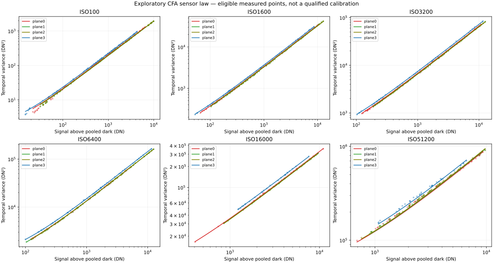
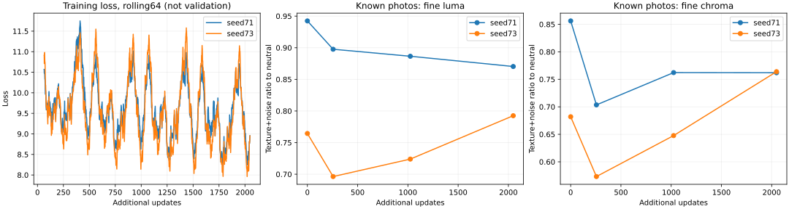

# Restauration neuronale — qualification du corpus

**Point de décision au 5 novembre 2026, après revue de Claude.** Le but
est un bénéfice visible sur de vraies photos face au débruitage classique
IPR, avec une perte de détails acceptable, pas la seule réussite du banc.
Ce bénéfice n'est pas démontré pour le correcteur CFA actuel.

| Question | État et décision actuelle |
| --- | --- |
| Ce qui fonctionne | Contrats signés, reprise, suivi par phase et deux essais mémoire de 256 pas, huit sauvegardes et trois contrôles complets par graine, sans dépassement. Pas une preuve de qualité photo. |
| Ce qui bloque | Couverture trop faible des détails forts à haute fréquence, bruit conditionnel différent des contrôles, contenus et initialisation confondus entre graines. La perte moyenne récompense des lissages destructeurs sur ce flux. |
| Derniers résultats | Réplication close : 10 et 12 échecs forts sur 48, après les 12 et 16 précédents. Sur les photos, sensibilité aux graines et motifs directionnels : bénéfice non validé. |
| Calcul engagé | Ordonnanceur de charge lancé : prévol et parité numérique réussis, attente de 14 h Paris pour reprise 224 puis comparaison. Poursuite conditionnelle bornée ; arrêt apprentissage le 7 novembre à 08 h 45 et superviseur 09 h 45. |
| Prochaine preuve utile | Lire tous les bras et jalons de la comparaison à données communes, vérifier initialisations et contrôles identiques avant d’interpréter les effets. Pas de sélection de graine ou de poids. |
| GPU | Débit médian 2,33–2,36 s/pas pendant la qualification ; environ 17 min par graine avec contrôles. Marge locale d’environ 15 Mio seulement au pic ; aucune garantie de plusieurs heures ou d’environnement concurrent. |
| Données | 349 RAW inventoriés, 105 paires étudiées. Température, bruit fixe et propagation restent à qualifier ; pas de nouvelles prises demandées pour cette expérience. |
| Critère d'arrêt | Pas de nouvelle série de variantes synthétiques pour améliorer les mêmes seuils. Après une courbe longue figée et un bruit caractérisé, absence de gain visible face au classique : abandon ou changement de taille/architecture, décision documentée. |

Les détails et limites de cette réorientation sont consignés en fin de
rapport. Aucun modèle n'est validé en production ; les réserves restent
fermées. Cette page de décision évolue dans le rapport unique, sans rapport
de synthèse parallèle.

## 1er novembre 2026 — scène pilote 6V1A0133

**Conclusion : composition retenue pour poursuivre les acquisitions ; pas
encore une référence propre ni une scène d'entraînement qualifiée.**

Source : `D:/DCIM/101EOSR6/6V1A0133.CR3`, R6 Mark III, ISO 100,
1/15 s, f/5,6, 32 mm. Source laissée intacte. Lecture des métadonnées
CMT1/CMT2, mosaïque décompressée par rawpy/LibRaw 0.22.1 et inspection du
JPEG intégré, dont huit recadrages à taille native. Aucun entraînement,
développement photographique IPR ou changement en production.

### Intérêt des matières

| Élément fourni par l'utilisateur | Utilisation envisagée | Limite |
| --- | --- | --- |
| Feuille blanche | Surface peu texturée claire, gradients et bruit chromatique | Pas une mire de gris/couleur étalonnée ; éclairage non uniforme possible |
| Porte de réfrigérateur blanche et lisse, à droite (précision utilisateur) | Zone claire peu texturée supplémentaire pour observer le bruit et les dominantes | Sélectionner une zone intérieure sans bord ni reflet marqué ; un gradient d'éclairage n'est pas du bruit |
| Tôle d'aluminium | Surface relativement lisse, reflets et détails faibles | Reflets, rayures et salissures visibles : pas un aplat uniforme de calibration |
| Tapis de yoga | Stries régulières, teinte sombre, préservation des motifs | Son relief est du signal, pas du bruit |
| Peluche | Fibres fines blanches et noires, transitions contrastées | Les fibres noires peu visibles exigent une référence indépendante |
| Sac rouge | Texture textile, coutures, plis et couleur soutenue | Ne pas confondre trame et bruit chromatique |
| Pull orange | Maille, coutures et gradients sur les plis | Test de conservation de texture, pas vérité colorimétrique |
| Carton | Fibres et reliefs faibles beiges | Surface non uniforme, zone périphérique moins précise |
| Lino | Motifs imprimés et bords à faible contraste | L'utilisateur confirme que les veines sont imprimées ; ne pas les effacer comme du bruit |

### Netteté et exposition : conclusion prudente

La vue d'ensemble permet de distinguer les objets et leurs structures. Dans
les recadrages JPEG à taille native, les stries du tapis et les coutures sont
visibles ; des détails textiles, du carton et du sol sont plus doux. Cela ne
prouve ni un flou de bougé ni une netteté RAW optimale : le JPEG a subi les
traitements du boîtier. Ne pas qualifier cette prise seule comme référence
parfaitement nette. Une prise sur trépied avec mise au point vérifiée reste
nécessaire, en particulier à 1/15 s et sur cette scène en profondeur.

Sur les quatre plans CFA, 0,00036 % à 0,00453 % des échantillons atteignent
le blanc déclaré par LibRaw (16383). Aucun écrêtage massif à ce seuil n'est
mis en évidence. Ce seuil ne remplace pas le blanc effectif caractérisé du
boîtier, et les rares valeurs maximales ne sont pas identifiées ici comme
reflets, pixels isolés ou autre cause. Les noirs déclarés par cette version
de LibRaw (0/44/130/94) ne sont **pas validés** : aucune estimation du bruit
ni marge d'exposition en EV n'est déduite de ces noirs.

### Prochaine acquisition proposée

Conserver cette composition. Immobiliser le boîtier et tous les objets,
vérifier la mise au point, garder éclairage, cadrage et ouverture constants.
Une ouverture f/8 peut être essayée si les différents plans ne sont pas
assez nets ; refaire alors aussi la référence dans les mêmes conditions.

Prévoir une rafale de référence à bas ISO, puis des rafales à ISO plus élevés
en adaptant le temps de pose pour une luminosité comparable, sans saturer les
surfaces claires. Le nombre et les ISO de la campagne seront figés avant
entraînement. Une moyenne alignée de rafale peut réduire le bruit aléatoire,
pas garantir une vérité sans bruit fixe. Avec ce seul fichier, impossible
de mesurer le bruit indépendant, la stabilité temporelle ou le gain U-Net.

Conserver cette scène entière dans une seule partition du corpus. Les
recadrages et ISO de la même composition ne doivent pas être répartis entre
entraînement et test : cela créerait une fuite de contenu.

Les métriques et les coordonnées des recadrages sont conservées dans le
JSON canonique `neural-pilot-0133-v001-*` sous `../raw/`. Les planches JPEG
de diagnostic restent dans le build dédié, sans nouvelle copie du RAW.

## 1er novembre 2026 — réception des séries intérieure et végétale

**Premier audit terminé : compositions pertinentes et séries candidates,
pas encore des paires RAW d'entraînement qualifiées.** Les 170 CR3
`6V1A0131` à `6V1A0300` sont présents sur `D:/DCIM/101EOSR6`, dont les trois
prises pilotes déjà connues. Chaque fichier a été lu pour les métadonnées et
son aperçu JPEG ; aucun original n'a été déplacé ou modifié.

Mémoire canonique :
[neural-capture-series-v001-20261101T152651Z.json](../raw/neural-capture-series-v001-20261101T152651Z.json).
Les groupes suivent les changements consécutifs de métadonnées : une même
combinaison ISO/temps/focale ne prouve pas l'identité d'une scène.

| Composition observée | Fichiers | ISO | Temps | Nombre |
| --- | --- | ---: | ---: | ---: |
| Intérieur, pilotes à 32 mm | 0131–0133 | 100 | 1/15 s | 3 |
| Intérieur, série à 29 mm | 0134–0151 | 100 | 1/15 s | 18 |
| Intérieur | 0152–0180 | 3200 | 1/200 s | 29 |
| Intérieur | 0181–0194 | 12800 | 1/1250 s | 14 |
| Intérieur | 0195–0209 | 51200 | 1/3200 s | 15 |
| Intérieur, prise isolée | 0210 | 12800 | 1/1250 s | 1 |
| Herbe et feuilles, série à 24 mm | 0211–0243 | 100 | 1/25 s | 33 |
| Herbe et feuilles | 0244–0262 | 1600 | 1/500 s | 19 |
| Herbe et feuilles | 0263–0280 | 6400 | 1/1000 s | 18 |
| Herbe et feuilles | 0281–0300 | 12800 | 1/2500 s | 20 |

Ouverture constante déclarée : f/5,6. La végétation apporte les nervures,
brins fins et détails à faible contraste recherchés ; ne pas assimiler ses
motifs irréguliers à du bruit. Les pilotes à 32 mm ne remplacent pas la
référence intérieure à 29 mm.

### Contrôle préliminaire de stabilité

Recalage euclidien ECC de chaque aperçu contre le premier de son groupe,
largeur maximale 800 px, OpenCV limité à deux threads. Tous les recalages ont
convergé. Dans la série intérieure ISO 100 à 29 mm, le déplacement maximal
est 0,018 px d'aperçu. Dans les quatre séries végétales, il est inférieur à
0,094 px. Ces résultats sont favorables au cadrage global, **sans prouver
l'immobilité locale des feuilles ni la précision à l'échelle du RAW**.

La série intérieure ISO 51200 est moins stable : déplacement maximal
0,539 px d'aperçu et moyenne du gris JPEG comprise entre 0,593 et 0,627
(échelle codée 0..1). L'origine reste à établir : éclairage, traitement du
JPEG ou autre variation. Ce n'est pas une preuve d'instabilité RAW, ni une
raison suffisante pour jeter la série.

Les expositions diffèrent entre séries : le produit ISO × temps n'est pas
constant, et les aperçus changent effectivement de luminosité. Ne pas
soustraire directement une image ISO élevé de la référence ISO 100. Il faut
contrôler la radiométrie linéaire, le recalage inter-séries et les zones
saturées, sans convertir un écart d'exposition en faux bruit.

### Décision et suite

Conserver toutes ces acquisitions ; aucune nouvelle photo demandée à ce
stade. Priorité aux 18 références intérieures et aux 33 références végétales
à ISO 100. La prise 0210 seule ne constitue pas une rafale supplémentaire.
Avant toute moyenne ou entraînement : qualifier mouvement local, netteté,
exposition et saturation dans le RAW, préparer masques valides et références
indépendantes. Garder toutes les variantes ISO d'une même composition dans
une seule partition ; deux compositions ne suffisent pas à démontrer une
généralisation U-Net. Aucun entraînement ou rendu de débruitage n'est lancé
par ce premier audit.

## 1er novembre 2026 — contrôle temporel des mosaïques RAW

**166/166 CR3 lus avec succès ; pas encore de cible d'apprentissage
qualifiée.** Les huit rafales de deux compositions ont été contrôlées en
221,8 secondes. Les trois pilotes à 32 mm et la prise isolée 0210 ne font
pas partie de cette campagne. Aucun fichier source supprimé, déplacé ou
modifié, aucun TIFF produit, aucun entraînement ni changement en production.

Mémoire canonique :
[neural-raw-series-v001-20261101T195454Z.json](../raw/neural-raw-series-v001-20261101T195454Z.json).
Le SHA-256 intégral de chaque source, sa taille, son horodatage, les
métadonnées, la géométrie et les quatre positions CFA sont conservés.
Outil de mesure : `tests/neural/qualify_raw_series.py`, révision `ffdc347` ;
son empreinte exacte figure dans le JSON. La tête Git enregistrée au début
du calcul précède ce commit. Les identifiants canoniques ont été ajoutés
à la publication du JSON, sans changer les mesures ni leur provenance.

### Méthode figée avant lecture des résultats

Décompression rawpy/LibRaw seulement : mosaïque visible entière ouverte,
puis neuf fenêtres fixes centrées à 20/50/80 % de chaque axe. Chaque
fenêtre contient 128 × 128 échantillons **par position du motif Bayer**,
soit environ 256 × 256 pixels capteur. Les coordonnées exactes figurent
dans le JSON. Aucun recalage, interpolation, correction de gain, masque
adaptatif ou rejet de prise. Aucun noir LibRaw soustrait et aucune valeur
déclarée comme calibration physique du R6 Mark III.

Pour chaque fenêtre et position CFA, conservation des moyennes de chaque
prise, de leur étendue, de la dispersion temporelle par pixel, des
différences entre prises consécutives divisées par √2 et de l'écart entre
les moyennes des deux demi-rafales entrelacées. Unités : codes capteur
(DN), sans balance des blancs, profil, gamma ni dématriçage. La dispersion
temporelle **mêle bruit, mouvement et éclairage** : ce n'est pas une
estimation isolée du bruit du capteur. La moyenne d'une rafale ne retire
pas le bruit fixe commun aux prises.

### Résultats de diagnostic

Les deux dernières colonnes sont les médianes des 36 couples fenêtre/CFA,
pas des pourcentages de bruit ni des valeurs RGB développées. L'étendue
porte sur la moyenne spatiale de chaque fenêtre au cours de la rafale ;
la dispersion est la racine de la moyenne spatiale des variances
temporelles non biaisées.

| Composition | ISO | Prises | Étendue des moyennes (DN) | Dispersion temporelle (DN) |
| --- | ---: | ---: | ---: | ---: |
| Intérieur | 100 | 18 | 1,641 | 11,032 |
| Intérieur | 3200 | 29 | 12,685 | 83,279 |
| Intérieur | 12800 | 14 | 15,858 | 158,027 |
| Intérieur | 51200 | 15 | 240,480 | 457,564 |
| Végétation | 100 | 33 | 76,533 | 56,008 |
| Végétation | 1600 | 19 | 8,256 | 53,867 |
| Végétation | 6400 | 18 | 24,313 | 155,779 |
| Végétation | 12800 | 20 | 28,710 | 195,130 |

La variation de la série intérieure ISO 51200 existe aussi dans les codes
RAW : elle ne vient donc pas uniquement du traitement du JPEG. Son origine
(éclairage, mouvement ou autre variation) reste ouverte. La végétation
ISO 100 varie davantage que ne le suggérait le seul recalage global JPEG ;
ce résultat interdit de déclarer sa moyenne comme référence propre sans
vérification locale. Les DN ne sont pas directement comparables entre
ISO et expositions comme un classement de bruit normalisé.

Certaines fenêtres atteignent le blanc **déclaré, non qualifié** par LibRaw
(16383). Le maximum observé sur une fenêtre/un plan/une prise est de 1,208 %
pour l'intérieur ISO 51200, et de 0,018 %, 3,290 %, 0,879 % pour la
végétation ISO 100, 6400 et 12800 respectivement. Ce ne sont pas des taux
sur l'image entière. Les autres groupes n'atteignent pas ce seuil dans la
grille observée ; cela ne prouve pas l'absence d'écrêtage ailleurs ou au
blanc effectif du boîtier. Aucune de ces fenêtres n'est retenue d'office
comme cible d'apprentissage valide.

### Décision et étape suivante

L'intérieur ISO 100 reste le premier candidat pour construire une référence
pilote ; sa stabilité temporelle ne prouve pas encore la netteté ni la
justesse radiométrique inter-ISO. Conserver toutes les rafales, sans nouvelle
acquisition demandée à ce stade. Avant entraînement : vérifier le mouvement
local et le recalage entre ISO, mesurer les écarts de gain/offset sur des
zones distinctes, puis extraire les données **caméra signées du pipeline IPR**
avec sa calibration effective. La décompression CFA de cette étude ne
remplace pas ce contrat d'entrée du réseau.

Construire ensuite les références et masques valides sans sélectionner les
zones sur le gain du futur réseau. Les deux demi-rafales entrelacées sont
un diagnostic de stabilité, pas un jeu de test indépendant. Conserver une
partition par composition/session et annoncer explicitement la limite de
deux compositions. Aucun gain photographique U-Net n'est démontré ici.

Vérification logicielle : 38 tests ciblés réussis (4 audit d'aperçus,
6 qualification CFA, 14 contrats de données, 14 réseau). Les six nouveaux
tests couvrent ordre CFA/géométrie impaire, unités temporelles, texture
statique non confondue avec bruit temporel, entrées invalides et confinement
des sorties au build dédié. Travail local sur `patch_neural_restoration`,
sans publication, fusion dans `dev`/`main` ni tag.

## 1er novembre 2026 — pilote photographique en caméra signée

### Conditions et protocole avant résultats

Précision de l'utilisateur : des branches oscillaient devant la fenêtre,
avec un soleil bas. C'est une cause plausible de variation spatiale et
temporelle de l'éclairage intérieur, **pas une cause démontrée**. Le
contrôle distingue donc une correction radiométrique globale des écarts
locaux ; il n'attribue pas automatiquement ces variations à du bruit.

Gel de campagne : `neural-photo-pilot-v001-20261101T202620Z`. Sélection
déterministe de 69 RAW parmi les 166 déjà contrôlés : les 18 références
intérieures et 33 végétales à ISO 100, puis les prises de début/milieu/fin
des six groupes d'ISO supérieurs. Pas de sélection selon le résultat du
réseau. Extraction avec la production de la révision `ff14324` ; le nouveau
banc est conservé dans `bd1fced`. Compilation et données restent dans le
build du worktree U-Net.

L'extracteur appelle `RawDecoder` en balance boîtier, développement signé,
calibration RAW active et optiques désactivées. Il prélève le véritable
buffer caméra retenu après RCD/médiane et avant LCP/DCP, et refuse une
calibration non appliquée. Le profil Camera Neutral sert au choix de la
calibration ; aucune table ou courbe DCP n'est appliquée aux pixels
d'apprentissage. Neuf fenêtres fixes de 384 × 384 pixels et un petit proxy
vert de recalage sont extraits, sans TIFF ni modification des originaux.

La suite est enchaînée automatiquement, sous conditions :

1. Recalage global par translation dans les proxies verts. Corrélation ECC
   minimale 0,97 et translation maximale de 12 pixels pleine définition.
   Ce modèle ne prouve pas l'absence de rotation ou de mouvement local.
2. Moyennes de rafale ISO 100, avec au moins huit prises recalées. Les
   fluctuations lentes, normalisées par les gains de balance des blancs,
   doivent rester sous 0,001 de l'unité caméra dans les pixels de référence.
   Masques de stabilité, saturation et bords ; pas de clamp des négatifs.
3. Une loi affine par canal pour rapprocher chaque série de la référence :
   cinq fenêtres servent au calcul et quatre autres au contrôle. Au moins
   deux fenêtres de contrôle doivent être cohérentes avant admission d'une
   prise. Les écarts lents résiduels servent à rejeter des fenêtres entières,
   pas à effacer le résidu de bruit fin pixel par pixel.
4. Seule la référence est interpolée dans les coordonnées de la prise
   bruitée ; **les entrées bruitées du réseau ne sont pas interpolées**.
   Découpes de 96 × 96 à positions fixes, au moins 90 % de pixels valides.
5. Intérieur exclusivement en apprentissage, végétation exclusivement en
   validation ; aucun jeu de test indépendant inventé. Seuils minimaux :
   32 découpes d'apprentissage et 16 de validation. Si ces conditions ne
   sont pas satisfaites, arrêt avant entraînement avec motifs conservés.
6. U-Net résiduel de largeur 8, 256 étapes Adam, lots de 4, taux 0,001,
   graine 71, échelle linéaire commune 2. Conditionnement par MAD Haar de
   chaque entrée seule : proxy influencé par les textures et le dématriçage,
   pas connaissance idéale du bruit. Aucun choix de checkpoint ni réglage
   des paramètres selon la validation. CPU : au plus quatre threads, en
   laissant deux processeurs logiques libres lorsque possible.

Ces seuils sont des **garde-fous exploratoires**, pas des garanties de
qualité universelles. Les moyennes conservent du bruit fixe et un bruit
résiduel corrélé par interpolation. La mesure d'erreur se fera contre ces
références imparfaites, pas contre une vérité sans bruit. Un pilote sur deux
compositions ne qualifie pas encore un modèle de production.

Contrôles avant apprentissage réel : compilation native et extraction de
0134 réussies ; calibration appliquée. Les 11 nouveaux tests numériques
et le test synthétique de bout en bout de l'entraîneur passent, en plus
des 38 contrats ciblés précédents. Le test synthétique ne constitue pas un
résultat photographique. Aucun changement de calcul en production.

### Résultat du premier passage et correction du banc

**69/69 extractions réussies en 583,2 s**, calibration appliquée, identité
des sources vérifiée. Les buffers caméra et leurs descripteurs restent dans
`build-patch_neural_restoration/photo-pilot-v001`. Aucun original modifié.
Premier résultat : 45 découpes intérieures et aucune végétale admises ;
arrêt automatique avant entraînement.

Ce premier verdict doit être lu comme **historique et partiellement
invalidé** : le masque de saturation du banc divisait les canaux par les
gains de balance des blancs. Or `RawDevelopment::develop()` borne déjà la
mosaïque balancée à **1 par canal**, dans les deux politiques, avant RCD.
Un rouge à 1 ne redevient donc pas un échantillon non saturé parce que son
gain vaut environ 1,9. Le masque pouvait laisser passer des zones écrêtées.
Cette erreur appartient au banc, pas aux acquisitions ni à LibRaw.

Correction `c5be51c` : seuil appliqué directement dans les axes caméra
balancés ; pixels proches du blanc exclus du recalage vert, avec marge
spatiale. Deux tests supplémentaires couvrent le blanc après gains et
l'absence de solution inventée lorsque le support de recalage est saturé.
**Aucun seuil de corrélation, stabilité ou admission n'a été abaissé.**
Rejeu sur les mêmes captures immuables, sans nouvelle décompression et
sans modification du moteur.

Mémoires canoniques :

- [v001 — premier passage invalidé, sans entraînement](../raw/neural-photo-pilot-v001-20261101T202620Z.json).
- [v002 — qualification corrigée](../raw/neural-photo-pilot-v002-20261101T204009Z.json).

Elles conservent les gels de protocole, les 69 descripteurs d'extraction,
empreintes de sources/pixels/profil/calibration, diagnostics de référence,
recalages, lois radiométriques par canal, fenêtres admises ou rejetées et
identités des découpes. Le résultat absent d'entraînement est `null`, avec
son motif : aucune métrique ou amélioration du réseau n'est inventée.

### État après correction : référence intérieure exploitable, contrôle manquant

| Ensemble | Résultat du rejeu corrigé | Interprétation |
| --- | --- | --- |
| Référence intérieure ISO 100 | Fraction stable admissible : environ 91 % à 100 % selon fenêtre | Bon candidat pour le pilote dans les fenêtres contrôlées ; pas une vérité parfaitement propre |
| Intérieur ISO 3200 : 0152, 0166, 0180 | Corrélation inter-ISO 0,939 à 0,943, sous 0,97 | Non admis par ce modèle global ; pas une preuve que chaque zone de ces photos est inutilisable |
| Intérieur ISO 12800 : 0181, 0187, 0194 | Trois prises avec 3 ou 4 fenêtres de contrôle cohérentes | Découpes admises pour apprentissage exploratoire |
| Intérieur ISO 51200 : 0195, 0202, 0209 | Trois prises avec 2 ou 3 fenêtres de contrôle cohérentes | Certaines zones sont récupérables malgré la variation initiale ; pas rejet de la rafale entière |
| Référence végétale ISO 100 | Fraction admissible d'environ 4 % à 78 % selon fenêtre | Stabilité locale hétérogène ; pas une moyenne propre généralisable à toute l'image |
| Végétation ISO 1600 : 0244, 0253, 0262 | Corrélation inter-ISO 0,835 à 0,837 | Sous le seuil du protocole |
| Végétation ISO 6400 : 0263, 0271, 0280 | Corrélation inter-ISO 0,769 à 0,773 | Sous le seuil du protocole |
| Végétation ISO 12800 : 0281, 0290, 0300 | Corrélation inter-ISO 0,728 à 0,729 | Sous le seuil du protocole |

Total corrigé : **351 découpes intérieures admissibles, 0 végétale**, contre
les minimums figés de 32 en apprentissage et 16 en validation. Les 351
découpes proviennent uniquement des six prises à ISO 12800/51200. Les
écarts radiométriques ont été contrôlés sur des fenêtres distinctes du
calcul de gain/offset. Cela montre qu'une différence de luminosité entre
ISO n'impose pas de jeter une série : certaines zones sont rapprochables.

Pour la végétation, un contrôle complémentaire des JPEG intégrés donne
aussi une corrélation inter-ISO dégradée sur les prises de début de groupe
(environ 0,924, 0,865, 0,846). Ce diagnostic n'est pas une métrique RAW de
vérité ni une preuve de la cause. Il renforce seulement la prudence : le
défaut de correspondance n'apparaît pas exclusivement dans les buffers
caméra extraits. Mouvement, lumière, géométrie non modélisée et différences
de mise au point restent à distinguer ; **ne pas conclure que tout vient
des branches ou que les photos sont mauvaises**.

La mémoire de ce contrôle JPEG est
[neural-preview-cross-check-v001-20261101T204657Z.json](../raw/neural-preview-cross-check-v001-20261101T204657Z.json) :
sélection fixe, empreintes des huit sources, versions et calculs conservés.
Ses scores ne servent pas à admettre des paires RAW.

**L'apprentissage photographique n'a pas été lancé.** Le contrôle d'arrêt
a fonctionné : entraîner sur les seules découpes intérieures puis les
réutiliser en validation créerait une fuite de contenu. Les tests
synthétiques restent des tests logiciels, pas une substitution à la
validation photographique. Aucun poids photographique n'a été produit.

### Suite recommandée et limites de cette étape

Conserver les acquisitions actuelles et les références ; aucune suppression
ni réexport TIFF demandé. Pour débloquer le pilote inter-ISO, la voie la
plus sûre est une **deuxième composition statique** : objets et tissus
immobiles, lumière stable sans ombres mobiles, trépied et mise au point
verrouillée entre séries. Prévoir 16 prises ISO 100, puis au moins 8 à
chaque ISO choisi (par exemple 1600, 6400, 12800), ouverture et cadrage
constants. Adapter le temps pour une exposition comparable, sans chercher
une correspondance exacte ; préserver les hautes lumières. Une scène
intérieure peut rester à l'apprentissage et cette nouvelle composition
entière au contrôle ; une troisième scène réellement réservée sera ensuite
nécessaire avant toute conclusion de généralisation.

Une autre voie serait d'étudier des cibles moyennées **au même ISO**,
constituées de prises indépendantes de l'entrée. Le principe de
[Noise2Noise, ICML 2018](https://proceedings.mlr.press/v80/lehtinen18a.html)
montre l'intérêt de cibles bruitées sous des hypothèses statistiques
appropriées. Ce n'est pas une validation acquise pour notre signal après
RCD/médiane : bruit fixe commun, biais, écrêtage et mouvement peuvent
enfreindre ces hypothèses. Cette variante n'a **pas** été implémentée pour
contourner l'échec du protocole figé ; elle demanderait une étude distincte.

État logiciel : 52 tests ciblés réussis après correction (38 précédents,
13 contrôles de paires et 1 test synthétique d'apprentissage de bout en
bout). Aucune intégration ou publication Git ; production inchangée.

## 1er novembre 2026 — acquisition de la nouvelle composition de contrôle

À la demande de l'utilisateur, récupération de **66 CR3**, de `6V1A0301`
à `6V1A0366`, depuis `D:/DCIM/101EOSR6`, dans le corpus partagé
`tests/image/colorimétrie/neural-validation`. Volume : **2 742 941 352 octets**.
Copie exclusive sans écrasement ; les 66 empreintes SHA-256 des copies sont
identiques à celles des sources. Aucun original supprimé ou modifié.

| Groupe chronologique | Fichiers | ISO | Temps | Nombre |
| --- | --- | ---: | ---: | ---: |
| 1 | 0301–0309 | 100 | 0,8 s | 9 |
| 2 | 0310–0319 | 1600 | 1/10 s | 10 |
| 3 | 0320–0327 | 100 | 0,8 s | 8 |
| 4 | 0328–0339 | 3200 | 1/40 s | 12 |
| 5 | 0340–0351 | 6400 | 1/80 s | 12 |
| 6 | 0352–0366 | 12800 | 1/160 s | 15 |

Boîtier déclaré : Canon EOS R6 Mark III ; ouverture f/5,6 et focale 24 mm
constantes. Inspection des JPEG intégrés : nouvel agencement des mêmes
types de matières, éclairage plus chaud ; cette composition entière est
réservée à la **validation**, tous ISO confondus, sans ajout à l'apprentissage.
Cela reste une scène de contrôle apparentée, pas un test produit indépendant
sur de nouvelles familles de matières ou un autre boîtier.

Le dépistage sur aperçus de 800 px au maximum ne rencontre aucun échec
de recalage intra-groupe. Corrélation ECC minimale selon groupe : environ
0,999919 à 0,999990 ; translation maximale d'environ 0,058 pixel d'aperçu.
Ces résultats sont encourageants, mais **ne qualifient ni la stabilité
locale RAW, ni l'absence d'écrêtage, ni les cibles propres du réseau**.

Les deux séries ISO 100 sont conservées séparément : leur niveau gris moyen
encodé diffère d'environ 1,5 %, sans cause établie. Ne pas les réunir comme
référence de 17 prises avant contrôle RAW. ISO 1600 est également plus
exposé : le produit ISO × temps vaut 160 contre 80 pour les autres groupes.
Une adaptation radiométrique reste possible dans le protocole, sans
prétendre que la lumière réelle ou le traitement JPEG sont identiques.

Mémoires canoniques :

- [Inventaire et stabilité des aperçus](../raw/neural-capture-series-v001-20261101T212959Z.json).
- [Acquisition et 66 couples d'empreintes](../raw/neural-corpus-import-v001-20261101T213020Z.json).

Quatre tests ciblés vérifient la copie, le refus d'écrasement, le refus d'un
inventaire périmé et la détection d'une empreinte divergente. Les copies
partielles restent visibles en cas d'erreur ; aucun nettoyage automatique.
Prochaine action : qualification des références et des paires dans le signal
caméra signé IPR, avec les mêmes critères qu'au passage corrigé précédent.
**Aucun nouvel entraînement photographique ni changement moteur à ce stade.**

## 1er novembre 2026 — qualification RAW de la nouvelle composition : lancement

Campagne gelée `neural-control-pairs-v001-20261101T213657Z`, banc local
`41cd686`, dans `build-patch_neural_restoration/control-pairs-0301-0366-v001`.
Ce paragraphe constate le lancement, **pas le résultat** de la qualification.

Sélection avant mesure : les 17 références ISO 100, et le début, milieu
entier inférieur et dernier fichier de chacune des quatre séries à ISO
plus élevé, soit **29 extractions**. Référence principale : 0301–0309,
première série chronologique ; 0320–0327 reste un diagnostic distinct.
Ne pas réunir les références ni remplacer la principale après observation
des nombres de fenêtres admises. La comparaison porte sur les mêmes
12 fichiers bruités dans les deux passages.

Signal extrait par le banc natif reconstruit : RGB caméra signé balancé,
après RCD/médiane, avant LCP/DCP, sans réduction du bruit ni corrections
optiques. Profil Camera Neutral et calibration identifiés par empreinte ;
la première extraction 0301 confirme la calibration réellement appliquée.
Les seuils et fenêtres du passage corrigé v002 sont repris sans modification.

L'identité de composition et la partition sont désormais lues dans le gel,
au lieu d'une liste codée limitée à `indoor`/`vegetation`. Refus des sources
dupliquées, d'une partition inconnue et d'une référence incomplète. Huit
tests nouveaux et les treize tests numériques de paires réussissent ;
construction de l'extracteur réussie. Aucun calcul photographique modifié.

Cette campagne ne contient **que de la validation**, donc aucun exemple
d'apprentissage. Le statut interne du qualificateur partagé exigeant à la
fois apprentissage et validation reste insuffisant pour entraîner ; le
bilan externe distinguera explicitement l'admission de paires de contrôle.
Même si elle réussit, cette étape ne lance pas automatiquement de réseau.
Le résultat final et les diagnostics seront conservés dans un nouveau JSON
canonique au nom de la campagne ; aucune ancienne preuve n'est remplacée.

### Résultat : rafales stables, contrôle principal bloqué par le déplacement

La campagne est terminée : **29/29 extractions**, environ 199 s pour
l'extraction et les deux qualifications. Aucune erreur du moteur ou de
calibration. Les neuf fenêtres de chaque référence ISO 100 ont une fraction
stable et valide de 100 % dans le support intérieur mesuré ; cela ne fait
pas de leur moyenne une vérité parfaitement propre.

Le contrôle principal produit **0 découpe** : toutes les prises bruitées
dépassent la limite de déplacement de 12 pixels caméra. Leurs corrélations
ECC sont pourtant d'environ 0,993 à 0,997, au-dessus du seuil 0,97.
Les translations estimées sont d'environ 93 pixels horizontalement à ISO
1600, puis 129–130 aux autres ISO, avec environ −13 à −16 verticalement.
Le motif de rejet est ici la portée géométrique du banc, **pas une
corrélation insuffisante ni une instabilité démontrée des rafales**.

La seconde référence admet **243 découpes à ISO 1600**, sur trois prises
déplacées d'environ 4 pixels horizontalement. Les autres ISO restent
rejetés par des déplacements d'environ 40 pixels, malgré une corrélation
supérieure à 0,997. Ces découpes diagnostiques ne remplacent pas le contrôle
principal après observation des résultats. Aucun entraînement n'est lancé.

Preuve : [qualification des deux références](../raw/neural-control-pairs-v001-20261101T213657Z.json).
Le protocole initial et son résultat restent conservés sans modification.

### Audit suivant : translation, rotation rigide et transformation affine

Même signal immuable : 2 références × 12 prises × 3 modèles = **72 cas**,
environ 14,7 s. Fenêtres d'ajustement radiométrique et de contrôle distinctes,
seuils radiométriques et locaux inchangés. Seule la référence est interpolée,
jamais l'entrée bruitée ; supports transformés et érodés pour exclure les
voisins invalides d'interpolation. Les deux séries ISO100 restent séparées.

L'audit **mesure au-delà de 12 pixels sans promouvoir de paires**. Il
diagnostique l'explication du rejet, sans modifier silencieusement le gel.

| Référence et modèle diagnostique | ISO 1600 | ISO 3200 | ISO 6400 | ISO 12800 |
| --- | ---: | ---: | ---: | ---: |
| Principale, translation | 2/4 | 2/4 | 2/4 | 1/4 |
| Principale, rigide | 1/4 | 1/4 | 1/4 | 0/4 |
| Principale, affine | 1/4 | 1/4 | 1/4 | 0/4 |
| Secondaire, translation | 4/4 | 4/4 | 4/4 | 3/4 |
| Secondaire, rigide | 4/4 | 4/4 | 4/4 | 3/4, 3/4, 4/4 |
| Secondaire, affine | 4/4 | 4/4 | 4/4 | 3/4 |

Chaque cellule indique le nombre de fenêtres de contrôle cohérentes pour
chacune des trois prises, sauf la cellule détaillée. Les 72 lois
radiométriques restent dans les bornes initiales. Un score global meilleur
ne suffit donc pas : rotation et affine ne rendent pas le contrôle
principal localement meilleur.

Preuve : [audit géométrique v001](../raw/neural-geometry-audit-v001-20261101T214408Z.json).
Six tests synthétiques réussissent : coordonnées globales/locales, support
interpolé, déplacement supérieur à la limite initiale, retour à l'origine
du proxy recadré et refus des entrées invalides.

**Conclusion actuelle : aucune nouvelle photo demandée à ce stade.**
Avant le pilote neuronal, préparer une version explicite du protocole
géométrique : support commun valide plutôt que portée fixe de 12 pixels,
garde de recouvrement, contrôles locaux et première référence conservée.
Ne pas simplement augmenter le seuil ou choisir la seconde référence parce
qu'elle passe mieux. ISO 12800 reste insuffisant sur le contrôle principal
dans ce diagnostic. Aucun gain photographique du réseau revendiqué,
aucune modification moteur, aucun calcul actif à la clôture de cet audit.

## 1er novembre 2026 — protocole de recouvrement et contrôle principal débloqué

Révision explicite du protocole géométrique, pas rectification rétroactive
de l'ancien rejet : la portée fixe de 12 pixels disparaît du qualificateur
courant. L'estimation reste une translation, sans rotation ni affine.
Deux nouvelles gardes sont figées avant le rejeu : au moins **50 % de
recouvrement géométrique pleine image** et une erreur de réciprocité
aller-retour d'au plus **1 pixel caméra**, avec ECC ≥ 0,97 dans les deux sens.
Ces gardes sont provisoires, pas des constantes universelles de qualité.

Le recouvrement global ne suffit pas à admettre une paire. Les exigences
existantes restent présentes : stabilité des références, saturation caméra,
bornes de la loi radiométrique, au moins 50 % de support local, deux fenêtres
de contrôle cohérentes distinctes des cinq fenêtres d'ajustement, puis 90 %
de pixels valides par découpe. Les masques interpolés exigent maintenant
que **tous** les voisins bilinéaires contributeurs soient valides ; un
masque au plus proche ne suffit plus. Aucune entrée bruitée n'est interpolée.

Le rejeu utilise les captures immuables existantes, sans nouvelle lecture
des RAW, et **uniquement la première référence ISO100 (0301–0309)**.
La seconde reste hors de cette qualification. Gel et outils : `67f9bdf`.
Résultat en environ **3,65 s** :

| ISO de contrôle | Prises admises / évaluées | Découpes admissibles |
| --- | ---: | ---: |
| 1600 | 3/3 | 54 |
| 3200 | 3/3 | 60 |
| 6400 | 3/3 | 72 |
| 12800 | 0/3 | 0 |
| Total | 9/12 | 186 |

Recouvrement pleine image mesuré : environ 97,81 % à 98,40 % ; erreur
aller-retour maximale **0,118 pixel**. Les deux nouvelles gardes passent
pour les douze prises ; ISO 12800 reste refusé par la cohérence locale
(1 fenêtre de contrôle au lieu de 2), et non par le déplacement.
Les neuf fenêtres de la référence conservent 100 % de support intérieur
stable et valide selon le diagnostic du banc.

Mémoire canonique complète :
[contrôle par recouvrement v001](../raw/neural-control-overlap-v001-20261101T215121Z.json).
Elle conserve les conditions initiales, la raison de révision, les
empreintes des captures, les décalages dans les deux sens, les masques
résumés, les décisions par fenêtre et les 186 identités de découpes.
Les campagnes antérieures restent inchangées. Les 186 découpes sont
corrélées, issues de neuf prises d'une seule composition, pas de 186 scènes.

Tests : huit contrats de recouvrement/réciprocité/masques, treize tests
numériques de paires, huit de gel des références et six de géométrie.
Le refus explicite d'un résultat non fini du solveur évite toute preuve
JSON contenant NaN. Ces tests vérifient le banc, pas la qualité du réseau.

**Conclusion actuelle : le pilote dispose d'un contrôle exploratoire
admissible à ISO1600–6400. Aucun entraînement lancé dans cette étape.**
Suite : reconstruire le jeu d'apprentissage existant avec le même
qualificateur courant, vérifier séparation par composition et couverture
ISO, puis lancer le pilote à architecture et durée figées. Les anciennes
découpes d'apprentissage étaient à ISO 12800/51200 : ne pas présenter le
contrôle à ISO1600–6400 comme une validation aux mêmes ISO ou comme une
qualification produit. Garder ISO 12800 exclu du contrôle jusqu'à preuve
complémentaire, sans choisir la seconde référence pour obtenir un succès.
Pas de nouvelle photo demandée à ce stade ; aucun changement moteur,
publication Git ou calcul actif à la clôture de cette étape.

## 1er novembre 2026 — premier pilote photographique figé : résultat négatif

Campagne `neural-reserved-photo-pilot-v001-20261101T220513Z`, orchestration
locale `50afa23`. Requalification des deux compositions avec exactement le
même protocole courant, sans nouvelle décompression : **342 découpes
d'apprentissage et 186 de contrôle**. Les 186 couples d'empreintes de pixels
entrée/cible et leurs identités sont **strictement identiques** au contrôle
qualifié précédent. Aucun exemple de la nouvelle composition n'entre dans
l'optimiseur ; aucune partition de test indépendante n'est inventée.

Le contrôle de provenance initial a arrêté le lancement avant calcul :
l'identifiant embarqué du premier moteur précédait le commit d'ajout du
banc d'extraction. Il ne désignait donc pas son fichier C++ d'extraction.
La vérification distingue désormais ces deux identités : sources de
production et calibration identiques entre les moteurs ; source historique
de l'extracteur vérifiée par l'empreinte canonique du commit `bd1fced`.
Sa seule différence avec l'actuelle est le nettoyage d'includes déjà relu
(`algorithm` retiré, `QCommandLineOption` explicité), sans changement de
corps de calcul. Toute autre différence est refusée. Sept tests de
provenance/partition et le test synthétique de bout en bout passent.
Ce correctif du banc ne modifie ni les captures ni les seuils photographiques.

Configuration reprise du gel initial, sans recherche : petit U-Net résiduel
à deux niveaux, largeur 8, six canaux d'entrée caméra/sigma, échelle commune
2, graine 71, Adam à 0,001, lot 4, **256 pas**, seul état final évalué.
Calcul CPU : 4 threads internes et 1 inter-opération, sur 20 processeurs
logiques disponibles. Environ **7,64 s** d'entraînement et évaluation,
**18,91 s** pour l'orchestration complète. Ces temps sur découpes ne
prédisent pas la latence d'un traitement pleine image ou d'un modèle produit.

| Partition / ISO | Découpes | Rapport MSE sortie / entrée |
| --- | ---: | ---: |
| Apprentissage ISO 12800 | 198 | 1,01308 |
| Apprentissage ISO 51200 | 144 | 0,99586 |
| Apprentissage, total pondéré | 342 | 0,99893 |
| Contrôle ISO 1600 | 54 | 1,03120 |
| Contrôle ISO 3200 | 60 | 1,08318 |
| Contrôle ISO 6400 | 72 | 1,02938 |
| Contrôle, total pondéré | 186 | 1,04192 |

Rapports pondérés par le nombre de pixels-canaux valides, et non moyenne
des rapports par découpe. Valeur inférieure à 1 = erreur plus faible par
rapport à la référence moyennée ; supérieure à 1 = erreur accrue. Le modèle
ne gagne qu'environ **0,11 %** en MSE globale d'apprentissage et **dégrade
le contrôle d'environ 4,19 %**. La pire découpe de contrôle atteint un
rapport de 1,586. Aucune équivalence perceptuelle, Lightroom ou amélioration
de bruit visible ne se déduit de ces chiffres.

Mémoire canonique :
[premier pilote à contrôle réservé](../raw/neural-reserved-photo-pilot-v001-20261101T220513Z.json).
Elle conserve les 48 descripteurs de captures, gels parents, contrats,
configurations, décisions et 528 identités de découpes, la suite des pertes,
les métriques par découpe et les empreintes du jeu et des poids. Les buffers,
le jeu `dataset.npz` et les poids `pilot-weights.pt` restent dans le build
dédié ; aucun fichier de modèle n'est intégré en production ou publié.

**Conclusion actuelle : pas de gain de débruitage démontré par ce pilote.**
Ne pas régler largeur, durée, force ou sélection d'état final en fonction
de cette scène de contrôle pour transformer cet échec en succès apparent.
Le faible apprentissage global et l'écart de couverture ISO empêchent
d'attribuer le résultat uniquement à la généralisation. Il ne réfute pas
non plus l'intérêt d'un réseau neuronal avec des données et un entraînement
adéquats : il ne qualifie que cet essai très court sur deux compositions
apparentées, sans ISO commun entre apprentissage et contrôle.

Prochain diagnostic recommandé, **sur l'apprentissage seulement** : vérifier
la capacité à apprendre un problème contrôlé et distinguer sous-apprentissage,
bruit des cibles et biais des paires avant toute nouvelle campagne de
transfert. Conserver ce premier contrôle comme résultat historique ; si
ses résultats pilotent ensuite des choix de modèle, il ne pourra plus être
présenté comme un test final vierge. Pas de nouvelle photo demandée à ce
stade, pas de variante relancée automatiquement, aucune modification moteur,
aucune publication Git et aucun calcul encore actif.

## 1er novembre 2026 — diagnostic d'apprenabilité sur l'apprentissage : lancement

Campagne `neural-train-learnability-v001-20261101T221250Z`, outil local
`d9b44a7`. Aucun nouveau RAW, aucune modification moteur. Le jeu parent
est vérifié par empreintes ; seuls les **342 exemples d'apprentissage**
entrent dans les tenseurs, métriques et optimisations. L'archive partagée
contient aussi les exemples de contrôle, mais leurs lignes ne sont pas
sélectionnées. Un test place volontairement NaN dans les lignes réservées
et vérifie qu'elles n'entrent pas dans ce diagnostic.

Plan figé avant exécution, sans recherche d'hyperparamètres :

| Cas | Données et objectif | Pas fixés |
| --- | --- | ---: |
| Décalage connu | Quatre cibles d'apprentissage à indices régulièrement espacés ; ajout RGB constant (+0,02 ; −0,015 ; +0,01) | 256 |
| Bruit synthétique renouvelé | Mêmes quatre cibles ; ajout gaussien indépendant σ = 0,02 à chaque mise à jour ; réalisation distincte fixe pour la mesure | 1024 |
| Mémorisation d'une paire | Première paire réelle d'apprentissage, sélectionnée par son ordre et non sa performance | 1024 |
| Apprentissage réel prolongé | Les 342 exemples, mêmes réglages que le pilote ; mesures aux pas 0, 256, 1024, 2048 | 2048 |

Architecture, largeur 8, graine 71, lot 4, Adam à 0,001 et échelle 2
inchangés. Quatre threads CPU maximum, un thread inter-opération. Les
mesures d'apprentissage ne sélectionnent aucun état du modèle ; aucun
réglage ni aucune inférence ne consulte la composition de contrôle.

Le cas de décalage vérifie la capacité d'optimisation élémentaire. Le cas
gaussien vérifie un problème de bruit **connu**, pas le bruit réel du capteur.
Les moyennes de rafales restent des images imparfaites ; leur bruit est ici
une partie fixe de la cible synthétique. La mémorisation ne vaut pas
généralisation ; le calcul prolongé distingue seulement quelques causes
possibles du faible apprentissage initial.

Le banc relève aussi le biais moyen par canal et l'énergie de la moyenne
locale 9×9 du résidu entrée/cible, par ISO d'apprentissage. Ces diagnostics
ne peuvent, à eux seuls, distinguer texture, erreur de recalage et bruit
corrélé. Les normes de gradient du début vérifient notamment que le corps
du réseau reçoit un gradient après le premier pas : la tête initialisée à
zéro donne normalement un gradient nul au corps au tout premier pas.

Six tests ciblés passent : sélection exclusive du train, conservation du
signal signé, refus d'empreintes altérées ou d'un train vide, propagation
des gradients, reproductibilité de la graine et statistique d'un résidu
constant. Ce paragraphe constate **le lancement, pas le résultat** de la
campagne. Les poids diagnostiques restent dans le build, sans déploiement.

### Résultat : apprentissage fonctionnel, budget initial trop court pour ces données

Campagne terminée sans erreur, en **77,72 s**. Les quatre cas fixés ont
été exécutés ; le jeu parent et les sources des outils sont restés
inchangés. Aucune inférence ou mesure sur la composition de contrôle.

| Cas | Rapport MSE après 256 pas | Après 1024 pas | Après 2048 pas |
| --- | ---: | ---: | ---: |
| Décalage RGB connu | 0,000000489 | — | — |
| Bruit gaussien renouvelé, mesure sur réalisation indépendante | 1,00010 | 0,62725 | — |
| Mémorisation de la première paire réelle | 0,98643 | 0,23437 | — |
| Toutes les paires d'apprentissage réelles | 0,99893 | 0,26964 | 0,15765 |

Les ratios sont mesurés par rapport à l'entrée, sur les pixels-canaux
valides. Le cas réel prolongé réduit donc l'erreur **d'apprentissage**
d'environ 73,0 % à 1024 pas, puis 84,2 % à 2048 pas. Ce ne sont pas des
pourcentages de bruit visuellement retiré, ni un résultat de généralisation.
Le diagnostic à 256 pas retrouve la MSE d'apprentissage du premier pilote
à environ 2,2×10⁻¹¹ près (évaluation par lots différente), ce qui soutient
la comparaison de trajectoire plutôt qu'un changement caché de données.

Les normes de gradient confirment le fonctionnement attendu : tête
non nulle au premier pas, corps nul à ce seul premier pas puis non nul
au suivant, dans les quatre cas. Le réseau n'est donc pas bloqué à
l'identité. Le décalage connu est appris ; le bruit synthétique indépendant
diminue après entraînement plus long, sur les quatre mêmes cibles de
train. La mémorisation d'une paire réussit partiellement, sans rien
prouver sur une photo inconnue.

Le résidu réel n'est pas expliqué principalement par un décalage RGB
constant : le carré du biais moyen par canal représente environ 0,009 %
de la MSE à ISO 12800 et 0,48 % à ISO51200. L'énergie de sa moyenne locale
9×9 représente environ 10,25 % et 9,96 % de la MSE. Cela ne sépare pas
bruit corrélé, erreur géométrique et structure ; aucune attribution à
une « vérité de bruit » n'est faite.

Preuve complète :
[diagnostic d'apprenabilité train-only v001](../raw/neural-train-learnability-v001-20261101T221250Z.json).
Elle conserve les 342 identités train, les quatre plans et graines, les
4352 pertes de mise à jour, les mesures aux points fixés, gradients et
empreintes des quatre modèles. Ces poids restent **diagnostiques** dans
le build ; ils ne remplacent ni le pilote initial ni le moteur classique.

**Conclusion actuelle : piste concrète de sous-apprentissage du premier
pilote à 256 pas, pas de preuve d'amélioration sur une nouvelle image.**
Le diagnostic exclut un blocage élémentaire de la chaîne d'optimisation ;
il ne démontre ni la propreté des cibles, ni la conservation des textures,
ni la cause unique de la dégradation de 4,19 % sur le contrôle initial.

Prochaine épreuve recommandée : geler l'état réel à 2048 pas, choisi ici
sur le train uniquement, et effectuer **un contrôle de transfert distinct**,
avec erreur, biais chromatique et préservation des structures. Ne pas
chercher ensuite la meilleure durée ou force sur cette composition.
La scène de contrôle a déjà servi à un premier pilote : elle n'est pas un
test final vierge ; un futur jeu final indépendant restera nécessaire.
Pas de nouveau calcul lancé après ce diagnostic, de changement moteur,
de push, de fusion ou de tag.

## 1er novembre 2026 — transfert du modèle figé à 2048 pas : échec du contrôle

Campagne `neural-reserved-transfer-v001-20261101T222029Z`, banc `84f7d7d`.
Un seul état évalué : `real_training_long` à 2048 pas, empreinte vérifiée
contre le diagnostic train-only, force **100** fixée avant mesure. Aucun
optimiseur, réentraînement, recherche de force ou sélection de checkpoint.
Les 186 découpes de contrôle restent celles de la première référence
ISO100 ; pas de substitution de référence ou de modification des masques.

Les seuils de structure sont les quartiles 25 % et 75 % du module du
gradient vert caméra lissé des **cibles d'apprentissage uniquement** :
environ 0,00074636 et 0,00344116, en unités caméra par pixel. Les gradients
de contrôle ne choisissent donc pas leurs propres catégories après rendu.
Une mesure centrale exclut 24 pixels sur chaque bord de découpe pour
réduire l'effet du contexte limité des convolutions. Les indicateurs de
structure requièrent aussi un voisinage 5×5 entièrement valide.

### Erreur de reconstruction et couleur

| ISO de contrôle | Rapport MSE complète | Rapport MSE au centre | Rapport d'erreur opposée couleur au centre |
| --- | ---: | ---: | ---: |
| 1600 | 2,02684 | 1,84831 | 12,11289 |
| 3200 | 0,99396 | 0,92860 | 3,51251 |
| 6400 | 0,59007 | 0,53095 | 1,72353 |
| Total pondéré | 1,31050 | 1,20773 | 5,94242 |

Ratios sortie / entrée relativement à la même cible, pondérés par le
nombre de pixels valides. L'erreur totale augmente donc de **31,05 %**,
et de **20,77 %** au centre. Un gain MSE est présent à ISO 6400, et
faiblement à ISO3200, mais il ne valide ni la couleur ni les détails.
Sur l'ensemble des découpes, le rapport d'erreur opposée couleur vaut
6,74003 ; l'exclusion des bords ne fait pas disparaître le défaut.

« Couleur » désigne ici les axes **R−G et B−G du RGB caméra balancé**,
pas une chrominance perceptuelle ou un ΔE. Les écarts moyens centraux de
sortie par rapport aux cibles sont environ (−0,00287 ; −0,00766 ; +0,00696)
dans les trois canaux caméra. Ils ne permettent pas de déduire directement
une dominante d'affichage sans développement par le profil et rendu écran.

### Structures : le lissage seul ne suffit pas

Sur les fenêtres de structure forte, le gain de projection des gradients
sur ceux de la référence passe de **0,72309 à l'entrée à 0,32687 en sortie**.
Pour les structures faibles : 0,25944 à 0,08379. Cela signale une
atténuation de la structure corrélée à la référence, sans permettre de
chiffrer un pourcentage absolu de « détails perdus » : l'entrée n'est déjà
pas à un gain de 1 et les références restent bruitées/imparfaitement calées.

En parallèle, l'erreur quadratique de gradient baisse sur les structures
fortes (rapport 0,49676) et faibles (0,18395). **Une réduction de l'erreur
haute fréquence peut donc coexister ici avec une perte de structure
corrélée**. Ne pas confondre cette baisse avec une conservation des détails
ou avec une amélioration photographique visuellement validée.

Preuve complète :
[transfert du modèle figé v001](../raw/neural-reserved-transfer-v001-20261101T222029Z.json).
Elle conserve le gel avant inférence, les empreintes des poids et données,
les définitions des métriques et empreintes des outils, les sommes par découpe,
les dénominateurs et les agrégations par ISO. Calcul d'inférence et métriques
environ **1,55 s** sur les découpes, CPU quatre threads ; pas une mesure de
traitement pleine définition. Aucune interpolation ou modification des
entrées, aucune saturation artificielle du signal signé.

Huit tests ciblés passent : identité, absence de faux gain à erreur nulle,
détection de l'aplatissement des gradients, biais couleur signé, voisinages
invalides, pondération des pixels, régions vides et refus de poids ou
checkpoint différents. La force zéro reste une identité exacte.

**Conclusion actuelle : ne pas retenir ces poids pour la production ni
comme candidat de validation visuelle dans IPR.** L'apprentissage prolongé
réduit l'erreur sur le train, mais ne résout pas le transfert au corpus de
contrôle et amplifie les défauts de couleur ; prolonger encore les pas
n'est pas une justification suffisante. Le changement simultané de scène,
d'éclairage et d'ISO empêche d'en attribuer une cause unique avec ce seul test.

Suite recommandée : travailler sur la diversité et la représentativité du
jeu d'apprentissage et sur le modèle de bruit conditionnel, notamment aux
faibles niveaux de bruit, plutôt que chercher une force qui passe sur cette
scène. Inventorier d'abord les données déjà présentes ; aucune nouvelle
prise demandée à ce stade. Cette composition a désormais été consultée
deux fois : ne pas la déclarer test final vierge dans une campagne future.
Aucun nouveau calcul lancé après ce contrôle, aucun changement moteur,
publication, fusion ou tag.

## 1er novembre 2026 — audit du corpus existant et couverture du faible bruit

Audit local `44e3489`, sans entraînement ni développement RAW, sur les
dossiers partagés `colorimétrie`, `base`, `base-hors-protocole`, les images
utilisateur et les deux cartes SD D:/E:. Formats parcourus : CR3 et CR2
uniquement ; ne pas présenter cet inventaire comme celui de tous les formats
ou de toutes les marques. Lecture de métadonnées statiques CMT pour CR3,
TIFF/EXIF par Pillow pour CR2, puis criblage borné des JPEG intégrés.

**4 011 fichiers lus**, copies comprises :

| Boîtier déclaré | Fichiers avec métadonnées lues |
| --- | ---: |
| Canon EOS R6 Mark III | 2032 |
| Canon EOS 60D | 1733 |
| Canon EOS R7 | 246 |

Trois autres CR2 ne sont pas identifiés par Pillow : `IMG_7039.CR2`,
`IMG_7040.CR2`, `IMG_7041.CR2`, dans `Pictures/RAW/Oliana` ; **cela ne
démontre pas une corruption ni un échec de LibRaw**. Le diagnostic et
les chemins sont conservés. Ces fichiers
restent hors du classement de métadonnées ; ils ne bloquent pas l'étude R6III.

L'inventaire signale 387 enregistrements avec des alias possibles par
nom, modèle et date de prise. Il ne calcule pas toutes les empreintes
complètes : ces rapprochements sont une **quarantaine conservatrice**,
pas un dédoublonnage certifié. Aucune image supprimée, déplacée ou copiée.
La propagation des rôles protège aussi les copies possibles des compositions
de contrôle et les séries de calibration.

| Classe de provenance / usage possible | Enregistrements |
| --- | ---: |
| Images R6III non qualifiées, isolées ou en séquence | 1204 |
| Rafale existante à qualifier pour le réseau | 42 |
| Calibration seulement, selon provenance du dossier | 252 |
| Composition d'apprentissage déjà utilisée | 79 |
| Composition de contrôle déjà évaluée | 132 |
| Végétation initialement réservée, non qualifiée | 91 |
| Astronomie spécialisée, à traiter séparément | 232 |
| Autres boîtiers nécessitant qualification distincte | 1979 |

Ces nombres désignent des fichiers et copies, **pas des scènes physiques
indépendantes**. Un nom tel que `6V1A0145` ou `6V1A0282` peut aussi désigner
une prise d'août et une prise de novembre différentes : conserver modèle,
date, chemin et SHA-256, jamais le seul nom comme identité de corpus.

### Le manque de couverture est mesurable dans les données du pilote

Le modèle a vu **six RAW bruités d'une seule composition** pendant
l'apprentissage, contre neuf RAW d'une autre composition au contrôle.
Les nombres de découpes 342/186 masquaient cette faible diversité.

| Canal caméra | Médiane du proxy sigma en train | Médiane au contrôle | Rapport train / contrôle |
| --- | ---: | ---: | ---: |
| R | 0,009631 | 0,003955 | 2,44 |
| G | 0,008973 | 0,003463 | 2,59 |
| B | 0,009582 | 0,003532 | 2,71 |

Le 10e percentile du train est même au-dessus du 90e percentile du contrôle
dans les trois canaux. **Ce proxy Haar/MAD est affecté par les textures et
les corrélations du dématriçage : ce n'est pas un sigma physique certain.**
Il montre néanmoins que la variable de conditionnement réellement fournie
au réseau n'a pas la même distribution entre les deux partitions. L'ISO,
à lui seul, ne décrit pas le bruit ; la luminosité et les distributions de
couleur des pixels échantillonnés diffèrent également.

Vérification complémentaire des descripteurs parents : les six RAW de train
et les neuf de contrôle ont le même `camera_neutral`, environ
(0,52837977 ; 1 ; 0,59088286). **Ne pas attribuer ces écarts à un changement
de ce vecteur de balance**. Cela n'implique pas que la lumière physique ou
les couleurs de la scène étaient les mêmes. Les descripteurs et les
distributions sont traçables dans les preuves parentes et l'audit.

### Séquences candidates : priorité à la rafale existante ISO 4000

Dix séquences de huit fichiers ou plus satisfont le groupement temporel
conservateur (noms consécutifs, réglages identiques, intervalles bornés).
Neuf groupes ont été criblés par leurs prises de début, milieu et fin,
soit au maximum 27 aperçus avec empreintes des sources sélectionnées.
Ce groupement ne prouve ni cadrage fixe, ni immobilité, ni référence propre.

- **`colorimétrie/rafale/6V1A9819.CR3` à `6V1A9860.CR3` : 42 prises,
  ISO 4000, 1/200 s, f/5,6, 26 mm.** Priorité pour une qualification caméra
  signée au même ISO, sans remélanger au contrôle. Le dépistage JPEG donne
  des ECC d'environ 0,998 au milieu et 0,988 à la fin, mais aussi des
  déplacements d'environ 53 et 112 pixels pleine image. Il faut contrôler
  recouvrement, mouvement local et évolution du signal après développement.
- Huit prises `6V1A9984` à `9991` à ISO250 sur E: sont très majoritairement
  sombres (environ 99,7 % de pixels d'aperçu sous le seuil de gris 0,01).
  Usage spécialisé à identifier : **ni cible propre générique ni preuve
  de bouchon fermé**, malgré des corrélations élevées.
- Les autres séquences criblées, à ISO400/3200/4000/8000, ont des changements
  de correspondance importants ou des échecs de recalage. Les ECC de
  plusieurs prises sont entre environ 0,41 et 0,94. Ne pas les moyenner
  automatiquement comme des scènes immobiles ; les zones locales peuvent
  rester utiles, mais ne sont pas qualifiées par cet audit.

Les 252 fichiers de provenance calibration peuvent aider à construire et
contrôler un modèle de bruit ; des noirs et aplats ne remplacent pas la
diversité de textures nécessaire à un réseau. Les CR2 du 60D et les CR3
du R7 restent des chantiers séparés : ne pas mélanger leurs RGB caméra
avec ceux du R6III sans contrat colorimétrique et caractérisation adaptés.

### Images isolées à faible ISO : supports possibles, pas vérité propre

Un second criblage borné `c88bb21` trouve **510 enregistrements candidats**
à ISO ≤ 800, focale ≤ 105 mm et temps ≤ 1/250 s, hors rôles protégés.
Ce sont des priorités de lecture, pas une preuve de faible bruit réel.
Sélection déterministe d'au plus une image par date, sans score du modèle :

| Fichier | Date de prise | ISO | Emplacement |
| --- | --- | ---: | --- |
| 6V1A9072.CR3 | 17 juillet 2026 | 100 | Pictures/RAW/pleneuf |
| 6V1A9938.CR3 | 25 juillet 2026 | 100 | Pictures/RAW/24-07-26 |
| 6V1A0005.CR3 | 5 août 2026 | 100 | Pictures/RAW/05-08-26 |
| 6V1A0145.CR3 | 12 août 2026 | 100 | tests/image/base-hors-protocole |
| 6V1A0282.CR3 | 23 août 2026 | 100 | D:/DCIM/100EOSR6 |

Les cinq aperçus sont lus et leurs sources empreintées. Celui de 9938 a
environ 6,9 % de pixels avec au moins un canal proche du blanc encodé :
contrôler les zones RAW avant usage, sans conclure à l'écrêtage du RAW
depuis le JPEG. Cinq dates ne prouvent pas cinq scènes indépendantes.
Une image ISO100 isolée reste bruitée et n'a pas de cible propre appariée.

Elle pourrait fournir un support de contenu pour un apprentissage avec
bruit ajouté, **à condition de qualifier le bruit ajouté**, ses dépendances
au signal, aux canaux et au développement, et de conserver le bruit résiduel
de la cible dans les limites de conclusion. Une simple injection gaussienne
non représentative ne résoudrait pas le défaut de domaine observé.

Mémoires canoniques :

- [Inventaire, séquences et couverture du pilote](../raw/neural-corpus-audit-v001-20261101T223414Z.json).
- [Criblage de cinq sources à faible ISO](../raw/neural-low-noise-source-screen-v001-20261101T223744Z.json).
- [Descripteurs parents des captures et partitions](../raw/neural-reserved-photo-pilot-v001-20261101T220513Z.json).

Audit principal en environ 53,4 s ; six tests de classification/protection
et trois de sélection bornée passent. Les aperçus ne sont pas développés
en RAW ; aucun nouvel entraînement, aucune redistribution des partitions.
Tous les travaux et données restent locaux, sans publication.

**Conclusion actuelle : des données utiles existent ; pas de nouvelles
photos demandées avant leur qualification.** Ordre proposé :

1. Qualifier la rafale ISO 4000 dans le signal caméra signé, en séparant les
   prises sources de celles servant à la moyenne de référence. Vérifier
   stabilité locale et bruit commun ; une moyenne n'est pas une vérité absolue.
2. Qualifier les régions des cinq sources ISO100 et les profils de bruit
   disponibles pour étudier un entraînement plus divers et mieux conditionné,
   surtout au faible bruit. Ne pas les déclarer propres depuis leur seul ISO.
3. Maintenir la composition de contrôle hors du train, et prévoir une
   future qualification indépendante sans chercher la force ou durée qui
   passe sur cette scène déjà consultée.

Aucun de ces candidats n'est automatiquement autorisé ou qualifié pour
l'apprentissage par le seul inventaire. Aucun changement moteur, aucune
suppression ou copie de RAW, aucun calcul actif à la clôture de l'audit.

## 1er novembre 2026, 22:49 UTC — qualification de la rafale ISO 4000 lancée

Campagne `neural-same-iso-burst-v001-20261101T224914Z`, banc local
`47f7bf9`, après 33 tests ciblés réussis. Les 42 RAW `6V1A9819` à
`6V1A9860` sont lus dans le signal caméra signé d'IPR, sans optique ni
débruitage. Le premier développement a confirmé la calibration requise.

La répartition est figée avant mesure : positions chronologiques impaires
pour les 21 prises de référence, positions paires pour les 21 sources.
Aucune source ne participe à sa cible. Toutes les prises conservent leur
ISO 4000 réel ; aucun gain ou décalage radiométrique n'est ajusté. Les
contrôles existants de recouvrement, réciprocité, stabilité temporelle et
cohérence locale sont maintenus, avec au moins huit références recalées.

La dispersion temporelle et la différence des deux demi-moyennes seront
consignées sur les pixels valides. L'incertitude de moyenne calculée en
`1/sqrt(N)` est conditionnelle à l'indépendance des prises : elle ne mesure
pas le bruit fixe commun et ne transforme pas la moyenne en vérité propre.

**État courant : calcul en cours, aucun résultat d'admission acquis.**
Il s'agit uniquement de qualifier des paires candidates d'apprentissage ;
aucun entraînement, changement de partition du contrôle, changement moteur
ou publication. La campagne conservera sa mémoire JSON sous
`docs/validation/raw/` à sa clôture, y compris en cas d'échec.

## 2 novembre 2026 — résultats de la qualification ISO 4000

La campagne précédente s'est terminée normalement en **328,91 s** :
42 développements caméra signés, calibration appliquée sur chacun.
Les 50 vérifications d'empreintes du gel, des outils, dépendances,
descripteurs et pixels passent ; la mémoire canonique est identique au
résultat local. Aucun ajustement radiométrique n'a été appliqué.

- Les 21 références passent le recalage global.
- 18 des 21 sources passent ; `6V1A9852`, `6V1A9854` et `6V1A9856`
  échouent à la réciprocité : respectivement 1,012, 1,445 et 1,028 pixel,
  pour un plafond préalablement fixé à 1 pixel. Leurs corrélations sont
  pourtant supérieures à 0,988 et leur recouvrement supérieur à 97 %.
  Aucun seuil n'est assoupli après observation.
- **152 paires de patches 96 × 96** sont admises : 52 dans la zone 0,
  54 dans la zone 3 et 46 dans la zone 5. Ces trois zones conservent
  respectivement 67,7 %, 69,3 % et 64,3 % de support valide de référence.
  Les autres zones ne fournissent pas de patches admis ; une bonne
  corrélation globale ne suffit donc pas à qualifier toute la photo.

Les références sont des moyennes de 21 prises, avec des demi-moyennes
de 11 et 10 prises. Sur les trois zones utilisées, l'écart des demi-moyennes
est voisin de deux fois l'incertitude théorique de la moyenne complète,
ce qui est compatible avec l'échelle attendue sous indépendance. Cela
**ne prouve ni l'indépendance du bruit, ni l'absence de bruit fixe commun**.
Le masque de stabilité sélectionne aussi des régions moins variables.

Le statut extérieur `candidate_training_pairs_available` indique seulement
la disponibilité de candidats de train. Le statut interne
`insufficient_qualified_pairs_no_training` est attendu : cette campagne
isolée ne contient ni validation ni test, et ne satisfait donc pas la
barrière d'un pilote complet. Aucun `dataset.npz` d'entraînement complet
ni nouveau modèle n'est produit ; captures, masques reconstructibles,
identités et décisions d'admission sont conservés.

Mémoire canonique : [qualification de la rafale ISO 4000](../raw/neural-same-iso-burst-v001-20261101T224914Z.json).

**Conclusion actuelle : ajout exploitable pour un train exploratoire,
pas validation du U-Net.** Les 152 patches proviennent de seulement
18 sources très corrélées d'une même composition ; ils ne constituent
pas 152 scènes indépendantes. Le contrôle existant reste hors du train.
La prochaine étape proposée est de qualifier les cinq supports ISO100
et le bruit résiduel, avant de figer un nouveau pilote combinant les
compositions d'apprentissage. Aucune nouvelle photo demandée à ce stade,
aucun changement en production ou publication, aucun calcul actif.

## 2 novembre 2026, 09:55 UTC — diagnostic caméra des cinq supports ISO100 lancé

Campagne `neural-low-iso-supports-v001-20261102T095553Z`, banc
`41a5a30`, cinq tests ciblés réussis. La sélection reste celle du criblage
précédent : `9072`, `9938`, `0005`, `0145` d'août et `0282` d'août,
avec leurs chemins et empreintes complets, sans confusion avec les
homonymes du contrôle de novembre.

Les développements signés fournissent neuf zones fixes, chacune examinée
par neuf patches 96 × 96 : quantiles du signal, valeurs négatives,
support non saturé, proxy Haar-MAD, résidu passe-haut et gradients
passe-bas. Le support est utilisable au sens limité de ce diagnostic
si au moins 90 % de ses pixels restent sous 0,9 dans chaque canal caméra.
Ce critère n'est pas une certification de netteté ou de cible propre.
Aucun seuil sur le proxy de bruit ne sélectionne les régions.

**Limite principale : aucune prise appariée ne permet ici de séparer
physiquement bruit et texture.** Les mesures caractérisent leur mélange ;
elles ne suffisent pas à calibrer un bruit synthétique de capteur. Aucun
modèle de bruit ajouté, apprentissage ou affectation de partition n'est
lancé. Les valeurs signées restent inchangées et les sources sont lues
sans modification. Résultats en cours, à consigner en JSON à la clôture.

### Résultats de cette campagne — clôture le 2 novembre 2026

Les cinq développements se sont terminés en **39,42 s**, calibration
appliquée sur chacun ; mémoire canonique identique au résultat local.
Les 405 patches fixes ont été mesurés, dont **393** satisfont le seul
critère de support non saturé. Aucun patch n'est exclu parce que son
proxy de bruit est élevé.

| Source ISO100 | Supports non saturés / 81 | Médiane Haar-MAD R / G / B sur les 81 patches |
| --- | ---: | --- |
| 6V1A9072 | 81 | 0,003429 / 0,003228 / 0,003159 |
| 6V1A9938 | 69 | 0,001440 / 0,001434 / 0,001489 |
| 6V1A0005 | 81 | 0,000898 / 0,000884 / 0,000910 |
| 6V1A0145, août | 81 | 0,000467 / 0,000461 / 0,000471 |
| 6V1A0282, août | 81 | 0,001595 / 0,001548 / 0,001607 |

Unités : RGB caméra balancé signé normalisé, avant LCP/DCP. Ces médianes
incluent aussi les patches refusés au critère de support pour ne pas
masquer la sélection. Les douze refus de `9938` ne certifient pas un
écrêtage du capteur : le seuil porte sur le signal caméra balancé.
L'écart de proxy de plus de sept fois entre `9072` et `0145` n'est pas
un rapport démontré de bruit physique ; contenu, exposition, texture et
corrélations du développement peuvent tous contribuer.

Mémoire canonique : [diagnostic des supports ISO100](../raw/neural-low-iso-supports-v001-20261102T095553Z.json).

**Conclusion actuelle : supports de contenu disponibles, aucune nouvelle
cible propre qualifiée.** Ne pas injecter un bruit arbitraire en prenant
ces images pour une vérité sans bruit. Pour avancer avec des données
réellement appariées, la prochaine proposition est un pilote exploratoire
combinant le train déjà qualifié et les 152 paires de la rafale ISO 4000,
avec durée fixée avant mesure et contrôles par ISO. Le contrôle existant
reste hors du train mais, déjà consulté, ne constitue plus un test final
indépendant. Les supports ISO100 attendent un modèle de bruit qualifié
ou des références appariées avant leur utilisation comme cibles.
Pas d'entraînement lancé, pas de modification moteur ou publication ;
aucun calcul actif à cette clôture.

## 2 novembre 2026, 10:02 UTC — pilote enrichi lancé

Campagne `neural-enriched-photo-pilot-v001-20261102T100228Z`, banc
`97b30b8`, 23 tests ciblés réussis dont un entraînement synthétique de
contrat. Les 342 patches du train initial sont combinés aux 152 paires
ISO 4000 ; le contrôle demeure constitué des mêmes 186 patches.
L'assemblage exige les identités exactes de chaque source et cible des
deux campagnes parentes. Si elles changent, aucun entraînement ne démarre.

La radiométrie de chaque composition reste celle de sa qualification :
ajustement global par canal pour les paires inter-ISO existantes, identité
sans fit pour la rafale ISO 4000. Aucun seuil n'est modifié. Les sources
ISO100 isolées du dernier diagnostic ne sont pas utilisées comme cibles.

Budget figé : **2 048 étapes**, mêmes largeur, graine, échelle, optimiseur
et taille de lot que le pilote précédent ; un seul état final, sans
sélection sur le contrôle. Deux compositions au train, une composition de
contrôle hors train, mais déjà examinée : ce n'est pas un test indépendant
final. L'effet de l'ajout de données reste à mesurer, notamment par ISO et
sur les détails/couleurs ; un gain MSE seul ne suffira pas à qualifier le
rendu. Aucun changement de production ou publication. Calcul en cours.

Les prises utiles pour séparer les variations temporelles du détail réel
sont décrites dans le [complément de capture du protocole bruit](../protocols/protocole-bruit.md).

### Résultats du pilote enrichi — même journée

Le calcul s'est terminé normalement en **59,73 s**, dont **35,17 s**
d'entraînement CPU. Toutes les identités des sources et cibles restent
identiques aux qualifications parentes : 494 patches au train, 186 au
contrôle. Pas de cible ISO100 isolée, pas de bruit synthétique ajouté.

| Ensemble | Rapport MSE sortie / entrée |
| --- | ---: |
| Train, ISO 4000/12800/51200 | 0,17469 |
| Contrôle complet | 0,66333 |
| Contrôle ISO1600, 54 patches | 0,87290 |
| Contrôle ISO3200, 60 patches | 0,64955 |
| Contrôle ISO 6400, 72 patches | 0,40225 |

Les ratios par ISO sont pondérés par le nombre de valeurs valides, comme
l'agrégat global. La MSE au contrôle baisse donc de **33,67 %** par rapport
à l'entrée bruitée, et baisse aux trois ISO. Le pire patch de contrôle a
toutefois un ratio de **1,17433** : l'amélioration n'est pas uniforme.
Le précédent transfert à 2048 étapes avait un ratio global de 1,31050 ;
la nouvelle expérience donne une meilleure direction, mais ne démontre
pas à elle seule pourquoi ni un comportement général sur d'autres scènes.

Mémoire canonique : [pilote enrichi](../raw/neural-enriched-photo-pilot-v001-20261102T100228Z.json).

**Conclusion actuelle : première amélioration exploratoire encourageante
sur ce contrôle, non validée visuellement ou en production.** Le contrôle
a déjà été consulté et sa référence moyenne reste bruitée. La MSE ne
distingue pas à elle seule un débruitage fidèle d'un lissage destructeur.
Prochaine épreuve : rejouer les mesures de structure faible et forte,
de chroma et de biais sur les mêmes pixels, avec les seuils de diagnostic
existants, sans réentraînement ni choix du meilleur état. Les nouvelles
prises du protocole pourront ensuite fournir des scènes indépendantes.
Aucun calcul actif, aucune intégration ou publication.

## 2 novembre 2026, 10:09 UTC — détails, chroma et biais du pilote enrichi

Campagne `neural-enriched-transfer-v001-20261102T100913Z`, banc
`b698294`, douze tests ciblés réussis ; évaluation terminée en **1,41 s**.
Un seul état final à 2048 étapes, force100, sans optimiseur ou recherche
de force. Les 186 identités de contrôle restent celles du transfert
précédent. Les seuils de structures issus du train initial
`[0,00074636034 ; 0,00344116474]` sont réutilisés sans recalcul sur le
nouveau train ; code des métriques, normalisation et architecture identiques.

| Mesure au contrôle | Entrée | Ancien modèle 2048 | Pilote enrichi 2048 |
| --- | ---: | ---: | ---: |
| Rapport MSE RGB, patch entier | 1 | 1,31050 | 0,66333 |
| Rapport MSE RGB, cœur excluant 24 px de bord | 1 | 1,20773 | 0,56166 |
| Rapport erreur opposée R−G/B−G, patch entier | 1 | 6,74003 | 1,32049 |
| Rapport erreur opposée R−G/B−G, cœur | 1 | 5,94242 | 0,87791 |
| Gain de projection des gradients verts faibles | 0,25944 | 0,08379 | 0,10061 |
| Gain de projection des gradients verts forts | 0,72309 | 0,32687 | 0,37234 |

L'erreur opposée est une erreur de signal caméra par rapport à la moyenne
de référence, pas une mesure perceptuelle de couleur ou de bruit chroma
pur. Le résultat s'améliore fortement par rapport à l'ancien modèle, mais
reste **32,05 % au-dessus de l'entrée** pour cette erreur sur les patches
entiers, contre une baisse de 12,21 % au cœur. La partie hors cœur donne
un ratio de 1,47267. Cela motive une vérification du contexte d'inférence ;
ce n'est pas une preuve que le padding explique tout. À ISO1600, le ratio
opposé reste 1,36812 **même au cœur** (2,21238 sur le patch entier).
ISO3200 : 0,74660 au cœur ; ISO 6400 : 0,51016.

Les gains de projection augmentent par rapport à l'ancien modèle mais
restent inférieurs à ceux de l'entrée : la réduction du bruit mesurée
s'accompagne encore d'une atténuation du signal corrélé aux détails de
référence. Ces valeurs ne sont pas des pourcentages absolus de détails
préservés : bruit résiduel de la moyenne et recalage affectent la projection.
La baisse de l'erreur des gradients ne suffit pas à lever cette réserve.

Le biais moyen sortie moins référence vaut en RGB caméra signé normalisé
`[-0,001639 ; -0,004801 ; -0,000838]` sur les patches entiers ; au cœur,
`[-0,001046 ; -0,004396 ; -0,001679]`. Le canal vert est le plus
négativement décalé dans cette mesure. Aucun pourcentage de luminosité
affichée ni diagnostic de dominante après DCP n'en est déduit ici.

Mémoire canonique : [contrôle des détails et couleurs du pilote enrichi](../raw/neural-enriched-transfer-v001-20261102T100913Z.json).

**Conclusion actuelle : amélioration de la MSE sur ce contrôle, mais
candidat non qualifié pour la production.** Défauts restants : atténuation
des détails, biais par canal et erreur opposée à faible ISO, partiellement
renforcée près des bords. Prochaine épreuve proposée : inférer le même
modèle sur des zones plus larges, puis mesurer les mêmes pixels centraux
avec le même conditionnement sigma, sans changer force, poids, masques ou
référence. Cette ablation séparera un éventuel manque de contexte d'un
défaut appris ; elle ne remplace pas un test sur des scènes indépendantes.
Aucun réentraînement, nouvelle photo nécessaire à ce diagnostic,
changement moteur ou publication ; aucun calcul actif.

## 2 novembre 2026, 10:19 UTC — ablation du contexte d'inférence 96/384

Campagne `neural-context-ablation-v001-20261102T101919Z`, banc
`d0e91df`, **17 tests ciblés réussis**, mesure terminée en **4,04 s**.
Les 186 patches de contrôle sont comparés par deux calculs du même modèle :
inférence isolée 96 × 96, puis inférence de leur zone caméra 384 × 384
avec recadrage aux mêmes pixels. Les 33 contextes sont relus avec leurs
empreintes de descripteur et de pixels ; les sources recadrées sont
exactement identiques aux tenseurs du pilote. Chaque groupe conserve
le même sigma par canal, sans réestimation sur le contexte agrandi.

Poids, force100, échelle, masques, cibles et seuils de détail sont inchangés.
Les origines sont multiples de quatre, préservant la phase des deux
sous-échantillonnages du réseau. La branche96 rejoue les métriques
précédentes aux tolérances numériques fixées ; aucun réentraînement.

| Mesure, mêmes pixels | Entrée | Inférence 96 | Contexte 384 |
| --- | ---: | ---: | ---: |
| Rapport MSE RGB, patch entier | 1 | 0,66333 | 0,57809 |
| Rapport erreur opposée R−G/B−G, patch entier | 1 | 1,32049 | 0,91097 |
| Rapport MSE RGB, cœur24 | 1 | 0,56166 | 0,56166 |
| Rapport erreur opposée R−G/B−G, cœur24 | 1 | 0,87791 | 0,87791 |
| Projection gradients faibles, cœur | 0,25944 | 0,10061 | 0,10061 |
| Projection gradients forts, cœur | 0,72309 | 0,37234 | 0,37234 |

Le contexte réduit donc la MSE globale de **42,19 % par rapport à
l'entrée**, au lieu de 33,67 %. L'erreur opposée globale passe d'une
hausse à une baisse de **8,90 %**. Les valeurs du cœur et des projections
restent identiques à l'arrondi ; cela soutient un effet du contexte sur
la périphérie, pas une récupération des structures centrales atténuées.
Les zones384 gardent elles-mêmes leurs frontières ; certains patches
n'ont que 24 pixels de marge externe. Ce test ne prouve pas une absence
d'effets de bord pour tout découpage ou toute taille d'image.

| ISO de contrôle | MSE RGB contexte / entrée | Erreur opposée contexte / entrée |
| --- | ---: | ---: |
| 1600 | 0,74727 | 1,44128 |
| 3200 | 0,57910 | 0,74961 |
| 6400 | 0,35957 | 0,52701 |

Le défaut opposé à ISO1600 persiste : +44,13 % sur les mêmes patches
avec contexte, +36,81 % au cœur. Il ne peut pas être attribué uniquement
aux frontières des petites entrées. Le biais RGB global avec contexte
vaut `[-0,000906 ; -0,004330 ; -0,001736]` en unités caméra signées,
sans traduction en dominante perceptuelle ou luminosité affichée.

Mémoire canonique : [ablation du contexte 96/384](../raw/neural-context-ablation-v001-20261102T101919Z.json).

**Conclusion actuelle : le contexte d'inférence compte, mais ne suffit
pas à qualifier le modèle.** Un futur rendu tuilé devra être qualifié
avec contexte et recadrage plutôt qu'en juxtaposant des sorties96.
L'atténuation mesurée des structures centrales et le défaut faible ISO
restent ouverts ; aucune intégration de ce prototype en production.
La prochaine vérification proposée est de comparer les mêmes diagnostics
au cœur sur le train et sur le contrôle, sans changer les poids. Cela
aidera à distinguer un défaut déjà appris sur les références du train
d'un défaut surtout lié au transfert vers le contrôle, avant de changer
l'objectif d'apprentissage. Aucun calcul actif, aucune nouvelle photo
nécessaire à ce diagnostic, aucune publication ou modification moteur.

## 2 novembre 2026, 10:23 UTC — comparaison apprentissage / contrôle

Campagne `neural-train-control-v001-20261102T102305Z`, banc `3acb5f1`,
**17 tests ciblés réussis**, diagnostic terminé en **5,92 s**. Même état
final du pilote enrichi, force100, sigma, seuils de structure historiques
et inférence96 ; mesures au cœur24 pour limiter l'effet de bord identifié.
Les 680 identités de pixels sont vérifiées. Le contrôle rejoue les mêmes
ratios RGB et opposés que la campagne précédente, sans tolérance assouplie.
Aucun entraînement ou changement de recette.

| Composition et rôle | Patches / RAW sources | Rapport MSE RGB cœur | Rapport erreur opposée cœur |
| --- | ---: | ---: | ---: |
| Intérieur initial, train ISO 12800/51200 | 342 / 6 | 0,15596 | 0,26342 |
| Rafale ISO 4000, train | 152 / 18 | 0,41433 | 0,52494 |
| Intérieur de contrôle, ISO1600/3200/6400 | 186 / 9 | 0,56166 | 0,87791 |

Les résultats du train sont des mesures sur les images apprises, pas une
validation indépendante. Scène, ISO, structures et radiométrie diffèrent
entre groupes ; leurs écarts ne permettent pas une attribution causale
unique à la capacité du réseau ou à sa généralisation.

### L'atténuation existe déjà au train

Sur l'intérieur initial, la projection des gradients verts faibles passe
de **0,66464 à 0,21819**, et celle des forts de **0,87493 à 0,53970**.
Le contrôle donne respectivement **0,25944 à 0,10061** et **0,72309 à
0,37234**. Les seuils sont communs, issus du train initial. Ces observations
écartent l'explication « uniquement un défaut sur scène inconnue » :
l'atténuation du signal corrélé à la référence existe aussi sur le train.
Elles ne quantifient toujours pas un pourcentage absolu de détail réel
perdu, car les références et le recalage restent imparfaits.

La rafale ISO 4000 présente **zéro composante de gradient forte** et
seulement **492 composantes faibles**, contre 686250 composantes dans la
bande basse, sur le support retenu. Cela ne décrit pas toute la photo,
mais uniquement ses régions admises. Les 152 paires enrichissent donc
surtout les contenus peu structurés ; elles ne suffisent pas à enseigner
la conservation de détails forts à bruit plus faible. Ne pas réviser les
seuils après coup pour faire apparaître artificiellement une couverture.

### Biais moyen distinct d'un simple défaut de référence inter-ISO

Le diagnostic sépare entrée moins référence, sortie moins référence et
déplacement sortie moins entrée, canal par canal. Sur le cœur de la rafale
ISO 4000, l'entrée moins référence est presque centrée :
`[-0,0000254 ; -0,0000133 ; +0,0000257]`. Le modèle déplace la moyenne de
`[-0,0008859 ; -0,0029199 ; -0,0021920]`, donnant une sortie moins référence
`[-0,0009113 ; -0,0029332 ; -0,0021663]`, en unités caméra signées.
Cette série est à ISO constant, sans fit radiométrique : le défaut ne
peut donc pas être attribué entièrement aux ajustements inter-ISO.

Le déplacement moyen vert vaut aussi **−0,0036223** sur le train intérieur
et **−0,0042379** sur le contrôle. Cela documente un comportement commun
du modèle sur ces groupes, pas sa cause unique ni un pourcentage de
luminosité à l'affichage. À ISO1600, l'erreur opposée au cœur reste 1,36812,
contre 0,74660 à ISO3200 et 0,51016 à ISO 6400.

Mémoire canonique : [diagnostic train / contrôle](../raw/neural-train-control-v001-20261102T102305Z.json).

**Conclusion actuelle : il faut traiter un défaut déjà présent dans
l'apprentissage, pas seulement multiplier les images de contrôle.**
Le contexte périphérique est un problème séparé ; les priorités restantes
sont le centrage des corrections par canal, puis la protection des
structures, avec des données appariées couvrant effectivement ces structures.
La prochaine proposition est une expérience isolée de contrainte du biais
moyen par canal, budget et poids de perte figés avant mesure, sans cumuler
immédiatement une nouvelle perte de gradients ni ajuster sur le contrôle.
Le protocole de nouvelles scènes répétées pourra compléter la qualification
de la généralisation, mais aucune reprise des photos existantes n'est
requise pour consigner ce diagnostic. Aucun calcul actif, aucune intégration
en production ou publication.

## 2 novembre 2026, 10:28 UTC — expérience isolée de pénalisation du biais

Campagne `neural-bias-penalty-v001-20261102T102832Z`, banc `fb2b11a`,
dix tests ciblés réussis. Après accord de l'utilisateur, un seul candidat
est entraîné, même architecture, graine, lot, Adam, taux d'apprentissage,
échelle et budget de 2048 étapes que le pilote enrichi. Les tenseurs du
corpus sont copiés à l'identique pour protéger le parent ; aucune nouvelle
photo, requalification de paire ou modification des masques.

Seul changement d'objectif :

```text
L = MSE masquée + 1 × moyenne_{patch,canal}(moyenne_{pixels valides du cœur24}(sortie − référence)²)
```

La moyenne est calculée séparément pour chaque patch et canal, avant
élévation au carré, pour empêcher la compensation entre patches de biais
opposés. Le poids 1 est fixé avant mesure : une contribution supplémentaire
de même unité, sans recherche du meilleur coefficient. Ce n'est ni une
correction imposée après inférence, ni une garantie de moyenne nulle.
La perte utilise les mêmes cibles signées normalisées que la MSE et ne
reçoit aucune image de contrôle durant l'optimisation.

La perte MSE sans pénalité demeure strictement identique dans le test
synthétique. Aucune perte de gradients n'est ajoutée simultanément.
Le diagnostic final rejouera les mesures au cœur par composition et ISO,
avec les seuils historiques, sans sélection de checkpoint sur le contrôle.
**Calcul lancé, résultat non acquis** ; aucun changement de production,
publication ou tag. Un gain de biais ne suffira pas si l'erreur couleur
ou la préservation des structures se dégrade.

### Résultats — variante de poids 1 non retenue

Calcul terminé normalement en **52,51 s**, dont **42,56 s**
d'entraînement. Les mêmes tenseurs sont utilisés et le corpus parent
reste inchangé. Les contrôles d'identité et des outils passent ; aucune
recherche de coefficient ou de checkpoint supplémentaire.

| Mesure au cœur24 | Pilote enrichi | Avec pénalité de biais |
| --- | ---: | ---: |
| MSE train intérieur / entrée | 0,15596 | 0,22456 |
| MSE train ISO 4000 / entrée | 0,41433 | 0,65765 |
| MSE contrôle / entrée | 0,56166 | 0,57598 |
| Erreur opposée contrôle / entrée | 0,87791 | 0,87231 |
| Erreur opposée contrôle ISO1600 / entrée | 1,36812 | 1,07473 |
| Projection gradients faibles du contrôle | 0,10061 | 0,12305 |
| Projection gradients forts du contrôle | 0,37234 | 0,41863 |

La projection des détails s'améliore sans rejoindre celle de l'entrée,
mais la MSE RGB se dégrade sur les deux compositions du train et sur
l'agrégat de contrôle. L'erreur opposée à ISO1600 s'améliore nettement,
tout en restant au-dessus de l'entrée ; à ISO 6400 elle passe au contraire
de 0,51016 à 0,72152. Une moyenne globale seule masque ces compromis.

La grandeur directement visée par la nouvelle perte doit aussi être
vérifiée, sans la confondre avec le biais global pouvant se compenser.
En unités caméra non normalisées, la moyenne sur les patches et canaux
du carré de l'erreur moyenne du cœur vaut :

| Composition | Pilote enrichi | Avec pénalité |
| --- | ---: | ---: |
| Train intérieur | 0,0000172340 | 0,0000195531 |
| Train ISO 4000 | 0,0000049920 | 0,0000078239 |
| Contrôle | 0,0000099688 | 0,0000076224 |

Ces valeurs se recalculent depuis les sommes de biais et les nombres de
pixels par patch du JSON ; elles sont quatre fois les pénalités moyennes
correspondantes dans l'espace d'entraînement d'échelle2. Le candidat
réduit cette grandeur sur le contrôle mais pas sur le train. Le biais
global vert du contrôle s'améliore de −0,004396 à −0,002297 tandis que
celui du bleu passe de −0,001679 à −0,003049 : pas une correction uniforme.

Mémoire canonique : [expérience de pénalisation du biais](../raw/neural-bias-penalty-v001-20261102T102832Z.json).

**Conclusion actuelle : candidat non retenu ; le pilote enrichi reste le
point de comparaison expérimental, lui-même non qualifié en production.**
L'essai réfute l'idée qu'ajouter ce terme de poids1 suffirait, à budget
inchangé, à corriger le défaut de moyenne sans contrepartie. Il ne réfute
pas toute régularisation possible : convergence, compromis de pertes,
variabilité des lots et références peuvent intervenir. Ne pas poursuivre
une recherche de poids guidée par le contrôle déjà consulté. Avant de
cumuler une perte de gradients, la suite doit examiner la stabilité de
l'optimisation sur le train seul et l'équilibrage des contenus ; les
nouvelles scènes répétées du protocole restent utiles pour une future
évaluation indépendante. Aucun calcul actif ni intégration ou publication.

## 2 novembre 2026, 10:37 UTC — vérification de stabilité sur le train seul lancée

Campagne `neural-training-stability-v001-20261102T103741Z`, banc
`d495b5b`, neuf tests ciblés réussis. Deux rejeux des recettes déjà figées
sont lancés : MSE seule et MSE avec pénalité de moyenne de poids1. Chaque
rejeu conserve graine, lots, architecture, optimiseur et budget2048. Aucun
poids candidat n'est publié ni choisi ; les tenseurs finaux doivent
reproduire exactement leurs modèles parents. Un écart rend le rejeu non
conforme au lieu d'être interprété comme un nouvel essai photographique.

Les pertes de petits lots ne mesurent pas à elles seules la convergence.
Des diagnostics sur **les 494 patches du train** sont donc fixés aux
étapes `0, 512, 1024, 1536, 1792, 1920, 2048`. La fenêtre terminale
`1792/1920/2048` est déclarée avant mesure. Aucun pixel du contrôle n'est
évalué dans cette campagne. Les sondes ne doivent consommer aucun tirage
aléatoire ni modifier les paramètres ; les deux recettes doivent recevoir
exactement la même séquence de lots. Il n'y a ni continuation adaptative,
ni sélection d'étape selon les résultats.

L'audit de contenu réutilise les preuves du train : la composition initiale
représente **69,23 % des patches et 99,13 % de la somme des erreurs RGB
quadratiques initiales**, contre **30,77 % / 0,87 %** pour la rafaleISO 4000.
Ce contraste documente une forte disparité d'échelle d'erreur, pas une
mesure directe de contribution aux gradients ou un profil physique du
bruit. La répartition des structures et des fichiers sources est conservée.
Le biais moyen par patch/canal est suivi séparément de la MSE et de la
moyenne globale, pour ne pas masquer les compensations entre patches.

**Calcul en cours ; convergence non déclarée.** La variabilité sur trois
sondes finales sera descriptive, pas une preuve d'optimum global. L'objectif
agrégé sur tout le train n'est pas exactement l'espérance des pertes des
lots à masques de tailles variables. Aucun réglage n'est choisi à partir
du contrôle ; aucune modification moteur, publication ou nouveau corpus.

### Résultats de l'audit de stabilité — lecture du 2 novembre 2026

Les deux rejeux sont terminés normalement en **86,86 s**. Les poids finaux
reproduisent **exactement** les tenseurs des modèles parents, avec les
mêmes lots tirés dans le même ordre. Les sondes n'ont consommé aucun
tirage du générateur d'apprentissage. Le diagnostic ne met donc pas en
évidence une non-reproductibilité de ces deux entraînements. Il ne
qualifie pas, à lui seul, le dématriçage ou la généralisation.

| Étape fixe | Objectif train MSE seule | Objectif train MSE + biais |
| --- | ---: | ---: |
| 0 | 0,000137587 | 0,000140595 |
| 512 | 0,000066065 | 0,000140424 |
| 1024 | 0,000047295 | 0,000068218 |
| 1536 | 0,000030071 | 0,000049166 |
| 1792 | 0,000026452 | 0,000041142 |
| 1920 | 0,000023444 | 0,000034894 |
| 2048 | 0,000024035 | 0,000037326 |

Unités normalisées d'échelle2. Les colonnes n'ont pas le même objectif :
la seconde inclut le terme de biais. Leur écart brut ne doit pas servir
à classer les recettes ; la MSE caméra finale commune vaut respectivement
0,000096141 et 0,000133361. Sur la fenêtre terminale fixée, l'étendue
divisée par la moyenne vaut **12,21 %** et **16,54 %**. L'objectif à2048
est environ 9,14 % et 9,28 % sous celui à1792, mais remonte par rapport
à1920. Il n'y a pas de plateau de convergence établi ; aucune étape n'est
sélectionnée rétroactivement. Le rejet de la pénalité reste un verdict
au budget fixé, pas une preuve qu'elle échouerait à toute optimisation.

Le déséquilibre de contenu/échelle est confirmé : la composition initiale
concentre 99,13 % de la somme des erreurs initiales et toutes les
composantes fortes du train aux seuils historiques ; la rafale4000 apporte
surtout des zones peu structurées. Cela ne mesure pas directement les
gradients des paramètres et ne démontre pas une cause unique des défauts.

Mémoire canonique : [rejeux exacts et stabilité du train](../raw/neural-training-stability-v001-20261102T103741Z.json).

**Conclusion actuelle : calcul reproductible, convergence et équilibre
des contenus encore à qualifier.** L'utilisateur confirme le maintien
d'Adam : pas de recherche d'optimiseur à ce stade. L'étude d'un bloc
conjoint dématriçage/débruitage est une direction pertinente à comparer,
pas une intégration autorisée ni une preuve que RCD cause les défauts du
pilote. Un dématriçage transforme le bruit déjà présent et peut introduire
des erreurs de reconstruction ; les biais appris identifiés ici doivent
en rester distingués. Aucun calcul actif, changement moteur ou publication.

## 2 novembre 2026, 11:33 UTC — entrée mosaïque pour le futur modèle conjoint

Campagne `neural-mosaic-inlet-v001-20261102T113314Z`, banc `76d098a`,
terminée en **8,17 s**. Cinq tests Python passent, ainsi que seize contrôles
C++ de recadrage et origine CFA sur les huit orientations, avec origines
paires et impaires. Le banc compile dans le build neural dédié ; aucun
fichier `src/` n'est modifié et les sources moteur ne diffèrent pas des
révisions des captures parentes.

### Capture qualifiée, pas encore un réseau conjoint

Les anciens tenseurs du pilote étaient des RGB après RCD/médiane, pas
des mosaïques. Les RAW conservés permettent maintenant une extraction
supplémentaire en réutilisant les fonctions exactes de préparation d'IPR
dans un exécutable de test, selon le mécanisme déjà employé par
`tonal_base_probe`. Aucune copie du code LibRaw ni nouvelle API moteur.
La calibration blanche est celle de chaque capture de production figée ;
ce test ne requalifie pas la sélection automatique des calibrations.

Deux étapes sont capturées sur les mêmes neuf régions384 :

- CFA signée normalisée, avant gains de balance des blancs et borne haute ;
- CFA signée balancée reçue par RCD, qui comporte déjà sa borne haute à1.

Les niveaux noirs, diviseur, quatre gains, origine capteur, orientation et
motif CFA sont conservés. Le second vert garde son identité ; ne pas
supposer un ordre RGGB. Le rangement réversible produit quatre plans
192 × 192 correspondant aux positions haut-gauche/haut-droite/bas-gauche/
bas-droite. L'aller-retour est exact et n'interpole aucune valeur.

| Source, côté apprentissage | ISO | Orientation LibRaw | Régions RGB reproduites bit à bit |
| --- | ---: | ---: | ---: |
| 6V1A0134 | 100 | 0 | 9 / 9 |
| 6V1A0181 | 12800 | 0 | 9 / 9 |
| 6V1A9819 | 4000 | 5 | 9 / 9 |

Les 27 régions RGB reconstruites reproduisent les pixels des captures de
production figées, avec le même RCD/médiane signé. Les 54 régions CFA
passent le rangement aller-retour ; la relation gains/balance/borne haute
est vérifiée avec un écart maximum de **5,96×10⁻⁸**, compatible avec les
arrondis flottants des deux calculs. Les valeurs sous zéro sont conservées :
jusqu'à 10,74 % et 31,89 % dans certains plans/régions à ISO 12800 et4000.
Ces maxima ne décrivent pas le pourcentage global de pixels bruités.

Mémoire canonique : [qualification de l'entrée mosaïque signée](../raw/neural-mosaic-inlet-v001-20261102T113314Z.json).

### Qualification des cibles et besoins en photos

**Pas de nouvelles prises nécessaires pour l'entrée et le premier
prototype.** Les RAW des rafales sont conservés et les partitions restent
inchangées. En revanche, leurs moyennes RGB issues de RCD/médiane héritent
de cette reconstruction : elles ne constituent pas une vérité indépendante
pour démontrer un dématriçage meilleur que RCD. Le contrôle bit à bit
ci-dessus valide le raccordement des données, pas la fidélité de RCD.

La prochaine étape proposée est un test de reconstruction sur des signaux
RGB connus, échantillonnés en Bayer, puis un pilote apparié sur les rafales
réelles avec cette limite de cible explicitement conservée. Les détails
absents de l'échantillonnage ne deviennent pas récupérables sans hypothèses.
Garder ensuite des scènes naturelles indépendantes pour la revue visuelle.
Si de nouvelles prises deviennent nécessaires, demander une scène répétée,
immobile, détaillée et éclairée de façon stable selon le protocole déjà
fourni, sans refaire les séries existantes à ce stade.

**Conclusion actuelle : contrat d'entrée Bayer signé qualifié sur trois
R6III seulement ; modèle conjoint non entraîné et non validé.** Adam est
maintenu. Le choix d'une activation par défaut faible ou d'une action
utilisateur reste en attente des retours de l'entourage. Aucun raccordement
de réseau dans l'application, changement d'ouverture, suppression de RAW,
publication, fusion ou tag ; aucun calcul actif à la clôture.

## 2 novembre 2026, 11:44 UTC — premier pilote conjoint sur signaux connus lancé

Campagne `neural-synthetic-joint-v001-20261102T114401Z`, banc `6a4d6e9`,
**dix tests ciblés réussis**. Cette campagne ne lit aucune photographie :
elle vérifie le fonctionnement du nouveau contrat mosaïque/RGB avec une
vérité synthétique entièrement connue, distincte des références RCD.

Le prototype reçoit quatre plans Bayer spatiaux et quatre cartes de sigma,
plus les étiquettes explicites des couleurs des quatre positions. Un petit
U-Net de largeur8 opère sur les plans demi-résolution et produit douze
plans réorganisés en trois canaux RGB pleine résolution. Sa correction
résiduelle s'ajoute à une interpolation bilinéaire fixe, reproduite
exactement à l'initialisation. Aucun poids préentraîné ni code de réseau
tiers n'est repris. Les valeurs signées et supérieures au blanc restent
autorisées ; le domaine est ici une mosaïque balancée **non bornée**, qui
pourra être préparée depuis la capture normalisée avant gain, pas depuis
la seule étape pré-RCD déjà bornée en haut.

Protocole figé :

- 40 signaux d'apprentissage couvrant constantes, rampes, frontières,
  faibles ondulations achromatiques et ondulations chromatiques ;
- 60 cas de contrôle procéduraux, paramètres/germes distincts, cinq
  familles × quatre phases Bayer × trois niveaux de bruit ;
- bruit nul ou gaussien à variance dépendante du signal `a*max(signal,0)+b`,
  coefficients de simulation déclarés, non calibrés sur un Canon ;
- sigma d'entrée calculé depuis l'observation bruitée et les coefficients
  connus de simulation, **pas depuis la vérité propre** ;
- Adam, graine71, largeur8, lot4, taux0,001, échelle2,2048 étapes,
  un seul état final, MSE sur le cœur après exclusion de48 pixels ;
- mesures RGB, erreur opposée, biais et projection des gradients au même
  cœur ; aucune sélection de force, de coefficient ou de checkpoint.

Les tests vérifient toutes les phases, constantes négatives/supérieures
au blanc, reconstruction des rampes dans l'intérieur, non-modification
des entrées, finitude des gradients et générateurs reproductibles.
Un témoin distinct montre aussi que deux RGB différents peuvent produire
la même mosaïque : il est exclu de l'agrégat de qualité et rappelle une
limite d'identifiabilité, pas un défaut corrigible par tout réseau.

**Calcul en cours, modèle conjoint non qualifié sur photos.** Le contrôle
partage les règles de construction du train ; ses graines distinctes ne
prouvent pas une généralisation à des scènes naturelles. La comparaison
porte sur la bilinéaire de ce banc, pas sur RCD, Lightroom ou le pilote
RGB antérieur. Optique, réponse spectrale, bruit fixe, compression et
variantes de capteur ne sont pas reproduits. Aucune nouvelle photo requise
pour cette étape ; aucune modification du moteur ou du comportement IHM.

### Résultats du pilote synthétique — même journée

Le calcul s'est terminé normalement en **30,58 s**. Le réseau comporte
31084 paramètres ; les soixante cas ont été mesurés après les2048 étapes,
sans choix de checkpoint. Le résultat permet de vérifier l'exécution du
contrat, mais **ne qualifie pas la qualité de reconstruction du modèle**.

| Famille, trois niveaux de bruit confondus | Rapport MSE réseau / bilinéaire |
| --- | ---: |
| Constantes | 0,84654 |
| Rampes | 0,82600 |
| Frontières | 1,83628 |
| Faibles ondulations achromatiques | 0,83476 |
| Ondulations chromatiques | 0,87981 |
| Ensemble | **1,33820** |

Les agrégats mélangent reconstruction et bruit : ce ne sont pas des
pourcentages de bruit supprimé. Les contours dégradés pèsent assez pour
que l'erreur globale soit **33,82 % au-dessus de la bilinéaire**. L'erreur
opposée globale donne1,11336 ; la projection des gradients verts passe
de0,83024 pour la bilinéaire à0,72747 pour le réseau face à la vérité
synthétique. Le candidat lisse donc aussi des structures dans ce banc.

Par niveau de bruit, les ratios MSE globaux valent2,20847 sans bruit,
1,68057 au niveau intermédiaire et1,07848 au plus fort niveau simulé.
Sur les constantes bruitées seules, le ratio est0,86069 et0,84157 ;
le débruitage existe, mais il ne compense pas la reconstruction dégradée.
Sans bruit, la bilinéaire est exacte sur les constantes et presque exacte
sur les rampes ; le réseau introduit respectivement une MSE absolue de
0,0000011861 et0,0000011323. Les contours sans bruit passent d'une MSE
de0,00044502 à0,00097625. Le problème n'est donc pas uniquement le retrait
de bruit dans les cas les plus difficiles.

### Correction documentaire et numérique des ratios quasi nuls

La première mémoire v001 conservait un ratio numériquement énorme pour
les rampes sans bruit, parce qu'une erreur d'arrondi non nulle de la
bilinéaire était utilisée comme dénominateur. **Ce ratio n'est pas une
comparaison relative interprétable.** Le calcul des métriques a été corrigé
avec un seuil explicite de MSE de référence de10⁻¹² : sous ce seuil,
le ratio RGB ou opposé vaut `null` et les erreurs absolues sont conservées.
Cette garde ne sélectionne aucun modèle et ne modifie aucun pixel.

La mémoire v002 est une réanalyse versionnée des mêmes soixante prédictions,
pas un nouvel entraînement. Les sommes d'erreurs, biais, projections,
empreintes de prédictions et poids sont inchangés, de même que les ratios
globaux ci-dessus. Onze tests ciblés passent après correction. La mémoire
initiale reste historique, sans écrasement.

- [Pilote initial et provenance de l'apprentissage](../raw/neural-synthetic-joint-v001-20261102T114401Z.json).
- [Mesures corrigées, source courante pour les ratios](../raw/neural-synthetic-joint-v002-20261102T114800Z.json).

**Conclusion actuelle : contrat fonctionnel, premier candidat synthétique
non retenu.** Ne pas passer directement à un apprentissage photographique
avec cette recette. La prochaine proposition est de séparer les phases
d'apprentissage du **même réseau** : qualifier d'abord la reconstruction
sur mosaïques sans bruit, puis étudier l'ajout du débruitage en conservant
ce contrôle de fidélité. Cela ne nécessite pas deux moteurs exécutés en
production. Adam reste fixé ; aucune recherche de coefficients sur les
photos de contrôle. Ce résultat ne réfute pas l'approche conjointe, mais
écarte une bascule prématurée de ce prototype.
Aucune nouvelle photo nécessaire pour cette vérification synthétique ;
pas de nouveau calcul actif, changement moteur, IHM, publication ou tag.

## 2 novembre 2026, 11:53 UTC — phase de reconstruction sans bruit lancée

Campagne `neural-synthetic-reconstruction-v001-20261102T115339Z`, banc
`22bed68`, **15 tests ciblés réussis**. Le même réseau de31084 paramètres
est réinitialisé avec la même graine71 ; ce n'est pas une continuation du
candidat conjoint rejeté. Train de40 signaux, Adam0,001, lot4,2048 étapes,
échelle2 et cœur48 sont conservés. Seul le bruit d'apprentissage est retiré :
mosaïques propres et cartes sigma nulles. Les20 cas de contrôle sont les
cas sans bruit déjà définis dans les mêmes cinq familles/quatre phases.
Leurs règles sont connues et déjà consultées : pas de qualification de
généralisation photographique ni de jeu final indépendant.

Critères exploratoires figés avant le calcul :

- ratio MSE globale réseau/bilinéaire au plus0,98, et erreur opposée
  globale non supérieure à celle de la bilinéaire ;
- contours : erreur RGB et opposée non augmentées, projection du gradient
  au moins95 % de celle de la bilinéaire ;
- constantes et rampes : MSE absolue au plus10⁻⁶ ;
- ondulations faibles/chromatiques : MSE au plus celle de la bilinéaire
  plus10⁻⁶, projection au moins95 % de la bilinéaire ;
- MSE sur les sites réellement observés au plus10⁻⁶ en moyenne des cas.

Ces seuils ne sont pas des tolérances perceptuelles ou physiques qualifiées.
La garde des ratios à MSE de référence quasi nulle reste10⁻¹² ; les erreurs
absolues sont conservées. Toutes les conditions sont nécessaires ; aucune
adaptation au bruit ne sera lancée automatiquement si l'une échoue.
Le résultat sera celui de l'état final, pas du meilleur checkpoint.

**Calcul en cours.** Aucune perte supplémentaire, modification d'architecture,
nouvelle photo, modification moteur ou activation IHM. Cette phase doit
distinguer l'apprentissage de la reconstruction de celui du bruit avant
de cumuler les deux objectifs dans le même réseau.

### Résultats de la reconstruction seule — arrêt avant adaptation au bruit

Calcul terminé normalement en **27,14 s**. Les20 cibles, mosaïques et
cartes sigma sont identiques, par empreinte, au sous-ensemble sans bruit
de l'expérience mixte précédente. Les résultats restent donc comparables
sur ces mêmes entrées, sans nouveau cas sélectionné.

| Mesure sans bruit | Apprentissage mixte précédent | Apprentissage reconstruction seule |
| --- | ---: | ---: |
| MSE globale réseau / bilinéaire | 2,20847 | 1,08016 |
| Erreur opposée globale / bilinéaire | 1,36566 | 1,07588 |
| MSE contours / bilinéaire | 2,19371 | 1,07063 |
| Projection gradients verts globale | 0,73085 | 0,84098 |
| Projection contours | 0,68208 | 0,81319 |

La projection globale de la bilinéaire vaut0,83389, celle des contours
0,80468. Le retrait du bruit à l'apprentissage améliore fortement la
fidélité par rapport au premier essai, mais la MSE reste **8,02 % plus
élevée que la bilinéaire**, l'erreur opposée **7,59 % plus élevée**.
Les contours donnent une MSE de0,00047646 contre0,00044502 pour la
bilinéaire. Un gradient davantage conservé ne suffit pas à qualifier
couleurs et localisation du contour.

Six critères passent et six échouent. Échecs : gain RGB global,
erreur opposée globale, fidélité RGB et opposée des contours, fidélité
absolue des ondulations chromatiques, et fidélité des sites capteur
observés. Les critères ne sont pas modifiés après mesure ;
`decision=stop_before_noise_stage`. Aucune adaptation au bruit lancée.

La MSE moyenne aux valeurs réellement observées vaut **0,0000059614**,
au-delà du plafond préfixé10⁻⁶. Sans bruit simulé, ces valeurs sont des
observations exactes : le réseau n'avait pas besoin de les modifier pour
estimer les deux couleurs manquantes. Cela identifie une faiblesse du
contrat de sortie non contraint, sans prouver que cette faiblesse explique
à elle seule toutes les erreurs sur les composantes manquantes.

Constantes et rampes passent la tolérance absolue déclarée, avec des MSE
de0,0000008732 et0,0000009703 ; elles ne sont pas reconstruites exactement.
Les faibles ondes passent les seuils déclarés, mais leur MSE augmente de
0,0000000396 à0,0000008644 : une tolérance exploratoire respectée ne doit
pas être présentée comme une absence de dégradation. Les ondes chromatiques
passent de0,0000034305 à0,0000052785 et échouent à leur critère de fidélité.

Mémoire canonique : [phase de reconstruction sans bruit](../raw/neural-synthetic-reconstruction-v001-20261102T115339Z.json).

**Conclusion actuelle : progrès du découpage de l'apprentissage, candidat
non qualifié ; arrêt avant débruitage.** La prochaine correction proposée
est d'étudier la cohérence des sorties avec les valeurs CFA exactement
observées lors de la reconstruction sans bruit, au lieu de demander au
réseau de les réapprendre. Une contrainte dure de ce type serait légitime
uniquement dans ce régime sans bruit : dans le régime bruité, les mesures
doivent pouvoir être corrigées. Ne pas étendre cette contrainte sans
qualification à la sortie d'un débruiteur conjoint. Même Adam, mêmes
familles de contrôle déjà consultées ; pas de conclusion photographique.
Aucune nouvelle photo nécessaire à cette correction de principe, aucun
calcul actif, changement moteur, IHM ou publication.

## 2 novembre 2026, 12:01 UTC — cohérence des observations sans bruit lancée

Campagne `neural-synthetic-consistent-reconstruction-v001-20261102T120141Z`,
banc `d212919`, **19 tests ciblés réussis**. Le même réseau est réinitialisé
avec la même graine, les mêmes40 signaux et20 cas de contrôle, Adam0,001,
lot4,2048 étapes, échelle2, cœur48. Les critères de passage précédents
restent strictement inchangés.

Seul changement : dans le régime **explicitement déclaré sans bruit**,
la sortie RGB reprend exactement la composante mesurée à chaque photosite ;
les deux composantes manquantes restent les prédictions du réseau. Cette
projection est appliquée pendant l'apprentissage et l'évaluation. Elle
bloque les gradients de la prédiction sur les valeurs connues, sans
modifier les cibles ni les valeurs des composantes inconnues. Le réseau
conserve ses31084 paramètres. Aucun nouveau coefficient de perte.

La projection refuse les cartes sigma non nulles ; elle ne s'active pas
implicitement parce qu'un estimateur de bruit aurait fourni zéro. Le
contrat demande un choix explicite de régime. La voie bruitée conserve
la possibilité de corriger les composantes mesurées : pas de verrou
sur les RAW photographiques ni changement à l'ouverture d'IPR.

Un témoin contre-factuel est fixé : rejouer l'ancien modèle sans
réentraînement, puis projeter uniquement ses valeurs observées. Ses
couleurs manquantes ne changent pas. Ce témoin distinguera le gain mécanique
de la projection du gain éventuel d'un apprentissage contraint. Les
empreintes des entrées et le rejeu numérique de l'ancien modèle sont
vérifiés, sans sélection selon le contrôle.

**Calcul en cours, adaptation au bruit toujours suspendue.** La fidélité
exacte aux sites observés est une propriété imposée, pas un succès appris ;
elle ne suffira pas à passer les autres critères. Aucune nouvelle photo
requise et aucun changement moteur, IHM, publication ou tag.

### Résultats — cohérence acquise, reconstruction encore non qualifiée

Le calcul s'est terminé normalement en **43,08 s**. Les valeurs observées
sont conservées exactement sur les20 cas, y compris hors du cœur mesuré ;
la MSE sur ces sites est0. Les composantes manquantes restent libres et
ne sont pas remplacées par la vérité. Le rejeu de l'ancien modèle et les
empreintes d'entrées passent.

| Mesure sans bruit | Ancien modèle | Ancien modèle projeté, sans apprentissage | Apprentissage contraint |
| --- | ---: | ---: | ---: |
| MSE globale / bilinéaire | 1,08016 | 1,05800 | 1,03604 |
| Erreur opposée / bilinéaire | 1,07588 | 1,05231 | 1,06326 |
| Projection gradient vert globale | 0,84098 | 0,84169 | 0,84694 |
| MSE moyenne sur sites observés | 0,0000059614 | 0 | 0 |

La projection seule retire une part de l'erreur, sans changer les couleurs
manquantes. L'apprentissage contraint réduit encore la MSE RGB, mais son
erreur opposée reste plus élevée que celle du témoin projeté sans
apprentissage. Il n'y a donc pas d'amélioration cohérente sur tous les
critères : le gain global ne peut pas servir de validation couleur.

La MSE globale reste **3,60 % au-dessus de la bilinéaire**, l'erreur opposée
**6,33 % au-dessus**. Pour les contours : ratiosRGB1,01556 et opposé1,04037,
projection0,81992 contre0,80468 en bilinéaire. Les rampes ont une MSE
absolue de0,0000011260, dépassant légèrement le seuil10⁻⁶. Les ondes
chromatiques passent de0,0000052785 dans l'ancien modèle à0,0000097357,
contre0,0000034305 pour la bilinéaire : la correction des sites connus
n'a pas résolu leur reconstruction.

Six critères échouent : gain RGB global, erreur opposée globale,
fidélité RGB et opposée des contours, fidélité absolue des rampes et des
ondes chromatiques. Six passent, dont la cohérence des sites observés,
imposée par construction. Les critères ne sont pas assouplis et la
décision reste `stop_before_noise_stage`. Aucun apprentissage bruité lancé.

Mémoire canonique : [reconstruction cohérente sans bruit et témoin projeté](../raw/neural-synthetic-consistent-reconstruction-v001-20261102T120141Z.json).

**Conclusion actuelle : cohérence des observations démontrée, candidat
non qualifié sur les couleurs manquantes.** Avant un nouvel entraînement,
la prochaine vérification proposée est une comparaison des quatre phases
Bayer sur **le même signal RGB**, à modèle fixe. Dans le premier banc,
chaque phase avait aussi un germe de contenu distinct ; ces résultats
ne permettent donc pas d'attribuer un défaut à la phase seule. Cette
ablation croisée évitera de modifier au hasard architecture ou pertes.
Les contrôles synthétiques déjà consultés restent exploratoires. Aucun
besoin de nouvelle photo pour cette vérification ; pas de calcul actif,
adaptation au bruit, modification moteur/IHM ou publication.

## 2 novembre 2026, 12:10 UTC — comparaison croisée des phases Bayer

Campagne `neural-bayer-phase-audit-v001-20261102T121007Z`, banc `60eb794`,
**13 tests ciblés réussis**, mesure terminée en **0,46 s**. Aucun entraînement.
Les20 contenus RGB déjà définis sont chacun échantillonnés selon les quatre
phases, soit80 cas. Vérité RGB, modèle contraint, échelle2, sigma0 et cœur48
restent fixes. Les20 associations contenu/phase d'origine sont rejouées
avec leurs identités de cibles et mosaïques ; leurs erreurs reproduisent
les mesures précédentes. Tous les sites observés restent exacts.

| Phase, mêmes20 contenus | MSE RGB réseau / bilinéaire | Erreur opposée / bilinéaire |
| --- | ---: | ---: |
| RGGB | 1,74868 | 1,74185 |
| GRBG | 1,07464 | 1,05416 |
| GBRG | 1,07298 | 1,07164 |
| BGGR | 1,03805 | 1,05511 |
| Ensemble80 | 1,23125 | 1,22784 |

Cette matrice retire la confusion entre phase et germe de contenu. Elle
confirme une sensibilité du prototype aux phases, surtout RGGB. Le ratio
global des80 cas ne doit pas être présenté comme une régression après un
nouvel apprentissage : les poids n'ont pas changé ; le précédent agrégat
de20 cas sous-échantillonnait les associations contenu/phase défavorables.

La bilinéaire change aussi avec les mesures disponibles, notamment près
des frontières. Son erreur globale par phase varie ici entre0,000088307
et0,000090765 ; celle du modèle entre0,000092200 et0,000154421. Une partie
de la variation vient donc de l'échantillonnage, mais ne suffit pas à
expliquer l'écart observé sur le réseau.

Le cas constant est particulièrement instructif : les quatre phases
permettent à la bilinéaire de retrouver exactement le même RGB, avec
variance de phase0. La variance correspondante du réseau vaut
0,0000004671. Sa MSE sur les constantes vaut0,0000020232 en RGGB contre
0,0000004398 en BGGR. Les rampes donnent une variance de phase presque
nulle en bilinéaire (1,47×10⁻¹⁶) contre5,61×10⁻⁷ pour le modèle. Ce sont
des défauts supplémentaires de reconstruction, pas des différences dues
à un bruit simulé ou à des capteurs physiques différents.

Sur les ondes chromatiques, le ratio MSE vaut3,78807 en RGGB, contre
1,21432 en BGGR. Les ratios restent au-dessus de1 pour les quatre phases.
Sur les contours, ils vont de1,03371 à1,71732. La fidélité exacte aux sites
connus ne garantit donc pas la bonne estimation des deux couleurs manquantes.
La variance de phase des images complètes mêle toutefois observations
différentes, reconstruction et projection ; elle n'est pas une mesure
pure d'un défaut de l'encodage des étiquettes du réseau.

Mémoire canonique : [audit croisé des phases Bayer](../raw/neural-bayer-phase-audit-v001-20261102T121007Z.json).

**Conclusion actuelle : défaut du prototype dépendant de la phase,
pas conclusion sur la qualité d'un type de capteur Bayer.** Ne pas choisir
BGGR parce qu'il est le moins mauvais sur ces résultats, ni restreindre
la qualification à nos fichiers Canon. La prochaine proposition est de
qualifier une transformation spatiale réversible vers une convention
canonique fixe (RGGB), avec son inverse, sans interpolation ni permutation
des canaux RGB. Puis comparer un apprentissage de même architecture et
budget sur cette représentation, sur l'ensemble des phases et contenus.
Ce sera une hypothèse à tester, pas une amélioration garantie ou une
correction de LibRaw/RCD. Aucun nouveau réglage issu d'images de contrôle
naturelles, aucune photo requise, adaptation au bruit, modification moteur
ou publication ; aucun calcul actif.

## 2 novembre 2026, 12:20 UTC — représentation Bayer canonique lancée

Campagne d'apprentissage `neural-synthetic-canonical-reconstruction-v001-20261102T122036Z`,
banc `5357b26`, **26 tests ciblés réussis**. La convention est fixée à
rouge en haut-gauche et bleu en bas-droite (RGGB), et non à BGGR qui avait
obtenu le meilleur ratio sur le contrôle précédent. La transformation
emploie uniquement des retournements horizontaux/verticaux déterminés
par le motif d'entrée ; leur inverse replace le RGB dans son repère initial.

Le rangement spatial, les étiquettes des verts et les cartes sigma suivent
exactement les mêmes retournements. Aucun rééchantillonnage, modification
des valeurs, permutation des canaux RGB ou renommage des verts. Les tests
couvrent les quatre phases et leurs variantes d'identité des verts, des
images non carrées, des valeurs négatives/supérieures au blanc, les cartes
sigma distinctes par site et la propagation des gradients. La cohérence
des observations reste exacte et limitée au régime explicitement sans bruit.

Le réseau conserve31084 paramètres, initialisation71, Adam0,001, lot4,
2048 étapes, train40, sigma0, échelle2 et cœur48. La sortie est ramenée
au repère original avant la perte ; la vérité n'est pas modifiée. Les
critères de reconstruction sur les20 cas historiques sont inchangés.
Le modèle contraint précédent est rejoué sur ces mêmes entrées comme
témoin ; ce n'est pas un réglage de coefficient sur le contrôle.

Un audit croisé80cas est enchaîné après le calcul : mêmes20 contenus
chacun sous quatre phases, avec routage canonique déclaré par la recette
du modèle. Aucun passage au bruit prévu dans cette chaîne, même si les
critères des20 cas sont satisfaits : le comportement de toutes les phases
doit être relu. Les80cas sont consultés et procéduraux, pas un test final.

**Calcul en cours.** Aucun nouveau RAW, besoin de photo, modification de
RCD, LibRaw, moteur de profils, IHM, publication, fusion ou tag. Le gain
attendu de la représentation reste une hypothèse, pas une validation.

### Résultats — réduction de l'écart entre phases, candidat non retenu

Apprentissage terminé en **35,38 s**, audit croisé en **0,51 s**. Les
80 vérités RGB et mosaïques d'entrée sont identiques par empreinte à
celles de l'audit précédent ; seuls les poids appris avec la nouvelle
représentation et son routage changent. Le témoin précédent est rejoué
sur les20 cas historiques. Les sites observés restent exacts dans tous
les cas, et les pixels sont replacés dans le repère d'origine.

| Phase, mêmes20 contenus | Ratio MSE avant représentation canonique | Ratio MSE canonique |
| --- | ---: | ---: |
| RGGB | 1,74868 | 1,02769 |
| GRBG | 1,07464 | 1,11614 |
| GBRG | 1,07298 | 1,01744 |
| BGGR | 1,03805 | 1,02176 |
| Ensemble80 | 1,23125 | 1,04603 |

Tous les ratios comparent le réseau à la même bilinéaire. L'erreur sur
les80 cas passe donc de **+23,12 % à +4,60 %**, et l'erreur opposée de
1,22784 à1,06073. Le grand écart de RGGB est réduit, mais GRBG se dégrade.
Il ne faut pas choisir la phase la plus favorable ni déclarer une
invariance acquise. Les observations sous phases différentes ne sont
toujours pas les mêmes mesures physiques d'un signal.

Sur les20 cas historiques seulement, le ratio MSE passe de1,03604
à1,10592 et le ratio opposé de1,06326 à1,16847. Cet écart avec le bilan80
confirme qu'une sélection de couples contenu/phase aurait masqué des
comportements défavorables dans les deux directions. Les contrôles restent
exploratoires et déjà consultés, pas une validation finale indépendante.

Huit critères sur douze échouent sur les20 cas : gain RGB global,
fidélité opposée globale, fidélité RGB et opposée des contours, fidélité
absolue des constantes, rampes, ondes faibles et ondes chromatiques.
Les trois critères de projection de gradients et la cohérence imposée
des sites passent. La décision reste `stop_before_noise_stage` ;
aucune adaptation au bruit n'est lancée.

Le défaut sur les signaux simples persiste. Sur les20 cas, les MSE des
constantes et rampes valent0,0000013114 et0,0000012242, supérieures au
plafond10⁻⁶ ; leurs bases bilinéaires sont exactes ou quasi exactes.
Le biais vert agrégé des80 cas vaut−0,0011285 en unités caméra. La
variance entre phases sur les constantes augmente de4,67×10⁻⁷ à7,68×10⁻⁷,
alors qu'elle reste nulle en bilinéaire. La représentation canonique
ne suffit donc pas à supprimer les erreurs résiduelles sur les aplats.

Mémoires canoniques :

- [Apprentissage sur représentation canonique et critères historiques](../raw/neural-synthetic-canonical-reconstruction-v001-20261102T122036Z.json).
- [Audit des80 cas croisés du modèle canonique](../raw/neural-bayer-phase-audit-v001-20261102T122115Z.json).

**Conclusion actuelle : transformation exacte et utile à l'étude de phase,
mais pas de candidat qualifié.** Elle corrige une partie de la sensibilité
du prototype, sans rendre la reconstruction meilleure que la bilinéaire.
La prochaine vérification proposée est de mesurer les résidus des aplats
par composante et par position dans la cellule2×2, à poids fixes, pour
chercher une correction périodique indue liée aux sorties sous-pixel.
Cette cause reste à vérifier avant de modifier à nouveau architecture,
pertes ou durée d'apprentissage. Aucun besoin de nouvelle photo ni calcul
actif ; pas de changement moteur, IHM, publication, fusion ou tag.

## 2 novembre 2026, 12:38 UTC — résidus des aplats par position sous-pixel

Campagne `neural-flat-subpixel-audit-v001-20261102T123826Z`, banc
`87b66bf`, **neuf tests ciblés réussis**, mesure terminée en **0,26 s**.
Aucun entraînement ou poids modifié. Les quatre couleurs constantes déjà
définies sont croisées avec les quatre phases, pour les modèles contraints
avec et sans représentation canonique :32 cas. Le modèle canonique rejoue
les erreurs et identités de l'audit précédent. Les sites observés restent
exacts et les empreintes des fichiers de poids sont inchangées.

Le diagnostic porte sur le **cœur32 × 32**, après exclusion de48 pixels
sur une entrée128 × 128. Pour chaque canal et position haut-gauche/
haut-droite/bas-gauche/bas-droite, il conserve l'erreur moyenne et sépare
la moyenne par canal, le motif2 × 2 et le résidu spatial restant. Les
identités de décomposition de l'énergie sont vérifiées numériquement.
Sur ces32cas, le motif2 × 2 explique **100 % de la MSE mesurée** ; le
résidu à l'intérieur de chaque sous-grille est nul. Ce résultat concerne
les aplats synthétiques au cœur, pas les contours ou les images naturelles.

### Distinguer biais des couleurs manquantes et différences sous-pixel

Un simple biais uniforme sur les seules couleurs manquantes devient déjà
périodique quand les valeurs observées sont exactes. Le considérer comme
une anomalie indépendante des quatre sorties surinterpréterait le résultat.
Une seconde décomposition respecte donc le masque de mesure :

| Modèle | MSE totale des aplats | Part du biais moyen par canal sur sites manquants | Part périodique supplémentaire |
| --- | ---: | ---: | ---: |
| Sans représentation canonique | 0,0000008169 | 51,06 % | 48,94 % |
| Canonique | 0,0000013114 | 79,32 % | 20,68 % |

Le reste spatial est nul pour les deux modèles. La représentation canonique
réduit la part relative des différences supplémentaires entre positions,
mais augmente l'erreur totale et ne supprime pas le biais des couleurs
manquantes. Les sorties sous-pixel libres permettent ici une correction
répétée non nulle d'un signal qui devrait rester uniforme. Cela décrit
le comportement appris, pas un défaut inévitable de l'opération PixelShuffle.

### Annuler le paramètre de biais de la tête n'est pas une solution

Le diagnostic isole algébriquement la contribution du biais explicite de
la dernière convolution, avec les mêmes masques et retournements. Il ne
modifie pas le réseau et ne sélectionne aucune correction. Retirer cette
contribution ferait passer la MSE canonique de0,0000013114 à0,0001235894,
soit environ94fois plus ; pour le modèle sans représentation canonique,
elle serait environ28fois plus grande. Les contributions des caractéristiques
et du biais explicite se compensent donc en partie. **Le biais moyen
mesuré des couleurs manquantes n'est pas le seul paramètre `.head.bias`.**
Ne pas appliquer une remise à zéro de ce paramètre ni un recentrage global
des photos sur la base de cette observation.

Mémoire canonique : [audit des résidus sous-pixel des aplats](../raw/neural-flat-subpixel-audit-v001-20261102T123826Z.json).

**Conclusion actuelle : défaut structurel de fidélité aux signaux constants
confirmé sur le prototype, sans bruit ni référence RCD.** Avant de nouveaux
réglages de pertes ou de durée, la prochaine proposition est une interpolation
apprise sous contraintes : construire les composantes manquantes depuis
des observations de même couleur, avec conservation des constantes, puis
étudier la reproduction des rampes. Le réseau prédirait des poids de
reconstruction plutôt qu'une correction RGB entièrement libre. Ces propriétés
devraient d'abord être prouvées par tests, sans prétendre garantir la fidélité
des contours ou le débruitage. Adam reste inchangé, critères de passage non
assouplis ; adaptation au bruit suspendue. Aucune nouvelle photo nécessaire
pour cette vérification de principe, aucun calcul actif, changement moteur,
IHM ou publication.

## 2 novembre 2026, 13:03 UTC — interpolation apprise à moments contraints lancée

Campagne `neural-synthetic-moment-reconstruction-v001-20261102T130329Z`,
banc `11d5f79`, **23 tests ciblés réussis**. Le prototype remplace la tête
de correction RGB libre par des coefficients d'interpolation des couleurs
manquantes. Tronc U-Net de largeur8, représentation RGGB canonique,
graine71, train40, Adam0,001, lot4,2048 étapes, échelle2, cœur48 et critères
de passage sont conservés. La tête prédit32 coefficients au lieu de12
corrections :31264 paramètres contre31084, pas une architecture strictement
identique ni un gain déjà mesuré.

Pour chacune des huit composantes manquantes d'une cellule RGB/Bayer,
quatre candidats utilisent uniquement des échantillons de la même couleur :
deux interpolations symétriques et deux extrapolations unilatérales.
Chaque candidat a une somme des poids égale à1 et un premier moment nul
autour de la position cible. Les combinaisons unilatérales sont nécessaires
pour pouvoir privilégier un côté d'un contour ; elles ne sont pas des
moyennes convexes et peuvent comporter des poids négatifs.

La sortie est la bilinéaire plus une combinaison des différences
`candidat − bilinéaire`, avec coefficients bornés par tanh. Les différences
ont une masse et un premier moment nuls : la correction ne peut donc
introduire un biais sur un signal constant, et reproduit un plan affine
dans l'intérieur où les appuis ne sont pas réfléchis. L'initialisation
reproduit la bilinéaire. Les positions observées ne sont jamais réécrites.
Les appuis sont au plus à trois pixels ; les bords réfléchis conservent
les constantes, mais ne garantissent pas la reproduction d'une rampe.

Les tests vérifient la couleur de chaque appui, les deux moments, les
constantes signées/supérieures au blanc, les rampes avec coefficients
arbitraires et tête non nulle, l'aller-retour des phases et les gradients.
La voie refuse le bruit ou un régime d'observations non explicitement exact.
Ce n'est donc pas encore un débruiteur conjoint entraîné sur des RAW.

Le pilote sans bruit et l'audit croisé80cas sont lancés. Le modèle RGB
libre canonique précédent est rejoué comme témoin, sans rechercher un
nouveau coefficient ou une meilleure étape. Les contrôles restent
procéduraux et déjà consultés. **Résultat en attente**, pas d'adaptation
au bruit, de photo requise, changement moteur/IHM, publication ou tag.

### Résultats — invariants acquis, contours encore bloquants

Apprentissage terminé normalement en **43,84 s**, audit80cas en **0,62 s**.
Les80 vérités RGB et mosaïques sont identiques par empreinte à celles de
l'audit canonique précédent. Les sites observés restent exacts dans les
20cas historiques et les80cas croisés ; les paramètres comptés sont31264.

| Mesure, mêmes80 cas | Tête RGB libre canonique | Interpolation contrainte |
| --- | ---: | ---: |
| MSE des constantes | 0,0000013114 | 0 |
| MSE des rampes | environ0,0000012 | 2,67×10⁻¹⁶ |
| Variance de phase sur constantes | 7,68×10⁻⁷ | 0 |
| Rapport MSE global / bilinéaire | 1,04603 | 1,06891 |
| Rapport erreur opposée / bilinéaire | 1,06073 | 1,10813 |

La conservation des signaux simples se vérifie donc après apprentissage,
et pas seulement à l'initialisation : le défaut périodique sur les aplats
mesurés est supprimé. Cela constitue une propriété utile du nouvel opérateur,
pas la preuve d'une meilleure reconstruction de toutes les images.
Les erreurs globales se dégradent au contraire sur ces80cas, dominées par
les contours ; ne pas retenir uniquement le gain sur les aplats.

| Phase, mêmes20 contenus chacune | Rapport MSE réseau / bilinéaire |
| --- | ---: |
| RGGB | 1,08734 |
| GRBG | 1,26212 |
| GBRG | 1,06751 |
| BGGR | 0,85456 |

Une seule phase s'améliore globalement ; elle ne doit pas être sélectionnée
pour déclarer le modèle qualifié. Sur les80cas, les contours donnent un
ratioRGB1,07057 et opposé1,11133. Les ondes chromatiques s'améliorent
(RGB0,85299, opposé0,78071), alors que les faibles ondes achromatiques
se dégradent relativement (RGB1,10753), malgré une faible MSE absolue
de4,39×10⁻⁸. Les comportements restent dépendants du contenu.

Sur les20cas historiques, le ratioRGB vaut1,01602, opposé1,02926 ;
les contours valent1,01682 et1,03169. **Huit critères passent, quatre
échouent** : gain RGB global, erreur opposée globale, fidélité RGB et
opposée des contours. Les critères ne sont pas modifiés ; la décision
reste `stop_before_noise_stage`. Aucun apprentissage bruité lancé.

Mémoires canoniques :

- [Pilote d'interpolation contrainte et critères](../raw/neural-synthetic-moment-reconstruction-v001-20261102T130329Z.json).
- [Audit80cas du modèle à moments contraints](../raw/neural-bayer-phase-audit-v001-20261102T130416Z.json).

**Conclusion de cette campagne : garanties de fidélité aux constantes/rampes
acquises, candidat non qualifié pour les contours ou les photos.** Avant
un nouvel entraînement, la prochaine proposition est de calculer, sur les
signaux connus, le meilleur résultat accessible par ces voisinages sous
la borne déclarée des coefficients. Cette borne « oracle » utilisera la
vérité synthétique, jamais disponible sur une vraie photo : elle servira
seulement à distinguer une limite des appuis d'une difficulté à apprendre
les bons poids. Une borne favorable ne prouverait pas que le petit U-Net
peut l'atteindre ; une borne défavorable éviterait de prolonger inutilement
son optimisation. Adam et les seuils restent fixés, aucune nouvelle photo
nécessaire, aucun calcul actif, moteur/IHM, publication, fusion ou tag.

## 2 novembre 2026, 13:17 UTC — borne oracle des voisinages contraints

Vérification demandée après l'échec des contours, banc `3851365`,
**11 tests ciblés réussis** (interpolation et oracle), calcul terminé en
**1,33 s**. Les mêmes20 contenus et quatre phases forment80cas, avec
les mêmes empreintes de vérité et de mosaïque. Les80 prédictions du réseau
figé sont reproduites exactement par empreinte. Aucun apprentissage,
changement d'Adam, de seuil ou du modèle précédent.

### Question et calcul

Pour une composante manquante, noter `b` la bilinéaire, `d_i` les quatre
différences `candidat_i − b`, et `t = vérité − b`. La correction autorisée
est `somme(alpha_i * d_i)`, avec chaque `alpha_i` dans `[-1,1]`.
Elle peut parcourir tout l'intervalle `[-S,S]`, où
`S = somme(abs(d_i))`. Le minimum de l'erreur quadratique RGB locale
est donc obtenu par `correction = clamp(t, -S, S)`.

Un témoin explicite utilise `alpha_i = clamp(t/S,-1,1) * sign(d_i)` ;
si `S=0`, tous les coefficients valent0. Le banc applique ces coefficients
à l'interpolateur existant, puis vérifie la concordance avec la projection
calculée et la copie exacte des sites observés. Les tests couvrent le
support nul, les cibles accessibles/inaccessibles positives et négatives,
les coins de la boîte, le changement d'échelle, les données invalides et
les valeurs non finies. La comparaison porte sur le même cœur32×32 après
exclusion de48 pixels de bord, en unités RGB caméra balancées, signées.

Il s'agit d'une **borne optimiste utilisant la vérité synthétique**.
La boîte fermée autorise les extrémités±1, que tanh n'atteint qu'à la
limite ; les coefficients peuvent varier indépendamment à chaque site.
La capacité finie du U-Net, la cohérence spatiale et la possibilité de
déduire ces choix depuis la seule mosaïque ne sont pas contraintes ici.
Les erreurs opposées et gradients du témoin RGB sont descriptifs : ce ne
sont pas leurs minima propres. Aucun oracle utilisable sur une photo.

### Résultats des80 cas

| Famille,16cas chacune | MSE bilinéaire | MSE réseau figé | MSE oracle RGB |
| --- | ---: | ---: | ---: |
| Constantes | 0 | 0 | 0 |
| Rampes | 2,64×10⁻¹⁶ | 2,67×10⁻¹⁶ | 6,59×10⁻¹⁷ |
| Contours | 4,44×10⁻⁴ | 4,76×10⁻⁴ | 1,06×10⁻¹⁸ |
| Ondes achromatiques faibles | 3,96×10⁻⁸ | 4,39×10⁻⁸ | 0 |
| Ondes chromatiques | 3,43×10⁻⁶ | 2,93×10⁻⁶ | 2,73×10⁻²³ |
| Ensemble pondéré par pixels | 8,96×10⁻⁵ | 9,58×10⁻⁵ | 1,34×10⁻¹⁷ |

Sur163840 composantes manquantes mesurées, aucune cible n'est hors de
l'intervalle accessible au-delà de **10⁻⁷ unité caméra**, tolérance de
diagnostic déclarée avant le calcul. Le décompte strict sans tolérance
donne1,095 % hors intervalle : ces dépassements restent sous10⁻⁷, pas
une erreur de structure démontrée. Les43,75 % de supports de rayon nul
incluent notamment les constantes et les plages constantes des contours ;
un rayon nul n'est pas un échec quand la bilinéaire est déjà juste.
La précision des rampes ne doit pas être transformée en gain photographique.

**Interprétation : les appuis actuels ne constituent pas le verrou sur
ces signaux.** Ils peuvent représenter les contours de ce banc, alors que
le réseau appris donne encore un ratio MSE global de1,06891 par rapport
à la bilinéaire et échoue aux quatre critères de la campagne précédente.
Cela ne prouve ni l'identifiabilité des couleurs manquantes depuis le CFA,
ni la capacité de ce U-Net à réaliser le champ oracle, ni la couverture
de textures naturelles, d'aliasing ou de bruit capteur.

Mémoire canonique : [borne oracle,80cas et provenance](../raw/neural-moment-oracle-v001-20261102T131715Z.json).

**Conclusion de cette campagne : capacité locale favorable, apprentissage encore
non qualifié.** La prochaine vérification proposée est de comparer les
erreurs du réseau figé sur ses contenus d'entraînement et les contrôles,
en isolant les pixels proches des contours et leurs orientations. Cela
distinguera un défaut déjà présent sur l'entraînement d'une mauvaise
généralisation avant de changer l'objectif ou d'élargir les appuis.
Ne pas enseigner directement un unique champ de coefficients oracle :
plusieurs champs peuvent donner la même sortie, et la vérité est utilisée
pour les calculer. Pas d'adaptation au bruit ni de validation photographique
déclarée ; aucune nouvelle photo nécessaire pour cette vérification.
Aucun calcul actif, modification moteur/IHM, publication, fusion ou tag.

## 2 novembre 2026, 14:56 UTC — apprentissage, contrôles et contours par phase

Banc `f8caae7`, **15 tests ciblés réussis**, campagne terminée en
**1,99 s**, sans entraînement ni modification des poids. Rejeu des40
contenus d'entraînement et20 contenus de contrôle dans les quatre phases,
soit240 cas pour60 contenus distincts, **pas240 scènes indépendantes**.
Les80 contrôles reproduisent exactement les empreintes des vérités,
mosaïques et sorties de l'audit précédent. Les sites observés restent
exacts dans les240cas. Adam, critères et moteur photographique inchangés.

Une seule phase était présentée pendant l'apprentissage de chaque contenu.
Le diagnostic sépare donc les40 couples contenu/phase effectivement vus
des120 couples utilisant les mêmes contenus avec une autre phase. Le
rapport d'erreur est le quotient des sommes d'erreurs quadratiques RGB,
avec le même cœur32×32, le même domaine caméra balancé signé et la même
bilinéaire de référence. Un ratio inférieur à1 indique une amélioration.

| Groupe | Cas | Ratio MSE RGB / bilinéaire | Ratio erreur opposée / bilinéaire |
| --- | ---: | ---: | ---: |
| Entraînement, phase effectivement vue | 40 | 0,85822 | 0,78555 |
| Mêmes contenus, trois phases non vues | 120 | 1,06786 | 1,02102 |
| Entraînement, quatre phases réunies | 160 | 1,01547 | 0,96208 |
| Contrôles, quatre phases réunies | 80 | 1,06891 | 1,10813 |

Le réseau apprend donc une correction utile sur les couples vus : gain
RGB global d'environ14,18 %, essentiellement porté par les contours.
Ce gain ne se maintient pas lors du changement de phase sur les mêmes
contenus, où l'erreur augmente d'environ6,79 %. Ce n'est pas uniquement
un échec sur de nouvelles scènes : une sensibilité à l'échantillonnage
Bayer reste présente malgré les coordonnées canoniques. Les couleurs
observées changent avec la phase ; le résultat ne démontre donc pas à lui
seul une faute d'indexation. Les contrôles de représentation précédents
restent valides ; aucune modification du décodeur n'est justifiée ici.

### Localisation des erreurs de contours

Le masque de diagnostic est calculé depuis la vérité synthétique :
les deux extrémités de chaque transition sont marquées, puis dilatées de
trois pixels en distance de Chebyshev, avant découpe du cœur. Il est
indépendant des sorties du réseau. Le complément forme la région éloignée ;
la somme des pixels et erreurs des deux régions est contrôlée contre
les mesures globales. Ces masques ne sont pas un détecteur utilisable
sur une photo inconnue.

Sur les32 cas de contours issus de l'entraînement,9652 pixels sont proches
du contour et23116 éloignés. Sur les16 contrôles de contours,4540 sont
proches et11844 éloignés. **Toute l'erreur de ces contours est dans la
bande proche** ; l'erreur loin du contour vaut0 pour la bilinéaire et
le réseau. Les garanties sur les constantes empêchent donc la diffusion
du défaut dans ces plages uniformes.

Les ratios RGB des seuls contours sont0,85754 sur les8 couples appris,
1,06805 sur les24 autres phases des mêmes contours et1,07057 sur les16
contrôles. Le problème est la reconstruction locale des transitions,
pas un nouveau biais sur les aplats.

### Couverture des orientations : lacune explicite

L'angle indiqué est celui de la **normale du contour**, issu de la règle
du générateur figé, mesuré depuis l'axe horizontal dans les coordonnées
de l'image d'origine. Il ne s'agit pas de l'orientation de sa tangente.
Les quatre classes de45° sont définies avant le rejeu.

| Normale | Contenus train | Ratio RGB, quatre phases | Contenus contrôle | Ratio RGB, quatre phases |
| --- | ---: | ---: | ---: | ---: |
| [0°,45°[ | 2 | 1,04533 | 1 | 0,91994 |
| [45°,90°[ | 0 | non mesuré | 0 | non mesuré |
| [90°,135°[ | 2 | 1,13482 | 2 | 1,16227 |
| [135°,180°[ | 4 | 0,95097 | 1 | 0,99369 |

Le secteur[90°,135°[ est défavorable dans les deux groupes, mais les
effectifs et contrastes sont trop faibles et inégaux pour attribuer
causalement l'erreur à l'angle. **Le secteur[45°,90°[ est absent des
deux groupes** : les précédents tests ne couvraient pas toutes les
orientations, même si quatre phases étaient parcourues. Cette lacune
est conservée dans les preuves ; elle n'est pas corrigée rétroactivement.
Ces contrôles procéduraux déjà consultés restent distincts d'un jeu de
validation photographique indépendant.

Mémoire canonique : [diagnostic des240 cas, régions, angles et provenance](../raw/neural-moment-generalization-v001-20261102T145658Z.json).

**Conclusion de cette campagne : apprentissage utile sur les couples vus,
généralisation de phase insuffisante et couverture angulaire incomplète.**
La prochaine expérience proposée est une ablation unique : équilibrer
les quatre phases pendant l'entraînement, avec les mêmes40 contenus,
architecture, Adam, nombre d'étapes et critères. Les contenus restent
identiques mais leur exposition par phase change ; ne pas annoncer une
expérience à données strictement identiques. Fixer avant cette expérience
un contrôle angulaire supplémentaire couvrant aussi le secteur absent,
sans l'utiliser dans l'optimisation ni ajuster les seuils à ses résultats.
Cela testera cette piste avant d'élargir les appuis ou le réseau.
Aucun nouvel apprentissage lancé dans cette campagne, aucune nouvelle
photo nécessaire pour cette étape synthétique. Aucun calcul actif,
modification moteur/IHM, publication, fusion ou tag.

## 2 novembre 2026, 15:05 UTC — exposition Bayer équilibrée et contrôle angulaire

Campagne `neural-balanced-moment-v001-20261102T150546Z`, banc `f88af98`,
**19 tests ciblés réussis**. L'unique changement d'apprentissage est
l'exposition aux phases : pour chaque contenu tiré, la phase avance dans
un cycle des quatre dispositions. Les comptes par phase d'un même
contenu diffèrent au plus de1. Cette garantie est par contenu ; les
comptes globaux par phase ne sont pas imposés strictement identiques.

Les40 contenus, initialisation graine71, U-Net contraint31264 paramètres,
Adam0,001, lot4,2048 étapes, échelle2, cœur48 et critères sont conservés.
La suite des indices d'images est conservée exactement, y compris les
tirages aléatoires de bruit effectués par l'ancien pilote même à sigma0.
Le cycle de phase n'utilise pas de nouvel aléa. Le calendrier et ses
comptes sont figés avant apprentissage, contrôlés pendant son exécution.
Les cibles dans les coordonnées canoniques et les sites observés changent
avec la phase : il s'agit d'une augmentation d'échantillonnage, pas d'un
entraînement sur des tenseurs strictement identiques.

Un contrôle nouveau est également figé avant entraînement : normales
11,25°,33,75°,…,168,75°, chacune avec deux offsets−0,08/+0,08 et quatre
phases, soit16 contenus et64 cas. La paire de couleurs caméra est fixée
à(0,12;0,32;0,55) et(0,80;0,54;0,18). Les empreintes des vérités et
mosaïques sont enregistrées avant construction du modèle. Ces contenus
ne participent ni à l'optimisation ni à une sélection d'étape ; un seul
checkpoint final est retenu. Ils couvrent notamment le secteur absent
précédemment, mais une unique paire de couleurs ne qualifie pas la
diversité des contours naturels.

La comparaison utilise les20 contrôles historiques, leur croisement80cas
et les64 nouveaux cas angulaires, pour le candidat et le précédent modèle
figé. Les80 sorties de référence doivent être reproduites par empreinte.
Les12 critères historiques et leurs seuils sont inchangés ; ils sont
aussi appliqués séparément au croisement80cas. Le contrôle angulaire
reste descriptif, sans seuil ajusté à ses résultats. Régime sans bruit,
pas de nouvelle photo nécessaire ni modification moteur/IHM.

### Résultats — phases rapprochées, gain global insuffisant

Campagne terminée normalement en **46,39 s**, apprentissage et évaluations
compris. Les8192 présentations se répartissent en2050 RGGB,2049 GRBG,
2044 GBRG et2049 BGGR ; la différence par contenu reste au plus1.
Les80 sorties du précédent modèle sont reproduites exactement par
empreinte. Le nouveau modèle préserve les observations sur les80 contrôles
croisés et64 contrôles angulaires. Aucun changement des données ou outils
pendant la campagne n'est détecté.

| Mesure, ratio MSE / bilinéaire | Précédent modèle | Phases équilibrées |
| --- | ---: | ---: |
| RGB,20 contrôles historiques | 1,01602 | 1,17866 |
| Erreur opposée,20 contrôles historiques | 1,02926 | 1,25313 |
| RGB,80 contrôles croisés | 1,06891 | 1,16417 |
| Erreur opposée,80 contrôles croisés | 1,10813 | 1,24489 |
| RGB,contours des80 contrôles croisés | 1,07057 | 1,16680 |
| RGB,64 nouveaux contrôles angulaires | 1,07631 | 1,00412 |
| Erreur opposée,64 contrôles angulaires | 1,08445 | 1,00918 |

La comparaison historique reste défavorable : environ16,42 % d'erreur
RGB au-dessus de la bilinéaire sur80cas, contre6,89 % précédemment.
**Huit critères passent et quatre échouent**, tant sur les20cas que
sur leur croisement80cas : gainRGB global, erreur opposée globale,
fidélitéRGB et opposée des contours. Les critères ne sont pas assouplis ;
la décision reste `stop_before_noise_stage`.

Les garanties sur constantes et rampes sont conservées : MSE0 sur
constantes,2,66×10⁻¹⁶ sur rampes des80cas. Les ondes chromatiques donnent
un ratio0,82457 ; les ondes achromatiques faibles1,15941 pour une MSE
absolue de4,59×10⁻⁸. Un gain sur une famille ne compense pas les contours
bloquants pour déclarer le modèle qualifié.

| Phase, mêmes20 contenus | Ratio RGB précédent | Ratio RGB équilibré |
| --- | ---: | ---: |
| RGGB | 1,08734 | 1,16966 |
| GRBG | 1,26212 | 1,15477 |
| GBRG | 1,06751 | 1,16093 |
| BGGR | 0,85456 | 1,17164 |

L'étendue des ratios entre phases passe d'environ0,408 à0,017 : le
déséquilibre observé est fortement réduit sur ce banc. **Se rapprocher
entre phases ne signifie pas mieux reconstruire** : toutes les phases
se trouvent maintenant au-dessus de la bilinéaire. La phase auparavant
favorable n'est pas conservée comme résultat sélectionné.

Sur le contrôle angulaire nouveau, les huit orientations s'améliorent
par rapport au précédent modèle, mais seules quatre passent sous la
bilinéaire. Dans le secteur auparavant absent, les normales56,25° et
78,75° donnent respectivement1,01313 et1,06150, contre1,08407 et1,11877.
Le résultat global proche de1 ne vaut donc pas conformité de chaque
orientation. Les autres détails par angle/phase/offset sont conservés
dans le JSON. Ces16 contenus partagent une paire de couleurs et plusieurs
symétries ; les64cas ne constituent pas64 scènes indépendantes.

Mémoire canonique : [ablation phases équilibrées, calendrier, critères et144 contrôles](../raw/neural-balanced-moment-v001-20261102T150546Z.json).

**Conclusion de cette campagne : l'équilibrage réduit la dépendance aux phases,
sans rendre le modèle admissible.** L'hypothèse d'un simple manque
d'exposition aux phases ne suffit pas à expliquer les erreurs de contours.
Cette campagne ne mesure pas encore les pertes finales du candidat sur
les40 contenus d'entraînement ; elle ne tranche donc pas entre ajustement
insuffisant de ces contenus et généralisation insuffisante.

La prochaine vérification proposée est un rejeu du candidat figé sur
l'entraînement, comparé au précédent modèle sur les mêmes160 couples
contenu/phase, sans prolonger l'apprentissage. Il faut établir ce point
avant d'ajouter des orientations, changer la perte ou augmenter la durée.
Les contrôles angulaires viennent désormais d'être consultés : ne plus
les présenter comme un jeu vierge pour une sélection ultérieure.
Aucun apprentissage bruité lancé, aucune nouvelle photo nécessaire,
aucun calcul actif, changement moteur/IHM, publication, fusion ou tag.

## 2 novembre 2026, 15:11 UTC — rejeu apparié des deux modèles sur l'entraînement

Banc `d1275e3`, **11 tests ciblés réussis**, audit terminé en **3,13 s**.
Les deux checkpoints sont figés et évalués sur les mêmes160 couples
contenu/phase des40 contenus d'entraînement. Aucune étape d'optimisation,
aucun gradient calculé et aucun nouveau contrôle utilisé. Les160 sorties
de l'ancien modèle reproduisent exactement leurs empreintes du premier
diagnostic d'entraînement ; les sources sont inchangées et les sites
observés conservés par les deux modèles.

Les deux modèles ont vu les mêmes40 contenus, mais seul le candidat
équilibré a vu chacun dans les quatre phases. La séparation historique
des40 couples vus par l'ancien et120 autres couples est conservée pour
expliquer la redistribution du gain ; tous sont des données d'entraînement
du nouveau modèle et **aucun résultat de cette section ne vaut validation**.

| Groupe, même bilinéaire de référence | Ancien ratio MSE RGB | Candidat équilibré |
| --- | ---: | ---: |
| Ensemble des160 couples d'entraînement | 1,01547 | 0,93526 |
| Contours,32 couples d'entraînement | 1,01544 | 0,93478 |
| 40 couples vus auparavant par l'ancien | 0,85822 | 0,96576 |
| 120 autres couples des mêmes contenus | 1,06786 | 0,92509 |
| 80 contrôles historiques, rappel campagne précédente | 1,06891 | 1,16417 |

Sur l'ensemble d'entraînement apparié, le candidat réduit la MSE RGB
d'environ **7,90 % par rapport à l'ancien modèle**, et de **6,47 % face
à la bilinéaire**. L'erreur opposée donne un ratio0,91586 face à la
bilinéaire, contre0,96208 pour l'ancien. Il abandonne une partie du gain
sur les anciens couples privilégiés, mais améliore les trois autres
phases qui lui sont désormais présentées.

Le résultat se maintient avec les fréquences réelles de présentation :
sur la distribution d'exposition du candidat, MSE RGB caméra de
0,000130881 pour le candidat contre0,000142095 pour l'ancien. Ces valeurs
sont en unités caméra au carré ; l'objectif normalisé d'apprentissage
les divise par4 (échelle2). Il s'agit d'une évaluation finale de tous
les couples, pas d'une comparaison de derniers lots aléatoires.

Parmi les96 couples des trois familles dont l'erreur bilinéaire dépasse
le plancher10⁻¹²,52 s'améliorent et44 se dégradent par rapport à l'ancien,
avec une tolérance absolue de MSE10⁻¹² fixée avant le calcul. Le gain
agrégé n'est donc pas universel. Les64 couples constants/rampes sont
exclus de ce décompte relatif : constantes MSE0, rampes1,71×10⁻¹⁶.
Les ondes chromatiques restent à1,04547 fois l'erreur bilinéaire sur
l'entraînement, malgré leur gain sur les contrôles de la campagne
précédente ; ne pas confondre une famille et ses quelques réalisations.

Les erreurs des contours restent intégralement dans la bande de trois
pixels autour des transitions vérité ; leur complément est exact.
Les résultats par phase et régions, ainsi que les empreintes des deux
sorties pour chaque couple, sont conservés dans la mémoire canonique.

Mémoire canonique : [rejeu apparié des160 couples et pertes pondérées](../raw/neural-balanced-training-audit-v001-20261102T151106Z.json).

**Conclusion de cette campagne : le candidat ajuste mieux l'entraînement, mais
ce gain ne se généralise pas aux contrôles consultés.** Le pipeline
d'apprentissage n'est pas complètement inopérant ; l'équilibrage améliore
son objectif d'entraînement tout en aggravant les contrôles historiques.
La différence train/contrôles est réelle sur ces petits jeux procéduraux,
pas une estimation statistique du comportement sur toutes les photos.
L'ajustement n'est pas parfait : cet audit ne démontre ni convergence,
ni absence de limite d'optimisation ou de capacité du modèle.

La prochaine expérience proposée est de diversifier explicitement les
contours d'entraînement (orientations, positions et contrastes), tout en
gardant les phases équilibrées et le budget d'optimisation fixé. Préparer
avant ce nouvel apprentissage des contrôles distincts réservés, sans les
utiliser pour choisir une étape ou régler les seuils ; conserver les
contrôles actuels comme régressions déjà consultées. Cette piste est
prioritaire sur une simple augmentation de durée ou de largeur du réseau.
Aucun nouvel apprentissage lancé ici, aucune nouvelle photo nécessaire
pour cette étape synthétique. Aucun calcul actif, modification moteur/IHM,
publication, fusion ou tag.

## 2 novembre 2026, 15:18 UTC — diversité des contours à budget constant

Banc `f54412b`, **19 tests ciblés réussis**. Cette ablation conserve
l'architecture31264 paramètres, graine71, Adam0,001, lot4,2048 étapes,
échelle2, cœur48 et les critères. Le calendrier des indices et phases
est exactement celui du précédent pilote équilibré, contrôlé par empreinte
et par rejeu des tirages aléatoires. Le changement porte sur les exemples
de contours, pas sur la perte, l'optimiseur ou le nombre de présentations.

Les32 contenus hors contours restent fixes. Les huit emplacements de
contours reçoivent de nouvelles vérités toutes les quatre visites de
l'emplacement, après parcours des quatre phases. Cela produit **418
contours distincts pour1657 présentations**, en conservant8192 présentations
totales. Le dernier cycle de chaque emplacement peut être partiel ; aucun
contour n'est présenté deux fois dans la même phase. Ce n'est donc plus
un corpus de40 images fixes, mais32 contenus fixes et418 contours.

Les normales sont réparties sur32 classes de5,625°, avec une variation
déterministe dans chaque classe. Position de transition dans[−0,15;+0,15],
deux couleurs RGB caméra dans[0,03;0,97] et présence de contours
achromatiques varient à partir de graines déclarées. Chaque recette,
vérité et mosaïque par phase est figée avant construction du modèle.
L'ablation change ensemble orientations, positions, contrastes et nombre
de vérités distinctes ; elle ne permettra pas d'attribuer un gain à un
seul de ces facteurs.

Un nouveau groupe réservé comprend32 contours issus de graines disjointes,
un par classe angulaire, évalués dans les quatre phases :128cas. Aucun
partage d'empreinte de vérité avec l'entraînement n'est accepté. Ces
contrôles partagent le générateur et ne constituent pas une validation
sur des photos indépendantes. Ils sont exclus de l'optimisation et de
toute sélection d'étape. Les seuils de contours existants leur sont
appliqués : ratios RGB/opposés au plus1, gain de gradient au moins95 %
de celui de la bilinéaire, sans seuil nouvellement ajusté.

Les80 régressions historiques et64 contrôles angulaires déjà consultés
sont conservés. Le précédent modèle équilibré est rejoué avec contrôle
de ses empreintes sur ces144cas. Un petit témoin d'entraînement est aussi
figé avant apprentissage : première présentation rencontrée dans chacune
des32 classes angulaires, évaluée dans sa phase effectivement apprise.
Il ne représente pas la perte complète des1657 présentations de contours.
Un seul checkpoint final est évalué ; aucun apprentissage bruité lancé.

### Résultats — gain synthétique retrouvé, qualification encore incomplète

Campagne `neural-diverse-moment-v001-20261102T151802Z` terminée en
**49,20 s**, apprentissage et évaluations compris. Le précédent modèle
équilibré est reproduit exactement sur les144 régressions. Les sites
observés restent exacts pour les deux modèles sur tous les groupes
mesurés. Les empreintes des exemples et du code sont contrôlées ; aucune
modification pendant le calcul n'est détectée.

| Groupe, ratio MSE / bilinéaire | Équilibrage seul | Contours diversifiés |
| --- | ---: | ---: |
| RGB,20 contrôles historiques | 1,17866 | 0,99334 |
| RGB,80 contrôles historiques croisés | 1,16417 | 0,980113 |
| Erreur opposée,80 contrôles historiques croisés | 1,24489 | 0,98122 |
| RGB,64 contrôles angulaires déjà consultés | 1,00412 | 0,98074 |
| Erreur opposée,64 contrôles angulaires | 1,00918 | 0,98335 |
| RGB,128 nouveaux contrôles réservés | 1,03126 | 0,98231 |
| Erreur opposée,128 contrôles réservés | 1,01944 | 0,98073 |
| RGB,sonde32 présentations d'entraînement | 1,01436 | 0,98608 |

La diversification rétablit un gain agrégé sur les groupes mesurés,
au lieu de seulement mieux ajuster les anciens contenus d'entraînement.
Les gains RGB sur80 régressions et128 contrôles réservés sont d'environ
**1,99 % et1,77 % face à la bilinéaire**. Les gradients des contours
réservés passent de0,78054 pour la bilinéaire à0,79192 pour le candidat ;
il ne s'agit pas d'un gain photographique perceptuel mesuré.

| Phase | RGB,80 régressions | RGB,128 réservés |
| --- | ---: | ---: |
| RGGB | 0,97387 | 0,97916 |
| GRBG | 0,98607 | 0,98551 |
| GBRG | 0,98649 | 0,98713 |
| BGGR | 0,97373 | 0,97740 |

Toutes les phases ont un ratio agrégé inférieur à1 sur ces deux groupes.
Cela ne signifie pas que chaque exemple s'améliore. Parmi les128 couples
réservés,58 améliorent la bilinéaire et70 la dégradent (tolérance absolue
de MSE10⁻¹² pour ce décompte dérivé). En regroupant les quatre phases d'un
même contenu par somme d'erreurs,22 contenus s'améliorent et10 se
dégradent. Les gains et pertes n'ont pas tous la même amplitude ; un
gain agrégé pondéré ne remplace pas la revue des régressions individuelles.
Sur les64 anciens contrôles angulaires,32 couples gagnent et32 perdent.

Sur les80 régressions, les constantes restent exactes et les rampes à
2,66×10⁻¹⁶ de MSE. Les contours donnent un ratioRGB0,98349 et opposé0,98598.
Les ondes achromatiques faibles donnent0,68298 et les chromatiques0,54698.
Ces valeurs concernent toujours les quelques contenus procéduraux fixés,
pas une validation générale de ces familles naturelles.

**Onze critères sur douze passent**, aussi bien sur les20 contrôles que
sur leur croisement80cas. Le seul échec restant est le gain RGB global
minimal : seuil fixé à0,98, résultat0,99334 sur20cas et **0,9801126705**
sur80cas. L'arrondi de ce dernier à0,98 ne le rend pas conforme. Les
trois contrôles de contours réservés (RGB, opposé, gradient) passent,
mais ne remplacent pas le critère global. La décision reste
`stop_before_noise_stage`, sans adaptation des seuils ni sélection d'une
phase ou d'une étape favorable.

Mémoire canonique : [diversité des contours, recettes,128 contrôles réservés et régressions](../raw/neural-diverse-moment-v001-20261102T151802Z.json).

**Conclusion de cette campagne : piste de diversité utile sur ce banc synthétique,
candidat encore non qualifié.** L'amélioration se retrouve sur des vérités
réservées avant apprentissage et dans chaque phase agrégée, ce qui est
plus encourageant que l'équilibrage seul. Elle reste faible et inégale
par exemple. Une seule initialisation ne démontre pas sa reproductibilité,
et les changements simultanés de diversité ne permettent pas de désigner
un facteur causal unique. Ces contrôles réservés viennent désormais
d'être consultés ; ils ne seront plus présentés comme vierges.

Avant un nouvel ajustement, la prochaine vérification proposée est de
caractériser les régressions individuelles par contraste, orientation
et phase, sur les résultats déjà produits, puis de préparer une
initialisation indépendante à protocole inchangé si cette lecture ne
révèle pas de défaut bloquant. Ne pas retenir ensuite la meilleure graine
pour effacer une régression. Aucun apprentissage bruité lancé, aucune
nouvelle photo nécessaire pour cette étape. Aucun calcul actif, modification
moteur/IHM, publication, fusion ou tag.

## 2 novembre 2026, 15:24 UTC — régressions par contraste, normale et phase

Banc `10aae55`, **4 tests ciblés réussis**. Lecture du seul JSON canonique
de diversification, sans PyTorch, inférence, gradient ou entraînement.
Le calcul de regroupement dure **0,0043 s** et reproduit exactement le
ratio global0,9823057465 et le support131072 pixels des128 couples
réservés. Les32 vérités et leurs mosaïques par phase sont identifiées
par empreinte ; chaque contenu doit posséder les quatre phases, sans
doublon. Les anciens JSON et les checkpoints ne sont pas modifiés.

Les classes de ce diagnostic sont fixées avant le calcul, mais portent
sur des résultats déjà consultés : elles sont **descriptives et non
confirmatoires**. Le contraste est `max(abs(couleur_2 − couleur_1))`
dans les trois canaux caméra balancés ; ce n'est ni une luminance
colorimétrique ni un contraste perceptuel. Les normales sont groupées
par45° dans les coordonnées de l'image d'origine. Les effectifs et les
sommes d'erreurs sont conservés pour chaque groupe, ainsi que les
croisements contraste/phase et normale/phase.

### Le gain moyen masque des pertes plus nombreuses et souvent petites

Le ratio global pondéré0,98231 représente une amélioration de1,77 %
face à la bilinéaire. La médiane des128 ratios individuels vaut pourtant
**1,003915**, soit une hausse d'erreur d'environ0,39 % pour le ratio
médian. On retrouve58 couples améliorés et70 dégradés, avec tolérance
absolue de MSE10⁻¹². Une MSE relative n'est pas une variation visuelle
équivalente et ce décompte ne constitue pas un seuil de perceptibilité.

| Contraste caméra | Contenus | Couples | Ratio pondéré | Couples améliorés / dégradés |
| --- | ---: | ---: | ---: | ---: |
| [0;0,15[ | 7 | 28 | 0,98665 | 15 / 13 |
| [0,15;0,35[ | 3 | 12 | 0,99423 | 6 / 6 |
| [0,35;0,65[ | 13 | 52 | 0,98636 | 22 / 30 |
| [0,65;+∞[ | 9 | 36 | 0,97876 | 15 / 21 |

Toutes ces classes ont un gain pondéré ; la régression ne se limite
donc pas aux faibles contrastes. Les groupes achromatiques (6contenus,
24couples) et chromatiques (26contenus,104couples) donnent respectivement
0,97773 et0,98277. Ces effectifs sont inégaux et confondent contraste,
angle, position et couleur : aucun facteur causal n'est isolé.

### Interaction structurée entre orientation et phase

Les moyennes par normale (0,97954;0,99240;0,98355;0,97716) et par phase
(0,97916;0,98551;0,98713;0,97740) restent toutes inférieures à1. Leur
croisement révèle cependant une alternance qui était masquée.

| Normale | RGGB | GRBG | GBRG | BGGR |
| --- | ---: | ---: | ---: | ---: |
| [0°;45°[ | 1,01231 | 0,94881 | 0,95009 | 1,00679 |
| [45°;90°[ | 1,02462 | 0,95762 | 0,96209 | 1,02577 |
| [90°;135°[ | 0,95002 | 1,01818 | 1,01896 | 0,94652 |
| [135°;180°[ | 0,94314 | 1,01127 | 1,01143 | 0,94242 |

Chaque cellule regroupe les mêmes8 contenus de sa classe d'orientation,
dans une phase donnée. Dans[45°;90°[, les8 contenus régressent en RGGB
et les8 en BGGR. Dans[90°;135°[, les8 régressent en GRBG et les8 en
GBRG. Il ne s'agit donc pas uniquement de pertes dispersées dans quelques
cas indépendants. Les quatre mesures d'un contenu restent corrélées.

Le pire ratio individuel est **1,10729**, sur la graine synthétique
`2000016`, phaseGBRG, normale94,617°, contraste caméra0,39757. Sa hausse
de MSE vaut environ1,56×10⁻⁵ unité caméra au carré. Les quatre phases
de ce même contenu régressent d'environ9,76 à10,73 %. Cela interdit de
présenter toutes les pertes comme négligeables, même si leur effet
photographique n'est pas établi par ce banc.

Le motif est compatible avec une sensibilité directionnelle après
canonisation : RGGB ne subit pas de réflexion, BGGR subit deux réflexions,
GRBG et GBRG une seule dans `bayer_canonical.py`. Une seule réflexion
inverse le signe de l'orientation, modulo180°. Cette lecture du contrat
est une **piste explicative après observation**, pas une preuve d'erreur
du mapping, des appuis, du réseau ou du décodeur. Les changements de
sites observés entre phases sont aussi réels.

Mémoire canonique : [diagnostic des régressions, regroupements et mesures individuelles](../raw/neural-contour-regressions-v001-20261102T152447Z.json).

**Conclusion de cette campagne : gain moyen confirmé, asymétrie orientation/phase
à expliquer avant de poursuivre l'apprentissage.** Ce résultat modifie
l'ordre proposé : l'essai d'une seconde initialisation est reporté.
La prochaine vérification proposée porte sur les symétries du chemin
canonique et des appuis, avec une même mosaïque transformée et ses tags
Bayer transformés ensemble, puis remise des sorties dans les mêmes
coordonnées. Comparer séparément la bilinéaire, les appuis contraints et
le réseau figé permettra de localiser une éventuelle asymétrie sans
confondre transformation exacte d'une observation et nouvel échantillonnage
de la vérité. Aucun correctif n'est décidé à partir de ces groupes.
Qualification inchangée, pas d'apprentissage bruité, de nouvelle photo,
de calcul actif, modification moteur/IHM, publication, fusion ou tag.

## 2 novembre 2026, 15:32 UTC — symétries exactes de la mosaïque et des appuis

Banc `691d53f`, **8 tests ciblés réussis**. Le contrôle porte sur les32
contours déjà consultés, leurs quatre phases et les huit transformations
du carré : quatre rotations, avec ou sans réflexion. Soit1024 cas de
transformation pour128 observations sources, et toujours32 contenus
distincts. Les valeurs de la mosaïque et les tags2×2 sont transformés
ensemble, sans interpolation ni acquisition de nouveaux sites depuis la
vérité. Les sorties RGB sont ensuite remises dans les coordonnées sources.

Les tests préalables couvrent aussi les tailles non carrées, valeurs
signées/supérieures au blanc, les deux identités des verts, la copie des
échantillons capteur et les aller-retour exacts. Les32 vérités et128
prédictions sources du réseau doivent reproduire les empreintes de la
campagne précédente. Tous les calculs utilisent le cœur excluant48pixels
de bord, les poids figés, sans gradient ni étape d'apprentissage.

Cinq opérateurs sont distingués : bilinéaire ; interpolateur canonique
avec coefficients nuls ; même interpolateur avec les deux seuls candidats
symétriques pondérés chacun par0,25 ; même interpolateur avec ses quatre
candidats pondérés chacun par0,25 ; réseau appris. Les deux témoins à
poids fixes ne sont pas proposés comme nouveaux modèles de qualité.
Leur rôle est de séparer un effet des appuis d'un effet exclusivement lié
aux poids appris. La tolérance absolue de cohérence de la bilinéaire et
du témoin nul est fixée à10⁻⁶ unité caméra avant le calcul.

Un second contrôle transforme symboliquement chaque liste de taps par
transposition et recherche le candidat correspondant au site transposé,
sans renommer les couleurs. Il teste la fermeture de la **liste** des
candidats, pas celle de toutes leurs combinaisons : un candidat absent
pourrait encore être représentable dans leur espace engendré. Aucun
changement de rendu ou de profil n'est autorisé par ce diagnostic.

### Résultats — asymétrie du prototype établie, mapping exact

Campagne `neural-bayer-symmetries-v001-20261102T153218Z` terminée en
**23,25 s**. Les1024 aller-retour mosaïque/tags sont exacts et les sites
observés restent identiques dans chaque opérateur. Les128 sorties sources
du modèle figé reproduisent leurs empreintes ; le code et les poids
n'ont pas changé pendant le calcul.

Le tableau mesure la différence entre une sortie source et la sortie
transformée puis remise en coordonnées source. **Ce n'est pas une erreur
de reconstruction face à la vérité**, ni une estimation du bruit.
Les valeurs sont dans le domaine caméra balancé signé, avant profil.

| Opérateur | MSE de désaccord,1024 cas | Écart absolu maximal |
| --- | ---: | ---: |
| Bilinéaire | 1,21×10⁻¹⁷ | 1,19×10⁻⁷ |
| Canonique, coefficients nuls | 3,23×10⁻¹⁸ | 1,19×10⁻⁷ |
| Deux candidats symétriques à poids fixes | 2,19×10⁻¹⁸ | 1,19×10⁻⁷ |
| Quatre candidats à poids fixes | 5,05×10⁻⁵ | 0,27438 |
| Réseau figé | 1,78×10⁻⁶ | 0,03568 |

Les trois premiers témoins satisfont la tolérance10⁻⁶ fixée avant le
calcul. Les deux derniers présentent un désaccord structurel bien
au-delà de l'arrondi. L'écart du témoin à poids fixes ne représente pas
la qualité d'un modèle proposé ; son poids0,25 arbitraire sert à rendre
visible une propriété de l'opérateur, sans apprentissage.

Après remise en coordonnées source, le réseau est exactement cohérent
pour les rotations0°/180° et les réflexions associées. Les quatre autres
transformations, impliquant un échange des axes après canonisation,
présentent le même maximum0,03568 et une MSE de désaccord3,56×10⁻⁶.
La moyenne1024cas inclut donc une moitié de cas à désaccord nul ; ne
pas la présenter comme l'amplitude de chaque transformation.

### Appuis localisés et limites de l'attribution

Le contrôle symbolique trouve **4 candidats sur32 absents de la liste
après transposition** : les deux extrapolations unilatérales du vert
au site rouge, et les deux au site bleu. Elles utilisent le voisinage
horizontal ; les extrapolations verticales correspondantes ne sont pas
dans la liste. Les16 candidats symétriques et les12 autres unilatéraux
possèdent leur correspondant.

La non-fermeture de liste et le témoin numérique à poids fixes confirment
une asymétrie de l'opérateur d'interpolation utilisé par le pilote.
Le réseau peut également apprendre des coefficients directionnels :
ce diagnostic ne décompose pas toute sa différence entre appuis et
poids, et ne prouve pas que chaque cible serait inaccessible avec les
appuis actuels. La borne oracle favorable précédente reste valide dans
ses conditions.

Les résultats ne mettent pas en défaut les rotations/réflexions des
données ni les tags Bayer sur ce banc. Ils n'impliquent aucune correction
du décodage Canon, de RCD ou du pipeline de production : ces éléments
ne sont pas les opérateurs modifiés ou qualifiés ici.

Mémoire canonique : [audit des1024 symétries, témoins et listes d'appuis](../raw/neural-bayer-symmetries-v001-20261102T153218Z.json).

**Conclusion de cette campagne : asymétrie directionnelle confirmée dans le
prototype d'interpolation ; nouvelle initialisation toujours reportée.**
La prochaine expérience proposée est un témoin symétrisé sans nouvel
apprentissage : moyenner à poids égaux la prédiction du réseau et sa
prédiction sur la mosaïque transposée, remise dans les coordonnées sources.
Ce témoin conserve les observations et utilise les mêmes poids figés ;
il permettrait de mesurer si supprimer cette dépendance améliore aussi
la reconstruction, au prix d'une seconde inférence. La symétrie seule
ne garantit pas ce gain de qualité. Une fermeture explicite de la liste
des appuis pourrait ensuite être étudiée si le bénéfice le justifie,
sans l'assimiler à un correctif déjà validé ou livré.
Aucun calcul actif, apprentissage bruité, nouvelle photo, modification
moteur/IHM, publication, fusion ou tag.

## 2 novembre 2026, 15:40 UTC — témoin à moyenne transposée, sans apprentissage

Banc `9021bfa`, **15 tests ciblés réussis**. Les poids du modèle diversifié
restent figés. Pour une observation CFA donnée, le témoin calcule la sortie
habituelle, puis celle de la même mosaïque transposée avec ses tags,
remet la seconde sortie dans les coordonnées sources et moyenne à0,5/0,5.
Il n'utilise ni vérité cible pour choisir un poids, ni meilleure phase,
ni nouvelle étape d'optimisation. Les sites observés sont explicitement
recopiés depuis la mosaïque source après moyenne ; aucune borne globale
de signal n'est ajoutée.

Les tests couvrent la cohérence des huit symétries sur un champ signé
non carré, les constantes et rampes intérieures, les valeurs observées
subnormales après projection, les formes incompatibles et les valeurs
non finies. L'évaluation reprend les20 contrôles historiques, les80
contrôles croisés, les64 contours angulaires et les128 contours auparavant
réservés. Ils sont tous déjà consultés : aucune nouvelle validation
indépendante n'est créée par cette moyenne.

Les sorties habituelles doivent reproduire les empreintes des272cas
sources. Le témoin symétrisé est aussi contrôlé sur les1024 transformations
exactes du groupe des contours auparavant réservés, avec tolérance10⁻⁶
dans le cœur excluant48pixels de bord et copie exacte des sites capteur.
Les12 critères de reconstruction historiques sont conservés et évalués
séparément sur20cas et80cas, sans modifier le seuil de gain global.

Le temps est mesuré en CPU à quatre threads sur32 entrées128×128 : trois
échauffements, sept répétitions alternant l'ordre des mesures entre sortie
habituelle et témoin symétrisé. Le chronométrage inclut les transformations
de coordonnées et la projection des sites, exclut les lectures, empreintes
et mesures de qualité. Il ne qualifie ni le temps d'ouverture d'un RAW
complet, ni le coût GPU ou la mémoire en pleine définition.

### Résultats — symétrie rétablie et gain modeste, coût doublé

Campagne `neural-symmetrized-moment-v001-20261102T154019Z` terminée en
**19,70 s**, contrôles et chronométrage compris. Les272 sorties habituelles
reproduisent exactement leurs empreintes. Le témoin conserve tous les
sites observés et les poids du modèle restent inchangés.

Sur les1024 transformations testées, le désaccord du témoin symétrisé
vaut **0** en MSE et en maximum absolu, contre1,78×10⁻⁶ et0,03568
pour la sortie habituelle lors de l'audit précédent. Ce résultat confirme
le fonctionnement du témoin sur ce banc ; il ne transforme pas la
symétrie en preuve de qualité photographique.

| Mesure, ratio MSE / bilinéaire | Réseau habituel | Moyenne transposée |
| --- | ---: | ---: |
| RGB,20 contrôles historiques | 0,99334 | 0,98929 |
| Erreur opposée,20 contrôles historiques | 0,99187 | 0,98583 |
| RGB,80 contrôles croisés | 0,980113 | 0,97573 |
| Erreur opposée,80 contrôles croisés | 0,98122 | 0,97462 |
| RGB,64 contrôles angulaires consultés | 0,98074 | 0,98026 |
| RGB,128 contours auparavant réservés | 0,98231 | 0,98025 |
| Erreur opposée,128 contours auparavant réservés | 0,98073 | 0,98015 |

Le gain RGB face à la bilinéaire est d'environ **2,43 % sur80cas** et
**1,97 % sur128cas**, contre1,99 % et1,77 % auparavant. Ces améliorations
agrégées restent faibles ; elles ne constituent pas une mesure de gain
visuel. Sur128 couples de contours,64 améliorent la bilinéaire et64 la
dégradent, contre58/70 auparavant (tolérance absolue de MSE10⁻¹²).
Le pire ratio de ce groupe passe de1,10729 à1,04849 : la régression
maximale diminue mais n'est pas supprimée. Les64 contrôles angulaires
conservent32 couples améliorés et32 dégradés.

Les quatre phases restent agrégativement meilleures que la bilinéaire :
sur80cas, ratios0,96861;0,98259;0,98261;0,96880 ; sur128cas,
0,97749;0,98298;0,98463;0,97588. La moyenne n'efface pas la variation
physique des sites échantillonnés entre phases : celle-ci est différente
du désaccord d'une même observation sous transformation exacte.

Les constantes restent exactes ; les rampes sont à2,57×10⁻¹⁶ de MSE
sur80cas. Les contours de ce groupe donnent un ratioRGB0,97932,
opposé0,97978 ; les ondes achromatiques faibles0,63047 et les ondes
chromatiques0,51519 en RGB. Les garanties d'observations et de signaux
simples sont donc conservées sur les contrôles mesurés.

**Les12 critères passent sur le croisement80cas. Sur les20cas
historiques,11 passent et le gain global minimal échoue encore** :
ratio0,98929 pour un seuil0,98. Le groupe80cas ne remplace pas après coup
le groupe20cas défavorable. La qualification globale reste incomplète
et aucun apprentissage bruité n'est lancé. Les contrôles de contours
RGB/opposé/gradient du groupe128 restent satisfaits, sans combler ce manque.

### Coût mesuré et décision

Sur les sept répétitions CPU à quatre threads, la médiane par entrée
128×128 passe de **4,96 ms à11,04 ms**, soit **×2,23**. Les deux passages,
transformations et copie des sites sont inclus, sans I/O, empreintes ou
mesures de qualité. Ces petites entrées et cette machine ne permettent
pas d'extrapoler un temps pleine définition ; aucune campagne mémoire
en pleine définition n'a été réalisée ici.

Mémoire canonique : [témoin symétrisé, qualité,1024 symétries et temps par répétition](../raw/neural-symmetrized-moment-v001-20261102T154019Z.json).

**Conclusion de cette campagne : la symétrisation corrige le désaccord directionnel
et apporte un gain de reconstruction, avec un surcoût élevé et des
régressions résiduelles.** Elle reste un témoin de banc ; aucune intégration
en production n'est décidée. L'essai confirme l'intérêt d'éviter l'asymétrie,
sans prouver que la liste d'appuis soit l'unique cause des erreurs.

La prochaine proposition est de fermer explicitement la liste d'appuis
par transposition et de vérifier l'opérateur obtenu avant un nouveau
pilote d'apprentissage. L'objectif serait d'étudier un traitement à une
seule inférence, pas de présumer le même gain ou une équivariance garantie
du futur réseau appris. Le témoin actuel et ses mesures serviront de
comparaison, sans sélectionner un groupe ou assouplir le seuil restant.
Aucune nouvelle photo nécessaire, aucun calcul actif, apprentissage
bruité, modification moteur/IHM, publication, fusion ou tag.

## 2 novembre 2026, 15:49 UTC — fermeture des appuis sous transposition

Banc `6f4cc26`, **8 tests ciblés réussis**. L'étude ajoute les quatre
candidats absents, sans modifier les fichiers du modèle figé ni les
preuves précédentes : deux extrapolations verticales du vert au site
rouge et deux au site bleu. Les huit composantes manquantes disposent
désormais de36 candidats au total, contre32. Chacune des deux composantes
vertes possède6 candidats ; les six composantes rouges/bleues en ont4.
Le tenseur de coefficients est plat à36 canaux, sans canaux de remplissage
ou poids inutilisés. Aucun réseau à cette tête n'est encore entraîné.

Chaque candidat utilise la même couleur de capteur, une masse1, un
premier moment nul et des appuis à distance maximale3pixels. Les tests
vérifient ces contraintes, constantes signées/supérieures au blanc,
rampes intérieures, initialisation bilinéaire à coefficients nuls,
copie des sites, gradients et rejet des coefficients invalides.
Les garanties affines excluent les bords réfléchis, comme auparavant.

La liste possède une permutation explicite de36 canaux sous transposition.
Elle est bijective et involutive. Pour transformer un champ de coefficients,
il faut **à la fois transposer son plan spatial et permuter ses canaux**
avec leurs appuis. La fermeture de liste ne dispense pas de ce contrat.
Un témoin négatif transpose le plan sans permuter les canaux pour vérifier
que l'audit distingue cette erreur.

Le contrôle reprend les32 contours consultés et leurs quatre phases.
L'ancien et le nouvel opérateur à coefficients0,25 sont comparés sur1024
transformations exactes de la même mosaïque avec ses tags. Les poids
fixes ne mesurent pas un gain de qualité : ajouter deux candidats au
vert change leur poids total à ce site, et aucune loi n'est calibrée ici.
Pour128 observations canoniques, des champs arbitraires déterministes
dans[−1;1] vérifient aussi la covariance par transposition avec permutation
des canaux, puis le retour exact du champ. Tolérances fixées avant calcul :
10⁻⁶ pour les témoins fixes et2×10⁻⁶ pour les champs arbitraires.

### Ressources de calcul et GPU

L'utilisateur autorise le GPU si nécessaire. `nvidia-smi` identifie une
**RTX3060,12288MiB**, pilote610.88. L'environnement d'étude installé est
**PyTorch2.9.1+cpu**, sans backend CUDA disponible. L'interrogation WMI
de la carte a été refusée ; les informations matérielles ci-dessus
proviennent de `nvidia-smi`, pas de cette commande refusée.

Cette qualification d'opérateur est exécutée à quatre threads CPU pour
conserver les conditions numériques des témoins. Aucun environnement
n'est remplacé et aucune installation GPU n'est effectuée ici. Pour un
prochain apprentissage plus lourd, un environnement GPU séparé pourra
être préparé et ses différences numériques/performance qualifiées ;
aucun gain GPU ou temps pleine définition n'est affirmé dans cette étude.

### Résultats — base fermée, covariance conditionnelle vérifiée

Campagne `neural-closed-moment-audit-v001-20261102T154929Z` terminée
normalement en **10,27 s**. Aucun candidat transposé n'est absent ; la
permutation des36 canaux est bijective et involutive. Les mosaïques
sources et les sites observés restent identiques. L'ancien témoin à
poids fixes reproduit la MSE de désaccord et le maximum de son audit
précédent, sans réentraîner ou charger de nouveaux poids neuronaux.

| Contrôle | Cas | MSE de désaccord | Écart maximal |
| --- | ---: | ---: | ---: |
| Ancienne liste, poids fixes0,25 | 1024 | 5,05×10⁻⁵ | 0,27438 |
| Liste complétée, poids fixes0,25 | 1024 | 5,37×10⁻¹⁹ | 5,96×10⁻⁸ |
| Champs arbitraires, canaux correctement permutés | 128 | 2,09×10⁻¹⁷ | 3,58×10⁻⁷ |
| Témoin négatif, plan transposé sans permutation des canaux | 128 | 0,003489 | 2,64888 |

Les contrôles positifs satisfont leurs tolérances fixées avant le calcul.
Le témoin négatif montre qu'une liste symétrique ne suffit pas si les
coefficients ne suivent pas la transformation de leurs appuis. Son grand
écart concerne des champs arbitraires et des extrapolations à poids
éventuellement négatifs ; ce n'est ni une mesure de bruit ni une
dégradation photographique attribuable au modèle actuel.

**La fermeture et la covariance de l'opérateur sont vérifiées sur ce
banc.** La nouvelle liste n'impose aucune orientation privilégiée dans
le témoin uniforme, et un champ arbitraire accompagné de sa permutation
donne la sortie transposée attendue. Cela retire la dissymétrie de liste
identifiée, sans prouver la capacité d'une future tête neuronale à
produire spontanément ce champ covariant. Le réseau appris conserve
ses propres degrés de liberté directionnels.

Mémoire canonique : [opérateur à36 candidats,1024 symétries et128 champs de coefficients](../raw/neural-closed-moment-audit-v001-20261102T154929Z.json).

**Conclusion de cette campagne : opérateur complété prêt pour un pilote
d'apprentissage, aucun nouveau modèle qualifié.** Le prochain essai
proposé est une tête à36 coefficients sur le même tronc, avec les mêmes
données diversifiées, calendrier, Adam, budget et critères. Il devra
mesurer séparément la qualité, la covariance du réseau effectivement
appris et le coût d'une seule inférence, en conservant le témoin à deux
vues comme comparaison. Ne pas supposer que la fermeture de liste rend
à elle seule les convolutions ou coefficients appris équivariants.
Une tête36 au lieu32 ajouterait36 paramètres à largeur8 si le tronc
est strictement conservé ; ce compte prévisionnel devra être vérifié
sur le modèle effectivement construit.
Aucun apprentissage lancé ici, nouvelle photo nécessaire, calcul actif,
modification moteur/IHM, publication, fusion ou tag.

## 2 novembre 2026, 16:15 UTC — campagne autonome de structure à36 coefficients

L'utilisateur autorise la poursuite autonome avec traçabilité des choix.
Banc `789b958`, **8 tests ciblés réussis**. La première ablation entraîne
une tête36 avec le tronc ordinaire :31300 paramètres vérifiés, soit36
de plus que le pilote32. La graine71 initialise exactement les mêmes
tenseurs de tronc que le précédent modèle. La tête commence à zéro,
donc à la bilinéaire. Données32fixes/418contours, calendrier des8192
présentations et phases, Adam0,001, lot4,2048 étapes, échelle2, cœur48
et seuils sont conservés. Aucun chargement d'un poids entraîné dans
la nouvelle tête ; un seul checkpoint final sera évalué.

### Choix de structure prévu avant les résultats

Si la fermeture de liste ne suffit pas à rendre le modèle fiable, une
seconde ablation contraint les convolutions par la transposition. Les
canaux d'entrée suivent l'échange des sites TR/BL ; les canaux cachés
sont appariés ; les36 sorties suivent la permutation des appuis. Pour
chaque convolution, les poids effectifs sont projetés par
`W_effectif = (W + P_sortie transpose_spatiale(W) P_entrée)/2` et les
biais par `(b + P_sortie b)/2`. Les permutations sont involutives.
Il s'agit d'une projection des petits noyaux, **pas de deux inférences
de l'image**. SiLU, pooling carré et redimensionnement explicite suivent
ces représentations. Les gradients traversent la projection.

Les tests vérifient cette covariance avec une tête non nulle, des
coefficients non entraînés, des données signées et une image non carrée,
puis la copie des sites et les gradients. Cette construction impose
une symétrie de structure ; elle ne prouve pas une meilleure qualité.
Le nombre de paramètres stockés reste31300, mais le nombre de degrés
de liberté indépendants diminue : ne pas annoncer une capacité identique.

L'ordre est fixé : fermeture seule, puis modèle contraint si nécessaire,
puis reproduction indépendante avec graine 73 de la structure retenue,
sans sélectionner la meilleure graine. Les contrôles historiques restent
des régressions consultées. Une confirmation distincte est réservée dès
maintenant : recettes `reserved` indices64à95 (graines2000064à2000095),
hors entraînement et hors évaluation de ces premiers pilotes. Elle sera
consultée seulement après choix de structure, sur les modèles finaux,
sans régler un seuil à partir de ses résultats.

Chaque pilote mesure les critères20/80cas, les contours consultés128,
la covariance1024 transformations et un temps CPU128pixels. Les limites
des anciens témoins à deux vues restent présentes ; aucune comparaison
de temps non intercalée n'est présentée comme une accélération garantie.
Le GPU n'est pas requis pour ces petits pilotes CPU de durée courte.
Pas de débruitage entraîné, de qualification photographique, de
modification moteur/IHM, publication, fusion ou tag.

### 16:15–16:16 UTC — fermeture seule : encore directionnelle

Pilote `neural-closed-unet-v001-20261102T161547Z`, terminé en56,47s.
RatioRGB0,99493 sur20 contrôles historiques (11/12critères),0,97997 sur
80cas croisés (12/12),0,98197 sur128 contours consultés. Le maximum de
désaccord des1024 symétries vaut encore0,03713, pour une MSE1,03×10⁻⁶.
Les31 300 paramètres sont vérifiés. La fermeture des appuis ne suffit
donc pas à garantir la covariance des poids effectivement appris.
Ce résultat déclenche l'ablation structurelle prévue, sans retoucher
les données ou seuils. Temps observé d'une inférence128px :5,34ms,
mesure non intercalée avec les campagnes antérieures.

### 16:17–16:19 UTC — convolutions contraintes et reproduction indépendante

Pilotes `neural-equivariant-unet-v001-20261102T161708Z` et
`neural-equivariant-unet-v001-20261102T161847Z`, terminés respectivement
en58,58s et54,81s. La graine 73 est une initialisation indépendante,
pas un second modèle choisi parmi une recherche de graines. Les deux
checkpoints finaux sont conservés et rapportés sans sélection.

| Mesure | Graine 71 | Graine 73 |
| --- | ---: | ---: |
| RatioRGB,20 contrôles historiques | 0,98866 | 0,98926 |
| RatioRGB,80 contrôles croisés | 0,973677 | 0,973679 |
| Ratio opposé,80 contrôles croisés | 0,97335 | 0,97344 |
| RatioRGB,128 contours consultés | 0,980634 | 0,980637 |
| Maximum de désaccord,1024 symétries | 1,19×10⁻⁷ | 1,19×10⁻⁷ |
| Temps médian CPU,une entrée128px | 5,74ms | 5,61ms |

Les résultats sont proches sur les deux initialisations et la covariance
reste à la précision numérique sur les poids appris. Le tronc plus la
tête stockent31300 paramètres, comme l'ablation précédente, avec moins
de degrés de liberté indépendants à cause des projections.
Les80cas passent12/12critères ; **les20cas historiques restent à11/12**,
le gainRGB minimal de2 % étant manquant pour les deux graines. La
symétrie n'efface pas ce verdict. Aucun apprentissage bruité lancé.

## 2 novembre 2026, 16:20 UTC — confirmation sur des vérités distinctes

Outil `0da3392`, **2 tests dédiés réussis** en complément des8 tests
de structure. Les recettes de32 nouveaux contours (indices64à95,
graines2000064à2000095) sont préannoncées dans le plan des premiers
pilotes. Un groupe mixte de20 nouveaux contenus (graines9200+100famille+j)
est ajouté au plan de confirmation, avec empreintes figées à16:18:19 UTC,
après le début du premier entraînement contraint et avant le second.
Ce groupe supplémentaire n'était donc pas préannoncé avant tous les
entraînements ; aucun modèle ne l'utilise pour s'optimiser ou choisir une
étape. Les deux graines de la structure choisie pour sa propriété algébrique
sont évaluées, sans retenir la plus favorable.

La campagne `neural-structure-confirmation-v001-20261102T162029Z`
croise20 nouveaux contenus avec les quatre phases (80cas), et32 nouveaux
contours avec les quatre phases (128cas). Les cibles et observations
respectent leurs empreintes. Les recettes et leurs partitions restent
dans le JSON ; toutes ces vérités restent issues des mêmes générateurs,
pas d'une nouvelle séance photographique ou d'un autre boîtier.

| Confirmation, ratio MSE / bilinéaire | Graine 71 | Graine 73 |
| --- | ---: | ---: |
| RGB,80 nouveaux cas mixtes | 0,96270 | 0,96235 |
| Erreur opposée,80 nouveaux cas mixtes | 0,96819 | 0,96799 |
| RGB,128 nouveaux contours | 0,98417 | 0,98429 |
| Erreur opposée,128 nouveaux contours | 0,98676 | 0,98698 |
| RGB,20 nouveaux cas dans leurs phases initiales | 0,91224 | 0,91016 |

Les **12 critères passent pour les deux graines** sur les80 nouveaux
cas mixtes, ainsi que sur leur sous-groupe20cas. Le gainRGB agrégé vaut
environ3,73–3,76 % sur80cas et 1,57–1,58 % sur les128 contours. Aucun
seuil ne change. Le succès de ce nouveau groupe ne remplace pas l'échec
du groupe20 historique, conservé dans la conclusion.

Le gain n'est pas universel : sur les128 nouveaux couples de contours,
64 gagnent/64 perdent pour la graine71 et61 gagnent/67 perdent pour 73
face à la bilinéaire (tolérance absolue MSE10⁻¹²). Les pires ratios
individuels y valent1,03062 et1,03236. Sur80cas mixtes,41 gagnent/7
perdent/32 sont ex æquo pour 71,40/8/32 pour 73. Cela reste une validation
de structure synthétique limitée, sans gain visuel ou débruitage réel
revendiqué. Ces données de confirmation sont désormais consultées.

## 2 novembre 2026, 16:24 UTC — préparation des noyaux une fois, sorties identiques

Outil `2bcc9d9`, **2 tests dédiés réussis**. La préparation effectue une
copie indépendante du modèle évalué, remplace chaque convolution projetée
par une convolution ordinaire contenant ses poids/biais effectifs, puis
fige l'objet en inférence. Elle ne modifie ni les poids source, ni l'état
du générateur aléatoire ; des poids non finis ou un modèle non évalué
sont refusés. Une modification ultérieure des poids source impose de
reconstruire cette copie, et non de réutiliser un noyau préparé périmé.
Il ne s'agit pas d'un export ONNX ou d'un raccordement moteur déjà livré.

Campagne `neural-prepared-inference-v001-20261102T162412Z` : **480 sorties
par graine,960 au total, identiques au bit près** aux prédictions conservées.
Les sites capteur sont conservés. Les contrôles comprennent80 régressions
historiques,64 angulaires,128 contours déjà consultés,80 nouveaux cas mixtes
et128 nouveaux contours. Les états des modèles sources restent inchangés.
Les tests unitaires couvrent aussi valeurs signées, image non carrée,
toutes les phases et refus des poids invalides.

| Mesure CPU128px,sept répétitions intercalées | Graine 71 | Graine 73 |
| --- | ---: | ---: |
| Préparation ponctuelle d'une copie | 7,81ms | 4,44ms |
| Inférence avec projection répétée, médiane | 6,11ms | 5,85ms |
| Inférence avec noyaux préparés, médiane | 5,45ms | 5,12ms |

Le gain de cette préparation est d'environ11–12,5 % sur ce petit banc
intercalé. Les32 entrées de chronométrage proviennent des premiers cas
mixtes (constantes/rampes), contrairement aux précédents temps sur contours ;
seule la comparaison intercalée de cette campagne est directement appariée.
Les résultats ne donnent ni temps pleine définition, ni pic mémoire,
ni accélération GPU. Le GPU reste inutilisé : ces pilotes CPU durent
environ une minute et l'environnement PyTorch GPU n'a pas été installé.

Mémoires canoniques de la campagne autonome :

- [Fermeture seule,31 300 paramètres](../raw/neural-closed-unet-v001-20261102T161547Z.json).
- [Structure équivariante,graine71](../raw/neural-equivariant-unet-v001-20261102T161708Z.json).
- [Reproduction indépendante,graine 73](../raw/neural-equivariant-unet-v001-20261102T161847Z.json).
- [Plan complet et confirmation distincte,les deux graines](../raw/neural-structure-confirmation-v001-20261102T162029Z.json).
- [Préparation ponctuelle et960 sorties exactes](../raw/neural-prepared-inference-v001-20261102T162412Z.json).

**Conclusion de cette campagne : structure expérimentale fiabilisée sur le banc
synthétique, qualification photographique et bruit non acquises.** La
base retenue pour poursuivre l'étude est l'interpolation à36 candidats
fermée, la tête issue d'un tronc contraint par transposition et les noyaux
préparés une fois. Elle traite l'image en une passe, conserve les sites
observés dans ce régime sans bruit et respecte les symétries contrôlées.
Deux initialisations et une confirmation distincte soutiennent sa
reproductibilité dans ces conditions ; les poids ne sont pas pour autant
interchangeables entre boîtiers ou qualifiés en production.

Le seuil global reste manquant sur les20 contrôles historiques pour les
deux graines. Ce défaut n'est pas effacé par les nouveaux contrôles ou
par une sélection de graine. Le contrat actuel refuse sigma non nul :
préparer le véritable joint dématriçage/débruitage demandera un traitement
explicite des observations bruitées, un modèle de bruit et une référence
indépendante adaptés au CFA, puis la vérification visuelle. Ne pas
recycler la projection exacte des observations comme débruiteur capteur.

Les garanties structurelles et limites sont reprises dans
[l'architecture B4](../../architecture/restauration-neuronale.md#13-structure-bayer-expérimentale--2-novembre-2026).
Aucun calcul actif, modification moteur/IHM, export photo, installation
GPU, publication, fusion ou tag. Les checkpoints et preuves sont sauvegardés
localement ; aucune mise en veille n'est déclenchée dans cette session.

## 2 novembre 2026, 20:58 UTC — mémoire bornée avant le pilote bruité

L'utilisateur signale une montée antérieure de tests à10Go de RAM et
autorise la poursuite du processus en demandant de protéger la mémoire.
Cette observation n'est pas attribuée à un processus précis : aucune
mesure historique disponible ici ne permet de diagnostiquer son origine.
Les outils de protection et leurs tests sont figés dans `7078322`.

### Deux protections distinctes, pas de promesse de plafond global

Chaque nouveau calcul lourd de ce banc est rattaché à son propre job
Windows avec une **limite dure de2Gio de mémoire engagée par processus**.
Le mécanisme interdit les allocations engagées dépassant ce plafond ;
ce n'est pas une limite de RAM résidente globale. La sémantique est celle
de [JOB_OBJECT_LIMIT_PROCESS_MEMORY](https://learn.microsoft.com/en-us/windows/win32/api/winnt/ns-winnt-jobobject_basic_limit_information)
et de [ProcessMemoryLimit](https://learn.microsoft.com/en-us/windows/win32/api/winnt/ns-winnt-jobobject_extended_limit_information).
Si le job ne peut pas être créé/assigné, le banc refuse le calcul au lieu
de poursuivre sans quota. Pas de repli silencieux non protégé sur un
autre OS ; cette implémentation du quota est Windows.

Un moniteur propre au processus mesure toutes les0,25s la mémoire privée,
résidente et la mémoire physique disponible de la machine. Il demande
un arrêt coopératif dès1,25Gio privés/résidents ou80 % de mémoire physique
utilisée. Le calcul vérifie cet état à chaque micro-lot et chaque mesure.
Ces deux seuils sont **échantillonnés**, pas des quotas OS du système :
les autres applications ne sont ni limitées ni arrêtées. Le thread est
arrêté et joint avec un délai borné, le handle du job est libéré, y compris
en cas d'erreur. Une allocation refusée ou un seuil atteint est tracé
comme abandon, pas comme résultat qualifié.

### Précontrôle et exécution des données

**5 tests ciblés réussis** : compteurs mémoire cohérents, seuils,
configuration invalide, fermeture du thread, quota dur testé sur un
sous-processus isolé. Dans ce dernier, une allocation256Mio sous quota
128Mio est refusée, sans charger cette allocation dans le processus des
tests. Les gradients accumulés sur quatre micro-lots sont comparés au
gradient d'un lot de quatre, avec tolérance numérique déclarée ; aucune
identité bit à bit de la trajectoire Adam n'est promise.

Le cache ne contient que quatre images128px. Les autres signaux sont
reconstruits à la demande, une image à la fois. Aucun tableau de toutes
les images ni liste de graphes d'autograd n'est conservé ; chaque
micro-lot exécute son backward, puis ses tenseurs sont libérés. Les
preuves restent des nombres et empreintes, pas des pixels exportés.

Précontrôle `neural-memory-preflight-v001-20261102T205832Z` :32 étapes
réussies, sans évaluation de qualité et sans choix de poids. Pic résident
**312066048octets, soit297,6Mio** ; pic engagé mesuré par le job
**1005342720octets, soit958,8Mio**. La mémoire privée échantillonnée
atteint957,7Mio. La machine reste sous60,8 % d'utilisation physique,
aucun seuil atteint. Ne pas confondre ces deux catégories avec1Go de
RAM réellement résidente. Le précontrôle est antérieur au commit des
outils mais conserve leurs empreintes exactes dans son JSON.

## 2 novembre 2026, 20:59 UTC — un essai plus long pour le verrou historique

Avant de former un modèle sur des observations bruitées, le critère
historique restant n'est pas supprimé. Un essai unique préannoncé pousse
la même structure équivariante à8192 étapes : quatre reprises du même
calendrier2048, mêmes32 signaux fixes/418 contours, mêmes phases,
graine71, Adam0,001, échelle2 et critères. Micro-lot1 avec accumulation4,
donc lot effectif4. La durée et l'exécution micro-lots diffèrent du premier
pilote ; le résultat ne sera pas attribué causalement à la seule durée.

Un checkpoint final seulement ; les20 et80 contrôles historiques sont
évalués après la dernière étape, sans consultation intermédiaire pour
choisir un poids. Les champs mémoire et le maximum engagé du job seront
conservés avec la campagne. L'entraînement bruité reste conditionné au
passage des deux groupes. Aucune nouvelle photo, installation GPU,
modification moteur/IHM, publication, fusion ou tag à cette étape.

### Préparation indépendante du contrat bruité pendant le calcul

Un module de données, sans nouveau réseau, définit les quatre plans CFA
bruités, leurs tags, sigma et la vérité RGB caméra complète. Il conserve
les négatifs et sur-blancs, refuse les normalisations destructrices et
utilise un générateur local déterministe. **4 tests ciblés passent** :
reproductibilité et RNG global intact, sigma calculé depuis l'observation
bruitée, régime sans bruit, signaux étendus, paramètres invalides et perte
sur toutes les composantes RGB avec masque valide. La vérité propre a
une perte nulle même si elle diffère des sites capteur bruités : ces
sites ne seront donc pas réimposés comme une cible exacte en régime bruité.

Les valeurs `a,b` de la loi synthétique sont connues, pas calibrées Canon.
Ce contrat testé ne franchit pas la barrière des critères et ne signifie
pas qu'un modèle bruité est entraîné. La mémoire de cette préparation
est limitée à un exemple à la fois ; aucun RAW ou TIFF n'est chargé ici.

### Résultat de l'essai borné — mémoire maîtrisée, verrou non levé

Campagne `neural-bounded-reconstruction-v001-20261102T205947Z` terminée
normalement en **427,62s**,8192 étapes et évaluation finale comprises.
Les1696 sondages et les compteurs de pic OS sont conservés dans le JSON.
La fermeture du moniteur et du handle est exécutée avant l'enregistrement
final de ses statistiques. Les journaux intermédiaires ont un champ de
pic du job encore à0 : il n'est interrogé qu'à la fermeture ; cette valeur
intermédiaire n'est pas une mesure de consommation nulle.

| Ressource mesurée | Pic |
| --- | ---: |
| RAM résidente du processus,compteur OS | 313307136octets =298,79Mio |
| Mémoire privée,maximum échantillonné | 1005117440octets =958,55Mio |
| Mémoire engagée,maximum OS du job | 1005318144octets =958,75Mio |
| Utilisation physique de toute la machine | 62,79 % |

Aucun quota ni seuil coopératif n'est atteint, aucune intervention sur
un autre processus et aucune croissance vers10Go n'est observée dans
cette campagne. Le compteur système comprend toutes les applications ;
il ne faut pas le présenter comme la consommation du test. Le maximum
privé est échantillonné, le maximum engagé du job provient du compteur OS.
Ces protections s'appliquent à ce processus mono-worker, pas à d'éventuels
autres bancs ou applications lancés indépendamment.

| Reconstruction,ratioRGB / bilinéaire |2048 étapes,graine71 |8192 étapes,graine71 |
| --- | ---: | ---: |
|20 contrôles historiques |0,98866 |0,98998 |
|80 contrôles croisés |0,97368 |0,97483 |

Les20cas restent à **11 critères réussis sur12**, avec le gain global
minimal en échec (`0,98998 > 0,98`). Les80cas passent12/12. Les deux
ratios se dégradent légèrement par rapport au premier pilote ; la
prolongation n'apporte donc pas le bénéfice attendu sur les contrôles.
L'exécution micro-lots différant également de celle du premier pilote,
ne pas en tirer une preuve de convergence ou une attribution causale
à la seule durée. Le checkpoint final est sauvegardé comme preuve
d'étude ; il ne remplace pas les anciens poids et n'est pas livré.

Mémoires canoniques :

- [Précontrôle de mémoire,32 étapes sans qualité](../raw/neural-memory-preflight-v001-20261102T205832Z.json).
- [Essai8192 étapes,mesures individuelles,critères et mémoire](../raw/neural-bounded-reconstruction-v001-20261102T205947Z.json).

**Conclusion de cette campagne : garde mémoire opérationnelle et contrat bruité
préparé, entraînement bruité non lancé.** Les9 tests ciblés des nouveaux
contrats et de la mémoire passent, et les vérifications documentaires
ne trouvent ni erreur ni lien interne manquant dans leur périmètre.
Le verrou historique est conservé au lieu d'être remplacé par les80cas
favorables. Répéter encore la même prolongation n'est pas la prochaine
action retenue ; il faudra expliquer le plafond du modèle ou concevoir
une amélioration justifiée avant un nouvel essai d'apprentissage.
Le module actuel continue de refuser sigma non nul. Aucun débruiteur
photographique n'est revendiqué et aucune nouvelle photo n'est demandée
par ce résultat. Aucun calcul actif, modification moteur/IHM, installation
GPU, publication, fusion ou tag.

## 2 novembre 2026, 21:30 UTC — adaptation réelle des coefficients, à poids figés

Diagnostic demandé par l'utilisateur, banc `e0eb5ea`, **4 tests ciblés
réussis**, campagne `neural-coefficient-adaptation-v001-20261102T213028Z`
terminée en **4,30s**. Comparaison des checkpoints équivariants graine71
à2048 et8192 étapes, sur les mêmes20 contenus et quatre phases :80cas
par checkpoint, toujours des contrôles procéduraux déjà consultés.
Aucun entraînement, changement de seuil ou sélection de poids.

### Ablations et vérifications

Quatre champs de coefficients sont comparés avec le même interpolateur,
les mêmes sources et la même bilinéaire de référence :

- **Complet** : coefficients locaux réellement produits par la tête.
- **Biais seuls** : tanh du biais effectif de la tête, après sa projection
  de symétrie, sans contribution de ses caractéristiques d'entrée.
- **Moyenne par image** : chaque canal de coefficients est remplacé par
  sa moyenne spatiale sur toute l'image, bords inclus.
- **Moyenne du cœur** : même opération sur le cœur fixe de la perte,
  témoin supplémentaire pour distinguer l'influence des bords.

Les deux moyennes sont calculées **après tanh**, pas sur les logits.
Elles restent conditionnées par l'image ; ce ne sont pas des filtres
universels à coefficients constants entre toutes les images. Les biais
seuls forment une ablation des poids appris, pas un filtre fixe réoptimisé.
La vérité ne participe qu'au calcul des erreurs, jamais à la sélection
des coefficients ou de la zone de moyenne.

Un hook de lecture récupère les logits sans modifier le modèle ; il
est retiré même en cas d'erreur. Les160 prédictions complètes sont
reproduites par empreinte, puis reconstruites exactement depuis les
champs capturés. Les sites observés restent identiques dans chaque
variante, les sources et états des checkpoints sont inchangés.
Les tests couvrent l'ordre moyenne/tanh, les champs constants et nuls,
la moyenne du cœur, les données manquantes, non finies ou incompatibles.

### Reconstruction : la variation locale apporte très peu

| Checkpoint | Variante | Ratio MSE RGB / bilinéaire,80cas | Ratio,20cas historiques |
| --- | --- | ---: | ---: |
|2048 | Complet |0,97367729 |0,98865567 |
|2048 | Biais seuls |0,97760753 |0,98855496 |
|2048 | Moyenne par image |0,97368887 |0,98861351 |
|2048 | Moyenne du cœur |0,97367773 |0,98865329 |
|8192 | Complet |0,97482851 |0,98998364 |
|8192 | Biais seuls |0,97491982 |0,98922310 |
|8192 | Moyenne par image |0,97482837 |0,98998369 |
|8192 | Moyenne du cœur |0,97482846 |0,98998350 |

À2048 étapes, remplacer les coefficients locaux par leur moyenne d'image
augmente la MSE globale du réseau complet de seulement **0,00119 %**.
La moyenne du cœur ne change cette erreur que de0,0000457 %. À8192
étapes, la moyenne par image la diminue d'environ0,0000137 % : aucun
bénéfice local utile n'est démontré par une différence aussi faible sur
ce banc. Ces pourcentages comparent des erreurs quadratiques, pas des
changements visuels ; ils ne sont pas des seuils perceptuels.

Le témoin de biais seuls est plus dégradé à2048 : environ0,404 % de
MSE en plus par rapport au réseau complet sur80cas. Cela confirme une
contribution des caractéristiques d'image, mais pas une adaptation locale
forte : la moyenne par image retrouve presque tout le résultat. Après
8192 étapes, les biais seuls ne sont plus qu'à0,00937 % de MSE au-dessus
du modèle complet. Sur les20cas historiques, ils font même légèrement
mieux que lui ; aucune variante ne franchit le seuil de gain global0,98.
Ces témoins ne sont pas choisis comme remplacement du modèle.

### Variation spatiale mesurée dans la tête

| Statistique moyenne sur les80cas |2048 étapes |8192 étapes |
| --- | ---: | ---: |
| Écart-type spatial moyen par canal,dans le cœur |1,86×10⁻⁵ |1,39×10⁻⁶ |
| Différence absolue moyenne entre coefficients et biais seuls |0,02010 |0,006254 |
| Fraction d'énergie des coefficients due à leur variation spatiale |2,29×10⁻⁷ |1,43×10⁻⁹ |
| Écart RGB maximal,complet contre moyenne par image |1,80×10⁻⁴ |6,20×10⁻⁶ |

Les fractions sont des moyennes de proportions par cas, calculées sans
soustraire la vérité. Elles complètent les erreurs de sortie, mais ne
prouvent pas à elles seules la valeur d'un réseau. L'ablation spatiale
donne le constat décisif : les coefficients se comportent presque comme
un champ constant par image, et la prolongation ne renforce pas cette
adaptation locale. Le témoin du cœur écarte une explication limitée à
la seule moyenne des bords dans ce diagnostic.

Sur les contours des80cas, le ratio complet passe de0,97740 à0,97871
entre les deux checkpoints ; la moyenne par image vaut respectivement
0,97741 et0,97871. Les ondes chromatiques gardent un apport des
caractéristiques d'image par rapport aux biais seuls, mais leur variation
spatiale est également presque supprimable dans ces signaux. Il ne faut
donc ni déclarer le réseau totalement indépendant de l'image, ni présenter
ses31300 paramètres stockés comme preuve d'une forte adaptation locale.

### Ressources et décision

Le quota2Gio engagés et les seuils coopératifs restent actifs pendant
toute l'analyse. Pic résident **227,98Mio**, mémoire privée échantillonnée
869,52Mio, pic engagé du job870,70Mio ; aucun seuil atteint. Une seule
image et ses champs sont conservés à la fois ; aucun graphe ou champ de
pixels n'est ajouté au JSON. Le hook et le moniteur sont libérés.

Mémoire canonique : [coefficients,quatre variantes,160 cas et mémoire](../raw/neural-coefficient-adaptation-v001-20261102T213028Z.json).

**Conclusion de cette campagne : adaptation spatiale quasi absente confirmée ;
allonger l'entraînement ne l'a pas corrigée.** Le modèle
apprend surtout un filtre à coefficients presque constants par image ;
après8192 étapes, il se rapproche encore du témoin de biais seuls. Cela
ne démontre ni des gradients évanouissants, ni une incapacité intrinsèque
du U-Net ou d'Adam ; ces causes ne sont pas mesurées ici.

La prochaine piste proposée est une connexion courte donnant à la tête
un accès explicite aux variations locales, en conservant les symétries
et les contraintes d'interpolation. Une ablation devra la comparer au
modèle actuel à budget fixé, avec les mêmes garde-fous mémoire, avant
tout nouvel allongement ou entraînement bruité. Le critère historique
reste échoué et aucun correctif de production n'est décidé ici.
Aucun calcul actif, nouvelle photo requise, installation GPU, modification
moteur/IHM, publication, fusion ou tag.

## 2 novembre 2026, 21:42 UTC — voie courte locale, ablation appariée

Banc `ba30435`, **8 tests ciblés réussis**. La piste ajoute une route
plus courte vers la tête à36 coefficients, après le diagnostic d'un
champ de coefficients presque constant par image. Les entrées de cette
route sont16 descripteurs : pente centrale absolue horizontale/verticale,
et différence seconde absolue horizontale/verticale, pour chacun des
quatre plans spatiaux CFA. Ils ne lisent que l'observation, jamais la cible.
Une maille du plan compact représente deux pixels pleine définition ;
ces descripteurs ne sont pas des gradients photométriques calibrés.

Deux convolutions contraintes par transposition, SiLU et une tête1×1
produisent une contribution aux logits de la tête existante. Les deux
contributions sont additionnées avant tanh. La permutation échange
TR/BL et les directions H/V ; la symétrie de structure est conservée.
La nouvelle tête locale commence à zéro et les paramètres du tronc
partagé ont exactement la même initialisation que le témoin. Le début
de l'apprentissage reste la bilinéaire, pas un filtre local préajusté.

Le modèle compte **33368 paramètres**, contre31300 pour le témoin.
Les2068 paramètres supplémentaires, le descripteur explicite et la
longueur de chemin changent ensemble : un gain ne sera pas attribué
uniquement à la longueur du chemin. Les tests vérifient les valeurs
constantes, la localité et covariance des descripteurs, l'initialisation
commune, le compte de paramètres, les huit symétries avec tête locale
non nulle, les gradients et le refus du régime bruité/non-fini.

### Comparaison fixée avant les résultats

Deux apprentissages séquentiels utilisent les mêmes données diversifiées,
graines71, calendrier, Adam0,001,2048 étapes, échelle2 et critères :
un témoin équivariant sans route locale, puis le candidat avec route.
Tous deux utilisent micro-lot1 et accumulation4. Le témoin est donc
réentraîné pour ne pas comparer directement micro-lots et anciens lots4.
Un seul checkpoint final est retenu pour chaque modèle, sans inspection
des scores intermédiaires pour choisir une étape.

Les protections restent le quota Windows2Gio engagés, les seuils
coopératifs1,25Gio privés/résidents et80 % physique machine, le cache
quatre images et l'évaluation en flux. Aucun lancement parallèle des
deux apprentissages, aucun corpus de tenseurs chargé en bloc, aucun GPU
installé. Les champs de qualité et d'adaptation sont conservés par cas.

Sur les80 contrôles déjà consultés, l'évaluation compare la sortie
complète, les biais seuls, les moyennes d'image et de cœur, et une
ablation de la contribution locale. Cette dernière utilise les poids
entraînés ensemble et n'est pas un filtre optimisé indépendamment.
Pour le témoin sans route, elle égale la sortie complète. Les12 critères
sont calculés sur20 et80cas, sans modifier les seuils, et128 transformations
exactes des contours vérifient aussi la covariance des modèles appris.
Ce banc reste sans bruit et sans validation photographique indépendante.

### Résultats — adaptation locale utile et verrou historique franchi

Témoin `neural-local-route-baseline-v001-20261102T214222Z`, terminé en
**108,74s** ; candidat `neural-local-route-local-v001-20261102T214421Z`,
terminé en **128,84s**. Le témoin réentraîné en micro-lots retrouve les
scores précédents à l'arrondi numérique près : ratioRGB0,97367729 sur80cas
et0,98865567 sur20cas. Cela confirme le fonctionnement de la comparaison
appariée ; aucun résultat de modèle n'a servi à choisir une autre durée.

| Mesure sur la sortie complète | Témoin sans voie locale | Candidat avec voie locale |
| --- | ---: | ---: |
| Ratio MSE RGB / bilinéaire,20cas historiques |0,98866 |0,41443 |
| Ratio MSE RGB / bilinéaire,80cas croisés |0,97368 |0,42328 |
| Ratio RGB des seuls contours |0,97740 |0,42387 |
| Ratio opposé des seuls contours |0,97901 |0,45982 |
| Ratio RGB,ondes achromatiques faibles |0,61147 |0,34020 |
| Ratio RGB,ondes chromatiques |0,49555 |0,34773 |
| Gain du gradient des contours,référence idéale1 |0,82133 |0,91555 |
| Maximum de désaccord,128 symétries |5,96×10⁻⁸ |1,79×10⁻⁷ |

Le candidat réduit la MSE RGB globale des80cas de **57,67 % par rapport
à la bilinéaire**, et de **56,53 % par rapport au témoin apparié**.
Il s'agit d'erreurs quadratiques sur des signaux synthétiques, pas
d'une baisse mesurée du bruit ou d'une amélioration visuelle équivalente.
Les contours dominent ces erreurs globales ; les quatre contenus de
contours et leurs phases ne constituent pas16 scènes indépendantes.

Les **12 critères passent désormais sur les20cas historiques et les80cas
croisés**, sans modification de seuil. Les48 couples informatifs des
trois familles non triviales améliorent la bilinéaire, aucun ne la
dégrade dans cette campagne ; les32 constantes/rampes sont ex æquo à
la tolérance absolue de MSE10⁻¹². Les constantes restent exactes et
les rampes à2,56×10⁻¹⁶ de MSE. Les sites capteur sont préservés dans
les sorties et les ablations. La covariance des poids appris reste
dans la tolérance2×10⁻⁶ déclarée avant calcul.

Le gain de gradient des ondes atteint1,00567 et1,00688, légèrement
au-dessus de1. Les critères actuels vérifient une conservation minimale,
pas un plafond de renforcement : ces chiffres ne doivent pas être
présentés comme une absence générale de suraccentuation ou d'artefact.
Aucun contrôle visuel sur photo naturelle n'a été effectué ici.

### L'ablation confirme l'utilisation des informations locales

| Variante figée,ratio RGB / bilinéaire sur80cas | Témoin | Candidat |
| --- | ---: | ---: |
| Complet |0,97367729 |0,42327965 |
| Biais seuls |0,97760744 |0,99078552 |
| Moyenne par image |0,97368885 |1,01190020 |
| Moyenne du cœur |0,97367767 |1,05084554 |
| Contribution locale désactivée |0,97367729 |0,98700471 |

Remplacer les coefficients du candidat par leur moyenne d'image porte
la MSE à **2,39fois** celle de sa sortie complète. Le témoin du cœur
se dégrade aussi : le résultat ne provient pas seulement des bords.
En retirant la contribution locale, le candidat perd l'essentiel de
son gain, mais conserve les autres poids entraînés avec elle ; cette
ablation n'est pas équivalente au témoin réentraîné sans voie.

L'écart-type spatial moyen des coefficients dans le cœur passe de
1,86×10⁻⁵ pour le témoin à **0,01728** pour le candidat. La moyenne
de la fraction d'énergie spatiale passe de2,29×10⁻⁷ à0,07764.
Ces statistiques et les ablations montrent une adaptation locale
effectivement utilisée sur les contrôles, contrairement au comportement
quasi constant précédent. Elles ne désignent pas seules la cause du
plafond antérieur : accès explicite aux variations, longueur de chemin
et capacité supplémentaire changent ensemble.

### Mémoire et limites de qualification

| Ressource | Témoin | Candidat |
| --- | ---: | ---: |
| Pic RAM résidente du processus |300,79Mio |305,50Mio |
| Pic engagé OS du job |958,04Mio |960,49Mio |
| Pic d'utilisation physique de toute la machine |66,67 % |76,58 % |

Aucun seuil n'est atteint. L'utilisation totale de la machine varie
indépendamment du petit écart entre processus ; les pourcentages système
ne sont pas attribués au seul test. Le quota2Gio et le moniteur sont
libérés à la fin de chaque essai. Aucun apprentissage parallèle, export
image, chargement RAW ou installation GPU n'est effectué. Les durées
ci-dessus incluent apprentissage et mesures : ce ne sont pas des temps
d'inférence pleine définition.

Mémoires canoniques :

- [Témoin apparié en micro-lots](../raw/neural-local-route-baseline-v001-20261102T214222Z.json).
- [Candidat local,ablations,critères et mémoire](../raw/neural-local-route-local-v001-20261102T214421Z.json).

**Conclusion de cette campagne : piste locale concluante sur le banc de
développement, barrière historique franchie sans assouplissement.**
La voie courte rétablit une adaptation spatiale utile, conserve la
structure symétrique et reste sous306Mio de RAM résidente mesurée.
Le résultat repose sur une seule initialisation et des contrôles déjà
consultés. Il ne remplace pas une reproduction indépendante ou une
confirmation sur de nouveaux contenus, et ne qualifie pas encore une
restauration photographique.

La suite proposée est de reproduire cette version et de la confirmer
sur des contenus distincts avant le premier pilote bruité. Le contrat
actuel refuse toujours sigma non nul ; franchir les critères sans bruit
ne transforme pas ce modèle en débruiteur. La préparation des noyaux
d'inférence devra également être requalifiée sur la nouvelle branche
locale. Aucun calcul actif, nouvelle photo requise pour cette confirmation
synthétique, modification moteur/IHM, publication, fusion ou tag.

## 2 novembre 2026, 21:59 UTC — reproduction et confirmation de la voie locale

Banc `8bf9d95`, **6 tests ciblés réussis**. L'initialisation de reproduction
est fixée à73, contre71 pour le premier candidat, sans recherche d'une
meilleure graine. L'architecture,33368 paramètres, données32fixes/418contours,
calendrier, Adam0,001,2048 étapes, micro-lot1 avec accumulation4,
échelle2 et critères sont conservés. Le runner expose désormais la
graine ; son orchestration évolue sans réécrire les précédents JSON.
Le chargeur de confirmation vérifie les configurations hors graine,
les seuils et les empreintes des implémentations de calcul/données ;
les deux versions du runner restent identifiées dans les preuves.

Le plan complet est figé à **21:59:13 UTC**, avant le début du second
apprentissage à21:59:15. Il contient32 nouveaux contours, indices128à159
(graines2000128à2000159), et20 nouveaux contenus mixtes, graines
3100000+100famille+j. Les52 vérités et leurs quatre mosaïques sont
identifiées par empreinte. Aucune collision entre ces vérités et les
cibles d'entraînement n'est acceptée. Les tests vérifient la couverture
des32 classes angulaires et le refus d'une collision simulée.

La confirmation est postérieure au choix d'architecture et aux résultats
du premier candidat ; elle n'est pas présentée comme un protocole figé
avant toute étude. Elle partage les générateurs procéduraux et ne
qualifie pas une nouvelle séance photographique ou un autre boîtier.
Chaque checkpoint final des graines71 et73 sera mesuré, sans sélection,
sur80 nouveaux cas mixtes et128 nouveaux cas de contours, plus le rejeu
des80 contrôles connus pour vérifier les identités.

La préparation des noyaux est aussi requalifiée pour la nouvelle route :
copie indépendante du modèle évalué, projection ponctuelle des noyaux
et biais des deux branches, puis convolutions ordinaires. Un test avec
têtes non nulles, données signées et image non carrée vérifie des sorties
identiques au bit près dans les quatre phases, et source/RNG inchangés.
La campagne mesurera la même identité sur les checkpoints entraînés et
tous les nouveaux cas, avec des temps intercalés CPU128px à sept
répétitions, quatre entrées mises en cache,32 appels par répétition.
Ces quatre entrées proviennent du premier contenu constant dans les
quatre phases ; aucun temps de photo pleine définition n'est déduit.

Le quota2Gio engagés, les seuils coopératifs1,25Gio privés/résidents et
80 % physique machine, le cache borné et l'évaluation en flux restent
actifs. Pas d'entraînements parallèles, de changement de seuil ou
d'usage de ces nouveaux contenus pour optimiser les poids. Le modèle
reste sans bruit et aucune production/IHM n'est modifiée.

### Résultats de reproduction et de confirmation

La reproduction73 se termine en139,54s. Le rapport d'erreur RGB à la
bilinéaire vaut0,44620 sur20 contrôles historiques et0,45563 sur80.
Les12 critères passent sur80, mais seulement11 sur20 : le critère
`chromatic_wave_absolute_fidelity` échoue. Sur ces quatre cas historiques,
la MSE passe de3,43047e-6 pour la bilinéaire à4,44125e-6 pour le modèle.
L'excès1,01078e-6 dépasse la tolérance1e-6. Ce dépassement est conservé
comme échec, sans changement de seuil ni sélection de la graine71.
La covariance D4 conserve un écart maximal8,94e-8.

La confirmation distincte se termine ensuite en17,31s :

| Contrôle nouveau | Graine 71 | Graine 73 |
| --- | ---: | ---: |
| Rapport MSE RGB,80 cas mixtes | 0,40660 | 0,47221 |
| Rapport d'erreur opposée,80 cas mixtes | 0,40572 | 0,47500 |
| Critères sur80 cas mixtes | 12/12 | 12/12 |
| Critères sur leur sous-ensemble20 | 12/12 | 12/12 |
| Rapport MSE RGB,128 cas de contours | 0,34630 | 0,40616 |
| Rapport d'erreur opposée,128 contours | 0,37391 | 0,43736 |

Ces rapports comparent les erreurs agrégées à la reconstruction
bilinéaire ; ils ne représentent pas un gain perceptuel ni un résultat
de débruitage. Les nouveaux contenus mixtes montrent une baisse d'erreur
RGB de52,8à59,3 %, les contours de59,4à65,4 %. Ils confirment le bénéfice
sur cette distribution procédurale, sans annuler l'échec historique73.

Les576 sorties comparées (288 par graine, dont80 rejeux connus) sont
**identiques au bit près** entre les noyaux projetés à chaque appel et
leur copie préparée une fois. Les sites observés restent exacts et les
modèles sources inchangés. La préparation prend6,00/4,74ms pour 71/73.
Les médianes CPU par appel128px passent de8,17à7,16ms et de8,09à6,89ms.
Le protocole chronométrique porte sur quatre entrées constantes en
quatre phases, pas sur des photos pleine définition.

| Ressource maximale mesurée | Reproduction73 | Confirmation |
| --- | ---: | ---: |
| RAM résidente du processus | 304,52Mio | 228,00Mio |
| Mémoire engagée du job Windows | 961,98Mio | 872,85Mio |
| Mémoire physique totale utilisée sur la machine | 70,45 % | 65,79 % |

Aucun seuil n'est atteint. Les quotas et le moniteur sont libérés à
la clôture ; ces mesures ne prédisent pas le coût d'une photo entière.
Les résultats canoniques conservent les cas, configurations, empreintes,
critères, ablations et ressources :

- [Reproduction73](../raw/neural-local-route-local-v001-20261102T215915Z.json).
- [Confirmation des deux graines et noyaux préparés](../raw/neural-local-confirmation-v001-20261102T220249Z.json).

**Conclusion de cette campagne : gain de reconstruction reproduit, qualification
encore partielle.** Les deux initialisations bénéficient de la voie
locale sur les nouveaux contenus. La fidélité chromatique des signaux
lisses reste sensible à l'initialisation ; sa cause n'est pas établie
par ces mesures. La suite proposée est une étude de protection de ces
structures, avec contrôle explicite des compromis sur les contours,
avant d'autoriser un apprentissage bruité. Les nouveaux contenus ayant
maintenant été consultés, ils ne seront plus présentés comme réservés
pour un futur choix de modèle. Aucun calcul actif, changement moteur/IHM,
publication, fusion ou tag ; aucune nouvelle photo requise pour ce point.

## 2 novembre 2026, 22:10 UTC — pondération relative des erreurs

Hypothèse de travail, pas diagnostic acquis : l'erreur RGB absolue des
contours domine peut-être l'optimisation et laisse une faible priorité
aux variations chromatiques lisses. Tester une pondération par exemple
permet de changer cet équilibre sans ajouter de données ou de paramètres.

Pour chaque exemple d'entraînement, dans le même cœur32×32, le nouvel
objectif est `MSE(prédiction,cible) / max(MSE(bilinéaire,cible),1e-6)`
en unités physiques du signal. Le plancher1e-6 reprend l'échelle de
tolérance absolue déjà déclarée ; il n'est pas ajusté aux sorties73.
Le calcul en unités réseau divise ce plancher par le carré de l'échelle.
La cible et le dénominateur sont détachés du gradient. Une seule valeur
pondère tout l'exemple RGB, sans masque de famille, canal ou pixel.
La cible n'est utilisée qu'à l'apprentissage, jamais à l'inférence.

Ce choix change les poids relatifs **et l'échelle du gradient** sous
Adam ; le résultat ne permettra pas d'attribuer un effet à la seule
pondération chromatique. Il faut contrôler les contours et les ondes
achromatiques autant que les ondes colorées. Une amélioration globale
ne compense pas un critère de fidélité échoué.

Protocole fixé avant calcul : graines71 et73, toutes deux rapportées,
2048 étapes finales, pas de recherche de meilleure graine/checkpoint,
architecture locale33368 paramètres, données/calendrier/Adam0,001/
micro-lot1×accumulation4 inchangés. Comparaison aux deux témoins RGB
déjà archivés, critères historiques20/80 inchangés. Ces contrôles ont
été consultés : c'est un essai de développement, pas une confirmation
indépendante. Aucun apprentissage bruité ni gain photographique revendiqué.

Les trois tests de l'objectif vérifient l'équilibrage d'erreurs relatives,
le plancher et l'invariance d'échelle sur signal signé, la présence du
gradient seulement sur la prédiction, le recadrage et les entrées
invalides. Avec les quatre tests de la voie locale : **7 tests ciblés
réussis**. Les deux apprentissages sont séquentiels, CPU4, cache borné,
quota Windows2Gio engagés et arrêts coopératifs1,25Gio privés/résidents
et80 % mémoire physique machine. Aucun changement de production/IHM.

### Résultats — essais terminés à22:17 UTC

Les deux apprentissages se terminent normalement, en170,93s et163,97s.
Les graines71 et73 passent chacune **12/12 critères sur20 et80 contrôles**,
sans modification des seuils. Les constantes restent exactes, les rampes
à l'erreur d'arrondi et les sites capteur inchangés.

| Mesure sur80 contrôles consultés | Relative71 | Relative73 |
| --- | ---: | ---: |
| Rapport MSE RGB à la bilinéaire | 0,37733 | 0,48100 |
| Même rapport, objectif RGB précédent | 0,42328 | 0,45563 |
| Variation MSE face au précédent de même graine | −10,85 % | +5,57 % |
| Rapport MSE RGB, ondes chromatiques | 0,00418 | 0,00704 |
| Rapport MSE RGB, ondes achromatiques faibles | 0,01783 | 0,01059 |
| Rapport MSE RGB, contours | 0,38025 | 0,48470 |
| Gain de gradient, contours (bilinéaire0,80468) | 0,91959 | 0,91493 |

La fidélité chromatique est fortement améliorée sur ce banc, y compris
pour la graine 73 précédemment en échec. Cependant, l'erreur globale de
cette graine augmente de5,57 % face à son témoin : le compromis sur les
contours n'est pas uniformément meilleur. Le nouveau résultat ne suffit
donc pas à déclarer cette pondération supérieure dans tous les cas.
Il soutient l'utilité d'équilibrer les faibles erreurs, sans démontrer
que la domination des contours était l'unique cause du défaut.

Les pics résidents restent à304,26/303,99Mio ; les pics engagés du job
à959,82/949,11Mio. L'usage physique total de la machine atteint74,07 %
et78,07 %, sans déclencher les protections. Ce dernier pourcentage inclut
les autres processus, pas seulement l'étude. Aucun calcul de cette
campagne ne reste actif.

Preuves canoniques :

- [Objectif relatif, graine71](../raw/neural-local-route-local-v001-20261102T221126Z.json).
- [Objectif relatif, graine 73](../raw/neural-local-route-local-v001-20261102T221420Z.json).

**Conclusion de cette campagne : protection des faibles variations encourageante,
compromis global à confirmer.** Les deux graines passent les barrières
historiques, mais ces données ont servi au développement. La suite
proposée est une comparaison appariée sur des contenus procéduraux
distincts, figés avant leur mesure et rapportant les deux graines, les
contours et les ondes. Aucun entraînement bruité, changement de production,
publication, fusion ou tag n'est lancé à la clôture de cette campagne.

### Protocole suivant — confirmation appariée du compromis

Comparer les quatre checkpoints finaux déjà obtenus : objectifs RGB et
relatif, graines71 et73. Aucun réentraînement, mélange de modèles,
choix de graine, sélection de cas ou réglage de seuil. Le plan conserve
les empreintes des quatre résultats et poids avant la première inférence.
Seules graine et fonction de coût peuvent différer dans les configurations.
Les versions d'orchestration restent tracées ; calculs et données doivent
être identiques. Les12 critères absolus existants sont conservés.

Les nouveaux contrôles sont32 contours (indices160à191, graines2000160à
2000191,32 classes angulaires) et20 signaux mixtes (graines3200000+
100famille+j). Chaque vérité est mesurée dans les quatre phases :208 cas
par modèle,832 comparaisons au total. Les empreintes doivent être uniques
et distinctes des cibles d'entraînement, contrôles historiques du source,
contours réservés qu'il conserve et52 vérités de la confirmation précédente.
Le plan est figé après les quatre apprentissages, avant toute mesure de
ces nouveaux contenus. Les générateurs restent communs : cela confirme
une généralisation procédurale, pas une qualité photographique.

Rapporter chaque graine, chaque famille, le groupe de contours distinct
et les cas meilleurs/moins bons/équivalents face au témoin RGB de même
graine. Le seuil1e-12 de MSE sert seulement au décompte des égalités,
pas à une décision de supériorité. La comparaison ne remplace pas les
échecs ou limites déjà constatés. Vérifier aussi chaque sortie préparée
au bit près face à son modèle source et l'identité des sites observés.

Trois tests ciblés vérifient le refus de sélection/configuration différente,
la couverture et les collisions des nouvelles vérités, ainsi que les
appariements exacts et la conservation d'une régression entre graines.
**3/3 réussis.** Évaluation en flux, un modèle et sa copie préparée à
la fois ; quotas mémoire et CPU4 inchangés. Aucun apprentissage bruité,
export image ou changement moteur/IHM.

### Résultats de confirmation — 2 novembre 2026, 22:30 UTC

Plan figé avant les inférences, banc40b1a14. Les832 sorties sont exactes
au bit près entre modèle source et noyaux préparés ; sites capteur
inchangés. Les quatre modèles passent12/12 critères sur les80 nouveaux
cas mixtes et leur sous-ensemble20. La campagne dure12,33s, pic résident
226,41Mio, job870,53Mio, machine56,94 %, aucun seuil déclenché.

| Mesure appariée (MSE relative / MSE objectif RGB) | Graine 71 | Graine 73 |
| --- | ---: | ---: |
| Groupe mixte80 | 0,71600 | 0,91214 |
| Ondes chromatiques16 | 0,01136 | 0,00514 |
| Ondes achromatiques faibles16 | 0,05685 | 0,00792 |
| Contours du groupe mixte16 | 0,71962 | 0,92520 |
| Groupe distinct de contours128 | 1,06692 | 1,17955 |

Le groupe mixte favorise le nouvel objectif, mais le groupe distinct de
contours montre une hausse d'erreur de6,69 % et17,96 %. Il serait biaisé
de présenter seulement les contours du groupe mixte. Sur128 cas distincts,
83/80 s'améliorent et45/48 régressent pour 71/73 ; malgré la majorité de
cas gagnants, les régressions pèsent davantage dans l'erreur agrégée.
Les rapports RGB à la bilinéaire restent inférieurs à1 sur ce groupe :
RGB71/73=0,35571/0,40164, relatif71/73=0,37952/0,47375.

La réduction d'erreur chromatique dépasse98 % face aux témoins RGB sur
les nouvelles ondes, pour les deux graines. La protection des faibles
variations est donc confirmée sur ces générateurs, mais sa contrepartie
sur les contours est réelle. Cela ne justifie pas une intégration photo.

Preuve : [confirmation appariée des objectifs](../raw/neural-objective-confirmation-v001-20261102T223031Z.json).

**Conclusion de cette campagne : compromis confirmé, pas de supériorité
uniforme de l'objectif relatif.** L'utilisateur autorise la poursuite
autonome. La piste suivante est un objectif intermédiaire fixé avant
apprentissage, sans changement d'architecture, pour réduire la pénalisation
des contours. Les quatre checkpoints actuels restent des témoins immuables.

### Protocole de poursuite autonome — pondération tempérée

Un seul candidat intermédiaire est fixé, sans balayage d'hyperparamètres :
`MSE / sqrt(1e-6 × max(MSE bilinéaire,1e-6))` en unités physiques.
L'exposant de l'énergie est ainsi1/2, entre l'objectif RGB non pondéré
et l'objectif relatif d'exposant1. Le même plancher assure l'invariance
d'échelle et ne reçoit pas de nouveau réglage. Les deux initialisations,
2048 étapes, données, architecture, Adam et quotas restent inchangés.
Les changements d'échelle de gradient sous Adam restent un confondant.

Comparer ensuite **les six modèles**, pas le meilleur de chaque graine,
sur32 nouveaux contours d'indices192à223 et20 nouveaux signaux mixtes
de graines3300000+100famille+j. Les832 cas précédents restent consultés.
Le nouveau plan doit exclure leurs vérités et celles de la première
confirmation, en plus des cibles d'apprentissage et contrôles source.
Il est figé avant la première inférence sur ces nouvelles vérités.
Rapporter les régressions par groupe, même si les critères absolus
passent. Une seule confirmation est prévue pour ce candidat ; un échec
ne sera pas masqué par une sélection de graine ou de groupe. Les résultats
restent une étude sans bruit, sans qualification photo ou intégration.

### Résultats tempérés — confirmation du2 novembre2026,22:38 UTC

Les deux apprentissages tempérés se terminent en149,06/152,29s. Sur les
contrôles historiques80, leurs rapports RGB à la bilinéaire valent
0,37017/0,42457 pour 71/73 ;12/12 critères passent sur20 et80. Les pics
résidents valent304,06/299,44Mio, engagés950,51/959,66Mio, machine65,01/
63,62 %. Aucun seuil atteint. L'écart maximal D4 reste1,79e-7/2,38e-7.

La confirmation des six modèles sur le nouveau lot est terminée en26,20s.
Les1248 sorties préparées sont exactes au bit près et les sites observés
inchangés. Les six modèles passent12/12 critères sur les80 cas mixtes
et leur sous-ensemble20, sans masquer les régressions relatives ci-dessous.

| Objectif, rapport MSE RGB à la bilinéaire | Mixte71 | Mixte73 | Contours128,71 | Contours128,73 |
| --- | ---: | ---: | ---: | ---: |
| RGB | 0,32749 | 0,39939 | 0,38249 | 0,44547 |
| Relatif | 0,35016 | 0,41550 | 0,41146 | 0,51243 |
| Tempéré | 0,30719 | 0,37675 | 0,35208 | 0,42012 |

Face au témoin RGB, le tempéré réduit l'erreur mixte de6,20/5,67 % et
sur les contours distincts de7,95/5,69 %. Sur ces128 contours,106 cas
s'améliorent et22 régressent pour chaque graine : le gain agrégé n'est
pas une domination de tous les cas. Le gradient projeté de ces contours
passe de0,95016/0,90525 à0,96058/0,91198 (bilinéaire0,76495).
Les ondes chromatiques tempérées ont une erreur0,05285/0,09421 fois
la bilinéaire, contre0,43364/1,26697 pour les témoins RGB. L'objectif
relatif reste encore meilleur sur ces seules ondes, au détriment des
contours. La préférence pour le tempéré est un compromis explicite.

Confirmation : pic résident227,86Mio, job858,79Mio, machine56,45 %,
aucun seuil atteint. Preuves :

- [Apprentissage tempéré71](../raw/neural-local-route-local-v001-20261102T223306Z.json).
- [Apprentissage tempéré73](../raw/neural-local-route-local-v001-20261102T223538Z.json).
- [Six modèles, confirmation distincte](../raw/neural-objective-confirmation-v001-20261102T223828Z.json).

### Vérification finale verrouillée avant clôture

Le candidat tempéré et les deux graines sont maintenant conservés sans
modifier leurs poids, architecture ou objectif. Un dernier lot est fixé :
32 contours d'indices224à255 et20 mixtes de graines3400000+100famille+j,
quatre phases, les six modèles rapportés. Exclure aussi les vérités des
trois cohortes antérieures. Le lot est figé après la préférence ci-dessus,
avant toute mesure nouvelle. Il vérifie le candidat choisi ; il ne fera
pas l'objet d'un ajustement ou d'une recherche de meilleur checkpoint.
Si le gain n'est pas retrouvé, le bilan restera nuancé. Les générateurs
communs limitent toujours cette qualification à la reconstruction
synthétique sans bruit, pas à une restauration photographique fiable.

### Résultats verrouillés et conclusion actuelle — 2 novembre2026,22:40 UTC

La dernière confirmation se termine normalement en26,71s, sans aucun
changement des six checkpoints. Les1248 comparaisons préparées sont
exactes au bit près. Les six modèles passent12/12 critères sur les80
cas mixtes et leur sous-ensemble20. Les sites capteur restent inchangés.

| Rapport MSE RGB à la bilinéaire | Mixte71 | Mixte73 | Contours128,71 | Contours128,73 |
| --- | ---: | ---: | ---: | ---: |
| RGB | 0,46008 | 0,52591 | 0,32411 | 0,39228 |
| Relatif | 0,37103 | 0,48255 | 0,34684 | 0,43551 |
| Tempéré | 0,36916 | 0,42088 | 0,29344 | 0,36501 |

Face au témoin RGB, le tempéré réduit ici l'erreur mixte de19,76/19,97 %
et celle des contours distincts de9,46/6,95 %. Sur128 contours,102/100
cas s'améliorent et26/28 régressent pour 71/73. Le gain ne vaut donc
pas pour tous les contenus. Le gradient de ces contours vaut0,95337/
0,90692, contre0,93590/0,90456 en RGB. Les erreurs des ondes chromatiques
tempérées valent0,03735/0,08663 fois celles de la bilinéaire, avec des
gains de gradient proches de1. Les constantes et rampes restent fidèles.

Pics mesurés :227,18Mio résidents,867,11Mio engagés du job,60,78 %
de mémoire physique machine. Aucun quota atteint. Les calculs sont clos.
Preuve : [confirmation finale verrouillée des six modèles](../raw/neural-objective-confirmation-v001-20261102T224026Z.json).

**Conclusion de cette campagne : base tempérée retenue pour poursuivre la
qualification, stabilité étayée sur la reconstruction synthétique sans
bruit.** Elle conserve les12 critères historiques sur20/80 pour les deux
initialisations, puis améliore les groupes mixtes et les contours distincts
sur deux nouvelles cohortes sans modification des poids. Il n'y a ni
choix de la meilleure graine ni changement des seuils. La protection
des faibles variations et le compromis sur les contours sont suffisamment
cohérents sur ce périmètre pour clore cet essai d'objectifs.

Cette conclusion n'est ni une garantie universelle ni une qualification
de débruitage. Les générateurs, leur plage fréquentielle, les32 classes
angulaires, les couleurs procédurales, le cœur32×32 et les deux graines
limitent la portée. Les gradients mesurés utilisent le canal vert ; ce
seul indicateur ne prouve pas toute la fidélité chromatique. Les cohortes
ont été choisies successivement, la dernière après sélection du compromis,
et partagent les mêmes générateurs ; aucune photo indépendante n'est
qualifiée. Les régressions par cas restent dans les JSON canoniques.

La prochaine étape utile est le contrat du pilote bruité : conditionnement
par le niveau de bruit et traitement des observations bruitées. Le modèle
actuel impose sigma0 et conserve exactement les sites capteur : il ne
peut pas être présenté tel quel comme un débruiteur. Pas de nouvel
ajustement de poids, entraînement bruité, export photo, modification
moteur/IHM, publication, fusion ou tag à la clôture. Aucune nouvelle
photo nécessaire pour préparer ce contrat.

## 3 novembre2026 — premier pilote bruité, protocole avant calcul

L'utilisateur autorise l'adaptation du contrat puis un premier apprentissage
sur bruit synthétique. La reconstruction tempérée reste un témoin immuable,
pas un chemin remplacé en production. Aucune photo ou export n'est écrit.

### Modèle et contrat

Le nouveau modèle comporte36588 paramètres, contre33368. Une petite
branche transposition-équivariante reçoit observations CFA, sigma estimé,
étiquettes de couleur et16 descripteurs locaux. Elle prédit une correction
`3 × sigma × tanh(logits)` par échantillon physique, avant la reconstruction
locale. La borne porte sur les observations CFA, pas sur tous les RGB
interpolés. Les canaux capteur restent distincts, sans écrêtage des négatifs
ou des valeurs supérieures à1. Le modèle reconstruit ensuite les échantillons
corrigés ; les deux parties sont entraînées ensemble.

À sigma nul, la branche est contournée et le résultat est identique au
modèle de reconstruction portant **les mêmes poids de tronc**. Cela ne
garantit pas l'identité avec le parent initial après son affinage ; les
critères historiques sans bruit sont donc remesurés. Une demande de
projection exacte avec sigma non nul est refusée. Les poids du parent
sont chargés strictement, seuls les nouveaux modules pouvant manquer.
La tête de correction commence à zéro ; les deux parents71/73 sont testés.

Neuf tests ciblés passent : trois de modèle (bruit nul, signal signé,
borne, gradients, entrées invalides, D4 et préparation bitexacte), deux
de protocole (répétabilité, sigma à partir de l'observation, refus de
masquer une régression chromatique ou structurelle), quatre d'objectif.

### Données, apprentissage et séparation

Le bruit indépendant gaussien est ajouté **dans la mosaïque avant
dématriçage**, avec variance `a × max(signal propre,0) + b`. Trois états :
`(a,b)=(0,0)`, `(0,0002;0,000025)` et `(0,0008;0,0004)`. Les coefficients
servent à la simulation et au sigma estimé depuis l'observation bruitée ;
le sigma fourni au modèle n'est pas calculé depuis la vérité propre.
Ce modèle ne reproduit ni toute la distribution photonique, ni les
corrélations ou défauts fixes d'un vrai capteur. Il n'est pas calibré en ISO.

Source d'apprentissage et calendrier identiques au banc précédent :40
emplacements,32 contenus fixes et418 contours renouvelés,2048 étapes,
micro-lot1 avec accumulation4, Adam0,001,CPU4. Les niveaux alternent
par présentation ;2731 exemples sans bruit,2731 faibles et2730 plus
bruités. Les réalisations d'apprentissage sont renouvelées avec des
graines74000000+indice, communes aux deux modèles. Les deux affinages
partent de leurs parents tempérés, jamais du meilleur checkpoint.
L'objectif tempéré utilise cette fois l'erreur **bilinéaire bruitée**
comme référence : son énergie mélange bruit et contenu, limite déclarée.
Seul le checkpoint final est évalué, sans arrêt optimisé ni sélection.

Validation figée avant les deux apprentissages :32 nouveaux contours
d'indices256à287 et20 mixtes de graines3500000+100famille+j, quatre
phases et trois niveaux, soit624 observations par modèle. Les vérités
sont distinctes de l'entraînement, des contrôles source et des quatre
cohortes précédentes. Observations et champs sigma ont leur empreinte
propre ; graines de validation94000000+indice, disjointes de l'apprentissage.
Les80 contrôles historiques sont rejoués à sigma0, en plus de ce lot.

### Comparaisons et décisions fixées avant calcul

Trois sorties pour chaque observation : modèle complet, même modèle
entraîné avec sa correction contournée, parent tempéré figé appliqué
à l'observation bruitée. La bilinéaire bruitée sert de référence commune.
Le parent a moins d'étapes d'apprentissage ; l'ablation du modèle affiné
isole une contribution mais n'est pas un témoin optimisé séparément.

Exiger les12 critères sans bruit sur les nouveaux mixtes80/20 et les
historiques80/20, ainsi que non-régression RGB/couleur et gradient des
contours distincts face à la bilinéaire. Pour chaque niveau positif,
sur le lot mixte puis sur le lot complet : MSE RGB au plus0,98 fois le
parent, erreur opposée au plus1 fois le parent, MSE RGB au plus celle
de l'ablation. Le gradient des contours et des deux types d'ondes doit
rester au moins à95 % de celui du parent. Rapport des familles et des
biais de canaux même en cas d'échec. Un gain global ne masque pas une
perte de structure ; ces seuils exploratoires ne sont pas perceptuels.

Contrôler aussi sources inchangées, finitude, identité des noyaux préparés
sur624 observations et covariance D4 sur un contour bruité dans les
quatre phases. Le moniteur et le quota restent actifs :2Gio engagés,
arrêt coopératif à1,25Gio privés/résidents ou80 % de mémoire physique
machine. Deux apprentissages séquentiels, cache4 images, évaluation en
flux. Aucun chargement du corpus entier ni modification moteur/IHM.

### Arrêt mémoire et reprise à plan inchangé

Le premier essai71 est interrompu après39,38s par le seuil physique
global :80,12 % de RAM machine utilisée. Son pic résident propre est
307,23Mio, son pic engagé966,61Mio, sous les deux plafonds du processus.
Il n'y a pas de résultat photographique ni de checkpoint final ;73 n'a
pas démarré. La preuve d'arrêt est conservée, sans l'écraser :
[premier essai interrompu](../raw/neural-noisy-moment-v001-20261103T113327Z.json).

Après clôture, une mesure indépendante relève69,94 % de mémoire physique
utilisée. Une reprise est autorisée dans de nouveaux dossiers, sans
modifier le plan, les poids initiaux, les graines ou les limites. Elle
recommence depuis l'initialisation déclarée, pas depuis un checkpoint
choisi. Aucun processus tiers n'est fermé. Un nouvel arrêt ne déclenchera
pas une boucle de relances sous pression mémoire.

### Second arrêt et état courant — 3 novembre2026

La reprise71 dépasse1024 étapes, puis s'arrête à143,19s lorsque la
mémoire physique machine atteint82,98 %. Le pic propre du processus
est307,40Mio résidents et966,17Mio engagés, toujours sous ses plafonds.
La hausse globale a franchi le seuil entre deux observations : le
moniteur coopératif échantillonné n'est pas un plafond OS pour toute
la machine. Il arrête le pilote au prochain contrôle ; il ne peut
limiter les allocations des autres processus.

Preuve conservée : [reprise interrompue](../raw/neural-noisy-moment-v001-20261103T113520Z.json).
Il n'y a ni checkpoint final ni évaluation complète, et la graine 73
n'a pas démarré. Les sorties partielles ne permettent pas de conclure
à un gain ou un échec du débruitage. Les poids initiaux et les images
sources sont intacts. Le plan et les tests ne sont pas modifiés pour
contourner la limite.

**Conclusion de cette campagne : contrat bruité prêt et testé, apprentissages
non achevés pour cause de mémoire globale.** Les9 tests ciblés passent
et la validation propre/bruitée est figée. Aucun bénéfice de débruitage
n'est revendiqué. Les deux tentatives interrompues restent archivées ;
aucune boucle de relances supplémentaire. Après libération de mémoire,
la campagne peut reprendre depuis les parents déclarés dans de nouveaux
dossiers, avec les mêmes graines et critères. Il n'y a pas de checkpoint
intermédiaire de reprise dans cette version du banc.

Aucun calcul actif, changement moteur/IHM, export photo, installation
GPU, processus tiers fermé, publication, fusion ou tag. La prochaine
action dépend de la mémoire disponible, pas de nouvelles photos.

### 3 novembre2026 — seuil physique92 % autorisé par l'utilisateur

L'utilisateur autorise explicitement le passage de80 % à92 % de mémoire
physique globale pour reprendre cette campagne. Ce seuil est porté dans
le nouveau plan du pilote bruité (schéma2), avec les limites de processus
inchangées :2Gio engagés,1,25Gio privés/résidents, échantillonnage0,25s.
Le garde générique et les anciens plans gardent leurs valeurs historiques ;
les deux preuves d'arrêt ne sont pas réécrites. Ce moniteur reste coopératif,
pas un plafond OS imposé aux autres applications.

Six tests ciblés passent : trois de protocole dont admission à90 % et
arrêt à92 % avec maintien du plafond propre, et trois du garde mémoire,
dont refus effectif d'une allocation dans un processus enfant isolé et
jonction du thread. Aucun calcul d'image ou critère photographique ne
change. Le plan est refait avant les apprentissages dans un nouveau
dossier ; vérités, observations bruitées, parents, graines, configuration
numérique et seuils de qualification doivent correspondre au plan initial.
Les deux modèles repartent de leurs parents déclarés, sans sélection ni
checkpoint intermédiaire. Aucune image source ou sortie antérieure écrasée.

### Vérification après relance à92 % — 3 novembre2026

La tentative71 s'est arrêtée après236,70s : pic physique global95,08 %,
pour un pic propre307,20Mio résidents et956,36Mio engagés. Le garde
92 % a déclenché l'arrêt au contrôle suivant, sans dépassement des
plafonds propres au processus. Le journal confirme le passage1024/2048,
pas de fin2048 ; l'étape exacte d'arrêt n'est pas conservée dans le JSON.
La graine 73 n'a pas démarré. Ni checkpoint final ni évaluation disponible.

La preuve [arrêt sous seuil 92 %](../raw/neural-noisy-moment-v001-20261103T114145Z.json)
est conservée. Une lecture après clôture trouve59,22 % de mémoire globale
utilisée : le pic n'est plus actif. Cela ne permet pas d'attribuer ce pic
à une application particulière ni de conclure sur le modèle de bruit.

**État de cette vérification : aucun calcul actif, résultats de débruitage toujours
non qualifiés.** Pas de nouvelle relance lors de cette vérification.
La prochaine amélioration recommandée est un checkpoint technique de
reprise (poids, optimiseur, étape, compteurs et état aléatoire), avec
vérification qu'un calcul repris reproduit le calcul continu. Il doit
conserver l'évaluation au checkpoint final fixé, sans permettre une
sélection du meilleur état. Cette reprise n'est pas encore implémentée.

### 3 novembre2026 — préparation avec reprise, attente du signal utilisateur

L'utilisateur sera absent de13h30 à17h30, heure de Paris, et donnera
le signal de lancement. La préparation est autorisée ; aucune campagne
d'apprentissage ne démarre automatiquement à13h30. Les seuls calculs
exécutés ici sont les tests courts et le gel des données du nouveau plan.

La reprise technique est désormais implémentée, sans modifier le modèle,
le bruit simulé, le calendrier, l'objectif tempéré, les graines ou les
critères. Un checkpoint atomique conserve poids, état d'Adam, étape
complète, pertes, compteurs d'exposition et RNG Torch CPU. Il est écrit
au départ, puis toutes les64 étapes et à2048, après une mise à jour
complète. Une accumulation partielle est abandonnée et recalculée depuis
le dernier fichier valide. Le calendrier et le bruit sont déterministes
par indice ; le cache ne porte pas d'état aléatoire à restaurer.

Le contexte du checkpoint lie plan, graine, configuration, parent et
source. Un fichier étranger ou des compteurs incohérents sont refusés.
Une écriture temporaire fermée puis remplacée atomiquement conserve le
checkpoint précédent en cas d'erreur. Le JSON rapporte désormais l'étape
complète atteinte et le dernier fichier valide, même sur interruption.
Un checkpoint final2048 peut servir à rejouer une évaluation interrompue,
sans devenir un choix du meilleur modèle selon son score.

**11 tests ciblés passent** :3 de reprise,5 du lanceur et3 de protocole.
Le test de reprise utilise le vrai cadenceur, un petit modèle et quatre
étapes synthétiques : une interruption au milieu de l'accumulation de
l'étape3 est suivie d'une reprise depuis2. Poids, moments d'Adam, pertes,
expositions et RNG final coïncident au bit près avec le calcul continu.
Les tests vérifient aussi erreurs d'écriture/remplacement, refus de
contexte incorrect, limites de reprise/délai, fermeture des journaux et
maintien de l'évaluation73 malgré un échec qualitatif71. Ce n'est pas un
nouvel apprentissage de qualification ou un résultat photographique.

Le lanceur attend deux relevés de mémoire globale inférieure à90 % avant
chaque essai, sans charger PyTorch pendant cette attente. Il conserve
l'arrêt autorisé92 % et les plafonds2Gio/1,25Gio. Après arrêt mémoire,
seul le dernier checkpoint technique vérifié est repris, dans un nouveau
dossier. Huit tentatives au plus par graine, arrêt sur autre erreur et
délai technique30minutes par processus. Une heure limite interdit de
démarrer un nouvel essai ; l'essai actif peut finir normalement.

La [procédure du pilote](../tools/pilote-unet-bruite.md) contient le lancement
préparé, les états à lire et les étapes d'analyse. L'ordre prévu reste :
finir71 et73, comparer bruit/couleur/structures à tous les témoins, puis
préparer une confirmation distincte si les critères passent. Un échec
sera diagnostiqué avant toute nouvelle variante, sans élargir les seuils.

**État de cette préparation : reprise et lanceur prêts, attente du signal explicite.**
Les anciens essais sans checkpoint ne sont pas récupérables ; le prochain
départ recommencera depuis les parents, puis sera sauvegardé. Le nouveau
plan schéma3 est préparé avant calcul et comparé au précédent pour vérifier
les identités numériques. Aucun calcul de campagne actif, mise en veille,
modification moteur/IHM, publication, fusion ou tag. Aucune nouvelle photo
nécessaire pour cette première qualification synthétique.

### 3 novembre2026,12:23 UTC — campagne autonome autorisée

Le signal explicite de l'utilisateur est reçu. Le lanceur démarre sur
le planv003 inchangé, dans `noisy-afternoon-v001`, avec dernière admission
à17h30 heure de Paris. Les deux graines sont conservées, y compris en
cas d'échec des critères de71. Aucun choix de checkpoint intermédiaire.
Les outils gelés ne sont pas modifiés pendant le calcul ; les arrêts
mémoire éventuels utilisent désormais la reprise technique validée.

L'objectif de cette session est d'aller aussi loin que les résultats le
permettent vers une base fiable, sans confondre validation synthétique,
qualité photographique et intégration. Les prochaines décisions reposent
sur les groupes et témoins déclarés ; les preuves négatives restent
conservées. Aucune publication, fusion, création de tag ou intervention
dans les travaux des autres agents n'est autorisée par cette autonomie.

### Première campagne bruitée complète — résultats négatifs conservés

Les deux apprentissages conjoints atteignent2048 étapes en225,51/222,48s,
sans arrêt mémoire ni reprise nécessaire.624 cas nouveaux par modèle et
80 historiques sans bruit sont évalués. Les1248 sorties préparées sont
exactes au bit près ;64 contrôles D4 ont un écart maximal2,98e-7.
Les checkpoints techniques finaux pèsent518697octets chacun.

| Rapport MSE RGB complet / parent figé | Faible 71 | Faible 73 | Fort71 | Fort73 |
| --- | ---: | ---: | ---: | ---: |
| Mixtes | 0,74003 | 0,75690 | 0,62628 | 0,54908 |
| Tous les cas, contours distincts inclus | 0,78852 | 0,87212 | 0,70919 | 0,71025 |
| Mixtes, complet / correction contournée | 0,96651 | 0,96328 | 0,86723 | 0,80902 |

L'erreur bruitée baisse, et la correction contribue. Mais les deux modèles
échouent au critère de gradient des contours à bruit fort, dans les mixtes
et le groupe complet. Le gradient projeté des contours mixtes est0,87537
contre0,95783 pour le parent71 ;0,81388 contre0,94884 pour 73. Le lissage
réduit aussi une partie du signal. Il ne suffit pas de présenter la MSE.

Les nouveaux contrôles sans bruit passent12/12 pour les deux graines,
mais la fidélité des ondes chromatiques historiques échoue pour 71 sur
20et80 et pour 73 sur20. L'affinage du tronc dégrade donc une propriété
déjà validée, malgré les ancres sans bruit. La petite ablation de correction
ne permet pas d'attribuer tout le gain à celle-ci : le tronc est aussi affiné.
Les parents ont un budget d'apprentissage plus court, limite maintenue.

Pics71/73 :311,12/310,52Mio résidents,958,98/958,82Mio engagés du job,
70,93/67,77 % de mémoire machine. Les compteurs finaux sont2048, aucun
seuil modifié. Les deux verdicts photographiques sont négatifs, même si
les processus se terminent normalement. Preuves canoniques :

- [Campagne et filiation des tentatives](../raw/neural-campaign-v001-20261103T122254Z.json).
- [Modèle conjoint71](../raw/neural-noisy-moment-v001-20261103T122311Z.json).
- [Modèle conjoint73](../raw/neural-noisy-moment-v001-20261103T122714Z.json).

### Comparaison ciblée suivante — reconstruction gelée

Hypothèse fixée avant calcul : geler les33368 paramètres de reconstruction
et n'entraîner que les3220 de correction CFA. Cela garantit à sigma0 le
rendu du parent, plutôt que compter sur le seul poids des ancres. Les
gradients traversent toujours le tronc fixe pour entraîner la correction ;
le calcul n'est pas placé sous `no_grad`. Les ancres sigma0 sont mesurées
et comptées, mais ne portent plus de gradient entraînable. Un état bruité
sans gradient attendu reste une erreur. Aucune architecture supplémentaire.

Même budget2048, parents71/73, initialisation de correction, observations,
bruit, Adam et critères. Ce groupe de validation est maintenant consulté :
c'est une comparaison de développement, pas une nouvelle confirmation.
La baisse de gradient à bruit fort reste une réserve à corriger ou mesurer,
pas un critère assoupli. Une autre cohorte est requise après choix du
candidat. Six tests ciblés passent : trois de politique/gel/gradient et
trois de reprise. La politique d'entraînement est explicite dans le plan
et les checkpoints ; il n'est pas possible de reprendre un état conjoint
comme s'il provenait de l'autre politique.

### Résultats de la reconstruction gelée

Les deux affinages atteignent2048 étapes en214,08/176,98s, sans reprise.
Tous les contrôles sans bruit passent pour les deux graines, et les
rendus sigma0 sont identiques aux parents au bit près, comme prévu par
le gel.3220 paramètres sont entraînés,33368 restent fixes. Mais le
verdict complet n'est positif que pour 73 :71 échoue au gain RGB faible
bruit du lot complet (0,98294>0,98) et au gradient des contours à bruit fort.

| Rapport MSE complet / parent | Faible 71 | Faible 73 | Fort71 | Fort73 |
| --- | ---: | ---: | ---: | ---: |
| Mixtes | 0,96914 | 0,95773 | 0,88707 | 0,78884 |
| Tous cas | 0,98294 | 0,97738 | 0,92810 | 0,87937 |
| Rapport opposé, tous cas | 0,96469 | 0,98103 | 0,88210 | 0,88090 |

L'ablation de correction rejoint ici exactement le parent, puisque le
tronc est figé. L'effet ne peut donc plus être attribué à un affinage
implicite du dématriçage. L'analyse du premier essai conjoint montrait
déjà que la baisse de gradient venait surtout de la correction CFA :
sur les contours mixtes forts71,0,87537 avec correction contre0,96810
sans, et73,0,81388 contre0,94433. Le gel résout le rendu sans bruit,
mais ne garantit pas la protection des contours bruités.

Pics71/73 :307,86/308,17Mio résidents,954,75/964,58Mio engagés du job,
85,34/62,62 % de mémoire machine, aucun seuil atteint. Les deux graines
restent rapportées ;73 n'est pas sélectionnée comme meilleur modèle.
Preuves :

- [Campagne gelée](../raw/neural-campaign-v001-20261103T123606Z.json).
- [Correction seule 71](../raw/neural-noisy-moment-v001-20261103T123625Z.json).
- [Correction seule 73](../raw/neural-noisy-moment-v001-20261103T124017Z.json).

### Épreuve suivante — protection de contraste observé, sans réentraînement

Un seul essai est fixé : multiplier la correction CFA par une confiance
dérivée des observations et de sigma, sans lire la cible. Les différences
de sommes des trois voisins de gauche/droite et haut/bas excluent le
centre ; elles sont normalisées par l'écart-type estimé de ces sommes.
Le maximum H/V puis entre plans physiques fournit un score conservateur.
La confiance vaut `exp(-0,5 × max(score-3,0)^2)`, avec halo de trois
cellules CFA pour protéger support d'interpolation et descripteurs locaux.
Les paramètres de cet essai sont fixés, pas balayés pour franchir un seuil.

Le début de protection à3 écarts-types est une heuristique, **pas** un
taux de faux positifs calibré : estimations de sigma, maximum et dépendances
spatiales modifient cette interprétation. Une protection large peut aussi
laisser du bruit et manquer des structures faibles. Les poids appris des
deux corrections gelées sont réutilisés intégralement, sans nouvel Adam.
L'identité sigma0, la borne3sigma et la covariance restent testées.

Trois tests ciblés passent : deux du modèle/protection (marche, aplat,
impulsion4sigma non assimilée à un contour cohérent, identité sigma0,
préparation exacte et D4), un d'appariement (régression de contours
distincts conservée même si l'ensemble progresse, observations identiques).
Même624 cas consultés et critères ; nouvelle confirmation indépendante
requise si les deux graines passent. Aucune modification de production.

### Première protection — contours conservés, gain insuffisant

L'épreuve sans réentraînement se termine en44,99s. Les deux graines
conservent les contours forts : leurs gradients rejoignent ceux des
parents. Les contrôles sans bruit restent exacts. Mais les deux échouent
au gain RGB faible bruit du groupe complet : rapports0,99192/0,98902,
au lieu d'au plus0,98. Les groupes mixtes et le niveau fort passent.
Le bruit ne doit pas être laissé partout pour protéger les contours.
Preuve : [protection par gradient observé](../raw/neural-edge-protection-v001-20261103T125508Z.json).

Un audit des confiances sur le même cœur confirme la cause : à faible
bruit, confiance moyenne0,144 sur les rampes et pratiquement0 sur les
ondes chromatiques lisses. Le maximum sur plans/directions et son halo
atténuent aussi59,99 % des cellules d'aplats constants, bien que leur
confiance moyenne reste0,957. Ces cellules sont corrélées : ne pas les
traiter comme autant de mesures indépendantes. Il ne s'agit pas d'un
échec des poids appris mais d'une protection trop large et mal adaptée
aux variations lisses. Preuve : [audit du détecteur de confiance](../raw/neural-confidence-audit-v001-20261103T130345Z.json).

### Correction du détecteur — courbure et comparaisons multiples

Une nouvelle formule est fixée avant la mesure suivante, sans modifier
poids, critères ni seuils de qualification. Au lieu de l'amplitude du
gradient, utiliser des contrastes d'ordre2, nuls sur un signal affine.
Ils comparent les deux colonnes voisines à trois fois les deux voisins
centraux haut/bas, et réciproquement les lignes aux voisins gauche/droite.
Le centre est toujours exclu. La variance prend les carrés de ces poids
(1 et9), plutôt que la variance d'une différence de colonnes.

Le maximum porte nominalement sur4plans×2axes×49positions du halo.
Un objectif nominal de1 % pour la famille locale conduit au seuil
`sqrt(2×log(2×392/0,01))`, par borne de queue gaussienne et union des
comparaisons. Les dépendances entre comparaisons ne rendent pas la borne
d'union invalide, mais le sigma estimé depuis les données et le modèle
de bruit imparfait empêchent d'en faire une garantie de faux positifs.
Le seuil est donc explicitement nominal, à auditer, pas ajusté sur les
scores RGB. Le halo et la décroissance exponentielle sont conservés.
Un test affine supplémentaire vérifie l'absence de protection du cœur
sur une rampe propre à sigma positif. Les sorties mesurées antérieures
restent historiques ; aucune preuve n'est écrasée.

### Courbure corrigée — progrès structurel, gain faible encore insuffisant

L'audit corrigé laisse une confiance moyenne1 sur rampes et ondes
achromatiques au faible bruit,0,99995 sur les aplats constants. Les ondes
chromatiques restent partiellement protégées (confiance moyenne0,8632).
Au bruit fort, les rampes ont une confiance moyenne0,99846, avec1,20 %
de cellules légèrement atténuées ; cela ne constitue pas une calibration
probabiliste, malgré le seuil nominal. Preuve :
[audit de confiance par courbure](../raw/neural-confidence-audit-v001-20261103T130830Z.json).

Deux évaluations sont interrompues par un pic mémoire global, sans perte
de poids appris. Les preuves d'arrêt restent conservées :
[premier arrêt](../raw/neural-edge-protection-v001-20261103T130836Z.json),
[reprise partielle](../raw/neural-edge-protection-v001-20261103T131454Z.json).
La seconde contient déjà le résultat négatif71 ; la tentative suivante
rejoue les deux graines, sans ajustement de formule ni sélection.

L'épreuve complète se termine en53,22s : les critères de structure, de
couleur et de fidélité sans bruit passent. Le gain RGB faible du groupe
complet échoue toujours :0,98883/0,98374 pour 71/73, au lieu d'au plus0,98.
Au bruit fort, rapports0,94626/0,89891, critères passés. Le détecteur
remplit mieux sa fonction, mais ne rend pas la correction suffisamment
efficace. Preuve : [courbure, deux graines complètes](../raw/neural-edge-protection-v001-20261103T132514Z.json).

### Conditionnement suivant — résidu local en unités de bruit

Une voie courte supplémentaire reçoit le résidu signé entre observation
et moyenne des huit voisins du même plan physique. Elle le divise par
`sqrt(sigma_centre² + somme(sigma_voisins²)/64)`, puis borne ce **descripteur**
à±8 ; le signal n'est pas écrêté. Ce sont observations et sigma estimé,
pas la vérité cible. Le résidu est nul dans les intérieurs affines ; le
bruit gaussien indépendant y a une échelle proche de1 par construction.

Cette voie est une convolution contrainte4→8, ajoutée aux caractéristiques
du correcteur, initialisée à zéro et créée sans décaler le RNG des poids
communs.296 paramètres s'ajoutent, soit36884 au total et3516 entraînables
avec reconstruction gelée. Le changement combine normalisation et petite
capacité supplémentaire : ne pas attribuer un gain à la seule division
par sigma sans ablation supplémentaire.

Trois tests du descripteur passent (affine, invariance d'échelle, covariance,
bornes, statistiques gaussiennes et entrées invalides). Les deux modèles
seront réentraînés sur les mêmes données et2048 étapes, puis la protection
de courbure fixe sera évaluée sans ajustement sur leurs poids. Les anciens
poids/protocoles restent des preuves versionnées ; aucun ancien moteur
de production n'est introduit. Une confirmation indépendante sera nécessaire
si cette étape franchit enfin tous les critères.

Avant les deux nouveaux affinages,15 tests ciblés passent :3 du
conditionnement,3 du modèle bruité,2 de sa protection,4 du périmètre
d'entraînement et3 de la reprise. Les tests de covariance et préparation
utilisent également des poids non nuls dans la nouvelle voie ; son
initialisation nulle ne masque donc pas une erreur de symétrie. Un test
de gradient confirme qu'elle peut réellement apprendre. Les anciens
checkpoints de correction ne peuvent pas être chargés avec une nouvelle
implémentation sans correspondance explicite d'empreinte et de forme.

Le protocole conserve l'entraînement sans protection, puis mesure la
protection de courbure **inchangée**, sans réentraîner à partir des scores.
La comparaison aux précédentes corrections n'attribue donc pas un gain
à une nouvelle pénalisation ou à des données supplémentaires. Les deux
graines repartent des mêmes parents, sous les mêmes quotas et avec
checkpoints techniques. Aucune sélection d'initialisation.

### Conditionnement par moyenne locale — gain utile, courbes atténuées

Les deux graines atteignent2048 étapes, avec reprise effective après
arrêts mémoire :71 reprend de704 puis1536,73 de0,832 puis1664. Les
pertes et expositions complètes sont conservées dans les checkpoints.
Les7 tentatives ne sont pas7 modèles indépendants ou une recherche de
meilleure initialisation ; elles composent les deux calculs déclarés.
Preuves : [campagne normalisée](../raw/neural-campaign-v001-20261103T133324Z.json).

Sans protection, les aplats constants ont une erreur d'environ0,18 fois
le parent, mais les contours et les ondes faibles se dégradent. Les deux
modèles sont donc négatifs au protocole complet, malgré leur gain bruit.
Les résultats finaux sont
[71](../raw/neural-noisy-moment-v001-20261103T133847Z.json) et
[73](../raw/neural-noisy-moment-v001-20261103T134701Z.json) ; les autres
JSON de la campagne conservent les interruptions.

La protection de courbure, sans réentraînement, conserve les contours.
Les rapports RGB tous cas complets/parent deviennent0,90901/0,91164 au
faible bruit et0,71243/0,70588 au bruit fort pour 71/73. Mais le seul critère
restant échoue pour les deux : gradient des ondes achromatiques faibles.
Pour71,0,95672 contre1,02031 au faible bruit,0,94705 contre0,99909 au fort.
Pour73,0,95642 contre1,02126 et0,94190 contre1,00114. Ces projections
portent sur des réalisations finies : la fluctuation du parent bruité
fait partie de la comparaison, d'où le besoin de répétitions ultérieures.
Le seuil de95 % du parent reste inchangé. Preuve :
[normalisation et protection](../raw/neural-edge-protection-v001-20261103T135016Z.json).

### Conditionnement quadratique fixé avant les prochains apprentissages

Le résidu précédent est sensible à la courbure du signal, pas seulement
au bruit. Le prochain candidat utilise la valeur centrale d'un ajustement
quadratique isotrope sur5×5 échantillons du même plan. Ses poids sont
`w(x,y)=(27-5×(x²+y²))/175`, pourx,y de−2à2. Somme1, premiers et seconds
moments appropriés nuls : constants, rampes et quadratiques sont reproduits.
Les poids négatifs appartiennent au descripteur, pas à un écrêtage du signal.

Le résidu centre−ajustement a un coefficient central148/175. Sa variance
estimée inclut ce coefficient au carré et les carrés des poids voisins,
ce qui tient compte du partage de l'observation centrale avec l'ajustement.
À sigma constant, elle vaut `(148/175)×sigma²`. Le descripteur est toujours
normalisé et borné à±8 ; la correction finale reste bornée à3sigma.
Deux tests du stencil vérifient moments, variance, suppression du signal
quadratique et covariance. Aucun nouveau paramètre appris : architecture,
initialisations communes, quotas,2048 étapes et données restent identiques.
Le support et l'ordre polynomial changent ensemble ; ce n'est pas une
preuve que toute texture photographique faible sera conservée.

La politique de calcul est verrouillée par les empreintes de toute la
chaîne de conditionnement, pas seulement de la classe portant les poids.
Les versions Python et Torch sont désormais consignées pour la reprise.
Si les deux graines passent après protection, une cohorte distincte avec
trois réalisations de bruit sera ouverte ; les contrôles nouveaux restent
inaccessibles au banc de confirmation tant que cette éligibilité manque.

### Quadratique et protection fixe — premier passage des deux graines

Les deux entraînements atteignent 2048 étapes, après 7 tentatives techniques
pour 71 et 6 pour 73. Les reprises ne sélectionnent pas un score : elles
restaurent le dernier état Adam complet du même calcul. Preuves :
[campagne](../raw/neural-campaign-v001-20261103T135948Z.json),
[71](../raw/neural-noisy-moment-v001-20261103T140718Z.json) et
[73](../raw/neural-noisy-moment-v001-20261103T141601Z.json).
Sans protection, les deux modèles échouent encore sur les contours et le
gain global à faible bruit ; les ondes achromatiques faibles passent désormais.
Les rapports RGB tous cas sont 1,11967/1,17163 au faible bruit et
0,83470/0,89397 au bruit fort. Ce n'est donc pas un candidat admissible seul.

La protection de courbure déjà fixée, appliquée sans ajustement ni
réentraînement, fait passer **tous les critères déclarés pour les deux graines**.
Les rapports d'erreur RGB au parent deviennent :

| Groupe | Bruit | Graine 71 | Graine 73 |
| --- | --- | ---: | ---: |
| Tous les cas | Faible | 0,90920 | 0,91131 |
| Tous les cas | Fort | 0,71086 | 0,70338 |
| Mélange des cinq familles | Faible | 0,61096 | 0,62275 |
| Mélange des cinq familles | Fort | 0,37801 | 0,36491 |

Les contrôles des gradients, couleur, absence de bruit et symétrie sont
également conservés. Les 50,29 secondes de mesure ont un pic résident
échantillonné de 237,37 Mio. Un premier départ interrompu immédiatement par
la RAM globale est conservé, sans interprétation photographique.
Preuves : [arrêt mémoire](../raw/neural-edge-protection-v001-20261103T142303Z.json),
[mesure complète](../raw/neural-edge-protection-v001-20261103T142450Z.json).

Cette réussite concerne le banc de développement consulté, pas encore des
photographies inconnues. Le modèle retenu pour la prochaine épreuve est
donc **quadratique + protection fixe**, pour les deux graines, sans choix
de la meilleure initialisation. La confirmation ouvre maintenant 52 nouveaux
contenus et trois réalisations de bruit, avec les mêmes critères et aucun
nouvel apprentissage. Les contrôles sans bruit répétés ne constituent pas
trois références indépendantes. Tout échec y restera visible.

Un audit technique distinct compare des centres identiques entre vues
384 et tuiles 128/160/192, sur les 27 ROI CFA déjà capturées et quatre
phases de bruit synthétique. Les halos 64 et 80 pixels doivent respecter
2×10⁻⁶ d'écart absolu ; le halo 48 reste diagnostique. Les sigma constants
0/0,01/0,03 sont des scénarios de contrainte, pas une calibration ISO.
Trois tests vérifient alignement, rejet des phases de pooling incompatibles,
finitude et présence des neuf ROI qualifiées pour chacune des trois sources.


### Confirmation indépendante et tuiles — premier succès limité

Les six groupes (deux graines × trois réalisations de bruit) passent sans
réentraînement. Rapports RGB complets/parent tous cas : 0,89005–0,89111
et 0,89730–0,89812 au faible bruit pour 71/73 ; 0,68087–0,68206 et
0,68375–0,68463 au fort. Les 52 contenus sont communs aux graines ;
les 1 248 champs positifs distincts ne sont pas 2 496 scènes indépendantes.
Durée 158,61 s, pic résident 242,02 Mio. Preuves :
[arrêt mémoire conservé](../raw/neural-noisy-confirmation-v001-20261103T142620Z.json),
[confirmation](../raw/neural-noisy-confirmation-v001-20261103T142750Z.json).

Les 558 comparaisons de tuiles passent : maximum 1,49×10⁻⁷ pour le halo
48, 2,98×10⁻⁸ pour 64/80, sous 2×10⁻⁶. Durée 13,22 s, pic 282,52 Mio.
La marge prévue reste 64 ; réussir 48 ici n'est pas une borne universelle.
Preuve : [tuiles](../raw/neural-tiling-audit-v001-20261103T143103Z.json).
Ces résultats ne constituent pas une validation photographique.

### Extension spectrale — limite du premier protocole

L'épreuve suivante, sans apprentissage, utilise 72 signaux : 4/8/16/24
cycles par 128 pixels, amplitudes 0,005/0,02/0,08, trois orientations,
ondes achromatiques ou opposées. Quatre phases Bayer, trois bruits et
deux réalisations par bruit positif donnent 2 880 observations pour les
deux modèles. Fenêtre 192, centre 64, halo 64. L'amplitude et la quadrature
sont ajustées pour chaque canal ; deux tests vérifient ce calcul.
Preuve : [spectre initial](../raw/neural-spectral-noise-v001-20261103T143313Z.json).

À faible bruit, RGB/parent vaut 1,616/1,353 à 16 cycles et 1,406/1,085
à 24 cycles pour 71/73. Le transfert moyen tombe à environ 0,61 contre
0,95–0,96 pour le parent à 16 cycles ; 0,41–0,42 contre 0,81–0,82 à
24 cycles. Une erreur moyenne réduite peut masquer une perte de signal.
Ces contenus deviennent consultés, pas réservés pour la suite.

### Enrichissement d'apprentissage — protocole puis résultats

L'expérience conserve parents, architecture, 2 048 étapes, Adam 0,001,
microbatch 1 × accumulation 4 et les deux graines. Les deux familles
d'ondes sont remplacées par deux ondes planes mélangées : fréquences
log-uniformes 2–28 cycles/128, amplitudes 0,003–0,12, angles/phases
continus, moyenne −0,02–0,6. Poids secondaire 0,35, normalisation 1,35,
poids chromatiques variables, aucun écrêtage. Ce changement de distribution
est plus large qu'un ajout de fréquences : attribution causale limitée.
Chaque exposition est figée par identifiant, phase, paramètres et empreinte.
Le RNG local ne modifie pas le RNG global ; cache limité à quatre images.
Trois tests d'enrichissement et trois de reprise générique passent, dont
une vraie interruption d'accumulation reprise au bit près.

3 282 expositions sont remplacées. Les deux modèles atteignent 2 048
étapes : 71 en une tentative, 73 avec reprises 1 408 puis 1 984.
Preuves : [campagne](../raw/neural-campaign-v001-20261103T144208Z.json),
[71](../raw/neural-noisy-moment-v001-20261103T144225Z.json),
[73](../raw/neural-noisy-moment-v001-20261103T144951Z.json).
Le développement passe après protection, RGB/parent 0,91470/0,91634
au faible bruit et 0,72391/0,71543 au fort.
Preuve : [protection](../raw/neural-edge-protection-v001-20261103T145219Z.json).

Le spectre complet, après six arrêts mémoire conservés, reste négatif :
à 16 cycles/faible bruit, RGB/parent 1,280/1,103, transfert 0,706/0,709 ;
à 24 cycles, RGB/parent 1,329/1,045, transfert 0,486/0,488. L'erreur
CFA corrigée à 24 cycles vaut 1,427/1,432 fois celle des observations :
le défaut précède l'interpolation. Preuve :
[spectre enrichi](../raw/neural-spectral-noise-v001-20261103T170241Z.json).

54 planches exploratoires couvrent 27 ROI réelles pour les deux graines :
RCD/médiane, sigma 0, sigma 0,01, sigma 0,03. Canal vert caméra balancé,
contraste partagé par ROI fixé sur RCD, gamma 2,2 ; pas de LCP/DCP ni
rendu couleur d'écran. Les sigma sont fournis, pas calibrés par ISO.
Le JSON conserve fenêtre et fractions coupées à l'affichage. RCD n'est
pas une vérité propre. Deux planches inspectées montrent du lissage et
une perte possible de fibres à sigma fort. Quatre tests couvrent fenêtre,
signal signé, PNG valide/non écrasé et lecture RGB avec troncature.
Preuve : [planches](../raw/neural-camera-visual-v001-20261103T170454Z.json).

### Ancrage du signal propre et protection diagonale

Pour chaque exposition positive, le CFA propre est aussi passé avec
le sigma estimé sur l'observation. Sa correction doit rester près de zéro,
avant interpolation, poids 1 et même énergie RGB bruitée tempérée que
le terme de données. Architecture, données et budget restent identiques.
Deux tests de perte, six de reprise et quatre de périmètre passent.
La provenance distingue entraînement archivé et inférence courante ;
calcul, runtime et convention de bruit restent strictement vérifiés.

Les deux graines terminent sans arrêt mémoire. Le développement passe :
RGB/parent 0,92424/0,92524 au faible bruit, 0,75751/0,74632 au fort.
Le transfert à 16 cycles monte à 0,791/0,801, mais reste à 0,564/0,566
à 24 cycles. Preuves : [campagne](../raw/neural-campaign-v001-20261103T171051Z.json),
[protection](../raw/neural-edge-protection-v001-20261103T171828Z.json),
[spectre](../raw/neural-spectral-noise-v001-20261103T172047Z.json).

Le diagnostic par orientation révèle une zone aveugle exacte. Les réponses
H/V sont `2cx(1+2cy)-6cy` et `2cy(1+2cx)-6cx` : elles s'annulent pour
`cx=cy=0`. Le motif diagonal `[1,0,-1,0][(x+y) modulo 4]` reproduit le
défaut, avec un test d'abord en échec. La composante ajoutée
`TL+BR-TR-BL`, variance somme des quatre coins, répond
`−4sin(kx)sin(ky)` et lève cette annulation. Les trois réponses ne
s'annulent ensemble qu'en DC modulo 2π. Cela ne garantit pas la détection
de toute texture faible. Le compte passe de 392 à 588 comparaisons,
avec le même alpha nominal 0,01 ; aucun seuil ajusté aux scores.
Quatre tests passent, dont confiance intermédiaire D4, rampes/aplats,
point isolé, identité et préparation. Aucun réentraînement.

Après correction, les motifs forts à 16/24 cycles retrouvent le transfert
du parent ; RGB/parent tous contrastes vaut 0,678/0,715 et 0,917/0,940.
Preuves : [Hessienne et ancrage](../raw/neural-edge-protection-v001-20261103T172259Z.json),
[spectre](../raw/neural-spectral-noise-v001-20261103T172516Z.json).
Sans ancrage, la même protection conserve aussi ces détails :
[mesure](../raw/neural-edge-protection-v001-20261103T172631Z.json),
[spectre](../raw/neural-spectral-noise-v001-20261103T172726Z.json).
À 8 cycles, l'ancrage conserve 98,76/98,56 % du transfert fort contre
97,45/97,34 % sans, avec moins de lissage. Cette recette et les deux
graines sont figées avant les nouvelles confirmations.

### Confirmations réservées — critères puis échecs conservés

La cohorte classique utilise les blocs 320/3700000, en excluant les
anciennes vérités et l'apprentissage. La cohorte fine utilise
6/10/14/18/22/26 cycles/128, amplitudes 0,008/0,06, trois nouveaux angles
et une phase nouvelle, trois réalisations par bruit positif et quatre
phases Bayer. Avant mesure, chaque groupe fort graine/fréquence/famille/
bruit doit conserver 95 % du transfert du parent dans chaque canal,
sans augmenter l'erreur RGB/CFA (tolérance relative 10⁻⁶). Le gain
global doit atteindre 2 % par bruit positif. Le transfert faible est
rapporté sans exiger une absence de biais à faible SNR.

La cohorte classique échoue dans les six groupes : seul le gradient des
contours mixtes au bruit fort est sous 95 %, à 92,47–94,09 % pour 71,
92,88–94,40 % pour 73. Le contour 11 est le plus touché. Le sans-bruit,
les faibles ondes, la couleur et les gains d'erreur passent. Preuve :
[classique](../raw/neural-noisy-confirmation-v001-20261103T173122Z.json).
Sur 4 032 observations fines, RGB/parent global vaut 0,748/0,784 au
faible bruit, 0,525/0,488 au fort. Mais 20 des 48 groupes forts échouent,
tous au fort bruit ; R/B conservent parfois seulement 62,6–68,1 % à
26 cycles. Pour 71, l'erreur RGB de ce groupe augmente aussi de 5,23 %.
Tous les groupes forts à faible bruit passent. Preuve :
[fine](../raw/neural-fine-confirmation-v001-20261103T173344Z.json).

Les tuiles passent et les 54 planches sont régénérées :
[tuiles](../raw/neural-tiling-audit-v001-20261103T173515Z.json),
[planches](../raw/neural-camera-visual-v001-20261103T173529Z.json).
Index local : `build-patch_neural_restoration/fixed-point-hessian-camera-v001/index.html`.
Ces contrôles techniques ne valident pas le débruitage photographique.

### Capacité élargie — expérience écartée

Le correcteur passe de 8 à 32 canaux internes, sans changement du support,
des parents, données, pertes ou étapes. Le prétest mesure 54 332 paramètres,
dont 20 964 entraînables, 303,60 Mio résidents et 972,94 Mio privés ;
ses poids sont jetés. Dix tests ciblés passent. Preuve :
[prétest](../raw/neural-wide-preflight-v001-20261103T174100Z.json).
Les deux entraînements atteignent 2 048 étapes, pics 324,08/322,66 Mio.
La perte des 256 dernières étapes baisse de 7,123/7,599 à 6,966/7,299,
sans que cela vaille validation. Preuves :
[campagne](../raw/neural-campaign-v001-20261103T174116Z.json),
[71](../raw/neural-noisy-moment-v001-20261103T174133Z.json),
[73](../raw/neural-noisy-moment-v001-20261103T174537Z.json),
[développement](../raw/neural-edge-protection-v001-20261103T174938Z.json),
[spectre](../raw/neural-spectral-noise-v001-20261103T175029Z.json).

Avant de nouveaux contenus, les données et critères des anciennes cohortes
sont rejoués avec les poids courants. Ces régressions gardent tous les
échecs ; deux tests vérifient qu'elles ne sont pas renommées indépendantes.
Le premier rejeu passe, le second échoue encore dans six groupes :
92,58–94,13 % du gradient parent pour 71, 92,75–94,24 % pour 73.
Le rejeu fin échoue dans 23 des 48 groupes forts, contre 20 pour le compact.
Preuves : [premier rejeu](../raw/neural-noisy-regression-v001-20261103T175145Z.json),
[second rejeu](../raw/neural-noisy-regression-v001-20261103T175416Z.json),
[rejeu fin](../raw/neural-fine-regression-v001-20261103T175647Z.json).
La chaîne s'arrête avant de préparer les blocs 352/3800000 et la cohorte
fine 2 : ces contrôles restent réservés. Retour au correcteur 8 canaux,
dont le fichier retrouve exactement le SHA-256 lié à ses poids. Aucun
mode large n'est maintenu ; les preuves restent dans l'historique.

### Couverture et décomposition de la reconstruction

Le contour 11, seed 3700203, a des contrastes R/G/B de
0,0495/0,2125/0,2598. Le rapport contraste/bruit de deux échantillons vaut
1,28/5,27/6,78 au bruit fort. Sur 548 expositions de contours à ce bruit,
330 recettes distinctes, 108 ont un maximum R/G/B au plus égal et 203
un rapport vert au plus égal. Cela ne prouve pas la couverture jointe des
angles/couleurs ; l'audit est exploratoire, après sélection du contrôle
en échec. Preuve : [couverture](../raw/neural-edge-coverage-v001-20261103T175937Z.json).

Une trace sépare données corrigées à coefficients d'origine, coefficients
corrigés sur données d'origine, puis les deux. Les 96 reconstitutions du
calcul courant sont identiques au bit près. Le transfert vaut
93,23/93,61 % du parent ; figer les coefficients donne 94,05/94,06 % ;
changer seulement les coefficients donne 99,16/99,56 %. Le recalcul
explique une petite fraction de la perte : la correction CFA reste
majoritaire. Cette hypothèse ne justifie donc pas un garde RGB qui
masquerait le défaut. Preuve :
[trace](../raw/neural-reconstruction-trace-v001-20261103T180516Z.json).

### Conclusion courante — 3 novembre, 19 h 15

Signal signé, sigma nul exact, symétries, tuiles, reprises et quotas sont
vérifiés. La composante croisée corrige une vraie zone aveugle et l'ancrage
améliore le transfert. Le correcteur local reste non qualifié à fort bruit.
Aucun modèle n'est annoncé prêt pour la production.

La prochaine variable est le contexte appris : le correcteur voit environ
14×14 pixels capteur, puis le U-Net intervient en reconstruction. Le plan
multi-échelle, avec fenêtres plus grandes et conservation exacte des
anciens centres, est dans l'
[architecture, §20](../../architecture/restauration-neuronale.md#contexte-multiechelle).
Pas de nouvelles photos nécessaires au prochain contrôle simulé ; les
références photographiques restent indispensables avant validation réelle.
Les planches locales restent exploratoires. Aucun push, fusion, tag ou
moteur de production modifié.

Vérification de clôture : 40 tests ciblés passent sur le code compact
restauré (modèle, protection, pertes, reprises, provenance, régressions,
confirmations, tuiles et prévisualisation). Contrôle documentaire : zéro
erreur et zéro avertissement de lien de fichier ; ce contrôle ne compile
pas LaTeX et ne vérifie pas les liens externes. Les derniers ajouts du
rapport ont été remis en UTF-8 et consolidés après détection d'une
conversion ASCII du lanceur PowerShell. Les JSON numériques restent
immuables ; aucun processus de calcul de cette campagne ne reste actif.

### Correction multi-échelle — préparation et prétest du 3 novembre

Le correcteur local est remplacé par un U-Net à deux réductions et
connexions de saut, largeurs8/16/32. Ses40entrées sont les quatre plans
CFA, leurs sigma, les étiquettes de couleur, les descripteurs locaux et
le résidu quadratique normalisé. La tête est initialisée à zéro, la
correction reste bornée à3sigma, le signal reste signé. Le reconstructeur
qualifié est figé. Aucun double chemin ancien/nouveau n'est conservé.

Les dépendances calculées pour les quatre phases de pooling donnent un
rayon maximal45cellules. La marge conservatrice96pixels est vérifiée
en comparant le même centre64entre vues384et256. L'apprentissage garde
le centre32du précédent objectif (bord112dans256), ses labels et son
bruit ; le calendrier de tirages reste calculé sur la taille source128,
car utiliser256changerait les consommations RNG et les exemples tirés.
Le contexte et l'architecture changent, avec plus de paramètres ; le
résultat ne sera pas attribué au seul rayon de voisinage.

Les halos prolongent analytiquement les scènes, sans réflexion ni
redimensionnement. Les centres RGB, CFA bruités et sigma sont identiques
au bit près ; le bruit du halo provient d'un flux indépendant. Les familles
historiques, contours dynamiques, textures enrichies et contrôles fins
sont couverts par les tests. Une reprise du vrai cadenceur avec256pixels,
après interruption dans l'accumulation, retrouve exactement poids et pertes.

Le prétest exécute huit mises à jour représentatives, puis des contrôles
avec paramètres actifs.65 820paramètres au total,32 452entraînés,
33 368figés. Pic résident381,86Mio et privé échantillonné1 044,12Mio,
sous1,25Gio souple/2Gio engagés. Quatre comparaisons de fenêtres donnent
2,98×10⁻⁸ au maximum ; les32contrôles D4 donnent1,19×10⁻⁷, sous2×10⁻⁶.
Sigma nul conserve exactement le parent et les observations. Les poids
de ce prétest sont jetés, sans sélection ni qualification de qualité.
Preuve : [prétest multi-échelle](../raw/neural-context-preflight-v001-20261103T183523Z.json).

50tests ciblés passent. Le plan schéma4 fige runtime, outils, contexte,
bruits et preuve de prétest. Deux graines fraîches restent prévues,
2 048étapes chacune, mêmes quotas, ancrage propre et critères. La mesure
classique ajoute du contexte mais conserve exactement ses centres128,
son centre scoré32et ses champs de bruit. Les contrôles fins conservent
leurs centres192, étendus à384 ; les tuiles utilisent maintenant des halos
96/112/128. Leurs résultats ne sont pas encore des gains mesurés.

La campagne `noisy-context-campaign-v001` est démarrée : la première
graine a dépassé512étapes avec environ391Mio résidents, sous les plafonds.
Un contrôleur léger attend les deux entraînements puis lance la protection
et les trois rejeux connus. Aucun nouveau contrôle réservé ne sera ouvert
par cette chaîne. Les verdicts finaux ne sont pas encore disponibles ;
les JSON de campagne et de chaque étape seront conservés à leur clôture.

### Diagnostic de stabilité de l'apprentissage — 3 novembre, 20 h 39

Les deux entraînements multi-échelles sont terminés à 2 048 étapes.
La graine 73 passe les contrôles de développement protégés ; la graine 71
reste pratiquement à l'identité et échoue au gain RGB minimal. La chaîne
s'est donc arrêtée avant les rejeux suivants. Aucun nouveau jeu réservé
n'a été consulté. Les résultats des deux graines, y compris l'échec,
sont conservés dans les JSON canoniques :
[campagne](../raw/neural-campaign-v001-20261103T184526Z.json),
[graine 71](../raw/neural-noisy-moment-v001-20261103T184543Z.json),
[graine 73](../raw/neural-noisy-moment-v001-20261103T185530Z.json) et
[protection](../raw/neural-edge-protection-v001-20261103T190505Z.json).

Le [diagnostic en lecture seule](../raw/neural-learning-diagnostic-v001-20261103T193904Z.json)
compare les états initiaux et finaux, sans mise à jour des poids : premier
exemple déjà consulté de chacune des cinq familles mixtes, phase zéro,
deux bruits positifs. Les centres et les bruits historiques sont vérifiés
par empreinte ; les poids restent identiques après la mesure. Les sondes
de gradient utilisent les deux termes de l'objectif courant, RGB tempéré
et point fixe CFA propre, sur le même centre de 32 pixels.

Sur les dix sondes de la graine 71 finale, tous les gradients du
correcteur de contexte sont exactement nuls en float32. Les activations
précédant la dernière SiLU atteignent environ −211 à −228 sur les vues
mesurées ; le dernier étage est fortement déséquilibré et ne transmet
plus de gradient utile depuis le centre scoré. Sur l'aplat, la correction
RMS vaut seulement 0,0082 à 0,0084 fois le sigma. La graine 73 garde des
gradients actifs ; sa correction vaut environ 0,69 à 0,70 sigma, avec une
erreur CFA ramenée à 0,37–0,38 du bruit initial sur ces deux sondes.
Ce constat localise un blocage final de l'apprentissage ; il ne date pas
son apparition et ne prouve pas encore quel événement l'a provoqué.
Les gradients internes nuls à l'initialisation sont, eux, attendus à
cause de la tête à zéro : son propre gradient est alors non nul.

La prochaine expérience ne change que la mise à jour des poids : norme
L2 globale des gradients accumulés limitée à 1 avant Adam. Ce seuil est
un choix expérimental, pas un optimum mesuré. Les deux graines repartent
des parents d'origine, avec mêmes exemples, pertes, budget de 2 048 étapes,
contexte et critères. L'architecture et le calcul d'inférence ne changent
pas. Une réussite devra concerner les deux graines ; conserver seulement
la graine 73 masquerait l'instabilité. Les tests vérifient notamment la
borne juste avant les vraies étapes Adam, la reprise bit à bit, le parent
figé et le retrait des sondes après diagnostic. Aucun changement en production.

### Reprise autonome de la qualification — 3 novembre, soirée

La graine 71 de l'essai à gradients limités termine les 2 048 étapes
et passe ses critères de développement non protégés, contrairement à son
premier entraînement. Durée : environ 553 secondes ; la graine 73 doit
encore terminer avant de conclure sur la stabilité à deux initialisations.
Preuve : [graine 71, gradients limités](../raw/neural-noisy-moment-v001-20261103T194042Z.json).

À la demande de l'utilisateur, la qualification continue sans attendre
une relance manuelle. `run_stability_qualification.py` attend la clôture
du contrôleur d'entraînement, puis mesure la protection sur les deux
graines finales. Si ce développement passe, il rejoue les deux cohortes
classiques déjà consultées et la cohorte de textures fines connue, avec
leurs entrées et critères historiques. Les trois verdicts sont conservés,
même si l'un échoue. Une erreur d'exécution arrête la chaîne ; chaque
sous-processus possède un délai maximal de deux heures. Aucun nouveau
jeu réservé n'est ouvert automatiquement par ce contrôleur.

Deux tests de l'orchestration vérifient qu'un développement négatif ne
lance aucun rejeu et qu'une campagne d'entraînement incomplète conserve
son erreur sans démarrer un autre calcul. Les calculs photographiques
restent soumis aux mêmes gardes mémoire dans chaque sous-processus.

À la clôture des deux entraînements, les deux graines passent le
développement non protégé. Le rapport d'erreur RGB corrigé/parent sur
tous les exemples vaut respectivement 0,9275 et 0,7454 pour la graine 71
(bruits 1 et 2), puis 0,9046 et 0,6753 pour la graine 73. Le pic résident
échantillonné reste proche de 391 Mio. Cela établit un gain sur ce banc,
sans démontrer une qualification photographique ni une robustesse à
d'autres initialisations. La mesure protégée et les rejeux suivent.
Preuves : [campagne à gradients limités](../raw/neural-campaign-v001-20261103T194026Z.json)
et [graine 73](../raw/neural-noisy-moment-v001-20261103T195013Z.json).

### Bilan des rejeux autonomes — 3 novembre, soirée

La chaîne est terminée sans erreur d'exécution. Le développement protégé
passe pour les deux graines. Les deux corpus classiques historiques passent
chacun leurs six groupes (deux graines × trois réalisations de bruit), soit
12/12. Cela inclut le deuxième corpus, qui échouait sur la conservation des
contours avec les correcteurs locaux précédents. Sur les deux corpus,
l'erreur RGB corrigé/parent vaut environ 0,916–0,931 au premier bruit et
0,749–0,799 au second. Les autres critères restent obligatoires et passent.
Il s'agit de rejeux connus, pas de nouvelles confirmations indépendantes.

La cohorte fine de 4 032 observations échoue. Les quatre critères d'erreur
RGB globale passent (rapports au parent 0,821/0,660 pour la graine 71 et
0,797/0,535 pour la graine 73), mais **24 des 48 groupes à amplitude forte**
échouent à au moins un critère. Parmi eux, 22 échouent au transfert minimal
par canal, trois à l'erreur RGB et deux à l'erreur sur les sites capteur ;
ces nombres se recouvrent. Trois groupes en échec sont au premier bruit,
21 au second. Le pire transfert relatif est 0,468 sur le bleu d'une texture
chromatique à 14 cycles, graine 73, bruit 2, contre un minimum requis de 0,95.
Ce transfert mesure l'amplitude de la structure simulée, pas le pourcentage
de détails perdus sur une photographie réelle.

Le modèle local précédent échouait sur 20/48 groupes forts, avec un minimum
de transfert proche de 0,626 ; son élargissement échouait sur 23/48. Le nouveau
contexte et l'apprentissage stabilisé règlent donc le blocage de la graine 71
et les contours classiques sur ces cas, mais **ne règlent pas la préservation
des textures fines** ; leur pire atténuation est même aggravée. On ne retient
pas ce candidat comme version qualifiée et on ne choisit pas seulement la
meilleure graine. Les nouveaux jeux réservés restent fermés.

Preuves : [développement protégé](../raw/neural-edge-protection-v001-20261103T195930Z.json),
[premier rejeu classique](../raw/neural-noisy-regression-v001-20261103T200131Z.json),
[second rejeu classique](../raw/neural-noisy-regression-v001-20261103T200733Z.json),
[rejeu fin](../raw/neural-fine-regression-v001-20261103T201352Z.json).
La prochaine investigation doit isoler l'atténuation des textures chromatiques
dans le correcteur CFA, sur ces mêmes cas connus, avant tout nouvel entraînement
ou ouverture d'un jeu réservé. Aucun changement en production.

## 4 novembre 2026 — préservation des structures CFA

### Décomposition de l'atténuation sur les cas fins connus

Le diagnostic reprend toutes les 36 textures à amplitude forte, les deux
bruits positifs, les deux graines, avec phase Bayer zéro et première
réalisation : 144 sondes. Les 192 pixels centraux, le bruit, les sigma et
le prolongement à 384 sont identiques à la campagne précédente. Un miroir
des coefficients de reconstruction doit reproduire le forward complet au
bit près ; la réponse sinusoïdale doit aussi retrouver la mesure historique.

À bruit fort, la médiane du transfert par canal relatif au parent vaut
0,918 sur les textures achromatiques et 0,857 sur les textures chromatiques.
En gelant les coefficients d'interpolation à ceux de l'entrée bruitée, ces
valeurs deviennent 0,917 et 0,856 : l'atténuation persiste. En ne changeant
que ces coefficients, elles valent 1,001 et 1,002. La correction des valeurs
CFA est donc le mécanisme dominant dans ces sondes. Retirer la protection
des contours aggrave encore les médianes, à 0,866 et 0,755 : cette protection
est utile, mais insuffisante. Ces médianes de sondes individuelles ne sont
pas les groupes agrégés sur quatre phases et trois bruits du verdict précédent.
Preuve : [trace des textures fines](../raw/neural-fine-trace-v001-20261104T073219Z.json).

### Expérience de supervision de structure

On ajoute un seul terme d'apprentissage, sans modifier l'architecture ni
le calcul d'inférence. Pour chacun des quatre plans physiques et le centre
scoré, on note `d` la cible CFA propre dont on a retranché la moyenne, `e`
l'erreur corrigé moins propre et `sigma` le bruit estimé de l'observation.
La pénalité est `(somme(e*d))² / somme(d²*sigma²)`, moyennée sur les plans,
avec contribution exactement nulle pour une cible constante ou une variance
nulle. La soustraction préalable d'un échantillon évite qu'une constante
devienne artificiellement non constante par arrondi de sa moyenne.

Ce terme pénalise l'erreur cohérente avec les variations propres ; il
complète l'erreur RGB et le point fixe CFA propre. Il n'utilise ni fréquence
ni phase connues de la sinusoïde. Son espérance sous bruit seul vaut un
uniquement pour une variance indépendante correcte et fixée ; le sigma
estimé depuis l'observation rend cette échelle approximative. Il ne garantit
pas un estimateur sans biais et ne constitue pas une mesure photographique.
Le poids 1 est déclaré avant le nouvel entraînement ; il n'a pas été optimisé
sur les contrôles de validation. La supervision exploite une cible propre
disponible seulement à l'entraînement synthétique.

Les 17 tests ciblés passent : cible constante, identité, bruit orthogonal,
bruit indépendant, réduction cohérente, changement d'échelle, permutation des
plans, cibles détachées, entrées invalides, reprise bit à bit et orchestration.
Le prétest de huit mises à jour conserve les contrôles d'identité, D4 et
fenêtres ; pic résident 385,13 Mio, privé échantillonné 1 076,95 Mio, sous
les quotas. Ses poids sont jetés. Preuve :
[prétest de supervision](../raw/neural-context-preflight-v001-20261104T073525Z.json).

Le plan `noisy-structure-plan-v001` conserve parents, graines 71/73, 2 048
étapes, observations, contextes, pertes précédentes, limitation L2 des
gradients à 1 et critères. Seul le terme décrit ci-dessus est ajouté.
Les deux graines seront mesurées même si l'une échoue. Le développement
protégé conditionne les trois rejeux connus, qui conservent tous leurs
échecs. Aucun nouveau jeu réservé n'est ouvert par cette chaîne.

### Règles de décision pour la poursuite autonome

L'utilisateur autorise la poursuite sans attendre de confirmation, avec
traçabilité des choix. Les résultats seront comparés à l'essai précédent
sur les observations appariées : mêmes identités, centres, bruits, parents
et critères. Le comparateur refuse les entrées dépareillées, les observations
manquantes ou dupliquées et un changement de référence. Il rapporte séparément
l'erreur RGB, les échecs de structure et le pire transfert par canal ; une
moyenne favorable ne remplace pas le verdict des critères. Ses deux tests
ciblés passent, dont le cas d'une erreur RGB améliorée avec structure dégradée.

Si les trois rejeux connus passent, les poids sont figés avant toute
confirmation sur des contenus encore réservés. Si l'un échoue, le diagnostic
reste sur les cas connus et précède tout autre entraînement. Une atténuation
réduite avec perte du gain de débruitage sera consignée comme compromis
insuffisant ; elle ne permettra pas de relâcher les seuils. Aucun échec ni
aucune graine n'est retiré du bilan. Les modifications restent expérimentales,
hors production et sans push, fusion ou tag.

`run_neural_followup.py` prend désormais le relais de la qualification
connue. Il attend sa clôture sans charger PyTorch, avec un délai maximal
de deux heures. En cas d'échec, il exécute la comparaison fine appariée puis
la décomposition CFA/interpolation sur les seuls cas déjà consultés ; un
échec précoce du développement déclenche plutôt le diagnostic d'apprentissage.
Ce dernier inclut maintenant les trois termes de la perte courante. Aucun
réentraînement ni réglage automatique de seuil n'est effectué par le relais.

Si développement et trois rejeux connus passent intégralement, le relais
fige les deux poids et prépare la cohorte classique nouvelle (départ contours
352, graines mixtes 3 800 000), en excluant les anciens contenus par empreinte.
Si elle passe, il ouvre la cohorte fine 2, aux fréquences, angles, phases et
tirages de bruit distincts de la première. Un échec empêche d'ouvrir le jeu
suivant. Deux confirmations positives sont suivies des contrôles de tuiles
et d'une planche exploratoire sur les captures caméra déjà mises en cache.
Cette dernière n'a pas de vérité photographique propre et ne vaudra pas
validation visuelle. Les identités et verdicts restent dans les JSON.

Les tests du relais couvrent le refus d'un verdict contradictoire, l'absence
d'ouverture de nouvelles données après un échec et la terminaison de l'arbre
du sous-processus propre au relais en cas de dépassement de délai sous Windows.
Les processus restent séquentiels ; le relais léger ne consomme pas de mémoire
de modèle pendant l'entraînement ou les qualifications en amont.

Premier résultat disponible : la graine 71 termine les 2 048 étapes en
environ 550 secondes et passe le développement non protégé. Son erreur RGB
relative au parent vaut 0,9304 au premier bruit et 0,7591 au second, contre
0,9275 et 0,7454 sans le terme de structure. Le débruitage est donc légèrement
plus faible sur ce développement ; il reste à établir si ce coût améliore
la conservation des textures. La seconde graine et les rejeux restent en
cours ou en attente, sans sélection de ce premier résultat. Preuve :
[graine 71, supervision de structure](../raw/neural-noisy-moment-v001-20261104T073835Z.json).

### Lecture complémentaire et diagnostic biais–variance

Pendant les calculs, deux références sont consultées le 4 novembre : le
[poster des auteurs, Nagare et al., ICASSP 2021](https://madhurinagare.github.io/assets/pdf/BR_poster.pdf)
présente une pondération distincte du biais et de la variance en débruitage
CT, avec un compromis texture/bruit ;
[Tivnan et al., 2022](https://pubmed.ncbi.nlm.nih.gov/35656120/)
étudient une perte de covariance et biais pondérés, incluant des préférences
fréquentielles. Leur domaine est la reconstruction CT : leurs résultats ne
qualifient pas un débruiteur CFA photographique. La supervision de projection
IPR, définie avant cette lecture, reste l'expérience courante ; aucun autre
terme d'apprentissage n'est ajouté pendant l'entraînement.

Cette lecture motive un complément descriptif au comparateur : pour chaque
texture, phase, graine et bruit, les trois réalisations donnent une moyenne
et une variance échantillonnée des coefficients sinus et quadrature de
chaque canal. La cible est respectivement 1 et 0. L'estimateur de biais
quadratique est `(moyenne−cible)² − variance/3` ; il peut être négatif et
n'est pas tronqué. Il vérifie l'identité entre erreur quadratique empirique,
variance échantillonnée et biais quadratique ainsi corrigé. Ces statistiques
concernent une projection fréquentielle, pas tout le bruit des pixels.
Trois observations par série donnent une forte incertitude individuelle ;
les moyennes de groupes restent descriptives et ne créent aucun nouveau
seuil de validation. Un test contrôle notamment la correction de taille finie
et la conservation d'une estimation négative.

### Résultat de la supervision simple et diagnostic complémentaire

Les deux entraînements et le développement protégé passent. Les deux
corpus classiques passent chacun leurs six groupes. La cohorte fine reste
négative : **19/48 groupes forts échouent**, contre 24/48 sans la supervision
de structure. Dix-huit échecs concernent le transfert et un l'erreur RGB.
Le minimum de transfert passe de 0,468 à 0,653 pour la graine 73 à bruit fort,
et de 0,683 à 0,719 pour la graine 71. Le progrès est réel sur ces contrôles
connus, mais insuffisant au regard du minimum requis de 0,95.

L'erreur RGB fine de la graine 71 varie de +0,05 % au premier bruit et
−0,52 % au second par rapport au précédent modèle ; celle de la graine 73
varie de +1,02 % et +3,57 %. Sur les textures chromatiques fortes à bruit
fort, l'estimation descriptive du biais quadratique des coefficients baisse
de 0,0400 à 0,0210 pour la graine 71 et de 0,0594 à 0,0319 pour la graine 73,
sans hausse marquante de leur variance entre les trois tirages. Cela appuie
l'intérêt du contrôle de structure, sans qualifier son intensité ni garantir
une amélioration sur une photo. Preuves :
[développement protégé](../raw/neural-edge-protection-v001-20261104T075840Z.json),
[premier corpus](../raw/neural-noisy-regression-v001-20261104T080103Z.json),
[second corpus](../raw/neural-noisy-regression-v001-20261104T080747Z.json),
[textures fines](../raw/neural-fine-regression-v001-20261104T081415Z.json),
[comparaison appariée](../raw/neural-fine-comparison-v001-20261104T082947Z.json).
Le relais s'est arrêté après le diagnostic prévu ; aucun jeu réservé n'a été ouvert.

Une nouvelle sonde porte sur les contenus d'entraînement à deux ondes.
On prend les deux premiers événements par famille et intervalle de fréquence
`[2,6[`, `[6,12[`, `[12,20[`, `[20,29[`, d'amplitude au moins 0,04 : 16 motifs
fixés par leurs données, pas par leur sortie. Trois nouveaux bruits simulés
forts sont identiques pour les deux candidats et les deux graines. Les
composantes sont ajustées sur le même centre CFA ; les plans de couleur
d'amplitude relative inférieure à 0,25 ne servent pas aux rapports, et un
conditionnement supérieur à 10⁴ est signalé. C'est un diagnostic de contenus
d'entraînement, pas une confirmation indépendante.

Sur les 110 séries de plans retenues pour chaque candidat, le biais absolu
médian du transfert global passe de 0,0617 à 0,0427, mais la médiane de la
pire erreur de composante reste à 0,0922. Dans l'événement 13, graine 73,
plan vert, le transfert global moyen atteint 0,9758 tandis que les deux
composantes atteignent 0,9979 et 0,7695. La projection unique peut donc
sous-pondérer la composante secondaire, même quand la conservation globale
semble bonne. Ce constat ne prouve pas que ce mécanisme explique tous les
échecs fins. Preuve :
[sonde à deux ondes](../raw/neural-multitone-diagnostic-v001-20261104T082228Z.json).

### Essai suivant : deux projections de structure orthogonales au bruit

La seule modification suivante remplace la projection unique par au plus
deux directions : détail propre centré et courbure propre centrée, obtenue
par différences avec les quatre voisins. La seconde est orthogonalisée
par Gram–Schmidt avec le produit scalaire pondéré par `sigma²`. Chaque
projection conserve sa normalisation de variance et les contributions
actives sont **moyennées**, à poids global 1 inchangé : on ne double pas
simplement l'intensité du terme précédent. Les fréquences et phases des
ondes ne sont pas fournies à cette perte.

Les gardes relatives sont déclarées avant l'entraînement : énergie de
courbure supérieure à 10⁻⁸ de celle du détail et énergie orthogonale
supérieure à 10⁻⁴ de l'énergie de courbure. Elles écartent l'arrondi et
les directions presque colinéaires. Une constante donne zéro ; une rampe
intérieure conserve la projection unique. Un contre-exemple à deux ondes,
dont les erreurs se compensent dans la projection globale, est détecté par
la seconde. Le bruit indépendant à variance fixe garde une échelle unitaire
en moyenne, y compris à variance spatiale variable. Les 23 tests ciblés passent.

Le prétest de huit mises à jour passe sous quotas : 386,15 Mio résidents,
1 076,82 Mio privés échantillonnés. Ses poids sont jetés. Preuve :
[prétest à deux projections](../raw/neural-context-preflight-v001-20261104T082741Z.json).
Le plan `noisy-rank2-plan-v001` conserve données, parents, graines, 2 048 étapes,
limitation des gradients et critères. La comparaison se fera cette fois
contre la supervision simple, pas seulement contre l'ancien modèle moins bon.
L'inférence et la production restent inchangées ; les nouvelles confirmations
ne seront ouvertes que si développement et tous les rejeux connus passent.

### Bilan de l'essai à deux projections et diagnostic d'optimisation

Les deux entraînements terminent les 2 048 étapes sans erreur technique.
La graine 71 passe le développement protégé, avec des erreurs RGB relatives
au parent de 0,9426 et 0,8220 aux deux bruits positifs. La graine 73 échoue
au gain RGB minimal : rapports 0,999997 et 0,999976, donc correction presque
nulle. La chaîne s'arrête conformément au protocole avant les trois rejeux
et avant tout jeu réservé. On ne connaît donc pas le verdict fin de cette
variante et on ne peut pas annoncer une amélioration des 19/48 échecs.
Preuves : [graine 71](../raw/neural-noisy-moment-v001-20261104T083402Z.json),
[graine 73](../raw/neural-noisy-moment-v001-20261104T084339Z.json),
[développement protégé](../raw/neural-edge-protection-v001-20261104T085248Z.json),
[qualification arrêtée](../raw/neural-stability-qualification-v001-20261104T085446Z.json).

Le diagnostic complémentaire montre des gradients internes non nuls sur
les dix sondes de la graine 73. Sur l'aplat au premier bruit, la correction
vaut seulement 0,0061 sigma ; les activations précédant la dernière SiLU
restent entre environ −0,060 et 0,090. Ce n'est donc pas la saturation
négative ni l'annulation des gradients constatée sur le premier essai
multi-échelle. La cause du faible apprentissage reste à identifier.

Une sonde sépare ensuite les gradients des termes RGB, ancrage propre et
structure, aux états initiaux et finaux des deux graines. Elle conserve les
poids, retire ses hooks et n'exécute aucune mise à jour. Sur les dix cas
consultés, le terme de structure ne domine pas systématiquement le gradient
RGB de la graine 73 ; leurs directions peuvent être opposées sur certains
contenus. Cette observation locale ne suffit pas à expliquer la trajectoire
des 2 048 étapes et ne justifie pas, seule, de changer arbitrairement le poids.
Preuve : [équilibre des gradients](../raw/neural-gradient-balance-v001-20261104T114415Z.json).

La variante à deux projections n'est pas retenue comme candidate qualifiée.
La référence expérimentale reste la supervision simple : deux graines et
deux corpus classiques positifs, 19/48 groupes forts fins encore négatifs.
La prochaine piste est de vérifier une introduction progressive de la nouvelle
contrainte depuis un correcteur qui débruite déjà, avec un contrôle au même
budget supplémentaire, plutôt que relancer des graines jusqu'à obtenir une
réussite. Ce protocole de transition reste à préparer ; aucun nouvel
entraînement n'a été lancé à la clôture de ce diagnostic.

### Continuation appariée depuis les modèles apprenants

À la demande de l'utilisateur, le protocole suivant repart des deux modèles
à supervision simple, qui débruitent déjà et gardent leur limite de 19/48
groupes fins en échec. Les initialisations sont figées avant les nouveaux
résultats : mêmes poids par graine dans les deux bras, références SHA-256,
contrôle du plan d'origine et égalité du reconstructeur figé. Un mauvais
tronc est refusé avant chargement. Aucun modèle n'est choisi après comparaison.

| Élément | Contrôle | Introduction progressive |
| --- | --- | --- |
| Initialisation | Modèle à projection simple après 2 048 étapes | Strictement la même pour chaque graine |
| Étapes supplémentaires | 512 | 512 |
| Poids secondaire | 0 tout au long du stage | 0 à l'étape 1, progression linéaire jusqu'à 1 à l'étape 256, puis 1 |
| Adam | Moments neufs, taux 0,00025 | Même réinitialisation et même taux |
| Données | Rejeu exact des 512 premiers pas d'entraînement | Mêmes motifs, phases, centres, halos et bruits |
| Autres termes et contraintes | Perte RGB, point fixe, poids structure 1, norme globale des gradients limitée à 1 | Identiques |

Le terme de structure est une combinaison convexe continue entre sa
projection simple et la moyenne à deux projections. Une seule implémentation
est utilisée ; le poids est un paramètre de ce protocole d'apprentissage,
pas un mode de compatibilité ni une option de production. Le contrôle permet
de distinguer la nouvelle contrainte des effets d'un budget supplémentaire,
du redémarrage d'Adam et d'un taux réduit. Il ne teste pas une continuation
avec les anciens moments Adam.

Le source dérivé conserve les contrôles historiques, indique son origine
et ne remplace pas la mémoire initiale. Le stage compte 512 étapes et
2 048 expositions ; la lignée du correcteur de bruit compte 2 560 étapes
d'optimisation, hors préentraînement distinct du reconstructeur figé.
Les validateurs exigent les deux compteurs et les références d'initialisation.
Les points de reprise restent des checkpoints techniques tous les 64 pas,
sans choix par score. La progression de poids dépend du pas restauré, pas
du temps écoulé.

Les deux bras sont entraînés avant d'examiner leurs résultats. La qualification
connue passe désormais par les textures fines immédiatement après le
développement protégé. Un échec fin consigne ce résultat et marque les corpus
classiques comme non exécutés ; il ne les déclare pas positifs. Cette économie
de calcul vise la limitation actuelle, sans modifier un seuil. La comparaison
principale porte sur progressif contre contrôle au même budget, avec les mêmes
4 032 observations fines. Une absence de résultat fin du contrôle rend cette
comparaison incomplète et empêche le relais de confirmer sur du réservé.

Les 34 tests ciblés passent : identité des données de préfixe, initialisation
et tronc figé, poids de transition, budget cumulé, reprise exacte en cours
de transition, ordre des bras avant évaluation et arrêt sur échec fin. Le
prétest couvre huit étapes pour chaque paire graine/bras, avec une rampe
comprimée à quatre étapes pour exercer ses deux extrémités ; ses poids sont
jetés. Pic résident 407,27 Mio, privé échantillonné 1 083,57 Mio, sous les
mêmes quotas de 1,25/2 Gio et seuil physique coopératif de 92 %.
Preuve : [prétest de continuation](../raw/neural-warm-preflight-v001-20261104T120114Z.json).
Les plans sont figés dans `paired-warm-plan-v002`. Aucun résultat de qualité
de cette continuation n'est disponible au stade de cette préparation.

### Arrêt technique du contrôleur et reprise de l'évaluation

Les quatre entraînements terminent leurs stages de 512 étapes et passent
le développement non protégé. Le contrôle est mesuré sur les textures fines :
il garde 19/48 groupes forts en échec. La comparaison avec le bras progressif
n'est toutefois pas encore complète à ce point.

La graine 73 progressive a été interrompue par le seuil physique de mémoire
de 92 %. Le contrôleur d'entraînement a conservé son checkpoint au pas 192,
puis repris le même stage jusqu'à 512 dans un second dossier technique.
Le contrôleur de qualification ne cherchait que les dossiers `attempt01` :
il a refusé cette reprise pourtant terminée. Cet arrêt est un défaut
d'orchestration, pas un verdict négatif sur le modèle progressif.

Le résolveur partagé `campaign_artifacts.py` suit désormais la lignée
déclarée dans `campaign.json`. Chaque arrêt précédant la fin doit être un
arrêt mémoire ; les empreintes des résultats, du checkpoint repris et des
poids finaux sont contrôlées, ainsi que le plan, le pas restauré, les budgets
et le confinement des chemins. Un redémarrage après un résultat complet
est refusé, quel que soit son score. Le résolveur ne sélectionne jamais
selon la qualité, et accepte donc aussi un résultat final négatif à évaluer.
La qualification et les diagnostics utilisent tous ce même contrat.

La correction est couverte par 15 tests ciblés, dont corruption de checkpoint,
mauvaise référence de reprise, poids modifiés, tentative de reprise après
un résultat complet et absence de réentraînement pendant la récupération.
`recover_continuation_evaluation.py` reprend seulement les mesures, avec les
poids scellés et les mêmes critères. L'échec du contrôleur initial et ses
JSON restent conservés ; les sorties récupérées utilisent un nouveau préfixe.
L'admission attend moins de 85 % de RAM utilisée avant le chargement du
processus, tandis que le seuil physique d'exécution reste à 92 %.

### Verdict de la continuation et changement de piste

La récupération de l'évaluation est terminée. Les deux graines progressives
passent le développement protégé : le démarrage depuis des poids qui
débruitent déjà évite ici le résultat presque identitaire du démarrage à
froid. Le verdict fin reste négatif : **17/48 groupes forts en échec contre
19/48 pour le contrôle au même budget**. Les deux groupes gagnés concernent
la graine 71 à bruit fort (neuf échecs deviennent sept). La graine 73 garde
neuf échecs à bruit fort. Le pire transfert vaut 0,553 pour le progressif,
contre 0,568 pour le contrôle et 0,653 pour la référence initiale à
supervision simple.

L'erreur RGB fine progressif/contrôle vaut environ 1,0011 et 1,0050 pour
la graine 71 aux deux bruits, puis 1,0011 et 1,0128 pour la graine 73.
Ce gain de deux groupes n'est donc ni une résolution de la limite ni un
progrès uniforme entre graines. Les corpus classiques suivants sont
explicitement non exécutés après l'échec fin ; aucun jeu réservé n'est ouvert.
La poursuite ne multipliera pas les durées de rampe pour chercher un score
favorable. Preuves : [contrôle fin](../raw/neural-fine-regression-v001-20261104T122915Z.json),
[progressif fin](../raw/neural-fine-regression-v001-20261104T125258Z.json),
[récupération et comparaison appariée](../raw/neural-continuation-recovery-v001-20261104T125827Z.json),
[décomposition des sorties](../raw/neural-fine-trace-v001-20261104T125756Z.json).

### Sonde observationnelle de corrélation CFA

La piste suivante évalue l'information disponible pour distinguer motif et
bruit avant de modifier le réseau. Pour chaque plan physique, on calcule
des différences centrales horizontales et verticales. Leurs produits à
décalages un et deux sont moyennés sur des fenêtres de 9 et 17 cellules.
Au décalage deux, les deux différences partagent le pixel central avec
signes opposés : on ajoute sa variance estimée pour compenser la covariance
du bruit indépendant. Les produits sont normalisés par la variance locale
des différences. Le calcul ne lit que l'observation et son sigma estimé.
Les sorties ne sont pas des probabilités ni un détecteur calibré.

La sonde reprend les 1 728 observations fines positives déjà connues, une
seule fois chacune, sans duplication par graine de modèle. Chaque motif est
comparé à un placebo constant par plan, de même moyenne, avec les mêmes
tirages gaussiens et la même loi de variance. La cible propre ne sert qu'à
construire les étiquettes et le placebo de l'audit. Trente-deux champs plats
historiques ajoutent un contrôle des niveaux sombres. Aucun réseau n'est
entraîné et aucun seuil n'est ajusté sur ces observations.

Sur les groupes forts, l'aire sous la courbe ROC atteint 1 avec le support
17 dans ce banc procédural. À bruit fort, les très faibles motifs bleus
chromatiques restent peu séparables (AUC 0,537), tandis que les motifs
achromatiques faibles rouges/bleus atteignent environ 0,758/0,759. La
protection locale actuelle est proche de 0,502 sur ces groupes faibles.
Ces valeurs caractérisent la séparation des motifs périodiques et de leurs
placebos, pas la détection générale de texture naturelle ni le débruitage.
Les répétitions de contenu et les corrélations spatiales interdisent d'en
déduire ici un intervalle de confiance indépendant.

La mesure dure environ 60 secondes sous quatre threads, avec un pic résident
de 230,3 Mio. Les tests vérifient notamment la compensation de covariance
sous bruit indépendant hétéroscédastique, les valeurs analytiques d'une
rampe, la transposition, l'échelle et les ex æquo de l'AUC. Preuve :
[sonde de corrélation CFA](../raw/neural-correlation-cue-v001-20261104T215824Z.json).
La prochaine expérience envisagée fournit ces mesures au réseau ; leur
séparation statistique ne prouve pas encore qu'il saura mieux restaurer
les motifs. Aucun nouvel entraînement n'a été lancé lors de ce bilan.

### Entrées de corrélation — préparation du 4 novembre 2026

L'essai suivant conserve la supervision simple et reprend les poids à
2 048 étapes des deux graines. Il compare 512 mises à jour supplémentaires
avec Adam neuf à 0,00025 : projection statistique figée à zéro dans le
contrôle, apprise dans le candidat. Les données, tirages, pertes et norme
maximale des gradients sont identiques. La projection ajoute 264 paramètres,
soit 66 084 au total ; les nouveaux paramètres ne reçoivent que 512 mises
à jour, contrairement aux poids hérités qui en cumulent 2 560.

Les 32 mesures dérivées de l'observation et de son sigma sont comprimées
par `asinh`, puis projetées après le premier encodeur. Aucun pixel propre
n'entre dans ces mesures. La projection démarre à zéro : les 80 sorties
initiales contrôlées reproduisent exactement leurs empreintes archivées.
Les huit mises à jour techniques par graine et par bras sont jetées après
vérification. Le prétest complet passe, avec environ 418 Mio résidents et
1 096 Mio privés sous les limites mémoire conservées.

Le rayon composé passe à 51 cellules CFA, avec une marge conservatrice
de 104 pixels. Le contrôle des fenêtres utilise désormais une marge de
112 pixels ; 96 reste un témoin volontairement trop court. Les fenêtres
d'apprentissage 256 et leur centre de perte 32 restent compatibles.
La qualification conserve ses centres, critères et tolérance RGB.

La préparation exclut 3 792 empreintes propres de l'ascendance complète
avant toute future cohorte réservée. Un préfixe d'entraînement de 512 pas
ne doit pas faire oublier les données des poids initiaux. Ses compteurs de
phases sont recalculés sur ce préfixe ; les preuves historiques restent
intactes. Aucun jeu réservé supplémentaire n'a été ouvert.

Preuves : [prétest de contexte](../raw/neural-context-preflight-v001-20261104T221215Z.json),
[initialisation et exclusions](../raw/neural-statistics-warm-preflight-v001-20261104T222912Z.json).
La convolution de boîte séparable réduit le temps de la sonde de 60 à
36 secondes. Les AUC sont identiques, avec un écart maximal d'arrondi de
1,53 × 10⁻⁵ sur ses résumés internes ; cela ne modifie aucune tolérance
de restitution RGB. [Sonde optimisée](../raw/neural-correlation-cue-v001-20261104T221955Z.json).

Décision : lancer les deux bras et graines avant de lire leurs résultats,
puis rejouer les textures fines en premier. Un échec arrête l'ouverture
des cohortes réservées. La séparation observée entre motifs procéduraux
et placebos ne constitue ni une garantie de restauration ni une validation
photographique. Aucun changement de production n'est engagé.

### Résultat des entrées de corrélation — 5 novembre 2026

La campagne appariée s'est terminée à 00 h 10, heure de Paris. Les quatre
apprentissages atteignent leurs 512 étapes et passent le développement,
avec des pics résidents compris entre 395 et 401 Mio. Les jeux réservés
restent fermés après les échecs du rejeu fin.

| Graine et bruit | Échecs forts contrôle → candidat | Pire transfert contrôle → candidat | Erreur RGB candidat / contrôle |
| --- | ---: | ---: | ---: |
| 71, niveau 1 | 1 → 1 | 0,9684 → 0,9694 | 1,0048 |
| 71, niveau 2 | 9 → 5 | 0,7236 → 0,7599 | 1,0034 |
| 73, niveau 1 | 0 → 0 | 0,9676 → 0,9692 | 1,0005 |
| 73, niveau 2 | 9 → 9 | 0,5677 → 0,5960 | 1,0084 |

Le total passe de 19 à 15 groupes forts en échec sur 48. Les quatre
groupes gagnés concernent seulement la graine 71 à bruit fort. Les deux
pires transferts à bruit fort progressent, mais le candidat n'est pas
qualifié. L'erreur CFA des motifs forts augmente aussi : les rapports
erreur / observation bruitée passent de 0,7933 à 0,8062 pour 71 et de
0,6691 à 0,6752 pour 73. Le compromis préservation/lissage n'est donc pas
résolu par ces entrées supplémentaires.

La décomposition descriptive indique une réduction du biais cohérent
des motifs forts à bruit élevé, sans réduction générale de l'erreur RGB.
Elle utilise trois réalisations par série ; elle ne mesure pas toute la
variance spatiale du bruit et ne justifie pas un intervalle de confiance
indépendant. Preuves : [contrôle](../raw/neural-fine-regression-v001-20261104T225710Z.json),
[candidat](../raw/neural-fine-regression-v001-20261104T230449Z.json),
[campagne et comparaison](../raw/neural-paired-continuation-v001-20261104T231034Z.json),
[diagnostic du front CFA](../raw/neural-fine-trace-v001-20261104T230953Z.json).

La mise en veille demandée a eu lieu après sauvegarde de toute la chaîne.
À la reprise, aucun entraînement supplémentaire n'est ajouté d'emblée.
La prochaine sonde neutralise seulement la sortie de la projection
statistique dans les mêmes poids finaux. Le contrôle figé à zéro doit
rester identique au bit près ; le candidat complet doit retrouver les
mesures fines archivées. Ce contre-factuel distingue l'action directe
de la branche de l'adaptation des autres poids. Il reste descriptif,
sur une phase et une réalisation connues, sans nouveau seuil ni cohorte.

### Diagnostic causal de branche — 5 novembre 2026, 09:33 UTC

La sonde mesure 576 observations connues : deux bras, deux graines, toutes
les fréquences, amplitudes et couleurs, deux bruits positifs, phase 0 et
réalisation 0. Le contrôle est exactement identique quand on neutralise
sa projection nulle. Le candidat complet retrouve les mesures archivées.
Les crochets sont retirés même en cas d'erreur ; aucun poids n'est modifié.

Sur les motifs forts au bruit élevé, activer la branche fait passer le
gain moyen rouge/bleu d'environ 0,755 à 0,803 pour 71, et de 0,738 à 0,769
pour 73. Mais le rapport erreur CFA / observation bruitée monte aussi de
0,773 à 0,791 et de 0,648 à 0,662. Son action directe préserve donc davantage
de signal et davantage de bruit. Sur les très faibles motifs au bruit
élevé, son effet est presque nul. Ces moyennes concernent seulement la
sous-sélection déclarée ; elles ne remplacent pas les mesures fines complètes.

Calcul terminé en 77,5 secondes, pic résident 295,4 Mio. Preuve :
[ablation à poids fixes](../raw/neural-statistics-ablation-v001-20261105T093314Z.json).
Ce contre-factuel ne remplace pas un contrôle entraîné séparément.

### Gradients des textures connues — 5 novembre 2026, 09:38 UTC

La sonde choisit les deux premiers événements forts de chaque famille
dans les bandes de fréquence [2,6[, [6,12[, [12,20[ et [20,29[.
Elle conserve les deux bruits, graines et bras : 128 mesures sans mise
à jour. Les trois pertes et le centre de 32 pixels sont ceux de
l'apprentissage ; la sonde isole aussi les gradients de la projection.

Au bruit fort, les gradients RGB et structure sont opposés dans seulement
2/16 cas par graine et par bras. Pour le candidat, leur cosinus médian
global vaut environ 0,616/0,609 ; dans la projection, 0,661/0,583.
Au bruit faible, le conflit est plus fréquent dans la projection (9/16
par graine). Cette observation ne soutient pas un conflit général comme
explication principale du défaut à bruit fort. **Ne pas lancer une chirurgie
des gradients sur cette seule hypothèse.** Les normes ne sont ni une mesure
de progrès photographique ni une preuve d'optimum.

La première exécution s'est arrêtée avant calcul : le diagnostic utilisait
la liste des outils d'entraînement au lieu du contrat d'inférence protégée,
qui contient aussi le fichier de protection. Le calcul courant n'avait pas
changé. Sa preuve incomplète est conservée ; l'exécution corrigée vérifie
le contrat protégé avant toute mesure. Preuves :
[arrêt technique](../raw/neural-texture-gradients-v001-20261105T093806Z.json),
[diagnostic complet](../raw/neural-texture-gradients-v001-20261105T093825Z.json).
Durée 25,7 secondes, pic résident 367,3 Mio.

### Faisabilité d'une pénalité de biais appariée — 5 novembre 2026, 09:44 UTC

La perte projetée courante pénalise une erreur dont l'espérance quadratique
contient biais au carré et variance. Pour distinguer ces deux termes, une
sonde utilise huit observations indépendantes d'un même contenu, avec
normalisation fixée par la variance du signal propre simulé. Ce signal
propre sert seulement au diagnostic et à une éventuelle perte d'entraînement.
Il n'entre pas dans le réseau à l'inférence.

Si `q1` et `q2` sont deux projections indépendantes conditionnellement au
contenu, `E[q1*q2] = E[q]^2`. Le produit croisé est donc une piste de
pénalité du biais cohérent, distincte de la moyenne des carrés. Il peut
être négatif sur un lot fini ; ne pas le tronquer. Le test réutilisant
le même bruit retrouve au contraire la variance, ce qui contrôle
l'exigence d'indépendance. La normalisation dépendant de l'observation
ne permettrait pas de revendiquer directement cette même équation.

Sur les 128 séries conditionnelles connues du diagnostic, la part de
variance du candidat représente environ 51,8 % et 45,5 % au bruit faible,
mais seulement 9,3 % et 3,4 % au bruit fort (71/73). Le biais domine donc
encore ce dernier régime. Retirer la variance de cette pénalité ne constitue
pas une correction démontrée de sa principale limite ; **pas d'entraînement
supplémentaire fondé seulement sur cette sonde**. Les estimations de biais
au carré négatives restent conservées. Les 28 produits issus de huit
tirages ne sont pas 28 observations indépendantes.

Le produit croisé ci-dessus est une proposition du banc, pas une formule
attribuée à Noise2Noise. Ce dernier fournit un contexte sur l'apprentissage
avec observations bruitées et ses hypothèses ; il ne valide ni cette perte
ni nos résultats : [article original, ICML 2018](https://proceedings.mlr.press/v80/lehtinen18a.html).
Preuve : [huit réalisations par série](../raw/neural-paired-bias-study-v001-20261105T094456Z.json).
Durée 22,6 secondes, pic résident 266,7 Mio. Aucun entraînement réalisé.

### Couverture conjointe d'apprentissage — 5 novembre 2026, 09:49 UTC

Un audit des seules métadonnées croise famille, phase Bayer, niveau de
bruit positif, fréquence (quatre bandes précédentes) et amplitude
([0,003;0,01[, [0,01;0,04[, [0,04;0,121[). Les 192 cellules ont toutes
au moins une exposition dans les 3 282 textures du préentraînement 2 048.
Deux n'en ont qu'une. Le stage rejoué de 512 pas ne contient que 822
textures : **19 cellules sont vides et 31 n'ont qu'une exposition**.
Répéter le stage ou changer la graine du réseau n'ajoute pas de contenu.

Les fortes fréquences et amplitudes au bruit fort ne comptent que cinq
expositions achromatiques et sept chromatiques dans ce stage. La couverture
globale des phases ne garantit donc pas celle de leurs combinaisons avec
le signal et le bruit. Cette observation ne prouve pas que ces cellules
vides causent les échecs ; les bandes sont exploratoires après résultat.
Elles ignorent aussi DC, orientation et amplitude effective par canal.
Preuve : [cellules et provenance](../raw/neural-texture-coverage-v001-20261105T094903Z.json).

**Direction retenue :** préparer une continuation à couverture stratifiée,
avant d'augmenter encore la profondeur ou de multiplier les pertes. Comparer
un contrôle à tirages frais et un bras stratifié, avec mêmes parents,
budget, graines, pertes et marges ; conserver des distributions déclarées
et tracer tout changement de fréquence d'exposition. Générer uniquement
des textures procédurales d'entraînement distinctes des références fines,
sans copier leurs angles, phases ou fréquences exactes. Figer les deux
plans et prouver la couverture avant d'entraîner. Rejouer les critères
inchangés et fermer les jeux réservés dès un échec connu.

La préparation de ce prochain apprentissage reste à réaliser ; aucun
nouvel apprentissage coûteux n'a été lancé au cours de ces diagnostics.
Le moteur actuel et les références photographiques restent inchangés.

### Préparation de la couverture stratifiée — 5 novembre 2026, 09:56 UTC

L'utilisateur autorise cet essai. Les deux bras repartent des mêmes poids
à 2 048 étapes (71/73), avec projection de corrélation initialisée à zéro
et apprise dans les deux bras. Ils effectuent chacun 512 mises à jour,
Adam neuf à 0,00025, même supervision simple, ancrage propre, norme maximale
des gradients et reconstructeur figé. Les expositions hors textures, phases
Bayer, niveaux et graines de bruit restent identiques. Aucun nouvel état
photographique n'est ajouté.

Les deux bras reçoivent chacun 822 textures nouvelles, disjointes entre eux,
des contenus initiaux et des références fines connues. Une identité de contenu
distincte de l'identifiant d'exposition permet de conserver le calendrier
et de reconstruire exactement centre et halo analytiques. Le contrôle utilise
un flux d'identifiants frais sans conditionnement des paramètres. Le candidat
alloue au moins un exemple à chacune des douze combinaisons fréquence/amplitude
dans chaque groupe famille × phase × bruit, puis distribue le reste au plus
près des probabilités logarithmiques du générateur. Il choisit les contenus
par rejet sur ces deux seuls paramètres, avec une limite technique déclarée.
Les orientations, DC et couleurs ne sont pas sélectionnées selon un résultat.

Le contrôle présente 28 cellules positives vides sur 192 ; le candidat n'en
présente aucune. Il a fallu respectivement 822 et 10 212 tirages de contenu.
Les distributions empiriques ne sont pas identiques : fréquence moyenne
9,281 contre 9,743 et amplitude moyenne 0,03068 contre 0,03200, DC moyen
0,28792 contre 0,28822. L'essai mesure donc cette politique de répartition,
pas l'effet isolé des seules cellules vides à marges strictement constantes.
Les métadonnées par exposition conservent les distributions et les identités.

Les 80 sorties initiales contrôlées restent identiques aux empreintes archivées.
Huit étapes techniques par bras et par graine passent, puis leurs poids sont
jetés. Le reconstructeur reste identique ; la branche statistique apprend dans
les quatre cas. Le pic résident du prétest est de 416,1 Mio. Les 27 tests ciblés
passent, dont la reprise après interruption avec les nouvelles identités de
texture. Les exclusions couvrent 5 560 empreintes, y compris tous les contenus
d'entraînement des deux bras. Aucun jeu réservé n'a été ouvert.

Les plans `paired-coverage-plan-v001` sont figés avant les résultats. La chaîne
entraînera les deux bras et graines avant de les évaluer, puis appliquera les
mêmes critères fins. Un échec connu ferme les confirmations réservées ; les
diagnostics restent possibles sans ajustement des seuils. Preuve :
[préparation, couverture et prétests](../raw/neural-coverage-preflight-v001-20261105T095643Z.json).
Cette préparation n'est pas une réussite photographique. Les limites restent
quatre threads, arrêt coopératif à 92 % de RAM globale, plafond par processus
de 2 Gio et seuil doux de 1 280 Mio.

### Bilan de couverture — 5 novembre 2026, campagne terminée à 10:34 UTC

Les quatre apprentissages atteignent leurs 512 étapes, sans reprise
technique, et passent le développement. Le contrôle utilise des contenus
frais : ne pas confondre cette comparaison avec le contrôle rejouant
les anciens exemples de la campagne de corrélation précédente.

| Graine et bruit | Échecs forts contrôle → stratifié | Pire transfert contrôle → stratifié | Erreur RGB stratifié / contrôle |
| --- | ---: | ---: | ---: |
| 71, niveau 1 | 1 → 1 | 0,9696 → 0,9705 | 1,0352 |
| 71, niveau 2 | 9 → 4 | 0,7825 → 0,8273 | 1,0258 |
| 73, niveau 1 | 0 → 0 | 0,9792 → 0,9887 | 1,0191 |
| 73, niveau 2 | 9 → 7 | 0,6739 → 0,8047 | 1,0192 |

Le total diminue de 19 à 12 échecs sur 48. Huit groupes précédemment en
échec passent ; un nouveau défaut RGB apparaît à 22 cycles, chromatique,
graine 71/bruit fort. Le gain net est donc de sept groupes, pas une
amélioration uniforme. Les défauts restants comprennent dix échecs de
transfert et deux échecs RGB. Le plus faible bruit garde le défaut RGB
chromatique à 14 cycles sur 71. Les contrôles CFA des groupes forts passent.

La moyenne RGB fine reste meilleure que le parent sans correction dans
les quatre groupes (rapports 0,8472 / 0,6587 pour 71, 0,8184 / 0,5679
pour 73, niveaux 1/2). Cela ne compense pas les critères locaux en défaut.
Le candidat reste **non qualifié** ; aucun jeu réservé n'est ouvert.
Preuves : [contrôle fin](../raw/neural-fine-regression-v001-20261105T102056Z.json),
[candidat fin](../raw/neural-fine-regression-v001-20261105T102852Z.json),
[trace avant/après reconstruction](../raw/neural-fine-trace-v001-20261105T103353Z.json).

### Correction du diagnostic de domaines — 5 novembre 2026, 10:57 UTC

Le superviseur a terminé en `stopped_on_error` après les mesures principales :
le dernier diagnostic exigeait des textures d'entraînement identiques dans
les deux bras. Cette hypothèse était devenue fausse par construction. Les
résultats d'entraînement et de qualification fine sont complets ; ils ne
sont pas annulés par cet échec d'orchestration. Les preuves initiales restent
intactes, y compris l'arrêt technique.

Le diagnostic corrigé sélectionne seize événements par domaine connu et
fait passer les deux modèles sur chacun, en indiquant explicitement si
le contenu était dans leur propre apprentissage. Les deux graines d'un
bras doivent avoir exactement le même domaine déclaré. Lorsque les deux
domaines sont identiques, une seule sélection est utilisée ; aucune
validation de contenu n'est supprimée pour contourner l'erreur.
Les 128 enregistrements issus des deux domaines distincts sont complets,
avec trois bruits par événement à bruit fort. Ils restent descriptifs :
un contenu appris par un autre bras n'est pas un jeu réservé indépendant.

Les médianes de transfert composante par composante progressent légèrement
dans plusieurs comparaisons à contenu égal, mais pas toutes. Les domaines
eux-mêmes ont des difficultés différentes : comparer seulement chaque
modèle sur ses propres textures aurait été trompeur. Aucun poids n'est
modifié, aucun apprentissage ou qualification déjà achevé n'est relancé.
Preuves : [diagnostic corrigé](../raw/neural-multitone-diagnostic-v001-20261105T105745Z.json),
[récupération et identités des preuves](../raw/neural-coverage-recovery-v001-20261105T110200Z.json).

### Comparaison à une baisse globale de force — 5 novembre 2026, 11:00 UTC

Pour vérifier que le gain ne vient pas seulement d'un débruitage plus faible,
le contrôle est évalué aux neuf facteurs fixes `0, 1/8, …, 1`. Le candidat
reste à 1. Le facteur multiplie le delta CFA protégé avant reconstruction ;
les coefficients sont recalculés pour chaque état. Ce n'est pas un curseur
intégré ni un étalonnage recherché sur le score.

La sonde utilise tous les motifs fins connus, amplitudes faible et forte,
phase 0/réalisation 0, puis les quatre surfaces constantes connues avec
les mêmes bruits. Elle conserve 576 séries fines et 32 séries constantes.
Les extrémités contrôle 0/1 et candidat 1 retrouvent les transferts archivés
à la tolérance inchangée. Les constantes séparent biais moyen et variance
spatiale ; leur erreur CFA reste distincte de l'erreur RGB des motifs.
Durée 79,9 secondes, pic résident 311,5 Mio.

| Bruit fort, sous-sélection | Facteur | Erreur CFA des constantes / observation bruitée | Pire transfert fort / parent | Erreur RGB fine moyenne |
| --- | ---: | ---: | ---: | ---: |
| 71, contrôle | 1 | 0,5640 | 0,7676 | 0,00030882 |
| 71, contrôle | 0,75 | 0,5957 | 0,8261 | 0,00032133 |
| 71, stratifié | 1 | 0,5594 | 0,8029 | 0,00031885 |
| 73, contrôle | 1 | 0,3790 | 0,6734 | 0,00032298 |
| 73, contrôle | 0,625 | 0,4786 | 0,7958 | 0,00036152 |
| 73, stratifié | 1 | 0,3813 | 0,7979 | 0,00033288 |

Tous les points, pas seulement ces exemples, sont dans le JSON. Les deux
facteurs intermédiaires du tableau servent d'illustration descriptive,
sans sélection de réglage à déployer. Pour 73, le point stratifié conserve
un transfert proche du contrôle à 0,625, avec environ 20 % d'erreur CFA
en moins sur les constantes et environ 8 % d'erreur RGB fine en moins.
À force 1, il préserve nettement plus de transfert que le contrôle pour
une erreur des constantes proche. La graine 71 montre aussi un gain de
transfert sans augmenter l'erreur des constantes au point 1. Cela soutient
un gain de sélectivité dans ce banc, sans établir une domination universelle.

Ces minima concernent une phase et un bruit tiré par motif : ils diffèrent
des minima du protocole fin complet, moyennés sur les quatre phases et
trois réalisations. Les constantes ont leurs propres niveaux de signal ;
ce n'est pas une égalisation physique générale du bruit ni une mesure de
bruit perceptuel final après profil. Le bruit caméra n'est toujours pas
calibré par ISO dans cette sonde.
Preuves : [tous les facteurs et mesures](../raw/neural-correction-tradeoff-v001-20261105T110045Z.json),
[synthèse reproductible](../raw/neural-correction-tradeoff-summary-v001-20261105T110355Z.json).

**Conclusion actuelle :** conserver la couverture stratifiée comme direction
expérimentale, avec un gain sur les deux graines et une indication de meilleure
sélectivité à bruit fort. Ne pas intégrer ce candidat en production. L'étape
suivante doit expliquer les dix défauts de transfert restants, principalement
chromatiques, et les deux défauts RGB, en conservant les contrôles sur aplats.
Ne pas remplacer cette analyse par une hausse uniforme de force, une baisse
des critères ou une nouvelle série de réglages de durée. Aucun nouvel
apprentissage n'est lancé après ces diagnostics.

### Contrastes chromatiques appariés — 5 novembre 2026, 11:16 UTC

L'utilisateur autorise la prochaine campagne. L'audit de la stratification
précédente trouve 14 cellules absentes sur 96 : quatre bandes de fréquence,
trois bandes d'amplitude, deux niveaux de bruit et quatre classes de signes
relatifs entre R, G et B. Les phases Bayer sont regroupées dans ce décompte.
La classe indique si G et B varient chacun dans le même sens que R ou en
opposition ; elle n'est pas une teinte colorimétrique d'écran. Le déséquilibre
est conditionnel : les quatre classes sont déjà présentes globalement.
Il ne prouve pas la cause des échecs chromatiques.

L'essai compare **les mêmes 822 textures de base nouvelles**, déjà stratifiées
en fréquence/amplitude dans les deux bras. Les deux modèles repartent des
mêmes poids à 2 048 étapes, avec branche statistique apprise, Adam neuf
0,00025 et 512 étapes par graine 71/73. Architecture, pertes, reconstructeur
figé, calendrier des phases/niveaux et graines de bruit restent identiques.
L'amplitude absolue de chaque canal, le DC, les deux fréquences, directions
et phases du motif sont appariés. Les réalisations bruitées ne sont pas
identiques quand le signal change : la loi de variance dépend du signal.

Dans le candidat, seuls les signes de variation G et/ou B peuvent changer,
par réflexion autour du DC du motif synthétique. Aucun écrêtage n'est ajouté.
Les quatre classes relatives sont distribuées avec des effectifs différant
d'au plus un dans chaque groupe fréquence/amplitude/niveau de bruit. Les
phases Bayer sont regroupées pour ces quotas : cela ne garantit pas une
couverture exhaustive phase × classe au budget actuel. Le signe de R et
les magnitudes des trois coefficients restent inchangés.

Les 417 textures achromatiques restent identiques. Sur les 405 chromatiques,
105 restent aussi identiques ; **300 sont transformées**, soit 522 cibles
partagées au total. Le contrôle frais présente 8/96 cellules absentes ; le
candidat aucune. Les effectifs globaux des quatre classes du candidat sont
103, 103, 100 et 99. Les paramètres appariés et les images achromatiques
identiques ont été vérifiés ; les petites différences d'arrondi des canaux
réfléchis sont dans leurs propres empreintes, sans promesse d'identité avec
un autre mode de génération.

Les prétests de huit étapes par bras/graine passent et sont jetés. Les
80 sorties initiales restent identiques aux empreintes archivées ; les
28 tests ciblés passent, dont centre/halo, absence de mutation du RNG global,
signes invalides et reprise après interruption avec contrastes transformés.
Le reconstructeur reste inchangé. Pic résident du prétest 416,4 Mio.
Les 6 682 empreintes exclues couvrent ascendance, entraînements précédents,
nouvelles cibles des deux bras et références fines déjà consultées. Aucun
nouveau jeu réservé n'est généré.

Le diagnostic de contenus traite chaque événement partagé une seule fois
et conserve ses étiquettes de domaine. Les doublons appariés ne deviennent
pas des observations indépendantes. Les plans `paired-colour-signs-plan-v001`
sont figés avant résultat ; les deux bras et graines sont entraînés avant
évaluation. Les critères fins et l'arrêt avant cohortes réservées restent
inchangés. Preuve : [appariement, quotas et prétests](../raw/neural-colour-signs-preflight-v001-20261105T111630Z.json).

Cette campagne évalue une hypothèse de diversité d'apprentissage, sans
modifier la colorimétrie de production ni transformer les photographies
de l'utilisateur. Elle conserve les limites de quatre threads et de RAM
déjà déclarées. Un gain sur ce banc ne vaudra pas validation photographique.

### Bilan des signes chromatiques — 5 novembre 2026, terminé à 12:01 UTC

Les quatre apprentissages atteignent leurs 512 étapes en une tentative,
passent le développement et terminent toute la chaîne de diagnostics sans
erreur technique. Les pics résidents vont de 399,6 à 401,9 Mio. Aucun jeu
réservé n'est ouvert après les échecs fins.

| Graine et bruit | Échecs forts contrôle → équilibré | Pire transfert contrôle → équilibré | Erreur RGB équilibré / contrôle |
| --- | ---: | ---: | ---: |
| 71, niveau 1 | 1 → 1 | 0,9625 → 0,9712 | 0,9961 |
| 71, niveau 2 | 6 → 7 | 0,7737 → 0,7921 | 0,9970 |
| 73, niveau 1 | 0 → 0 | 0,9787 → 0,9836 | 1,0052 |
| 73, niveau 2 | 9 → 7 | 0,6463 → 0,7224 | 1,0048 |

Le bilan net est **15/48 échecs contre 16/48**. La graine 73 gagne les
groupes achromatiques à 22 et 26 cycles au bruit fort, tandis que 71 perd
le groupe chromatique à 18 cycles. Il reste quatorze défauts de transfert
et un défaut RGB. Le pire transfert augmente dans les quatre groupes,
mais ni les échecs ni l'erreur RGB ne progressent uniformément entre graines.
Le candidat n'est donc pas retenu comme amélioration générale ni intégré.

Le diagnostic de textures mesure 22 événements distincts : dix partagés,
six propres au contrôle et six propres au candidat. Les 88 enregistrements
modèle/contenu ne comptent pas deux fois les événements partagés dans un
même modèle. Les médianes de transfert composante par composante changent
peu et sans gain uniforme ; ce contrôle descriptif ne renverse pas le verdict.
Preuves : [contrôle fin](../raw/neural-fine-regression-v001-20261105T114645Z.json),
[candidat fin](../raw/neural-fine-regression-v001-20261105T115431Z.json),
[campagne complète](../raw/neural-paired-continuation-v001-20261105T120109Z.json),
[domaines et composantes](../raw/neural-multitone-diagnostic-v001-20261105T120056Z.json).

### Sensibilité au tirage d'entraînement — 5 novembre 2026, 12:04 UTC

Le précédent candidat stratifié naturel comptait 12 échecs ; le nouveau
contrôle stratifié naturel en compte 16. L'audit des fichiers confirme des
configurations et références d'initialisation identiques, ainsi que les
mêmes cibles fines, observations bruitées et critères. Les empreintes des
révisions du banc restent dans les plans : ne pas prétendre une identité
de toutes leurs sources logicielles. Les contenus d'entraînement ont changé.

À bruit fort, les deux pires transferts passent de 0,8273/0,8047 sur le
tirage précédent à 0,7737/0,6463 sur le nouveau contrôle. La variation entre
ces tirages est importante face au gain de l'intervention sur les signes.
Cela ne démontre ni sa cause unique ni une variance de population : nous
n'avons que deux tirages et deux initialisations de modèles. **Ne pas
sélectionner le tirage à 12 échecs pour le présenter comme stable.**
Preuve : [audit des entrées communes et des résultats](../raw/neural-texture-repeatability-audit-v001-20261105T120437Z.json).

### Répétabilité limitée — préparation du 5 novembre 2026, 12:06 UTC

La poursuite autonome choisit deux tirages supplémentaires, préfixés et
indépendants pour les contenus (origines 16 000 000 et 20 000 000), sous la
même politique de stratification fréquence/amplitude et signes naturels.
Le calendrier et les graines de bruit sont identiques entre essais ;
il ne s'agit pas de réalisations complètes statistiquement indépendantes.
Deux initialisations, 512 étapes et Adam neuf 0,00025 sont conservés, sans
nouvelle perte, architecture ou critère. Le but est de disposer de quatre
tirages naturels décrits, pas de retenir un vainqueur.

Chaque bras comporte 822 textures nouvelles et aucune cellule positive
fréquence/amplitude/phase/bruit manquante. La préparation demande 9 385
et 10 133 tirages de générateur. Les 80 empreintes de sortie initiales
restent exactes et les quatre prétests de huit étapes passent ; leurs
poids sont jetés. Pic résident 416,3 Mio, 8 326 empreintes exclues. Les
19 tests ciblés passent, dont une barrière empêchant l'ouverture de jeux
réservés même si tous les contrôles connus réussissent.

Les plans `paired-repeatability-plan-v001` portent le périmètre `known_only`.
Ce périmètre est appliqué par la suite automatique ; une erreur de calcul
reste une erreur, sans relance sur score. Les données et résultats défavorables
restent conservés. Aucun nouvel ajustement du modèle n'est décidé avant ce
bilan de répétabilité. Les limites mémoire et quatre threads sont inchangés.
Preuve : [tirages et prétests figés](../raw/neural-repeatability-preflight-v001-20261105T120647Z.json).

### Revue de Claude et recentrage produit — 5 novembre 2026, 12:27 UTC

Source fournie par l'utilisateur : `REVUE-UNET-CLAUDE-2026-11-05.md`, revue
du banc `44abb00`, empreinte SHA-256
`592588225c59cf5df76ec114ff295feb2109301e49b02028c6218e91d3af5853`.
La revue est documentaire ; elle n'est pas une nouvelle mesure. La réponse
de coordination est ajoutée au journal partagé `PLAN-SEPARATION-LIBRAW.md`.

**Accord sur le diagnostic principal.** Les dernières campagnes ont trop
optimisé un jeu procédural de développement, avec trop peu de retour sur
le bénéfice photographique du candidat actuel. La rigueur des preuves
ne valide pas à elle seule cette orientation. Le seuil de transfert 0,95
n'est ni un seuil perceptuel ni une limite physique démontrée. Les signes
uniformisés ne représentent pas un a priori mesuré sur les photos naturelles.
L'échec de leur essai ne justifie pas une nouvelle succession de quotas.

**Deux précisions factuelles.** Des pilotes sur de vraies photos ont été
entraînés avant le correcteur CFA : le pilote du 1er novembre porte sur
342 découpes d'apprentissage et 186 de contrôle, avec une dégradation de
4,19 % de la MSE du contrôle ([preuve](../raw/neural-reserved-photo-pilot-v001-20261101T220513Z.json)).
Des pilotes enrichis et l'ablation de contexte ont ensuite mesuré des gains
MSE mais des défauts de détails/couleur, sans qualification produit
([contexte réel](../raw/neural-context-ablation-v001-20261102T101919Z.json)).
Enfin, 54 planches exploratoires en canal vert ont été générées le 3 novembre
sur 27 ROI réelles ([preuve](../raw/neural-camera-visual-v001-20261103T170454Z.json)).
Ces éléments ne valident pas le correcteur CFA courant. La comparaison
photographique actuelle, en couleur et contre le classique, manque toujours,
comme le témoin NAFNet/DRUNet. La conclusion centrale de la revue reste valable.

**Choix immédiat.** Terminer uniquement la réplication scellée, sans la
prolonger ni sélectionner le meilleur tirage. Suspendre ensuite les nouveaux
ajustements de pertes, statistiques, quotas ou architecture procédurale
avant une comparaison photographique. Figer comme candidat exploratoire
le **premier bras naturel de répétabilité**, graines 71 et 73 toutes deux,
par son rôle déclaré avant ses résultats photo, pas selon son score fin.
Ses poids définitifs seront identifiés avant les inférences photographiques.

#### Comparatif photographique à préparer avant un nouvel entraînement

Sur trois scènes de développement déjà disponibles, choisir avant rendu
les ROI d'aplat, détail fin, ombre et bord contrasté. Conserver les deux
graines et une présentation partagée sans normalisation indépendante.
Comparer neutre RCD/médiane, classique IPR courant et correction CFA suivie
du **même RCD/médiane** ; présenter le reconstructeur appris séparément
pour distinguer ses effets. Ne pas mélanger profil, géométrie, exposition,
balance ou force avec un effet attribué au débruiteur. Déclarer les sigma
fournis et leurs limites, sans inventer une calibration ISO.

Ce comparatif peut être exploratoire sans référence propre et sans ouvrir
une réserve. Les résidus ne seront pas appelés erreur à la vérité. Une
demi-pile RGB peut servir à une mesure référencée seulement après audit
des images membres disjointes, alignements, masques, exposition et bruit
commun. Le rééchantillonnage après dématriçage interdit de l'utiliser comme
vérité CFA directe. Aucun nouveau moteur d'empilement CFA n'est demandé
avant contrôle des mouvements des séries disponibles.

Le `dev` local lu à `8b776bc` possède l'empilement. Ses fichiers RCD ne
diffèrent pas de ceux du banc courant, mais `CameraDenoise.cpp` et
`DetailProcessing.cpp` ont évolué : le témoin classique doit provenir du
build `dev` qualifié, avec SHA et paramètres, pas d'une ancienne copie.
Une interface de banc et les unités des demi-piles sont demandées à Claude
dans le journal ; aucun travail moteur d'un autre agent n'est modifié.

#### Mettre les seuils synthétiques en perspective

Conserver les critères gelés et ajouter des témoins, sans les abaisser :
classique IPR et référence linéaire de Wiener définie avec domaine, support,
puissances, conventions spectrales et hypothèses explicités avant calcul.
Un oracle utilisant la puissance propre d'un signal n'est pas un algorithme
déployable. Wiener n'est pas une borne universelle de toute reconstruction
non linéaire ; un SNR par pixel ne suffit pas à prouver qu'un transfert
cohérent de 0,95 est impossible sur un grand support. L'étalon doit aider
à interpréter les échecs, pas les faire disparaître.

Mesurer les corrélations/signes et le spectre sur des données réelles
admissibles avant d'en faire un a priori. Séparer plan CFA, RGB caméra
après RCD et image rendue : interpolation et bruit changent leurs
statistiques. Les références moyennées gardent du bruit commun ; les
faibles contrastes dominés par le bruit ne sont pas des signes de texture
fiables. Une loi naturelle de fréquences ne sera pas supposée mesurée.

#### Courbe d'apprentissage et CUDA

Le GPU observé est une RTX 3060, 12 288 Mio, pilote 610.88. L'utilisateur
confie l'installation CUDA à Claude ; un environnement distinct de
`.venv-neural` CPU est demandé dans le journal. Ne pas modifier le runtime
de la campagne engagée. Attendre chemin Python, versions et petit test
d'allocation/forward/backward, puis mesurer débit et pics mémoire avec
synchronisation avant de fixer une campagne longue.

Le nombre de pas de l'apprentissage courant est trop court pour conclure
à une limite de capacité du réseau. Cela ne démontre pas pour autant que
100 000 pas sur cinq graines seront suffisants ou réalisables en une nuit.
Figer ensuite un candidat, durée et checkpoints, données et partition,
cinq graines préannoncées et métriques de courbe. Distinguer départ froid
du correcteur sur reconstructeur préentraîné et départ froid du réseau
entier. Comparer une ascendance commune ne vaut pas cinq entraînements
indépendants. Ne pas choisir le checkpoint final d'après la scène de test.

Les budgets d'entraînement et d'inférence seront séparés et mesurés,
sans renoncer à la limite globale de RAM demandée. L'évaluation reste
reproductible dans le runtime CPU de référence ; GPU et CPU n'offrent pas
une identité bit à bit présumée. TF32, précision et déterminisme doivent
être déclarés. Aucun apprentissage GPU n'est lancé à ce stade.

#### Données et décisions d'arrêt

Les dossiers réels `tests/image/colorimétrie/protocole` contiennent déjà
`blacks` (77 fichiers présents, sans présumer que chacun est une prise
recevable), ISO 100/1600/3200/6400/16000/51200, ainsi que les rafales et
la validation neuronale. Auditer leurs métadonnées et la chaîne actuelle
signée/noir avant de demander des acquisitions ; ne pas assimiler les
anciennes études à une calibration actuelle. Le bruit de ligne/colonne,
fixe, pixels chauds et saturations restent à caractériser par boîtier.

Arrêts décidés pour cette piste : pas de troisième campagne locale de
réglage synthétique avant le comparatif réel ; pas d'ouverture de réserve
pour justifier une adaptation au développement ; si le comparatif est
impossible faute de contrat ou données admissibles, corriger ce manque
plutôt que reprendre les micro-variantes. Après une courbe longue figée et
un modèle de bruit caractérisé, absence de gain visible face au classique
sur les planches : arrêter cette configuration et décider une architecture
ou taille différente. La revue visuelle revient à l'utilisateur ; aucun
jugement humain ni succès n'est supposé en son absence.

## 5 novembre 2026 — réplication close, comparaison photographique et CUDA

### Résultat de la réplication scellée

Les deux nouveaux tirages naturels donnent **10 et 12 échecs forts sur
48**. Le premier bras donne 1/4 échecs faible/fort pour la graine 71 et
0/5 pour la graine 73 ; le second donne 1/4 et 0/7. Les tirages précédents
donnaient 12 et 16. Cela décrit ces essais et ne mesure pas une variance
de population. Aucun gagnant n'est sélectionné, aucune réserve n'est
ouverte. Les deux modèles du premier bras naturel sont retenus par leur
rôle fixé avant les résultats photographiques, et non pour leur score.
La preuve de clôture est
[neural-paired-continuation](../raw/neural-paired-continuation-v001-20261105T124453Z.json).

### Chaîne réelle commune et comparateurs

Trois compositions connues de développement sont utilisées :
**6V1A0181, intérieur ISO 12800 ; 6V1A0263, végétation ISO 6400 ;
6V1A9819, pièce ISO 4000**. Neuf régions fixes de 384 × 384 pixels par
photo, sans tri après résultat. Aucune n'est une vérité propre ni une
nouvelle réserve. Les RAW restent intacts.

La mosaïque équilibrée signée est capturée dans le repère du capteur.
Le correcteur travaille sur l'image entière par blocs de cœur 256, avec
128 pixels de contexte ; les dimensions impaires et la phase Bayer sont
préservées, sans redimensionnement. Le même RCD/médiane intervient ensuite,
puis l'orientation du RGB, puis un profil Camera Neutral et un affichage
Rec.2020 vers sRGB communs. Le RCD neutre rejoue **27/27 régions au bit
près** contre les captures RGB caméra. Les trois tests de tuilage vérifient
notamment dimensions impaires, sigma nul, orientation et accord avec le
calcul contextualisé sans tuilage.

Le rendu couleur commun est un instantané gelé du banc, sans correction
optique ni étirement indépendant ; il ne prouve pas une parité complète
avec la dernière application. Le comparateur classique fourni par Claude
est le `CameraDenoise` courant, révision `473a1a1`, aux forces 30 et 60,
sur l'image orientée entière. **Il couvre la luminance caméra seulement** :
la réduction couleur après les tons reste à raccorder avant de qualifier
la comparaison avec le produit complet. Cette limite figure sur les planches.

Les deux graines CFA sont montrées à sigma fourni 0,01 et 0,03 en unités
caméra équilibrées. Ces valeurs ne viennent pas d'un étalonnage ISO et
ne sont pas équivalentes aux curseurs classiques. La correction CFA
seule, suivie de RCD, est distincte du diagnostic de reconstruction RGB
apprise. Ce dernier utilise les mêmes régions et un contexte de 648 pixels ;
ce n'est ni une inférence RGB entière ni une qualification de remplacement
de RCD. Les couleurs sont affichées avec le même profil.

Le comparateur [DRUNet officiel de DPIR](https://github.com/cszn/DPIR)
utilise les sources figées au commit
`15bca3fcc1f3cc51a1f99ccf027691e278c19354` et les
[poids couleur distribués par les auteurs](https://github.com/cszn/KAIR/releases/download/v1.0/drunet_color.pth),
empreinte `479abe3c5327dfd10ff54a80ec7d4098ca80752a5c9492cdff31cee430bec4b4`.
Ce modèle de 32 640 960 paramètres reçoit le **sRGB encodé**, pas le signal
caméra signé. Les 54 rendus utilisent sigma 15/255 et 25/255, avec
192 pixels de contexte autour de chaque région. Ce comparateur à bruit
gaussien fourni n'est pas un modèle physique Canon ni une référence propre.
Sources, licence et poids restent dans le build local ; leur présence
n'autorise pas une redistribution en production. Aucune photographie
n'a été envoyée pour ce téléchargement.

### Ce que montrent les mesures et les planches

La médiane du rapport d'écart-type du détail fin de luminance **encodée**,
par rapport au neutre, est donnée ci-dessous sur les 27 régions. Le filtre
passe-haut est un retrait gaussien de sigma 1 ; huit pixels de bord sont
écartés à l'identique. **Ce détail contient texture et bruit** : une valeur
plus basse ne démontre ni une meilleure justesse ni des détails conservés.

| Variante | Rapport médian de détail fin |
| --- | ---: |
| Neutre RCD | 1,000 |
| Classique luminance 30 / 60 | 0,863 / 0,734 |
| CFA graine 71, sigma 0,01 / 0,03 | 0,988 / 0,911 |
| CFA graine 73, sigma 0,01 / 0,03 | 0,967 / 0,695 |
| DRUNet sRGB, sigma 15 / 25 | 0,414 / 0,174 |

La sensibilité aux graines persiste sur les vraies photos. À la lecture
des régions du vêtement orange d'0181, le correcteur CFA laisse apparaître
des motifs directionnels ; le classique et DRUNet lissent aussi, selon
des forces non équivalentes. Ce constat de banc n'est pas une validation
visuelle de l'utilisateur. **Aucun bénéfice photographique robuste du
correcteur CFA n'est établi**, et un lissage plus fort ne suffit pas à
lever cette réserve. Les variations de luminance moyenne et les mesures
par région restent dans les JSON, pas seulement dans ce tableau.

Planche locale principale :
`build-patch_neural_restoration/real-photo-display-v002/comparison.html`.
Elle montre les pixels à 100 %, avec défilement horizontal des variantes.
Le diagnostic RGB appris est séparé pour ne pas le confondre avec le
correcteur suivi de RCD. Les images restent locales et ne sont pas
supprimées automatiquement.

### Qualification CUDA et ressources

L'environnement séparé de Claude utilise PyTorch 2.9.1+cu128, CUDA 12.8,
RTX 3060 12 Go. Les douze cas CPU/GPU du modèle protégé ont une erreur
maximale de **7,45 × 10⁻⁸**, sous la tolérance inchangée de 2 × 10⁻⁶,
et les répétitions GPU sont identiques au bit près. L'accord du calcul
sur une fenêtre réelle et de la taille de lot est aussi contrôlé.

Un apprentissage jetable du graphe réel non protégé, Adam neuf et quatre
micro-lots par mise à jour, donne **0,32683 s/mise à jour** sur dix mises
à jour chronométrées après deux de chauffe. Les poids sont jetés. Le
pic alloué CUDA est de 71,4 Mio pour cet essai ; le processus engage
environ 3,1 Gio avec le runtime. Une extrapolation de 100 000 mises à
jour donne environ **9,1 h par graine, 45 h pour cinq**, avant génération,
évaluation et sauvegardes. Aucun long apprentissage n'a été lancé.

La correction CFA réelle seule prend de **4,63 à 8,18 secondes** par
photo dans ce petit modèle ; cela exclut décodage, RCD et rendu. DRUNet
sur régions contextualisées alloue au maximum environ 996 Mio CUDA ;
cela ne mesure pas sa latence sur une image entière. Les budgets distincts
sont explicites : natif pleine définition 4 Gio engagés/3 Gio souples,
CUDA 6 Gio/4,5 Gio, et arrêt physique global coopératif toujours à 92 %.
Le maximum physique échantillonné reste sous 67 %. Les premiers essais
arrêtés par le budget local trop bas sont conservés, pas effacés ; il
ne s'agissait pas d'un dépassement des 92 %. Aucun environnement n'a été
modifié, les travaux lourds sont séquentiels.

### Données existantes et décision suivante

La nouvelle lecture des métadonnées retrouve **349 RAW, zéro erreur**,
tous R6 Mark III, dans `protocole`, `rafale` et `neural-validation`.
Les 77 RAW de `blacks` couvrent plusieurs ISO ; la rafale existante
contient 42 prises ISO 4000. Le dossier `iso-3200` contient aussi huit
prises ISO 1600 et deux ISO 6400 : classement par métadonnées, sans
déplacement ni modification des sources. Le nom d'un dossier ne prouve
ni bouchon fermé, ni uniformité, ni indépendance des prises.

Cet inventaire **ne requalifie pas** les anciennes lois de bruit sous la
chaîne actuelle. Il reste à rejouer les noirs et niveaux éclairés avec
le traitement signé courant et à contrôler biais, bruit spatial,
écrêtage, stabilité et séparation des scènes. Une demi-pile RGB alignée
et rééchantillonnée ne devient pas une vérité CFA. Aucune nouvelle photo
n'est demandée avant ce travail.

La prochaine action utile est donc de compléter le comparateur couleur
courant avec Claude et de caractériser le bruit des données existantes.
Pas de nouvelle micro-variante procédurale, pas de sélection d'une graine
sur ces photos, pas de campagne longue décidée sur le seul débit CUDA.
Il n'y a ni modification du moteur de production, ni publication, fusion
ou tag dans cette campagne.

Preuves canoniques de cette étape :

- [CUDA, essai final](../raw/neural-cuda-engineering-v001-20261105T164115Z.json)
  et [arrêt local initial](../raw/neural-cuda-engineering-v001-20261105T163929Z.json).
- [Inférence CFA réelle](../raw/neural-real-cfa-inference-v001-20261105T170213Z.json)
  et [affichage commun](../raw/neural-real-photo-display-v001-20261105T171013Z.json).
- [DRUNet officiel](../raw/neural-drunet-comparison-v001-20261105T171131Z.json)
  et [reconstruction RGB séparée](../raw/neural-learned-photo-diagnostic-v001-20261105T171531Z.json).
- [Descripteurs des régions et liaison au diagnostic séparé](../raw/neural-real-photo-descriptors-v001-20261105T171750Z.json)
  et [inventaire des acquisitions](../raw/neural-calibration-inputs-v001-20261105T171100Z.json).

Un premier assemblage d'affichage s'est arrêté sur une collision de nom
entre le JSON RCD et le JSON d'affichage ; aucun fichier n'a été écrasé.
Les suffixes d'affichage sont maintenant distincts. Le dossier arrêté
`real-photo-display-v001` reste conservé ; la planche achevée est `v002`.
Cela ne change pas les modèles ni les entrées de la comparaison.

Vérifications de clôture : 14 tests Python ciblés réussis (tuilage CFA,
protection des structures, phase Bayer et quotas mémoire), 16 contrôles
du captureur mosaïque, 27 régions RGB natives identiques et 27 PNG neutres
identiques après l'ajout du mode diagnostique au renderer. Le contrôle
documentaire donne zéro erreur et zéro avertissement de lien ; il ne
vérifie ni liens externes, ni traduction, ni compilation LaTeX.

## 5 novembre 2026 — bruit des mosaïques existantes et loi dépendant du signal

### Hypothèse et protocole fixés avant la mesure

L'hypothèse est que fournir un sigma uniforme au correcteur ignore une
variation importante du bruit à l'intérieur d'une même photo. La nouvelle
étude porte sur les **données capteur avant balance des blancs et RCD**,
sans réapprentissage, nouveau modèle ou changement de production.

L'inventaire fournit **105 paires disjointes, 210 RAW** : 37 paires noires
et 68 éclairées. Les fichiers sont associés par métadonnées identiques
(boîtier, ISO, exposition, ouverture, focale, date, dossier), numéros
consécutifs et intervalle maximal de 30 secondes. Le contenu `iso-3200`
est classé selon les ISO réellement déclarés. Vingt-six fichiers candidats
restent sans paire ; ils ne sont pas assimilés à des mesures manquantes
à refaire. Aucune nouvelle réserve neuronale n'est ouverte. Les trois
photos connues du comparatif servent seulement au pont de décodage et au
diagnostic d'unités.

Chaque prise donne neuf zones fixes, centrées à 20/50/80 % dans les deux
axes, de **128 × 128 échantillons par site Bayer**. R, G1, G2, B restent
distincts. On conserve les codes entiers DN, sans soustraire le noir,
écrêter, équilibrer, recaler ou interpoler les pixels. La variance
temporelle est `Var(A − B) / 2`, avec variance d'échantillon ; le décalage
moyen entre prises est enregistré séparément, ainsi que la variance
spatiale et les différences des moyennes de blocs.

Cette mesure annule les structures communes aux deux prises : elle ne
représente pas tout le bruit d'une seule photographie. Mouvement,
éclairage et effets de compression peuvent encore intervenir. Le dossier
`blacks` et la cohérence des statistiques ne suffisent pas à certifier
la température ou toutes les conditions de prise.

Le Python existant utilise rawpy 0.27.1 / LibRaw 0.22.1, alors que le
banc natif utilisait 0.22.2. Avant la mesure, la capture native normalisée
non bornée des trois photos connues est ramenée aux codes entiers par
son diviseur et ses noirs effectifs. Les **27 régions retrouvent exactement
les DN décompressés par rawpy**. Ce pont limité ne qualifie pas toutes
les variantes de CR3 et ne valide pas les noirs erronés annoncés par les
métadonnées LibRaw : ceux-ci sont enregistrés mais non appliqués.

Pour l'ajustement exploratoire, les seuils sont gelés avant lecture des
résultats : dérive moyenne au plus 1 % du signal au-dessus du noir
empirique, étendue 90–10 % des moyennes de blocs au plus 5 %, aucune
valeur au blanc annoncé, variance positive. **Toutes les mesures sont
conservées**, y compris celles exclues de l'ajustement et leurs raisons.
Sur 2 448 mesures éclairées zone/site, 1 277 sont admissibles, 1 171
ne le sont pas. Ce sont des observations corrélées par prise, pas
2 448 expériences indépendantes.

La loi essayée est `variance_DN² = a × signal_DN + b`, avec pente
non négative et intercept fixé à la médiane des variances des noirs
à 1/200 s. Les niveaux d'exposition distincts sont répartis alternativement
entre ajustement et contrôle, avant mesure. Utiliser cet intercept pour
d'autres temps de pose suppose un courant d'obscurité négligeable ; les
sessions et températures différentes restent une limite de qualification.

### Résultats sur les niveaux non utilisés pour l'ajustement

Le tableau donne la plage des erreurs relatives médianes de variance
sur les quatre sites Bayer, pas un score perceptuel ni une incertitude
sur toute la population de boîtiers. La constante de comparaison est
la médiane des variances des points d'ajustement du même ISO/site. Les
contrôles hors de l'étendue de signal d'ajustement sont inclus dans ces
erreurs et signalés comme tels dans les JSON ; tout n'est pas interpolation.

| ISO | Loi avec signal | Variance constante |
| --- | ---: | ---: |
| 100 | 1,6–2,2 % | 48,9–67,6 % |
| 1600 | 1,1–2,7 % | 81,1–95,8 % |
| 3200 | 0,9–2,8 % | 62,5–91,6 % |
| 6400 | 0,5–1,0 % | 90,7–140,8 % |
| 16000 | 0,9–1,2 % | 86,8–116,0 % |
| 51200 | 2,4–6,1 % | 18,4–50,5 % |

Les ISO 12800 et 25600 ont des noirs, mais pas de paires éclairées
admissibles à cette sélection ; **aucune pente directement caractérisée
n'est déclarée à ces ISO**. À ISO 100 et 16000, une seule paire noire
est disponible dans cette association, ce qui limite fortement la
robustesse de l'intercept. Les valeurs et identités par point restent
dans la [preuve de mesure](../raw/neural-sensor-noise-v001-20261105T173608Z.json).



La courbe est un dérivé des mesures ; elle ne constitue pas un profil
de bruit livré. La variance temporelle des noirs va environ de 1,1 DN
d'écart-type à ISO 100 à 179–199 DN à ISO 51200 selon le site. Ces valeurs
sont **avant** normalisation et gains ; elles ne se substituent pas au
sigma d'une image dématricée.

### Contrôles des biais et de saturation

Un contrôle supplémentaire, exploratoire après cette première lecture,
ajuste avec les niveaux éclairés du 16 octobre et les noirs du 28,
puis examine les niveaux éclairés du 22. Les noirs du 22 ne servent pas
à cet ajustement ; les mêmes seuils sont recalculés avec le noir
d'ajustement. Il n'y a ni modification de seuil ni recherche du meilleur
découpage. Ce contrôle n'est pas une confirmation sur des données jamais
vues et les dates ne prouvent pas des scènes indépendantes.

Pour ISO 1600/3200/6400/51200, l'erreur médiane par site reste entre
environ **0,6 et 5,9 %**, inférieure à celle de la constante dans ces
cas. ISO 100 et 16000 manquent de noirs dans la session d'ajustement ;
ils ne sont pas complétés artificiellement. La
[preuve d'évaluation](../raw/neural-sensor-assessment-v001-20261105T173933Z.json)
conserve ces abstentions et tous les points de contrôle.

Soixante mesures de différence sont nulles dans des zones proches de
**16382 DN**, alors que le blanc déclaré vaut 16383 : ne tester que
`pixel >= blanc` manque ces saturations. Elles étaient déjà exclues par
la variance nulle. Une sensibilité explicitement postérieure applique
un garde conservateur supplémentaire : présence de n'importe quel
échantillon à `blanc annoncé − 16 DN` ou au-dessus. Ce n'est pas une
nouvelle estimation du blanc physique. Elle ne rejette **aucun des
1 277 points auparavant admissibles** et ne change ni les ajustements
ni leur conclusion. La preuve de sensibilité reste séparée de la
première mesure ; aucun résultat initial n'est écrasé.
La [preuve de sensibilité](../raw/neural-sensor-saturation-v001-20261105T174125Z.json)
conserve la règle, les mesures et les identités des caches utilisés.

### Conséquence pour le correcteur CFA

Sur les neuf régions des trois photos connues, on peut illustrer le
passage aux unités caméra par :

`sigma_caméra = gain_BdB × sqrt(a × max(signal_DN, 0) + b) / diviseur`.

Le signal vient de la capture native normalisée avant balance et sans
borne. Les paramètres positifs sont interpolés en log–log entre ISO
observés, sans extrapolation ; cela reste **une hypothèse non qualifiée**.
À ISO 12800, la pente est interpolée et le terme noir est mesuré ; à
ISO 4000, les deux sont interpolés. La troncature du signal estimé à
zéro ne tronque pas les pixels de l'image et évite une variance négative,
mais peut biaiser l'estimation près du noir.

Les plages ci-dessous vont du plus petit quantile 5 % au plus grand
quantile 95 % parmi régions et canaux ; elles ne sont pas les extrema
de tous les pixels :

| Photo | Sigma caméra illustratif |
| --- | ---: |
| 6V1A0181, ISO 12800 | 0,00388–0,05210 |
| 6V1A0263, ISO 6400 | 0,00565–0,05662 |
| 6V1A9819, ISO 4000 | 0,00146–0,01405 |

Cela explique pourquoi les seules constantes 0,01 et 0,03 ne décrivent
pas toutes les régions. L'apprentissage synthétique fournit déjà une
carte issue de `a × max(signal propre, 0) + b` ; c'est l'essai photographique
récent qui utilisait les deux constantes, faute de caractérisation.
Cela **ne démontre pas encore** qu'une carte
sigma améliore le réseau : la loi traite le capteur, pas les corrélations
de RCD, la compression, les points chauds ou le bruit fixe. Les planches
actuelles et le moteur restent inchangés.

La prochaine expérience est donc une comparaison bornée **carte sigma
locale contre sigma constant**, avec les mêmes poids, les deux graines,
les trois photos et le même RCD. Aucun réapprentissage ni nouvelle
micro-variante de perte n'est justifié avant ce contrôle. Le comparateur
couleur après les tons reste attendu de Claude. Aucune nouvelle photo
n'est demandée maintenant ; pas de publication, fusion ou tag.

La mesure a pris 35,1 secondes ; pic résident échantillonné 122 Mio,
mémoire physique globale échantillonnée au plus 69,4 %, sous l'arrêt
à 92 %. Les six tests dédiés couvrent appariement, bruit connu, composante
fixe, dérive d'éclairage, absence de support et saturation sous le blanc.

## 5 novembre 2026 — carte sigma locale à poids et RCD constants

### Expérience et contrôles de raccordement

La carte locale issue de la loi capteur expérimentale est maintenant
testée sur les trois photos et les deux graines déjà fixées. Aucun
apprentissage, changement de poids, réglage de force ou ouverture d'une
nouvelle réserve. Chaque site Bayer utilise son coefficient de variance,
son gain réel de balance des blancs et le diviseur de la capture native.
Les ISO interpolés, la température non caractérisée et les limites des
paires restent ceux de la campagne précédente.

L'estimation du signal utilise directement les DN décompressés, moins
le noir effectif de la capture native, ramenés à zéro seulement dans
le calcul de variance. Aucune moyenne spatiale ni borne arbitraire de
sigma n'est ajoutée. Les pixels source signés restent inchangés. Les
cartes suivent la même phase Bayer, réflexion aux bords et tuilage
256/128 que les mosaïques. L'entrée du modèle est normalisée par deux
pour les pixels **et** leurs écarts-types, comme dans l'apprentissage.

L'extension scalaire/carte est contrôlée avant l'essai :

- carte constante et scalaire donnent les mêmes valeurs au bit près ;
- le rejeu complet `0181 / graine 71 / sigma 0,01` retrouve exactement
  l'empreinte de la précédente image CFA corrigée ;
- une carte variable sur dimensions impaires retrouve le calcul avec
  contexte entier à la tolérance inchangée de 2 × 10⁻⁶ ;
- sur fenêtre réelle, erreur CPU/GPU maximale **4,47 × 10⁻⁸** ;
- contrôles de carte invalide et d'interpolation hors support : arrêt,
  sans extrapolation silencieuse.

Les six sorties CFA passent ensuite par le même RCD entier, la même
orientation et le même profil/affichage gelés. Les anciennes variantes
constantes et le classique luminance sont réutilisés avec leurs preuves,
sans nouveau calcul ni sélection. Le classique couleur après les tons
reste absent ; les planches l'indiquent toujours.

### Résultats descriptifs sur les 27 régions fixes

Le tableau mesure le rapport au neutre du contenu fin affiché, pas
la précision de débruitage. Pour la chroma, on retire le même flou
gaussien sigma 1 aux oppositions `R − B` et `G − (R + B)/2`, puis on
prend la racine de la moyenne de leurs variances, hors bord de huit
pixels. Il s'agit du sRGB encodé ; bruit et texture restent mêlés.

| Variante | Rapport médian luma fine | Rapport médian chroma fine |
| --- | ---: | ---: |
| Neutre RCD | 1,000 | 1,000 |
| Classique luminance 60, couleur exclue | 0,734 | 0,975 |
| Graine 71, sigma 0,01 | 0,988 | 0,980 |
| Graine 71, sigma 0,03 | 0,911 | 0,718 |
| Graine 71, carte locale | 0,942 | 0,856 |
| Graine 73, sigma 0,01 | 0,967 | 0,980 |
| Graine 73, sigma 0,03 | 0,695 | 0,554 |
| Graine 73, carte locale | 0,764 | 0,682 |

La carte fournit ici un effet global intermédiaire entre les deux
constantes. La différence RGB médiane entre graines passe de 0,01659
avec sigma 0,03 à 0,00771 avec la carte, mais reste supérieure aux
0,00128 de sigma 0,01. **Ces forces ne sont pas équivalentes** : la
diminution de cet écart ne prouve pas une stabilité acquise. Le bénéfice
photographique du modèle demeure non établi.

Le comportement varie aussi selon la scène. Sur la végétation 0263,
les rapports de luma fine sont 0,999 et 0,994 avec la carte, contre
0,954 et 0,901 avec sigma 0,03. Au niveau CFA, la médiane par région
de correction RMS divisée par le sigma fourni vaut 0,081 et 0,115,
contre 0,452 et 0,613 sur 0181. Cela documente une correction plus
limitée dans cette végétation ; cela ne démontre pas que les détails
sont mieux préservés, ni que la carte estime parfaitement le bruit.

Sur les régions du vêtement orange, le grain et la texture directionnelle
restent visibles et les graines diffèrent. Sans référence propre,
l'origine de chaque motif ne peut pas être attribuée au réseau avec
certitude. La lecture du banc ne remplace pas le retour visuel utilisateur.
Les mesures par scène/région et les deltas CFA sont conservés dans la
[preuve descriptive étendue](../raw/neural-local-sigma-descriptors-v001-20261105T180106Z.json).
La première version, limitée à la luminance, est conservée ; l'ajout
de la chroma n'a ni modifié les rendus ni relancé l'inférence.

### Décision et suite

La carte sigma locale est une entrée mieux motivée que les deux seules
constantes utilisées pour l'exploration photo ; **elle ne suffit pas
à rendre les poids actuels fiables**. Pas d'intégration en production
et pas de nouvelle grille de multiplicateurs de sigma sur ces mêmes
photos. L'étape utile suivante est une courbe d'apprentissage bornée
avec la loi de bruit caractérisée, initialisations et points de contrôle
fixés avant lancement, en conservant les régressions connues. Le budget
GPU devra tenir compte des validations graphiques de l'utilisateur ;
aucun apprentissage long n'est lancé dans cette étape.

Planche locale :
`build-patch_neural_restoration/local-sigma-display-v001/comparison.html`.
Elle présente les deux graines et toutes les régions à 100 %.
La [preuve d'inférence](../raw/neural-local-sigma-inference-v001-20261105T175732Z.json)
conserve le plan, les paramètres et empreintes des cartes ainsi que les
ponts numériques ; la [preuve d'affichage](../raw/neural-local-sigma-display-v001-20261105T175827Z.json)
décrit le RCD et les PNG communs.

Les six corrections prennent **5,06 à 5,11 s chacune**, hors génération
de carte, décodage, RCD et affichage. Pic résident échantillonné environ
1,97 Gio, mémoire engagée 3,21 Gio, pic physique global échantillonné
78,6 %, sous l'arrêt à 92 %. Les calculs sont terminés, le GPU est
libéré. Aucune nouvelle photo n'est nécessaire pour préparer cette suite.

## 5 novembre 2026 — préparation de la courbe CUDA bornée avec bruit expérimental

### Question et plan scellé

La question pratique est de savoir si les poids courants peuvent encore
progresser avec davantage de mises à jour et un bruit mieux renseigné.
Il s'agit d'une **continuation**, pas d'un apprentissage à zéro. Le
changement du bruit et la durée supplémentaire sont conjoints ; un
éventuel gain ne pourra pas être attribué à la seule durée.

Les deux poids déjà fixés, graines 71 et 73, servent de départ. Le
reconstructeur reste gelé ; la correction CFA et sa branche statistique
restent entraînables. Adam repart sans ses anciens moments, au même
taux 0,00025. Architecture, pertes, normalisation par deux, micro-lot 1,
accumulation de quatre et contexte 256/scoré central 32 restent fixés.
Le poids de structure reste nul, comme dans les initialisateurs courants ;
on ne réintroduit pas une nouvelle pénalité pendant cette courbe.

Les **2 048 mises à jour supplémentaires par graine** ont les points
de contrôle **0, 256, 1 024 et 2 048**, tous conservés. Un état technique
reprenable est sauvé tous les 64 pas. Les résultats ne seront pas
présentés en choisissant la meilleure graine ou le meilleur jalon.

Les 2 048 contextes de cibles connus du bras naturel déjà retenu sont
rejoués dans leur ordre d'origine, quatre fois avec un bruit frais
déterministe. Le centre de chaque contexte est vérifié contre l'ancien
et les empreintes des textures sont contrôlées. Il n'y a pas de nouvelle
famille procédurale, réglage de fréquence ou tri sur les résultats.
Ce fichier de cibles est lu séquentiellement par micro-lots ; il n'est
pas chargé en entier en RAM.

Le bruit est une approximation gaussienne indépendante conditionnée
par les trois scénarios ISO/gains/diviseurs utilisés dans l'essai photo.
Les quatre sites Bayer conservent leurs paramètres distincts. Le passage
de `variance_DN = a_DN × signal_DN + b_DN` aux unités équilibrées utilise
`a_caméra = a_DN × gain/diviseur` et
`b_caméra = b_DN × (gain/diviseur)²`. L'écart-type fourni au modèle est
estimé à partir de l'observation bruitée, et non de la vérité propre.
Un scénario sans bruit alterne avec les trois scénarios positifs.
L'image synthétique n'est pas bornée : cela conserve le contrat signé,
sans reproduire toutes les bornes de l'ouverture réelle.

La loi reste expérimentale et ne reproduit pas le bruit fixe, les
points chauds ni toutes les corrélations de compression. Les pixels
des photos ne servent pas de cibles d'apprentissage ; leurs conditions
de signal ont servi au paramétrage du bruit. Aucun nouveau jeu réservé
n'est ouvert.

### Prévols, budget et suite automatique

Deux prévols jetables de huit mises à jour vérifient le graphe complet,
avec lecture des cibles, génération CPU du bruit et transferts GPU.
Une reprise après quatre mises à jour retrouve **exactement les mêmes
poids à huit**, pour chaque graine. Le reconstructeur gelé reste identique
au bit près. La nouvelle loi est également testée sur les canaux,
la répétition déterministe du bruit et le cas sans bruit.

Les prévols définitifs mesurent **0,323 et 0,334 s/mise à jour** en médiane
après chauffe : environ 23 minutes pour les deux entraînements, avant
les rendus. Les
[preuves graine 71](../raw/neural-sensor-curve-v001-71-20261105T183000Z.json)
et [graine 73](../raw/neural-sensor-curve-v001-73-20261105T183009Z.json)
sont conservées. Les prévols intermédiaires sont aussi conservés ; la
paire finale inclut le libellé de configuration de prévol corrigé et
les gardes de micro-lot/canaux invalides, sans entraînement retenu.

Le superviseur refuse le démarrage si la projection d'entraînement
dépasse une heure. Il limite l'ensemble à **90 minutes**, les processus
d'entraînement à 45 minutes chacun, la mémoire engagée à 6 Gio avec
4,5 Gio souples, l'allocateur à 50 % de VRAM et l'arrêt physique global
à 92 %. Il s'arrête si les ressources deviennent insuffisantes, garde
les checkpoints et termine son seul arbre de processus en cas d'erreur
ou de dépassement de délai. Aucun nouveau paquet n'est installé.

Après les deux courbes, les trois jalons positifs sont automatiquement
exportés, puis comparés sur les mêmes trois photos, mêmes cartes sigma,
RCD et affichage communs. Le jalon zéro réutilise les rendus déjà
vérifiés. Les 27 régions restent toutes visibles, pour les deux graines.
Le superviseur prépare ensuite une planche et les descripteurs complets ;
il ne fusionne, publie, tague ni met la machine en veille.

Chemin de suivi :
`build-patch_neural_restoration/sensor-learning-campaign-v001/progress.json`.
Les étapes et journaux sont séparés des JSON canoniques de mesure.
Cette étape prépare une lecture de la courbe et des photos, **pas une
qualification complète** : les régressions fines/classiques connues
restent à rejouer si une direction utile se dégage. Elles ne sont ni
relâchées ni déclarées satisfaites par la baisse d'une perte d'entraînement.

**Démarrage confirmé à 18 h 31 min 58 s UTC** : superviseur PID 21548,
étape `train-71`, checkpoint technique +64 constaté sans erreur. Code
figé au commit local `13e7ba8`. Les scripts ne sont plus modifiés pendant
la campagne. Cette confirmation de démarrage n'est pas un verdict de
qualité ni l'annonce d'une campagne achevée.

### Arrêt mémoire et reprise de la courbe

La campagne s'est arrêtée à **18 h 35 min 04 s UTC**, au cours de la
première graine. Le contrôleur a mesuré **92,012 % de RAM physique
globale utilisée** et a appliqué la limite de 92 %, comme prévu.
Le processus d'entraînement utilisait alors environ 1,61 Gio résidents,
3,02 Gio engagés ; il n'avait pas dépassé son propre plafond. Cette
observation ne permet pas d'attribuer la hausse globale à une application
précise.

La graine 71 avait effectué 619 mises à jour. Le dernier checkpoint
technique durable est à **576**, avec 576 pertes et 2 304 expositions
validées. La graine 73 et les comparatifs de courbe n'ont pas démarré.
Il ne s'agit donc ni d'une campagne achevée ni d'un verdict négatif
sur la qualité du modèle.

Le checkpoint et les empreintes du code d'entraînement ont été contrôlés
avant reprise. Le calcul, les cibles, les poids de départ, Adam et les
seuils restent inchangés. Les 43 mises à jour non sauvegardées sont
rejouées depuis 576 avec les mêmes graines de bruit. L'arrêt initial et
ses journaux restent conservés dans les JSON canoniques.

La reprise du superviseur est limitée aux interruptions d'entraînement,
avant les étapes photo. Les nouvelles étapes ont des journaux distincts,
et le budget actif restant retranche le temps déjà consommé ; l'attente
entre les deux tentatives n'est pas du temps de calcul. Les jalons déjà
créés restent conservés et leurs empreintes sont reprises dans la
synthèse. À l'export, chaque reconstructeur est aussi comparé aux poids
initiaux, indépendamment du checkpoint de reprise.

Lors du contrôle de reprise, la RAM globale est redescendue à environ
57,8 % et la VRAM utilisée à 815 Mio. La limite 92 % n'est pas relevée
et aucun processus d'un autre agent n'est arrêté.

La reprise est confirmée à **18 h 54 min 21 s UTC**, superviseur
PID 17192. Les checkpoints +640 puis +704 sont constatés : le calcul
a bien repris après 576, sans repartir de zéro. La suite automatique
reste celle du plan initial. Les contrôles documentaires donnent zéro
erreur et zéro avertissement de lien.

### Clôture après reprise — 19 h 16 min 28 s UTC

La campagne se termine avec le statut principal
`completed_bounded_sensor_curve_known_only`. Les deux graines ont reçu
les **2 048 mises à jour supplémentaires** prévues. Les jalons
0/256/1024/2048 sont tous conservés ; les trois jalons positifs ont
chacun leurs six rendus entiers, puis leurs neuf régions par photo.
La synthèse et les planches sont produites. L'arrêt initial reste dans
l'historique `prior_attempt` ; il ne s'agit pas d'un nouvel échec de
la tentative achevée.

Les pertes ci-dessous portent sur la même fin du cycle de cibles
(64 dernières mises à jour de chaque cycle de 512). Le bruit est frais
à chaque passage ; ces valeurs restent des **pertes d'entraînement**,
pas une mesure indépendante de généralisation :

| Mises à jour supplémentaires | Graine 71 | Graine 73 |
| --- | ---: | ---: |
| 512 | 9,6131 | 9,4818 |
| 1024 | 9,4574 | 9,0912 |
| 1536 | 9,0682 | 8,9110 |
| 2048 | 8,9577 | 8,9523 |

La perte descend et les valeurs finales se rapprochent. Pour la graine
73, la dernière fin de cycle remonte légèrement par rapport à 1536 ;
il n'y a pas de sélection du checkpoint 1536, qui ne faisait pas partie
des jalons photographiques prévus. Aucune extrapolation à 100 000 pas
ni promesse de gain continu n'est déduite de cette courbe.



Sur les 27 régions fixes, les rapports médians de contenu fin au neutre
sont les suivants. Ils contiennent **texture et bruit** ; plus bas ne
signifie pas meilleur :

| Jalon | Luma 71 | Luma 73 | Chroma 71 | Chroma 73 |
| --- | ---: | ---: | ---: | ---: |
| Initial | 0,9424 | 0,7644 | 0,8562 | 0,6819 |
| +256 | 0,8976 | 0,6963 | 0,7035 | 0,5732 |
| +1024 | 0,8865 | 0,7240 | 0,7622 | 0,6477 |
| +2048 | 0,8703 | 0,7925 | 0,7620 | 0,7639 |

Les médianes de chroma se rapprochent nettement au dernier jalon ; les
deux rendus ne sont pas pour autant identiques. L'écart RGB absolu moyen
entre graines, en médiane par région, évolue de **0,00771** au départ
à 0,01062 / 0,00796 / **0,00703** aux trois jalons. L'amélioration
finale est modeste et non monotone. La différence de luma fine persiste.
Deux graines et trois scènes de développement ne mesurent pas la
stabilité sur d'autres boîtiers ou d'autres contenus.

La lecture des régions du vêtement orange retrouve encore du grain et
une texture directionnelle, avec des différences entre graines. Faute
de référence propre, cela ne permet ni d'attribuer chaque motif au
réseau ni de déclarer une meilleure préservation des détails. Le retour
visuel de l'utilisateur n'est pas supposé. La page locale présente
tous les jalons et le classique luminance 60, sans en isoler un comme
vainqueur :
`build-patch_neural_restoration/sensor-learning-campaign-v001/comparison.html`.

**Décision : la continuation apporte un signal de convergence, pas un
modèle validé.** Ne pas relancer immédiatement davantage de mises à jour
ou ajuster la force sur ces photos. Rejouer d'abord les contrôles de
développement connus avec leurs données et critères inchangés, puis
les régressions autorisées par ces contrôles. Aucun accès à une réserve
nouvelle ne sera justifié par la seule baisse de la perte. Le comparateur
couleur après les tons reste à compléter.

La reprise et la suite ont pris environ **22 min 07 s**, auxquelles
s'ajoutent les 3 min 06 s actives du premier essai interrompu : environ
25 min 13 s actives au total, rendus compris, hors attente entre les
tentatives. Les entraînements repris mesurent environ 0,286–0,287 s
par mise à jour et restent sous 67,7 % de RAM globale échantillonnée.
Le pic résident est de 1,62 Gio et l'allocation CUDA d'environ 69,7 Mio
pour le graphe d'entraînement. Les plafonds n'ont pas été relevés.
Les comparaisons de reconstructeur gelé aux initialisateurs originaux
ont passé à tous les jalons exportés. Les processus sont terminés et
le GPU est libéré ; aucune fusion, publication ou intégration n'a lieu.

Preuves de clôture :

- [Supervision achevée, historique inclus](../raw/neural-sensor-curve-campaign-v001-20261105T191628Z.json).
- [Graine 71 après reprise](../raw/neural-sensor-curve-v001-71-20261105T190138Z.json)
  et [graine 73](../raw/neural-sensor-curve-v001-73-20261105T191139Z.json).
- [Tous les jalons photographiques et pertes](../raw/neural-sensor-curve-assessment-v001-20261105T191628Z.json).
- [Relecture par région, entre graines et recettes figées](../raw/neural-sensor-curve-review-v001-20261105T194102Z.json).

Cette dernière preuve conserve aussi le plan scellé, les recettes du
jeu d'apprentissage connu et leurs identités. Les JSON restent la mémoire
des mesures ; ils ne sauvegardent pas les poids, tenseurs ni pixels.
Ces fichiers sont conservés localement pour le rejeu exact.

## 5 novembre 2026 — contrôles connus des poids finaux de la courbe

### Source et contrat de qualification

L'étape suivante utilise les **deux poids finaux +2048**, sans sélection
d'un jalon sur les photos, sans entraînement et sans nouvelle scène.
L'adaptateur accepte seulement une courbe complète, hors prévol, avec
2 048 pertes, 8 192 expositions, le reconstructeur gelé vérifié et les
empreintes exactes des checkpoints et exports. Il ne présente pas ces
poids comme issus de l'ancien budget de 512 pas et ne modifie pas la
règle d'éligibilité de cet ancien entraîneur.

Les observations sont celles du contrôle de développement déjà consulté
avant la courbe : **20 cas mixtes et 32 contours distincts**, quatre
phases Bayer et trois niveaux de bruit, plus les contrôles historiques
sans bruit. Les cibles, observations bruitées, cartes sigma, parents
gelés et critères sont repris exactement. Les deux anciens niveaux de
bruit restent des tests de régression, même si l'entraînement récent
utilise une autre loi. Ils ne deviennent pas une calibration Canon.

Le calcul reste celui de `run_noisy_moment_pilot.evaluate`, sur le Python
CPU/PyTorch épinglé, avec la protection existante. Les empreintes de ses
sources qualifiées sont vérifiées. Chaque observation et la sortie du
parent doivent rejouer au bit près le contrôle initial. Cette évaluation
compare le reconstructeur appris historique ; elle ne se substitue pas
au comparatif photographique avec RCD.

Les critères sont calculés à partir des mesures, jamais préremplis pour
déverrouiller l'étape suivante. Deux tests couvrent le contrat de source
(courbe incomplète, mauvais compte, prévol, reconstructeur non vérifié)
et le verrou de progression (une seule graine ou un échec de graine
ne peut pas être masqué par le booléen de synthèse).

### Ordre et limites du lancement

La chaîne préparée est **développement connu → régression fine connue
→ première puis seconde régression classique connue**. Elle s'arrête
sur le premier critère non satisfait. Les préparateurs de régression
existants ne sont appelés que si le développement complet passe pour
les deux graines. Ils conservent les données et les seuils historiques,
dont le transfert de canal minimal de 0,95 et le ratio RGB global maximal
de 0,98 dans le contrôle fin. Aucune nouvelle cohorte n'est préparée,
même si tous les contrôles connus passent.

Le CPU utilise quatre threads, le plafond local de la recette connue
(2 Gio engagés, 1,25 Gio souple) et l'arrêt physique global de 92 %.
Le GPU n'est pas utilisé. Le superviseur limite la chaîne à 90 minutes,
conserve les résultats partiels et termine seulement ses propres processus
sur erreur ou dépassement de délai. Une défaillance de critère est
distincte d'une erreur d'exécution.

Suivi prévu :
`build-patch_neural_restoration/curve-known-controls-v001/progress.json`.
Les calculs et journaux restent dans le build, les mesures complètes
seront sauvegardées en JSON canonique. Aucun résultat n'est encore
annoncé pour cette nouvelle étape ; aucune modification du moteur,
fusion, publication ou tag n'est engagé.


### Résultats clos — contrôles connus et décision

Les deux graines passent le développement connu (624 observations chacune),
avec des ratios MSE RGB ancien bruit faible/fort de 0,9422/0,7852 pour 71
et 0,9592/0,7558 pour 73, par rapport au parent appris. Les cibles, bruits,
cartes sigma et réponses du parent rejouent exactement les sources initiales.
Ce résultat ne suffit pas : sur les 4 032 observations du contrôle fin,
**20 groupes forts sur 48 échouent, contre 10 avant la continuation**.
Dix-sept échecs concernent le transfert de canal à bruit fort ; trois
concernent une très légère hausse de MSE à bruit faible. Les deux types
d’échec restent séparés dans les données, sans arrondir les petits écarts
à une réussite. Les critères et les seuils n’ont pas changé.

Les ratios RGB globaux s’améliorent pourtant : 0,8173/0,6071 pour 71 et
0,8941/0,5699 pour 73. Cette opposition confirme qu’une moyenne MSE plus
faible peut masquer une destruction de signal. La chaîne s’est arrêtée
normalement après cette régression ; les deux contrôles classiques suivants
n’ont pas été lancés. Aucune nouvelle réserve n’a été ouverte.

Preuves : [développement](../raw/neural-curve-known-development-v001-20261105T213422Z.json),
[régression fine](../raw/neural-fine-regression-v001-20261105T213427Z.json),
[supervision](../raw/neural-curve-known-controls-v001-20261105T214010Z.json)
et [relecture complète](../raw/neural-curve-controls-review-v001-20261105T214102Z.json).

### Localisation de l’atténuation — avant la reconstruction RGB

Le diagnostic conserve les 48 groupes forts, pas seulement les cas en
échec : 1 728 champs au total. L’ajustement sinusoïdal se fait aux positions
réelles de chaque plan CFA, en excluant les bords. Les sorties CFA sont
reliées sans erreur à leurs positions échantillonnées dans la reconstruction.
À fréquence 10 et bruit fort chromatique, les gains R/B du CFA final sont
0,7578/0,7666 pour 71 et 0,7848/0,7637 pour 73 ; le CFA bruité observé
reste proche de 1. L’atténuation est donc déjà présente avant reconstruction
RGB, RCD, DCP ou affichage. Ce banc synthétique n’incrimine pas le décodage.

Enlever la protection change très peu ces cas précis, mais son effet
maximal entre groupes atteint 0,306 : elle n’est pas inutile partout.
Le diagnostic ne justifie ni sa suppression ni un seuil affaibli. Il
localise la perte sans distinguer complètement capacité, données et perte
d’apprentissage. La continuation du petit modèle n’est pas retenue ;
un entraînement plus long de ces mêmes poids n’est pas lancé.

Preuve : [transfert CFA](../raw/neural-curve-sensor-transfer-v001-20261105T214915Z.json).

## 5 novembre 2026 — préparation technique d’une architecture CFA directe

### Hypothèse et périmètre

Le banc prépare une architecture résiduelle multi-échelle éprouvée,
[DRUNet dans DPIR](https://github.com/cszn/DPIR), avec **poids aléatoires**,
pas les poids RGB préentraînés. La révision locale et les empreintes du code
MIT sont enregistrées dans les preuves. L’adaptation compte 32 643 840
paramètres, huit entrées (quatre plans CFA et quatre sigma locaux), et
quatre résidus normalisés. Elle calcule CFA corrigé = CFA − sigma × résidu,
sans borne du signal signé ; sigma nul reste exactement l’identité.
Le futur objectif CFA évite le reconstructeur RGB gelé dans la perte.
Ce changement d’architecture n’est pas encore une preuve d’amélioration.

Le support maximal couvre 185 cellules empaquetées. Le halo retenu vaut
192 cellules, soit **384 pixels CFA** de chaque côté ; le centre utile
128 × 128 empaqueté demande un contexte 512 × 512, soit 1 024 × 1 024 CFA.
Le moteur de tuilage refuse un halo insuffisant pour ce modèle. Réutiliser
les petits contextes de l’ancienne architecture serait incorrect.

### Ressources et calcul des activations

Le premier essai s’arrête après un pas sur le plafond mémoire souple local ;
il reste conservé comme échec technique. Aucun plafond n’a été relevé.
Le calcul des activations par étage est ensuite repris pendant la
rétropropagation pour réduire la mémoire, suivant le mécanisme de
[checkpointing PyTorch](https://docs.pytorch.org/docs/2.9/checkpoint.html).
Un test compare le résultat et les gradients au calcul officiel direct.
L’inférence reste inchangée ; aucune couche aléatoire n’est ajoutée.

Le second prévol termine six mises à jour de quatre accumulations :
**1,805 s/pas médian**, 17,13 s au total. Pic CUDA alloué 1,37 Gio,
pic privé échantillonné 4,36 Gio, pic résident 1,54 Gio ; RAM globale
échantillonnée 70,44 %. Les limites restent 6 Gio engagés, 4,5 Gio souples,
50 % d’allocation CUDA et 92 % de RAM physique globale. Le contrôle
CPU/GPU après quelques pas donne un écart maximal de 1,49 × 10⁻⁸ ;
le rejeu GPU est exact. Tous les poids de ce prévol sont écartés.

Preuves : [arrêt initial](../raw/neural-dru-cfa-engineering-v001-20261105T215603Z.json)
et [prévol achevé](../raw/neural-dru-cfa-engineering-v001-20261105T220054Z.json).

### Arrêt et reprise : qualification technique terminée

La sauvegarde intervient seulement entre deux mises à jour complètes,
gradients libérés. Elle conserve modèle, Adam, générateurs aléatoires,
position, pertes et contrat d’exécution. L’écriture se fait dans un
fichier temporaire puis par remplacement atomique, sans copie CPU globale
de tous les états à la fois. Un contrat différent est refusé à la reprise.

Sur le contexte complet, une exécution continue est comparée à une
sauvegarde après le premier pas, destruction du modèle et d’adam, puis
rechargement et rejeu du deuxième pas. **Modèle, état d’adam et perte
suivante sont identiques au bit près.** Le checkpoint technique occupe
391 815 547 octets, environ 374 Mio ; ce n’est pas un modèle utile entraîné.
Le test prend 12,31 s ; pic privé échantillonné 4,45 Gio, résident 1,63 Gio,
RAM globale échantillonnée 73,06 %. Le budget local reste étroit lors du
rechargement : ne pas lancer un second modèle ou un gros cache en parallèle.

Preuve : [reprise complète](../raw/neural-dru-checkpoint-v001-20261105T220835Z.json).
L’utilitaire bas niveau est vérifié ; un arrêt demandé par l’utilisateur,
les sauvegardes périodiques et l’orchestration du futur apprentissage long
restent à raccorder. Ne pas présenter ce contrôle de deux pas comme une
campagne longue déjà prête à lancer.

### Préparation du planning avec l’utilisateur

L’utilisateur demande de préparer les besoins avant de réserver la machine.
Le calcul principal utilise la RTX 3060 ; le CPU prépare les observations,
alimente le GPU et exécute les validations. Le prévol limite PyTorch à
quatre threads CPU et un thread interop. Cela ne mesure pas encore la
charge CPU du chargement réel : quatre threads ne signifient pas quatre
cœurs saturés pendant toute la séance.

| Budget par graine | Projection entraînement seul à 1,805 s/pas |
| --- | ---: |
| 10 000 mises à jour | environ 5 h |
| 50 000 | environ 25 h |
| 100 000 | environ 50 h |
| 200 000 | environ 100 h |

Deux graines doublent ces temps. Ce sont des extrapolations de six pas,
pas une estimation de la convergence nécessaire. Le chargement de vrais
contextes, les sauvegardes, les contrôles et les rendus s’ajoutent.
Le [papier DRUNet](https://arxiv.org/pdf/2008.13751) décrit un entraînement
RGB différent, avec perte L1 et plusieurs jours sur un autre GPU ; il ne
permet pas de promettre le même délai ou la même qualité en CFA.
La MSE du prévol n’était qu’une vérification technique, pas une décision
définitive sur la perte du futur modèle.

Avant de réserver une première tranche longue :

1. Figer données d’apprentissage, perte, graines, bruit expérimental et
   jalons. Distinguer les contrôles déjà consultés d’une validation réservée.
2. Charger les contextes à la demande, sans conserver toutes les grandes
   images en RAM ; mesurer ce chargement avec les mêmes gardes mémoire.
3. Raccorder arrêt propre, sauvegarde périodique et reprise au lanceur,
   puis vérifier une interruption réelle de cette orchestration.
4. Comparer au même RCD et au classique courant, avec contrôles de transfert
   et de détails ; ne pas réutiliser implicitement le parent RGB appris.
5. Planifier un pilote court de deux graines, puis décider d’un premier
   budget de 10 000 pas uniquement si les contrôles justifient de continuer.

**état de clôture : tous les calculs sont terminés et les ressources
libérées.** Préparation technique de l’architecture et de sa sauvegarde
qualifiée ; protocole d’apprentissage utile et lanceur long encore à finir.
Aucune campagne de plusieurs heures n’est engagée avant le planning avec
l’utilisateur. Production, profils, réserves et environnements épinglés
restent inchangés ; aucune fusion, publication ni création de tag.


## 5 novembre 2026 — campagne nocturne autorisée, machine disponible avant 10 h

L’utilisateur autorise la préparation et le lancement, puis précise que
**l’apprentissage doit être terminé au plus tard le 6 novembre à 10 h,
heure de Paris**, pour pouvoir réutiliser le PC. L’interprétation peut
attendre cette heure. La campagne est donc lancée en mode entraînement
seul : aucune inférence photo complète, aucun RCD ni rendu comparatif
ne s’enchaîne automatiquement au réveil de l’utilisateur.

### Protocole de démarrage figé

Deux graines 71/73, initialisées aléatoirement, s’entraînent successivement
avec toute l’architecture CFA de 32 643 840 paramètres. Cible abaissée de
6 000 à **4 000 mises à jour par graine** après mesure du chargement réel
(2,5–3 s/pas plutôt que 1,8 s dans le prévol technique). Quatre observations
sont accumulées par mise à jour ; Adam à 10⁻⁴, float32 déterministe, quatre
threads CPU. Aucun ajustement de force d’après les photos pendant la nuit.

Les cibles sont produites à la demande : textures, surfaces constantes,
gradients, contours et ondes, identités fraîches déclarées dans le plan.
Les quatre phases Bayer sont réparties entre cycles ; les contextes
1 024 × 1 024 ne sont pas tous conservés en RAM. Le bruit gaussien suit les
trois scénarios expérimentaux déjà mesurés ; sigma dépend de l’observation.
Une observation sur 127 est sans bruit. Pas d’écrêtage ni de photo réservée.
Ce jeu est un amorçage procédural, pas une vérité propre issue du capteur.

La perte est la MSE CFA, normalisée par la variance moyenne de chaque
plan dans le centre utile, avec plancher 10⁻⁸ et même poids par plan.
Elle ne contient plus le reconstructeur RGB appris gelé. Architecture,
objectif et flux changent ensemble : un éventuel gain ne sera pas attribué
à un seul de ces changements. Ce protocole n’est pas un entraînement
DRUNet publié reproduit à l’identique.

Sauvegarde modèle/Adam/position/générateurs toutes les 32 mises à jour.
Jalons conservés : 0, 128, 512, 2 048 et 4 000. Les contrôles de transfert
utilisent tous les **864 champs forts bruités déjà connus** par jalon,
avec les centres et bruits historiques exacts et le contexte adapté au
support du nouveau réseau. Les mesures CFA ne se présentent pas comme
les anciens contrôles RGB : leurs références et leurs unités sont distinctes.
Le transfert de 0,95 reste visible, sans assouplissement ni sélection
d’une graine ou d’un jalon. Pas de nouveau jeu réservé.

### Vérifications avant lancement et incidents conservés

Trois tests couvrent la génération déterministe du contexte complet,
l’identité sans bruit, la normalisation de perte et l’exclusion du halo,
ainsi que le refus des dimensions insuffisantes. Le premier prévol du
lanceur s’arrête à six pas sur une pointe de RAM globale à 92,43 %.
Le deuxième termine huit pas, puis dépasse le plafond local pendant le
rechargement d’adam : l’ancien état n’avait pas été libéré avant lecture.
Les résultats d’échec et les checkpoints sont conservés.

Le lanceur libère désormais l’ancien modèle et Adam avant de recharger,
comme dans le test technique précédent. Les deux graines terminent alors
leur prévol sur le vrai flux de données : huit pas, sauvegarde à quatre,
rechargement et quatre pas rejoués ; **modèle, Adam et pertes suivants
sont identiques au bit près**. Les prévols sont écartés de l’apprentissage.
Le plafond souple reste étroit, environ 4,49 Gio privés au pic ; aucune
garde mémoire n’est relevée. Admission seulement après 20 s sous 80 %
de RAM physique globale, puis arrêt surveillé à 92 % pendant l’exécution.

Le premier superviseur a été arrêté proprement à zéro mise à jour utile,
pendant le contrôle initial, pour appliquer la précision de planning de
l’utilisateur. Son résultat reste archivé. Le second superviseur démarre
avec `--training-only` ; il ne modifie pas le plan d’apprentissage scellé.

### Limites horaires et surveillance indépendante du chat

L’échéance interne d’apprentissage est **08 h 45 Paris** : si le budget
n’est pas atteint, sauvegarder le dernier pas complet et terminer. Le
superviseur possède en plus un délai absolu à **09 h 45 Paris**, qui
termine seulement son propre arbre de processus si nécessaire. Ces marges
sont plus strictes que la limite utilisateur de 10 h. Aucune nouvelle
campagne ne redémarre après l’échéance. Les erreurs mémoire autorisent
au plus deux reprises du dernier état durable, après admission mémoire ;
une autre erreur arrête la campagne. Aucune autre application n’est fermée.

La surveillance est un petit processus local, pas une boucle de requêtes
au modèle. Il maintient la machine éveillée pendant la campagne, laisse
l’écran se mettre en veille et libère cette demande à la fin. Il ne met
pas le PC en veille. Le fichier `STOP` dans le dossier de campagne demande
un arrêt propre. Le contrôle horaire et la garde mémoire restent actifs
même sans réponse de l’utilisateur.

Suivi : `build-patch_neural_restoration/dru-overnight-campaign-v002/progress.json`.
L’entraînement actif écrit son propre `seed71/progress.json` ou
`seed73/progress.json`. Les résultats finaux complets, contrôles inclus,
sont enregistrés en JSON canonique horodaté. Les poids restent locaux.
Les outils d’inférence sur les trois photos connues et d’affichage au même
RCD/DCP sont préparés, mais différés. Aucun bénéfice photo n’est annoncé
avant ce comparatif. Pas de production, publication, fusion ni tag.


## 6 novembre 2026 — échec de tenue mémoire de la campagne nocturne

**Conclusion : il n’y a pas de résultat d’apprentissage nocturne à valider.**
Le superviseur se termine le 5 novembre à **23 h 47 min 09 s Paris**, après
les trois tentatives autorisées. Les poids finaux de deux graines annoncés
comme objectif n’ont pas été produits. Le contrôle court d’arrêt/reprise
était réussi, mais n’était pas une preuve suffisante de tenue prolongée.
La préparation mémoire doit être corrigée avant de réserver une autre nuit.

### Tentatives et état réellement conservé

| Graine 71 | Position initiale | Dernier pas exécuté en mémoire | Dernier état durable | Pic de RAM physique globale |
| --- | ---: | ---: | ---: | ---: |
| Tentative 1 | 0 | 42 | 32 | 92,28 % |
| Tentative 2 | 32 | 61 | 32 | 92,45 % |
| Tentative 3 | 32 | 60 | 32 | 93,33 % |

Les trois erreurs sont `system_physical_memory_threshold`. Les reprises
réexécutent des pas depuis le même checkpoint ; elles ne s’additionnent
pas pour donner un apprentissage de 163 pas. Le pas 61 de la deuxième
tentative n’est pas sauvegardé. L’empreinte du checkpoint au **pas 32**
est vérifiée lors de cette analyse ; le fichier est intact. La graine 73
n’a pas commencé. Aucun des jalons 128/512/2 048/4 000 n’est atteint.

Le contrôle initial, avant apprentissage, comporte les 864 champs forts
connus et 24 groupes. Le gain de canal minimal agrégé vaut environ 0,9936,
compatible avec le bruit observé autour de l’identité initiale. Ce n’est
pas une évaluation d’un modèle entraîné. Aucun contrôle entraîné, aucune
inférence photo et aucune planche comparative ne sont disponibles pour
cette campagne. Il serait trompeur de juger la capacité du réseau ou de
comparer à Lightroom avec ces seules traces.

Les pertes d’entraînement restent généralement proches de 1. Certains
pas proches de 0,75 comportent une observation sans bruit parmi les quatre
accumulées ; leur baisse ne prouve pas un gain de débruitage de 25 %.
Les contenus changent entre mises à jour et ce ne sont pas des mesures
appariées de qualité. Le débit médian des tentatives est respectivement
2,546, 2,566 et 2,600 secondes par mise à jour.

### Ce que les traces mémoire établissent, et leurs limites

Les pics privés du processus sont environ 4,22 à 4,44 Gio, sous le plafond
souple de 4,5 Gio ; le pic résident maximal est environ 1,63 Gio. La
condition déclenchée porte sur **la RAM physique totale de la machine**,
pas sur un dépassement du plafond CUDA ou du quota propre du processus.
Le seuil de 92 % est vérifié toutes les 250 ms ; dès un dépassement,
la raison est mémorisée et le prochain contrôle interrompt la tâche.
Un retour ultérieur vers 78–79 % n’annule donc pas l’arrêt déjà déclenché.
Ce fonctionnement respecte la garde choisie ; aucune preuve ne justifie
de relever son seuil ou d’ignorer ces pointes.

Le garde conserve le maximum, la dernière mesure et la raison, mais pas
la chronologie complète ni l’échantillon du premier franchissement avec
son contexte d’exécution. Ces données ne permettent pas de conclure à
une fuite, d’incriminer une autre application ou d’attribuer les pointes
au pilote GPU. La responsabilité peut être partagée. La limite de deux
reprises a évité une boucle sans fin ; en revanche, l’admission sur 20 s
sous 80 % et les prévols de huit pas n’ont pas suffi à qualifier la nuit.

### Décision et prochaine préparation nécessaire

Conserver checkpoint, contrôles, pertes et les trois arrêts. Ne pas
relancer les 4 000 pas, ne pas produire de comparaison photo avec ces
poids quasi initiaux et ne pas réduire arbitrairement le réseau à partir
de cet échec de ressources. Aucun calcul lourd n’est relancé dans cette
analyse, conformément à la disponibilité du PC à partir de 10 h.

Avant une autre campagne, préparer une télémétrie bornée à faible coût
avec horodatage, phases lecture/avant-arrière/sauvegarde/contrôle et
échantillon de franchissement ; distinguer mémoire physique globale,
mémoire propre et allocation GPU. Qualifier ensuite un essai prolongé,
comprenant plusieurs sauvegardes et un contrôle complet, avec davantage
de marge d’admission. Les seuils restent inchangés. La reprise doit aussi
préserver explicitement le bilan des tentatives et des jalons antérieurs
pour ne pas donner l’impression qu’ils ont disparu du résultat courant.
Ces améliorations sont proposées, pas annoncées comme implémentées.

Preuves : [audit de clôture et trois tentatives](../raw/neural-dru-overnight-review-v001-20261106T090536Z.json),
[supervision finale](../raw/neural-dru-overnight-v001-20261105T224709Z.json),
[tentative 1](../raw/neural-dru-training-v001-71-20261105T224318Z.json),
[tentative 2](../raw/neural-dru-training-v001-71-20261105T224527Z.json)
et [tentative 3](../raw/neural-dru-training-v001-71-20261105T224708Z.json).
Les JSON conservent les mesures et identités ; le checkpoint local reste
nécessaire à une reprise. Aucune production, publication, fusion ni tag.


## 6 novembre 2026 — suivi mémoire instrumenté et essai prolongé

L’utilisateur demande de préparer le suivi et de lancer les essais.
Le banc ajoute un observateur optionnel au garde existant ; les seuils,
le quota OS et la règle d’arrêt immédiat restent inchangés. Le garde
conserve désormais lui-même la première mesure en violation, avec sa
raison et son numéro d’échantillon, même si la RAM redescend ensuite.

`MemoryTrace` écrit un JSONL local borné à **16 Mio**, toutes les 250 ms,
avec UTC, temps écoulé, phase, pas et observation. Phases déclarées :
import PyTorch, initialisation, lecture/génération, transfert GPU,
propagation avant, rétropropagation, Adam, sauvegarde, rechargement et
contrôle connu. Les compteurs CUDA (allocation, réserve et pics) sont lus
uniquement par le thread de calcul aux changements de phase, puis joints
au prochain échantillon mémoire ; le thread de surveillance ne sollicite
pas CUDA. La phase et ces compteurs sont un contexte corrélé, pas une
preuve de causalité ni une mesure de mémoire partagée du pilote.

Un anneau de **64 échantillons**, environ 16 secondes, accompagne le
premier franchissement. Le résumé conserve cet événement et le dernier
anneau même lorsque le journal atteint sa limite. Les JSON canoniques du
superviseur reprennent les séries enregistrées, leurs chemins et empreintes.
Aucun compteur d’application tierce ni attribution de responsabilité
n’est inventé. Les erreurs de surveillance restent bloquantes.

Les reprises du lanceur conservent maintenant les références des jalons
et contrôles précédents, ainsi que le bilan et l’empreinte du résultat de
chaque tentative. L’état d’apprentissage reste celui du checkpoint durable,
pas celui du dernier pas volatil annoncé dans le journal.

### Vérifications courtes achevées

Cinq tests passent : seuils et configurations, compteurs Windows, refus
d’allocation au-delà du quota dans un enfant isolé et fin du thread,
premier franchissement avec phase conservé après récupération, fichier
borné et fermeture. Le prévol instrumenté sur le flux réel passe aussi :
huit pas, sauvegarde au quatrième, destruction/rechargement et quatre pas
rejoués, poids/Adam/pertes identiques au bit près. Il produit 164 mesures,
environ 90 ko, avec les onze phases observées. Aucun franchissement ;
pic global 74,33 %, pic privé 4,4935 Gio. Ce dernier reste proche du plafond
local : le prévol ne suffit toujours pas à conclure à la tenue longue.

Preuve courte : [prévol instrumenté](../raw/neural-dru-training-v001-71-20261106T092338Z.json).
Les poids de ce prévol ne sont pas un candidat photographique.

### Essai prolongé lancé

Plan : [qualification mémoire](../raw/neural-dru-memory-plan-v001-20261106T092256Z.json).
Deux démarrages frais successifs, graines 71/73, **256 mises à jour chacune**,
quatre observations par mise à jour, architecture/données/perte inchangées.
Huit sauvegardes périodiques par graine, plus les jalons ; trois contrôles
complets de 864 champs connus aux pas 0/128/256. Le test qualifie les
ressources ; ses poids ne deviennent pas une validation produit.

Admission renforcée : **une minute continue sous 70 % de RAM globale**,
contre 20 s sous 80 % la nuit précédente. Les limites pendant l’exécution
restent 92 % global, 4,5 Gio souples, 6 Gio engagés et 50 % d’allocation
CUDA. **Aucune reprise automatique** sur incident pour cet essai : la
première défaillance clôt la chaîne et conserve ses traces. Une seconde
graine n’est lancée que si la première se termine sans erreur technique.
Pas d’inférence photo, pas de nouveau corpus réservé.

Le plan borne l’apprentissage au 6 novembre **11 h 37 min 56 s Paris**
et son superviseur à **11 h 52 min 56 s**. Ce sont des limites, pas des
durées attendues ; la projection est de quelques dizaines de minutes pour
les deux graines, contrôles compris. Le fichier `STOP` de campagne demande
un arrêt propre. L’admission peut attendre au plus vingt minutes avant
refus ; aucune autre application n’est fermée et aucun quota n’est relevé.

Suivi : `build-patch_neural_restoration/dru-memory-campaign-v001/progress.json`,
puis les `seed*/memory-*.jsonl`. Le superviseur attend localement les
processus sans requêtes au chat. Maintien éveillé temporaire pendant
l’essai, sans ordre de veille du PC. **Résultats prolongés encore attendus**,
à distinguer du prévol déjà réussi. Aucun push, fusion, tag ou changement
de production n’est engagé.


## 6 novembre 2026 — bilan de la qualification mémoire prolongée

**Deux verdicts distincts : essai de ressources réussi dans les conditions
mesurées ; préservation du signal appris insuffisante.** Le superviseur
termine à **11 h 00 min 07 s Paris**, sans erreur ni reprise. Les deux
graines atteignent 256 mises à jour ; les sauvegardes périodiques et les
trois contrôles complets de 864 champs par graine sont présents. Les
empreintes des checkpoints, exports et checkpoints de reprise sont vérifiées.
Aucun rendu photographique ou apprentissage supplémentaire n’est lancé
pendant cette relecture.

### Tenue mémoire observée

| Mesure | Graine 71 | Graine 73 |
| --- | ---: | ---: |
| Durée du processus, contrôles compris | 16 min 48 s | 16 min 57 s |
| Mise à jour médiane | 2,331 s | 2,357 s |
| RAM physique globale maximale | 75,26 % | 75,72 % |
| Mémoire privée maximale | 4,4852 Gio | 4,4761 Gio |
| Mémoire résidente maximale | 1,589 Gio | 1,590 Gio |
| échantillons mémoire | 3 939 | 3 966 |
| Journal local | 2,25 Mo | 2,26 Mo |
| Première violation | aucune | aucune |

Les journaux restent sous leur plafond, sans troncature. Les pics privés
se trouvent autour du **premier pas suivant le contrôle 128**, pendant la
rétropropagation ou le calcul avant. Les sauvegardes ne constituent pas
le maximum privé : leur pic est voisin de 4,35 Gio. La mémoire privée
médiane des échantillons de rétropropagation passe d’environ 4,27 Gio
sur les pas 17–128 à 4,34–4,35 Gio sur 145–256, avec stabilisation sur cette
fin d’intervalle. Cela décrit un palier observé, pas une preuve générale
d’absence de fuite.

Le pire pic ne laisse qu’environ **15 Mio sous le plafond souple local**.
Une variation de bibliothèques, de cache ou de charge concurrente peut
encore l’atteindre. Les pointes globales à 92–93 % de la nuit précédente
ne sont pas reproduites ; la nouvelle admission et l’environnement ont
changé ensemble. On ne peut pas attribuer la réussite au seul seuil
initial de 70 %, ni déclarer les anciennes alertes erronées.
L’essai qualifie deux processus d’environ17 minutes et leurs transitions,
pas une nuit de plusieurs heures sous une autre charge système.

### Contrôles du signal pendant cet essai de ressources

Ces mesures sont des diagnostics **CFA directs**, avec gain absolu de
la composante sinusoïdale par rapport au signal propre. Elles n’utilisent
pas le parent RGB appris historique : leurs nombres d’échecs ne sont pas
à comparer directement aux 20/48 de l’ancien correcteur.

| Graine / pas | Groupes avec un gain de canal <0,95 (sur24) | Gain de groupe minimal | Médiane des ratios MSE CFA de groupe au bruit observé |
| --- | ---: | ---: | ---: |
| 71 / 0 | 0 | 0,9936 | 1,0000 |
| 71 / 128 | 8 | 0,8447 | 0,9783 |
| 71 / 256 | 19 | 0,6790 | 0,9527 |
| 73 / 0 | 0 | 0,9936 | 1,0000 |
| 73 / 128 | 14 | 0,3840 | 0,9468 |
| 73 / 256 | 21 | −0,2438 | 1,1944 |

Au dernier jalon de 73, une composante périodique chromatique à fréquence 18
et bruit fort présente même une réponse sinusoïdale moyenne négative
sur un canal : il ne s’agit pas simplement d’un léger lissage. Ce signe
ne signifie pas que toute l’image ou tous ses pixels deviennent négatifs.
Les groupes et observations restent disponibles dans les preuves, pas
seulement le cas le plus mauvais.

La perte moyenne des 64 premiers/derniers pas passe de 0,9857 à 0,8084 pour 71
et de 0,9856 à 0,8030 pour 73. Cette baisse sur les contenus d’apprentissage
n’empêche donc pas la dégradation des contrôles connus. Pour71, la médiane
MSE des groupes de bruit faible vaut 1,0066 et celle du bruit fort 0,8942
au pas 256 ; pour 73, elles valent 1,2248 et 1,1478. La moyenne globale ne doit
pas masquer les défauts à faible bruit ou la perte de détails.

### Décision et prochaine investigation utile

La nouvelle télémétrie et la qualification prolongée ont rempli leur rôle.
Conserver l’architecture et les checkpoints comme état expérimental, mais
ne pas sélectionner 71 à la place de 73 ni prolonger automatiquement ces
poids en supposant qu’un temps plus long corrigera la perte de signal.
Ce budget court ne démontre pas non plus que 32,6 M paramètres seraient
insuffisants ou que l’architecture serait à abandonner.

La piste utile est maintenant un audit de la **couverture des niveaux de
bruit, des fréquences et de l’objectif CFA**, à architecture fixe. Les
scénarios d’apprentissage à loi mesurée et les deux anciennes lois du
contrôle différent ; les mesures ne doivent pas être présentées comme
une généralisation déjà acquise. Avant une autre longue réservation,
distinguer ce décalage d’un biais de perte ou de données, avec une petite
expérience contrôlée et les mêmes critères, sans réglage opportuniste
sur le pire groupe. Aucune nouvelle photo n’est requise pour cet audit
préparatoire. Cette prochaine expérience n’est pas encore lancée.

Preuves : [relecture mémoire et contrôles](../raw/neural-dru-memory-review-v001-20261106T100844Z.json),
[superviseur complet, séries et contrôles inclus](../raw/neural-dru-overnight-v001-20261106T100007Z.json),
[graine71](../raw/neural-dru-training-v001-71-20261106T094208Z.json)
et [graine 73](../raw/neural-dru-training-v001-73-20261106T100006Z.json).
Les poids et pixels restent locaux. Aucun changement de production,
publication, fusion ni tag. Tous les calculs de cette campagne sont clos.


## 6 novembre 2026 — audit de la couverture et de l’objectif CFA

**Conclusion : le flux d’apprentissage et sa perte moyenne peuvent
récompenser un lissage qui détruit les détails des contrôles.** L’audit
met aussi en évidence un décalage conditionnel du bruit et un mélange
des effets de données/initialisation entre graines. Il ne démontre ni
une insuffisance des 32,6 M de paramètres ni une erreur de dérivation de
la perte. Aucun entraînement supplémentaire ou rendu GPU n’est lancé.

### Périmètre et méthode

L’audit CPU reconstitue les **2 048 observations des recettes scellées**
des deux entraînements de 256 pas, ainsi que les **864 champs forts
bruités déjà connus**. Les sources et recettes sont vérifiées ; les
cibles et bruits des contrôles rejouent leurs empreintes. Pour
l’apprentissage, les tenseurs d’époque n’étant pas sauvegardés, il s’agit
d’une reconstruction selon le générateur, pas d’une comparaison aux
captures de pixels de chaque pas. Le runtime CPU de qualification est
Python 3.14.3/PyTorch 2.9.1+cpu ; aucune bibliothèque n’est modifiée.

La relecture dure **80,37 s**, quatre threads CPU, pic privé d’environ
0,913 Gio, sous les gardes CPU existantes et le seuil global de 92 %.
Les 18 observations sans bruit restent comptées mais sont exclues des
moyennes de bruit, soit **2 030 observations bruitées**. Les fractions
et plages de valeurs sont calculées sur le centre et le contexte complets.
Les quantiles sigma sont une approximation spatiale déclarée, sur une
grille de pas 4 ; les dénominateurs de perte utilisent le centre complet.
Aucun poids n’est chargé et aucun nouveau contenu réservé n’est ouvert.

### 1. Le signal fin fort est rare dans le flux actuel

Les familles se répartissent en 25 % de textures aléatoires à fréquence
large, 25 % d’ondes basses fréquences, 25 % de contours, 12,5 % de
constantes et 12,5 % de gradients. Les quatre phases Bayer sont bien
couvertes pour chacune des huit positions de famille sur 32 observations :
aucune omission de phase n’est mise en évidence.

Seules **512 observations sur 2 048** ont une fréquence principale de texture
aléatoire entre 2 et 28 cycles/128 pixels. Une grande partie est à faible
amplitude. La somme des deux ondes y est divisée par 1,35 ; l’amplitude
nominale du générateur n’est donc pas celle de la composante principale.
Les décomptes suivants portent sur cette composante, avant le coefficient
de chaque couleur, pas sur toute l’énergie de la texture.

| Fréquence principale / amplitude effective | Graine 71 (1 024 observations) | Graine 73 (1 024 observations) |
| --- | ---: | ---: |
| ≥18 cycles/128 et ≥0,04 | 14 | 5 |
| ≥22 et ≥0,04 | 8 | 4 |
| ≥18 et ≥0,06 | 9 | 1 |
| ≥22 et ≥0,06 | 6 | 1 |

La seconde composante ne peut pas atteindre 0,04, car son amplitude
maximale vaut 0,12×0,35/1,35≈0,0311. Ce comptage n’exclut pas d’autres
contenus fins dans les contours ou des amplitudes plus faibles ; il
quantifie le manque de répétitions **fortes et périodiques** correspondant
à la difficulté observée, sans assimiler les contrôles à toutes les photos.
Leur échantillonnage ne doit pas être remplacé par les cibles exactes des
tests pour fabriquer une réussite.

### 2. Les niveaux de bruit et les rapports entre couleurs différent

À signal équilibré 0,3, en unités caméra avant division par 2 du tenseur,
les lois donnent :

| Scénario | Sigma R | Sigma G1 | Sigma B | Sigma G2 |
| --- | ---: | ---: | ---: | ---: |
| Apprentissage ISO 12800 | 0,03536 | 0,02520 | 0,03518 | 0,02521 |
| Apprentissage ISO 6400 | 0,02467 | 0,01779 | 0,02453 | 0,01781 |
| Apprentissage ISO 4000 | 0,01964 | 0,01405 | 0,01942 | 0,01403 |
| Contrôle faible | 0,00922 | 0,00922 | 0,00922 | 0,00922 |
| Contrôle fort | 0,02530 | 0,02530 | 0,02530 | 0,02530 |

Les contrôles faibles ne sont donc pas couverts **à cette luminosité**
par les trois lois. Une même valeur sigma peut être rencontrée ailleurs
à un autre niveau de signal, ce qui ne constitue pas la même couverture
conditionnelle. De plus, les lois d’apprentissage ont systématiquement
R/B plus bruités que G, contrairement aux contrôles isotropes. Ce décalage
ne prouve pas que les contrôles sont mauvais ou qu’il suffit de les enlever :
il révèle une diversité insuffisante pour conclure à une généralisation.
La loi à sigma estimé sur l’observation reste un substitut gaussien,
pas un émulateur complet du capteur.

### 3. Un témoin fixe montre l’ambiguïté de la perte moyenne

Trois témoins ont été déclarés avant le rejeu : moyenne 3×3 par plan CFA,
mélangée à l’observation avec alpha 0,25/0,5/1. Ils n’ont aucun poids appris,
ne sont pas proposés comme débruiteur et ne sont pas sélectionnés d’après
le meilleur score. Le centre mesuré exclut les bords du filtre.

| Prédiction témoin | Perte moyenne sur apprentissage bruité | Perte moyenne sur contrôles forts connus |
| --- | ---: | ---: |
| Observation inchangée | 0,9997 | 1,0006 |
| Mélange alpha 0,25 | 0,6254 | 0,9478 |
| Mélange alpha 0,5 | 0,3913 | 1,6790 |
| Moyenne entière | 0,3435 | 5,4934 |

Le même opérateur peut donc améliorer fortement l’objectif moyen du flux
et dégrader les détails forts. À bruit faible, alpha 0,25 donne déjà
1,2051 sur les contrôles ; à bruit fort, il donne 0,6905. La moyenne mélange
ainsi des comportements opposés. Cela **ne prouve pas que le réseau applique
ce noyau**, mais invalide l’idée que sa perte train plus basse suffirait à
attester une meilleure préservation. L’optimum propre exact aurait une
perte nulle ; le problème n’est pas une identité mathématique qui rendrait
le flou inévitable, mais la représentativité et les compromis appris.

### 4. Normalisation et plages d’entrée : distinguer constat et bug

La perte utilise l’erreur carrée par plan divisée par sa variance moyenne.
Le réseau prédit un résidu normalisé, puis calcule observation − sigma × résidu.
La dérivée par rapport à ce résidu contient donc aussi sigma : considérer
seulement le facteur inverse de variance serait incomplet. Le calcul
analytique du gradient est testé contre autograd. Les mesures à l’identité
ne révèlent pas un défaut d’implémentation de cette compensation. Les
observations sans bruit sont exactement l’identité, pas une source de
gradients infinis. Ce constat ne démontre pas que cette perte soit la
meilleure pour le rendu photographique.

Les rampes de luminance synthétiques étendues au grand contexte atteignent environ
**−8,46 à 9,75** en unités caméra équilibrée ; dans le centre utile,
**−1,82 à 3,17**. Ces valeurs proviennent de l’extension de pentes conçues
sur 128 pixels vers un contexte 1 024. Conserver négatifs et valeurs HDR
est intentionnel ; leur légalité numérique ne prouve pas que cette
répartition soit représentative des photos. Revoir la génération de ces
pentes reste une piste ; les écrêter arbitrairement créerait d’autres
structures et ne serait pas une correction neutre.

### 5. Deux graines ne séparent pas les causes actuelles

L’identité des contenus vaut 280000000+graine×100000+numéro. Changer la
graine change donc **à la fois l’initialisation et les données**. La
graine 73 reçoit notamment moins de détails forts à haute fréquence.
Ce n’est pas une preuve que ce manque explique à lui seul son mauvais
contrôle ; l’expérience ne sépare pas les deux facteurs. Une répétition
avec une graine de données indépendante et commune aux initialisations
est nécessaire pour mesurer la stabilité du modèle seul.

### Décision et proposition d’expérience suivante

Conserver l’architecture et la perte comme références, sans augmenter
la taille ni lancer un apprentissage long. D’abord séparer les identités
de données et de modèle, puis figer un plan apparié avec budgets et critères
inchangés : référence, bruit diversifié seul, couverture des détails seule.
Les variations de bruit doivent couvrir luminosités et rapports de canaux,
pas seulement ajouter un sigma constant. Les fréquences/amplitudes sont
tirées dans des intervalles continus avec quotas déclarés, sans réutiliser
les cibles des contrôles. Ne pas modifier simultanément la perte, la taille
et les données : cela empêcherait de savoir ce qui a aidé.

Une éventuelle perte structurelle est à étudier seulement après cette
comparaison, si nécessaire, avec contrôle du bruit conservé. Les contrôles
actuels sont connus et servent au développement ; une réussite ultérieure
ne deviendrait pas une validation indépendante sans protocole réservé.
Aucune nouvelle photo n’est nécessaire pour préparer ce petit essai.
**Cette expérience n’est pas encore lancée ; tous les calculs de l’audit
sont terminés.**

Preuves : [rejeu et mesures complètes](../raw/neural-dru-training-audit-v001-20261106T102117Z.json),
[relecture dérivée initiale](../raw/neural-dru-training-audit-review-v001-20261106T102353Z.json)
et [complément de runtime conservant la première version](../raw/neural-dru-training-audit-review-v002-20261106T102520Z.json).
Trois tests vérifient le gradient, le témoin de lissage et la couverture
phase/famille. Aucun changement de production, environnement, poids,
publication, fusion ou tag.


## 6 novembre 2026 — comparaison appariée référence, bruit et détails lancée

L’utilisateur autorise la comparaison proposée par l’audit. L’expérience
conserve l’architecture de 32 643 840 paramètres, la perte CFA normalisée,
Adam 10⁻⁴, quatre observations par mise à jour et le budget de 256 pas.
Elle comporte **trois bras × deux initialisations**, tous conservés.
La graine de données vaut 71 dans les six cas, indépendamment des graines
de modèle 71/73. La référence doit être réentraînée sur ces données communes :
l’ancienne graine 73 utilisait d’autres contenus et ne serait pas appariée.

### Facteurs modifiés et facteurs maintenus

| Bras | Cibles et textures | Bruit |
| --- | --- | --- |
| Référence | Générateur de référence, mêmes identités et tirages pour les deux modèles | Trois lois expérimentales existantes |
| Bruit | **Exactement les mêmes cibles** que la référence | Diversification prédéclarée de 504/1 024 observations ; les autres restent identiques |
| Détails | Quotas de fréquence/amplitude sur les 256 emplacements de texture ; autres familles inchangées | Mêmes lois, graines gaussiennes et affectations que la référence ; sigma reste dépendant du signal modifié |

Le bras bruit modifie une distribution, pas seulement une valeur sigma.
Une moitié des blocs de 32 observations garde les lois initiales ; dans
l’autre, les coefficients de variance sont tirés continûment : a entre
10⁻⁵ et 4×10⁻³ et b entre 10⁻⁶ et 5×10⁻⁴, avant les rapports de canaux.
Ces rapports sont tirés entre 0,7 et 1,5 et affectent a et b selon les gains ;
un quart de ces blocs diversifiés est isotrope. Le calendrier est équilibré
entre familles/phases. Les neuf observations sans bruit restent communes,
ce qui ramène le nombre de modifications effectives à 504. Ces lois sont
des substituts gaussiens d’étude, pas une nouvelle calibration physique.

Le bras détails conserve la part de 25 % de textures, les DC, directions,
phases et couleurs. Il répartit leurs fréquences principales dans
[2;8], [8;16], [16;28] cycles/128 pixels, et leurs amplitudes effectives dans
[0,003/1,35;0,012], [0,012;0,04], [0,04;0,12/1,35]. Les tirages restent
continus, pas les valeurs ou images exactes des contrôles. Les neuf cases
fréquence/amplitude comptent 28 ou 29 expositions chacune. La fréquence de
la composante secondaire suit le rapport de la recette d’origine, borné
à 2–28 ; son amplitude relative est inchangée.

Ce bras modifie donc conjointement fréquence et amplitude comme une
politique de couverture ; il ne permettra pas de séparer leurs effets
internes. Les rampes extrêmes signalées par l’audit restent volontairement
identiques dans les trois bras pour ne pas introduire un quatrième facteur.
Aucune perte structurelle, modification de taille ou nouveau rendu n’est
ajouté pendant cette expérience.

### Contrôles d’appariement et qualification du lancement

Cinq tests passent pour les politiques : rejeu au bit près des empreintes
archivées de la référence sur les cas vérifiés, cibles identiques du bras
bruit, modifications limitées aux emplacements de texture du bras détails,
refus d’un bras inconnu, neuf quotas continus équilibrés. Trois autres
tests vérifient l’analyse des résultats : conservation des 18 résumés
bras/graine/jalon, signe des différences appariées, rejet de poids initiaux
ou de contrôles initiaux différents. Les fixtures artificielles de ces
analyses restent dans des répertoires temporaires, hors preuves d’étude.

Une empreinte des poids initiaux est calculée avant transfert GPU. Le
bilan final exigera la même initialisation pour chaque graine entre bras
et les mêmes contrôles initiaux complets. Les sources, plans et paramètres
continus sont scellés avant les entraînements. Aucun bras ne réutilise les
poids déjà entraînés d’un autre bras ; tous démarrent des poids aléatoires.

Le prévol de référence instrumenté termine avec reprise modèle/Adam/pertes
au bit près. Les bras bruit et détails ont chacun leur propre prévol avant
leur entraînement. Un échec technique arrête l’ensemble, sans modifier les
plafonds ni réessayer automatiquement. Un défaut de signal mesuré ne retire
pas un bras : il reste nécessaire de conserver toute la comparaison.

### Budget, jalons et suivi

Six entraînements séquentiels de 256 pas ; contrôles connus complets de
864 champs aux pas 0/128/256. Sauvegardes périodiques, checkpoints, traces
mémoire et JSON canoniques sont conservés. L’analyse produira les effets
par fréquence, couleur, bruit, graine et jalon, sans choisir un meilleur
score ni présenter les contrôles connus comme une validation indépendante.
Pas d’inférence photo et aucune nouvelle cohorte réservée.

Admission 60 s sous 70 % de RAM globale ; arrêt 92 % global, plafond souple
4,5 Gio et quota 6 Gio, allocation CUDA plafonnée à 50 %. La durée projetée est
**environ deux heures**, prévols et contrôles compris. Les échéances absolues
sont **14 h 42 min 25 s Paris pour l’apprentissage**, et **14 h 57 min 25 s**
pour la campagne du 6 novembre. Le superviseur ne termine que son arbre
sur erreur ou dépassement et libère le maintien éveillé à la clôture ;
aucun ordre de veille du PC. `STOP` à la racine demande l’arrêt de la
comparaison, avec terminaison de son arbre et conservation des derniers
checkpoints durables si nécessaire.

Suivi : `build-patch_neural_restoration/dru-data-comparison-v001/progress.json` ;
les sous-campagnes sont `reference`, `noise` et `details`. Le superviseur
attend localement les processus, sans attente active dans le chat.
**Résultats encore attendus** ; le premier bras est démarré, aucune
amélioration n’est annoncée.

Preuves de préparation : [plans et recettes scellés](../raw/neural-dru-data-comparison-plan-v001-20261106T104225Z.json)
et [prévol de référence](../raw/neural-dru-training-v001-71-20261106T104420Z.json).
Pas de modification de production, d’environnement, publication, fusion
ou tag. La comparaison reste sur le banc expérimental.


## 6 novembre 2026 — comparaison arrêtée sur sécurité mémoire

À la vérification demandée par l’utilisateur, le superviseur est clos depuis
**12 h 18 min 21 s Paris**. La référence 71 termine ses 256 pas. La référence 73
s’arrête au pas 187 sur `system_physical_memory_threshold`, avec checkpoint
durable au pas 160. Les bras bruit et détails ne commencent pas. Il n’existe
donc pas encore de comparaison complète ni d’effet de politique à conclure.

Le suivi conserve le premier franchissement à 12 h 18 min 17,65 s, phase
rétropropagation, pas 187, deuxième observation : RAM globale 92,7135 %,
mémoire privée4 660 908 032 octets et résidente1 521 209 344 octets. Les compteurs
CUDA associés au dernier changement de phase sont environ806 Mo alloués
et 1 680 Mo réservés. Les plafonds propres du processus ne sont pas dépassés.
Cette corrélation de phase ne prouve pas que la rétropropagation cause
à elle seule la pointe globale. La garde reste inchangée ; aucune reprise
ni réinterprétation comme réussite n’est effectuée.

Les résultats et checkpoints partiels sont conservés. Aucun calcul n’est
relancé à l’occasion de cette demande de statut. Preuves :
[supervision de comparaison](../raw/neural-dru-data-comparison-supervisor-v001-20261106T111821Z.json),
[supervision de référence et séries mémoire](../raw/neural-dru-overnight-v001-20261106T111820Z.json),
[référence 71](../raw/neural-dru-training-v001-71-20261106T110237Z.json),
[référence 73 arrêtée](../raw/neural-dru-training-v001-73-20261106T111819Z.json).


## 6 novembre 2026 — reprise manuelle de la comparaison autorisée

L’utilisateur demande la relance après l’arrêt mémoire. Les superviseurs
acceptent maintenant une reprise explicite d’une campagne fermée en erreur,
sans transformer ce choix en nouvelle tentative automatique. Les plans
d’entraînement, leurs sources, graines, budgets et échéances sont inchangés.
Seul le manifeste d’orchestration porte les nouvelles empreintes des
superviseurs et l’identité de l’état interrompu.

La référence 71 complète est vérifiée : plan, longueur de pertes, état final,
checkpoints et contrôles référencés avec leurs empreintes et chemins locaux.
Elle est réutilisée sans nouvel entraînement. Pour73, le manifeste et
l’empreinte du checkpoint durable au **pas 160** sont vérifiés. La reprise
recharge modèle et Adam ; elle ne repart pas des187pas volatils du résultat
d’erreur. Le worker confirme `resumed_from_step=160`. Le prévol validé est
réutilisé puisque le code numérique du worker n’a pas changé.

Les anciens bilans sont copiés dans des fichiers `progress-before-resume`
versionnés dans le build ; les JSON canoniques d’erreur restent inchangés.
Les nouveaux journaux portent un suffixe distinct. Une campagne ou un bras
complet ne peut être réutilisé qu’après vérification de ses fichiers ; un
worker actif, un plan différent ou un checkpoint altéré est refusé.
Quatre tests passent sur ces cas et le choix nouveau/reprise/réutilisation.

Le manifeste de reprise conserve les plans des trois bras, leur ordre et
l’échéance initiale de 14 h 57 Paris pour le superviseur, avec arrêt des workers
à 14 h 42. Il n’y a ni modification du seuil 92 %, ni suppression d’images ou
fermeture d’application tierce. Après la fin de référence 73, les bras bruit
et détails doivent toujours passer leurs prévols avant leurs entraînements.
Aucun résultat comparatif nouveau n’est encore annoncé.

Preuve : [reprise et contrôles d’éligibilité](../raw/neural-dru-data-comparison-resume-v001-20261106T113517Z.json).
Suivi inchangé : `build-patch_neural_restoration/dru-data-comparison-v001/progress.json`.
Le superviseur local attend les calculs sans interrogation active du chat.
Aucune publication, fusion, création de tag ou modification du moteur.


## 6 novembre 2026 — reprise arrêtée sur le plafond local, checkpoint 224 conservé

La relance autorisée a effectivement repris depuis 160 et progressé jusqu’au
pas 242. Le superviseur se termine à **12 h 39 min 25,78 s Paris**, après
une nouvelle erreur de ressources. Cette fois, la cause enregistrée est
`process_soft_memory_limit`, pas le seuil de RAM physique globale.

Premier franchissement à 12 h 39 min 22,64 s, rétropropagation, pas 242,
deuxième observation : mémoire privée 4 832 014 336 octets contre un plafond
souple de 4 831 838 208 octets, soit **176 128 octets (172 Kio) au-dessus** au
premier échantillon déclencheur. La RAM globale vaut 70,29 % à cet instant,
et culmine à 71,63 % sur la tentative. Le pic de quota OS engagé reste
sous 6 Gio. Les compteurs privés et le quota OS n’ont pas exactement la même
définition ; les172 Kio ne décrivent pas tous les pics possibles entre
échantillons. Le constat confirme surtout que la marge locale était trop
étroite pour cette reprise, même avec de la mémoire physique disponible.

Le checkpoint durable est maintenant **224**, vérifiable avant une autre
reprise ; les 18 pas suivants ne sont pas durables. Référence 71 est toujours
complète et n’a pas été recalculée. Les bras bruit et détails restent non
démarrés, et la comparaison ne permet toujours pas de conclure. Aucun seuil
n’est relevé et aucune nouvelle relance n’est engagée à cette clôture.
La suite doit traiter la marge d’exécution du processus ou son empreinte,
pas attribuer cet arrêt à une saturation globale de la machine.

Preuves : [supervision après reprise](../raw/neural-dru-data-comparison-supervisor-v001-20261106T113925Z.json),
[sous-campagne et chronologies](../raw/neural-dru-overnight-v001-20261106T113925Z.json)
et [worker repris](../raw/neural-dru-training-v001-73-20261106T113924Z.json).
Les bilans précédents et les checkpoints sont conservés, sans publication,
fusion ni tag. Tous les calculs de cette tentative sont clos.


## 6 novembre 2026 — ordonnanceur de charge et autonomie autorisée

L’utilisateur autorise la relance, demande un ordonnanceur de charge,
annonce son absence à partir de 14 h et permet une poursuite d’apprentissage
si le pilote donne une piste concrète. Les ressources doivent être libérées
avant le **7 novembre à 10 h Paris**. Le Pi est laissé de côté. Aucune fusion
avec la migration de production OpenCV n’est engagée pendant cette campagne.

### Exécution séparée du protocole scientifique

L’arrêt privé précédent montre une marge locale insuffisante : le premier
échantillon en violation dépassait4,5 Gio de 172 Kio alors que le système était
à 70 %. Le nouvel encadrement porte donc explicitement le **plafond souple
privé à 5 Gio**, sous le quota dur inchangé de 6 Gio. L’arrêt physique global
reste 92 %, ainsi que la limite d’allocation CUDA de 50 %. Il ne s’agit pas
de présenter l’ancien test comme réussi : ses résultats et sa limite
restent archivés.

Les recettes des trois bras, leurs budgets et leurs empreintes ne sont
pas réécrits pour reprendre les checkpoints. Un **contrat d’exécution
versionné distinct** autorise le changement du worker de manière explicite,
avec empreintes avant/après, dépendances effectives et échéances. Le seul
corps de mise à jour numérique est conservé ; l’AST de `update`, après
exclusion des seuls appels de surveillance, reste identique à la version
mesurée. Les autres dépendances scientifiques doivent conserver leurs
empreintes. Une modification non déclarée bloque le démarrage.

La parité est aussi mesurée : nouveau prévol de huit pas, reprise depuis
quatre, puis comparaison au checkpoint 8 de référence antérieur. **Poids,
Adam et pertes sont identiques au bit près.** Cela vérifie ce rejeu court,
pas une équivalence universelle de tous les parcours. Les compteurs et
contrats d’exécution effectifs sont inscrits dans chaque nouveau résultat.

Preuves : [contrat de charge et plan d’autonomie](../raw/neural-load-plan-v001-20261106T122858Z.json),
[prévol instrumenté](../raw/neural-dru-training-v001-71-20261106T123046Z.json)
et [parité d’exécution](../raw/neural-load-execution-parity-v001-20261106T123405Z.json).

### Admission, pause et reprise

| Condition | Action fixée avant les nouveaux résultats |
| --- | --- |
| Avant 14 h Paris | Seulement le court prévol d’exécution et sa parité ; calculs substantiels en attente |
| Avant un worker | RAM globale <70 % et CPU extérieur <65 %, pendant 60 s |
| Charge pendant un worker | SurveillanceWindows et estimation CPU hors temps CPU du worker |
| RAM ≥85 % ou CPU extérieur ≥80 %, soutenu 15 s | Demande de pause coopérative, sauvegarde puis sortie du worker |
| Après une pause | Attente d’au moins 5 min puis nouvelle admission stable |
| Franchissement global 92 % malgré cela | Fin du worker, reprise depuis l’état durable après refroidissement ; au plus deux relances par job |
| Dépassement du nouveau plafond local ou autre erreur | Arrêt, sans relever automatiquement les budgets |

Le CPU propre au worker est soustrait au CPU total pour estimer la charge
extérieure. Cette estimation par compteurs Windows n’identifie pas chaque
application. Un seul worker, quatre threads Torch et une priorité CPU basse
sont utilisés. Aucun autre processus n’est fermé. Le suivi est un processus
local à faible charge, sans boucle de requêtes au modèle.

Une pause coopérative est traitée au contrôle de frontière de mise à jour
ou pendant un contrôle connu ; elle n’enregistre pas une demi-étape Adam.
Si un contrôle est interrompu après le checkpoint de son jalon, la reprise
rejoue ce contrôle manquant avant d’avancer. Cette récupération est décrite
explicitement : un jalon ne peut pas être déclaré évalué parce que ses
poids seuls ont été sauvegardés. Les pauses sont bornées en nombre et par
l’échéance absolue ; elles ne créent pas une attente infinie.

Le garde dur92 % reste instantané et peut agir avant la pause douce si
la pointe est trop rapide. La pause à 85 % n’est donc pas une garantie
contre toute interruption globale. Les tests des politiques CPU, critères
de poursuite et contrats de sources passent ; la parité du prévol est
mesurée. Les pauses réellement rencontrées seront documentées dans leurs
traces, sans prétendre qu’un test court simule toutes les charges système.

### Programme conditionnel de la journée et de la nuit

1. Reprendre référence 73 depuis le checkpoint 224 et réutiliser référence 71
   complète après vérification ; terminer les trois bras à 256 pas et les
   deux initialisations avec les mêmes contrôles.
2. Conserver tous les résultats. Une politique est seulement « prometteuse »
   si, pour **chacune** des deux graines, elle ne dégrade ni le nombre de
   groupes sous 0,95, ni le gain minimal, ni la médiane MSE de la référence,
   sans inversion de signal, avec au moins une amélioration stricte.
3. Si un bras est prometteur mais n’atteint pas les critères stricts,
   poursuivre tous les bras prometteurs **et leur référence appariée**
   jusqu’à 1024 pas totaux, soit 768 pas supplémentaires. Aucun meilleur poids
   ou meilleure graine n’est choisi d’après les contrôles.
4. Une poursuite longue est permise seulement si **les deux graines** d’un
   bras ont tous les gains de groupe entre 0,95 et 1,05, tous les ratios MSE
   de groupe ≤1,000001, et une médiane MSE ≤0,90. Ce dernier seuil demande un
   bénéfice numérique réel, pas seulement un rendu presque identité.
5. Pour chaque bras satisfaisant ces critères, lancer une seule continuation
   bornée de 2048 pas supplémentaires, avec sa référence au même budget.
   Si aucun bras ne passe, **ne pas lancer d’apprentissage nocturne**.

Ces critères sont fixés avant les résultats de cette reprise et figurent
dans le plan scellé. Ils servent à autoriser une **étude supplémentaire**,
pas une validation photographique ou indépendante. Le budget 1024peut
encore ne pas atteindre la convergence. Les checkpoints parents, leur
source scientifique et l’état Adam sont vérifiés avant continuation ;
les numéros d’observation continuent, sans réinitialiser les données ni
répéter les premiers pas. Les matrices et scènes photographiques restent
hors de cette expérience ; aucun profil de production n’est modifié.

### Échéances, supervision et migration annoncée

Le contrat arrête les workers au plus tard le **7 novembre à 08 h 45 Paris**,
et le superviseur au plus tard **09 h 45**, en ne terminant que son propre
arbre si nécessaire. Aucun rendu lourd ne s’enchaîne automatiquement après
ces limites. Les checkpoints permettent de poursuivre plus tard. Le
maintien éveillé est temporaire, l’écran peut s’éteindre, et aucun ordre
de mise en veille ou d’arrêt du PC n’est envoyé à la clôture.

Suivi : `build-patch_neural_restoration/neural-load-campaign-v001/progress.json`.
Les résultats par worker, les contrôles complets et les séries mémoire
sont archivés en JSON canonique. Le fichier `STOP` du superviseur demande
l’arrêt de son arbre ; les derniers checkpoints durables sont conservés.
**À ce lancement : parité réussie, attente de 14 h, résultats comparatifs
encore attendus.**

La migration OpenCV de Claude est annoncée comme presque terminée, pas
présumée livrée. Attendre son SHA/jalon et la clôture de cette campagne,
puis aligner la branche avec dev sans rebase de l’historique publié ni
reprise des changements non commités d’un autre worktree. Recompiler les
bancs natifs et qualifier les contrats de pixels, canaux, pas de ligne,
propriété mémoire et signal signé avant de comparer de nouveaux rendus.
Les recettesTorch et captures existantes restent figées pendant ce run ;
la qualification actuelle ne vaut pas automatiquement après migration.
Aucun push, fusion vers dev ou tag n’est autorisé implicitement ici.

## 6 novembre 2026 — point de décision flexible et veille autorisée

L’utilisateur précise que les quatre heures sont un point de décision, pas
un arrêt aveugle : poursuivre une piste prometteuse reste autorisé. Claude
est en stand-by. Cette consigne remplace la mention précédente « pas de
veille PC » ; les échéances de libération du PC demain à 10 h restent valables.

Le superviseur indépendant `tests/neural/study_sleep_watch.py` est lancé.
À **18 h 14 Paris**, il poursuit les calculs actifs seulement si une variante
présente déjà des résultats prometteurs sur les **deux initialisations**,
avec les critères numériques appariés fixés avant les mesures. Cela autorise
la continuation bornée prévue par l’ordonnanceur, pas un modèle de production.
Si la campagne se termine avant ce point, ou sans piste justifiant une suite,
il demande l’arrêt des workers avec sauvegarde avant la veille. En dernier
recours, seul l’arbre de processus de cette campagne est terminé ; aucun
logiciel tiers n’est fermé. L’identité des processus inclut leur création
pour éviter de viser un PID recyclé.

La veille attend trois minutes sans entrée utilisateur et l’absence du
fichier `BLOCK_SLEEP` dans `build-patch_neural_restoration/study-sleep-watch-v001`.
Créer `CANCEL_SLEEP` dans ce dossier annule cette surveillance. Le contrôle
cesse à 10 h demain pour éviter une veille tardive lors du retour utilisateur.
Les limites existantes restent : workers arrêtés au plus tard 08 h 45 et
ordonnanceur arrêté 09 h 45. Aucun réveil automatique n’est programmé.

Quatre tests ciblés passent : décision flexible, paire complète et cohérente
requise, appel de suspension sans hibernation avec événements de réveil
conservés, erreur de suspension remontée. Ces tests simulent l’API de veille ;
ils ne suspendent pas la machine. Le droit Windows requis a été vérifié,
sans appel réel de suspension. Le lancement hors environnement restreint
permet d’utiliser ce droit ; aucun changement des droits système n’est fait.

Plan canonique :
[neural-study-sleep-plan-v001-20261106T132413Z.json](../raw/neural-study-sleep-plan-v001-20261106T132413Z.json).
Suivi actif : `build-patch_neural_restoration/study-sleep-watch-v001/progress.json`.
Au lancement, la référence 73 est terminée et le bras bruit 71 est en cours ;
aucun verdict sur les variantes n’est encore disponible. Les sources figées
de l’apprentissage n’ont pas été modifiées.

## 7 novembre 2026 — clôture de la comparaison et diagnostic des pertes

La campagne du 6 novembre a terminé les six configurations appariées à
256 pas à 15 h 19 Paris, sans erreur d’exécution. Aucun bras ne satisfait
les critères de poursuite sur les deux initialisations. Le superviseur a
demandé la veille à 15 h 20 et a enregistré son retour le lendemain. Il n’y
a pas eu d’apprentissage nocturne. L’arrêt automatique a appliqué le plan
préparé, mais n’a pas remplacé l’analyse des causes : cette étape manquait.

À la demande de l’utilisateur, `diagnose_dru_controls.py` relit maintenant
les **18 contrôles complets** (trois bras, deux initialisations, jalons
0/128/256), soit 15 552 observations enregistrées. Les empreintes des
sources, l’identité des observations, le poids initial apparié et les
ordres physiques des couleurs sont vérifiés. Trois tests ciblés passent :
correspondance site/couleur, refus des données invalides, et ratio des
sommes MSE plutôt qu’une moyenne trompeuse de ratios. Aucun poids n’est
chargé pour cette première analyse ; aucune nouvelle mesure GPU n’y est
inventée.

Mémoire canonique :
[neural-dru-control-diagnosis-v001-20261107T095416Z.json](../raw/neural-dru-control-diagnosis-v001-20261107T095416Z.json).
Ce JSON conserve les groupes par fréquence, amplitude, type chromatique,
niveau de bruit, couleur, bras, graine et jalon ; les trajectoires et les
effets appariés sont explicités. Les contrôles sont connus et déjà utilisés :
ce diagnostic a posteriori n’est pas une confirmation indépendante.

### Localisation du défaut

Dans la référence, le gain moyen de signal au jalon 256 évolue ainsi
(moyenne des groupes et canaux, pour chaque fréquence du générateur ;
ces moyennes descriptives ne remplacent pas les critères par groupe) :

| Fréquence du générateur | Graine 71 | Graine 73 |
| --- | ---: | ---: |
| 6 | 0,993 | 0,980 |
| 10 | 0,967 | 0,912 |
| 14 | 0,933 | 0,850 |
| 18 | 0,910 | 0,835 |
| 22 | 0,897 | 0,824 |
| 26 | 0,899 | 0,810 |

La perte se concentre donc sur les détails fins, tout en variant selon le
canal et l’initialisation. La moyenne par canal sur les six configurations
situe le bleu à 0,832, le rouge à 0,870 et les deux verts à 0,947/0,970 :
c’est une description de ce banc particulier, pas une propriété générale
du capteur ni une preuve de cause liée à la couleur.

Entre 128 et 256 pas, le gain moyen de la référence baisse à la fréquence
26 de 0,058 (graine 71) et 0,094 (73). Dans le même intervalle, le ratio MSE
moyen à cette fréquence reste presque constant pour 71 (+0,001), et empire
pour 73 (+0,152). La perte d’entraînement moyenne des 32 premiers/derniers
pas baisse pourtant de 0,982 à 0,795/0,796. Cela montre une divergence entre
le progrès de l’objectif sur les observations d’entraînement et la fidélité
aux structures fines du contrôle. Les fenêtres ne portent pas sur les
mêmes exemples : elles ne prouvent ni convergence ni optimum du modèle.

La diversification du bruit protège mieux les basses et moyennes
fréquences, mais ne résout pas les hautes. L’enrichissement des textures
ne suffit pas avec cet objectif et ce budget. Il serait donc prématuré de
conclure que le réseau manque seulement de temps d’entraînement. Les
interventions testées n’isolent pas l’architecture et l’objectif ; aucune
attribution causale définitive à l’un des deux n’est permise.

### Complément lancé : dépendance à l’amplitude

Les contrôles sauvegardés ne couvrent que l’amplitude forte 0,06. Il manque
une mesure pour savoir si les petites structures sont encore davantage
atténuées. Le banc GPU `probe_dru_amplitudes.py` est donc lancé, sans
entraînement, sur tous les bras et les deux graines, aux jalons 128/256 :
amplitudes **0,008 / 0,03 / 0,06**, fréquences **6 / 14 / 26**, trois angles,
états achromatique/chromatique, deux niveaux de bruit. Une phase CFA et une
réalisation de bruit sont conservées, soit **1 296 observations** ; cette
restriction est déclarée et interdit de présenter ce sous-ensemble comme
une validation générale. Les tirages gaussiens sont appariés ; la variance
physique dépend encore du signal, donc l’image bruitée n’est pas identique
entre amplitudes.

Les observations corrigées et brutes, gains sinus/quadrature, erreurs DC,
MSE et empreintes seront conservés. Les poids proviennent des checkpoints
vérifiés ; aucun optimiseur ni apprentissage n’est exécuté. Budget maximal
20 minutes, quatre threads CPU, priorité basse, limite processus souple
5 Gio/dure 6 Gio, mémoire système 92 %, allocation CUDA 50 %. Le suivi est
`build-patch_neural_restoration/dru-amplitude-diagnosis-v001/progress.json` ;
un fichier `STOP` dans ce dossier demande l’arrêt au prochain contrôle.
Aucune mise en veille n’est demandée pour ce test de journée.

La prochaine décision dépend de cette mesure : séparer une simple réponse
fréquentielle d’une suppression des faibles contrastes. Un essai modifiant
l’objectif demanderait ensuite une référence appariée au même budget et
une pondération fixée avant mesure ; continuer longtemps les seuls poids
actuels n’est pas la conclusion de ce diagnostic.
